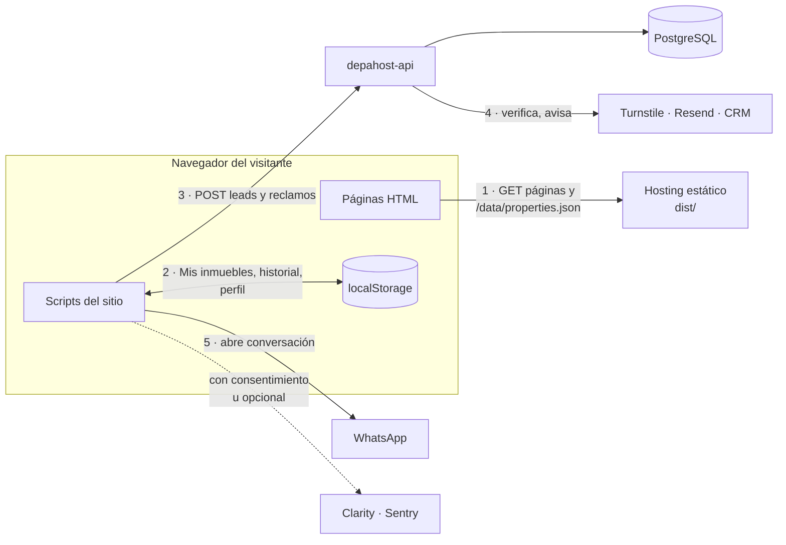
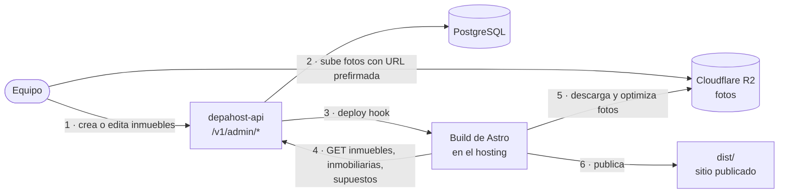
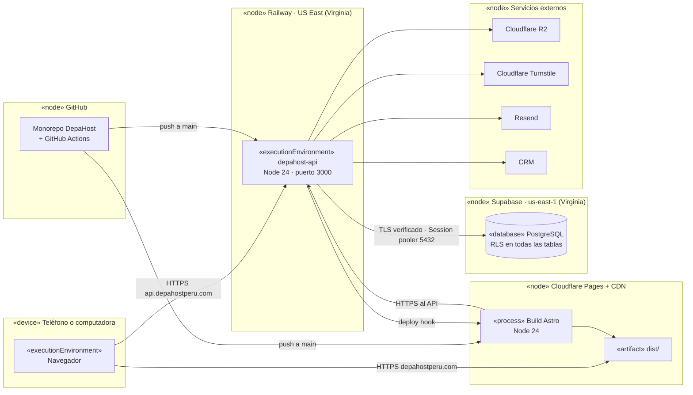
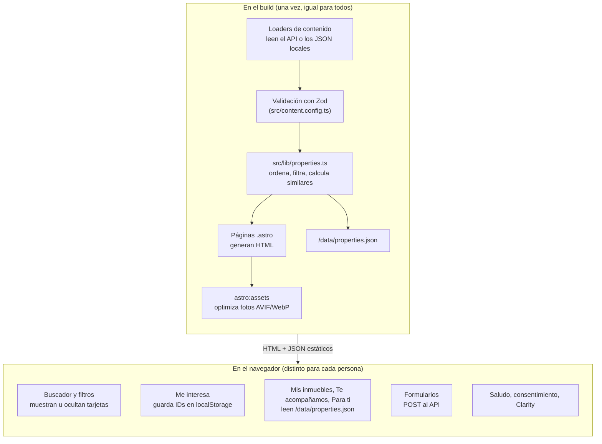

# 01 · Arquitectura

## 1. Principios

1. **El sitio es 100 % estático.** Astro genera archivos HTML en el build. No hay servidor
   ejecutando Astro en producción. Cualquier hosting estático sirve.
2. **El backend es un servicio aparte.** Toda la lógica de negocio, los datos y la seguridad
   viven en `depahost-api`. Astro nunca guarda datos ni valida reglas de negocio.
3. **Un contrato manda.** El API publica `openapi.json`. El frontend genera sus tipos desde ese
   archivo. Si mañana el API se reescribe en Go, el frontend no cambia mientras se respete el
   contrato.
4. **Lo personal vive en el navegador, y en la cuenta si hay sesión.** "Mis inmuebles", el
   historial y el saludo se guardan en `localStorage`. Si la persona tiene cuenta, "Mis inmuebles"
   también se guarda en el API y se sincroniza. El sitio sigue siendo estático y rápido para todos.
6. **El panel es otra app estática.** Comprador, propietario y administración usan
   `depahost-panel`, una app Vue servida aparte que solo habla con el API (ver
   [08 · Panel y cuentas](08-panel-y-cuentas.md)).
5. **WhatsApp es la salida final.** Cada camino termina en una conversación por WhatsApp. El
   API registra antes el interés, para que el equipo sepa de dónde viene cada contacto.

## 2. Diagramas de componentes (UML)

La plataforma tiene dos momentos distintos. Se ven mejor por separado.

### 2.1 Cuando alguien visita el sitio

### 2.2 Cuando el equipo publica cambios

### Responsabilidades

| Componente | Hace | No hace |
|---|---|---|
| Páginas HTML | Mostrar catálogo, detalle, formularios y textos | Guardar datos |
| Scripts del sitio | Filtros, Mis inmuebles, recomendaciones, envío de formularios | Validar reglas de negocio |
| `/data/properties.json` | Dar a los scripts un catálogo liviano con fotos optimizadas | Reemplazar al API |
| Build de Astro | Leer el API y generar todas las páginas | Correr en producción |
| API | Validar, guardar, avisar y servir datos | Generar HTML |
| PostgreSQL | Guardar inmuebles, inmobiliarias, leads, reclamos y supuestos | — |
| R2 | Guardar las fotos originales | Servir fotos al visitante: las sirve el hosting ya optimizadas |

## 3. Diagrama de despliegue (UML)

La base de producción será Supabase, usado solo como PostgreSQL gestionado (ver
[06 · Desarrollo y operación, sección 8](06-desarrollo-y-operacion.md#base-de-datos-en-supabase)).
El sitio y el panel van en Cloudflare Pages, y el API en Railway (ver
[06 · Desarrollo y operación, sección 8](06-desarrollo-y-operacion.md#hostings)). El código no
depende de ninguno en particular: el frontend es una carpeta `dist/`, el API es una app de Node y la base es cualquier
PostgreSQL al que llegue `DATABASE_URL`.

## 4. Lo que pasa en el build y lo que pasa en el navegador

Esta división explica casi todo el diseño.

| Qué | Dónde se resuelve | Por qué |
|---|---|---|
| Lista de inmuebles, precios, fotos | Build | Es igual para todos y debe cargar rápido y salir en Google |
| Inmuebles similares del detalle | Build | Depende solo del inmueble, no de la persona |
| Filtros rápidos (chips) | Build | Se derivan de los inmuebles publicados |
| Buscar y filtrar | Navegador | Es interacción, no cambia los datos |
| Mis inmuebles y su resumen | Navegador | Cada persona guarda los suyos |
| "Para ti, según lo que has visto" | Navegador | Depende del historial de cada persona |
| "Hola, Ana" | Navegador | El nombre lo dejó esa persona en su navegador |
| Guardar leads y reclamos | API | Hay datos personales, validación y obligaciones legales |

## 5. Tecnologías

### Frontend (`depahostcapital`)

| Pieza | Tecnología | Uso |
|---|---|---|
| Framework | Astro 7 | Páginas estáticas, Content Layer, optimización de imágenes, fuentes |
| Lenguaje | TypeScript 6 (modo estricto) | Todo el código, incluidos los `.astro` |
| Estilos | CSS propio con variables | `tokens.css` y `global.css`, más CSS por componente |
| Tipografías | Poppins (textos y títulos), la misma de depahostperu.com | Autoalojadas con la API de fuentes de Astro |
| Cliente HTTP | `openapi-fetch` + tipos de `openapi-typescript` | Llamadas tipadas al API |
| Sitemap | `@astrojs/sitemap` | `sitemap-index.xml` sin páginas personales |
| Errores | `@sentry/browser` (carga diferida) | Solo si hay `PUBLIC_SENTRY_DSN` |
| Pruebas | Vitest, happy-dom, Playwright | Unitarias y en navegador |
| Mock del API | Prism | API falsa desde el contrato |
| Calidad | Prettier, `astro check`, Lighthouse CI | Formato, tipos, rendimiento y accesibilidad |

### Backend (`depahost-api`)

| Pieza | Tecnología | Uso |
|---|---|---|
| Framework | Fastify 5 | Servidor HTTP |
| Validación | Zod 4 + `fastify-type-provider-zod` | Valida entradas y salidas, genera OpenAPI |
| Base de datos | PostgreSQL: local en desarrollo y preproducción, Supabase en producción; PGlite en pruebas | Datos persistentes |
| ORM | Drizzle ORM + drizzle-kit | Consultas tipadas y migraciones SQL |
| Documentación | `@fastify/swagger` + `@fastify/swagger-ui` | `/openapi.json` y `/docs` |
| Seguridad | `@fastify/helmet`, `@fastify/cors`, `@fastify/rate-limit` | Cabeceras, orígenes y límites |
| Fotos | `@aws-sdk/client-s3` | URLs prefirmadas de Cloudflare R2 |
| Errores | `@sentry/node` | Solo si hay `SENTRY_DSN` |
| Pruebas | Vitest + `fastify.inject()` + PGlite | Sin red ni Postgres instalado |
| Cuentas | `@fastify/cookie` + scrypt de Node | Sesiones con cookie, sin dependencias de terceros |

### Panel (`depahost-panel`)

| Pieza | Tecnología | Uso |
|---|---|---|
| Framework | Vue 3.5 con `<script setup>` | Interfaz |
| Rutas y estado | Vue Router 5, Pinia 4 | Navegación por rol y sesión |
| Build | Vite 8 | Archivos estáticos en `dist/` |
| Cliente HTTP | `openapi-fetch` + tipos del contrato | Llamadas tipadas con `credentials: 'include'` |
| Identidad visual | Tokens, estilos, íconos y formatos copiados del sitio | `pnpm sync:brand` |
| Pruebas | Vitest y Playwright contra el API real | Unitarias y de punta a punta |

## 6. Entornos

| Entorno | Sitio y panel | API | Base de datos |
|---|---|---|---|
| Desarrollo | `pnpm dev`: sitio en `:4321` con JSON locales, panel en `:5173` | `pnpm dev` en `:3000` | Postgres local, base `depahost_dev` |
| Desarrollo sin base | `PUBLIC_API_URL=http://127.0.0.1:4010` | `pnpm api:mock` (Prism) | — |
| Preproducción | `pnpm preprod`: builds de producción en `:4321` y `:4173`; el sitio lee el API | `pnpm preprod`: compilado, `NODE_ENV=production` | Postgres local, base `depahost_preprod` |
| Pruebas | Playwright con API simulada (sitio) o real (panel) | Vitest | PGlite en memoria o en `.e2e-db/` |
| Producción | Cloudflare Pages: sitio y panel (`app.depahostperu.com`) | Railway, US East (Virginia) | Supabase, con SSL verificado |

El detalle de cada entorno, sus archivos `.env` y cómo levantarlo está en
[06 · Desarrollo y operación](06-desarrollo-y-operacion.md#2-entornos).
