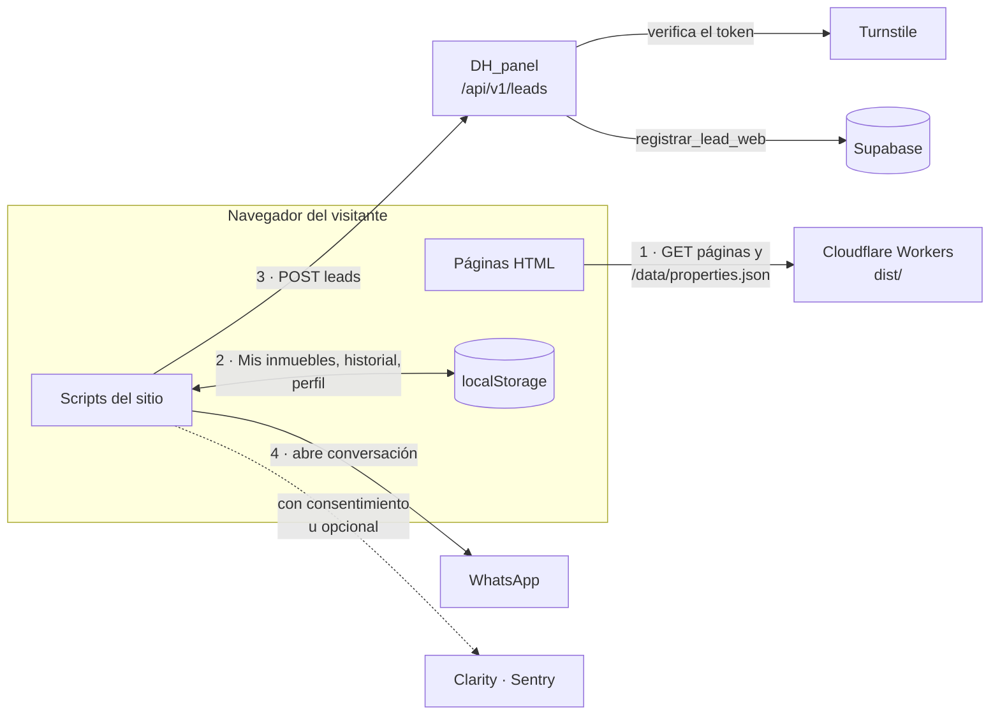
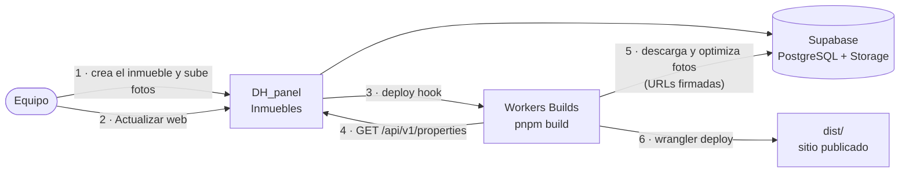
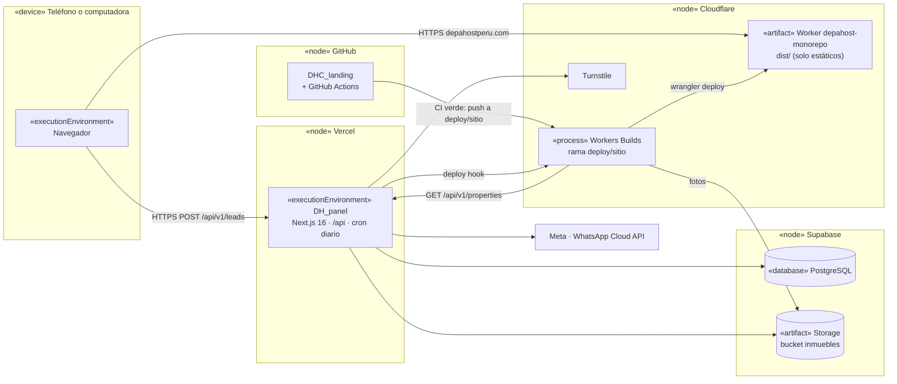
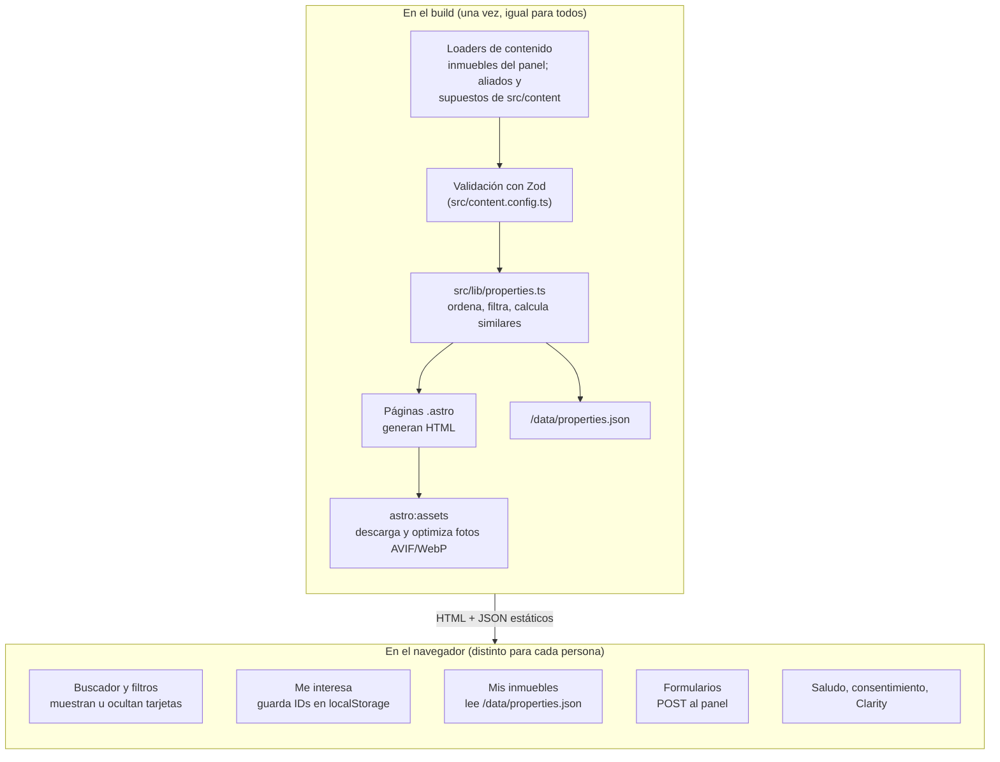

# 01 · Arquitectura

## 1. Principios

1. **El sitio es 100 % estático.** Astro genera archivos HTML en el build. No hay servidor
   ejecutando Astro en producción: Cloudflare Workers solo sirve la carpeta `dist/`.
2. **El backend es el panel de DepaHost.** Los datos, los interesados y la seguridad viven en
   `DH_panel` (Next.js + Supabase). El sitio nunca guarda datos ni valida reglas de negocio.
3. **Un contrato manda.** `openapi/depahost-api.json`, en este repo, describe lo que el sitio
   espera. El sitio genera sus tipos desde ese archivo y el panel lo implementa a mano. Mientras se
   respete el contrato, cualquiera de los dos puede cambiar por dentro.
4. **Lo personal vive solo en el navegador.** "Mis inmuebles", el historial y el saludo se guardan
   en `localStorage`. No hay cuentas ni login: el sitio sigue siendo estático y rápido para todos.
5. **WhatsApp es la salida final.** Cada camino termina en una conversación por WhatsApp. Antes,
   el panel registra el interés como lead, para que el equipo sepa de dónde viene cada contacto.

## 2. Diagramas de componentes (UML)

La plataforma tiene dos momentos distintos. Se ven mejor por separado.

### 2.1 Cuando alguien visita el sitio

### 2.2 Cuando el equipo publica cambios

### Responsabilidades

| Componente | Hace | No hace |
|---|---|---|
| Páginas HTML | Mostrar catálogo, detalle, formularios y textos | Guardar datos |
| Scripts del sitio | Filtros, Mis inmuebles, recomendaciones, envío de formularios | Validar reglas de negocio |
| `/data/properties.json` | Dar a los scripts un catálogo liviano con fotos optimizadas | Reemplazar al API |
| Build de Astro | Leer los inmuebles del panel y generar todas las páginas | Correr en producción |
| `DH_panel` (`/api`) | Servir los inmuebles publicables y registrar leads | Generar HTML del sitio |
| Supabase | Guardar inmuebles, interesados y fotos (bucket `inmuebles`) | Servir fotos al visitante: las sirve Cloudflare ya optimizadas |

## 3. Diagrama de despliegue (UML)

GitHub Actions corre en cada push a `main`: formato, lint, tipos, pruebas unitarias, build y
Lighthouse. Si todo pasa, empuja `main` a la rama `deploy/sitio`, que es la que construye
Workers Builds. `public/_headers` agrega las cabeceras de seguridad y caché (ver
[06 · Desarrollo y operación](06-desarrollo-y-operacion.md)).

## 4. Lo que pasa en el build y lo que pasa en el navegador

Esta división explica casi todo el diseño.

| Qué | Dónde se resuelve | Por qué |
|---|---|---|
| Lista de inmuebles, precios, fotos | Build | Es igual para todos y debe cargar rápido y salir en Google |
| Fotos | Build | Las URLs firmadas de Supabase caducan a las 6 horas: Astro las descarga y sirve copias propias |
| Filtros rápidos (chips) | Build | Se derivan de los inmuebles publicados |
| Buscar y filtrar | Navegador | Es interacción, no cambia los datos |
| Mis inmuebles y su resumen | Navegador | Cada persona guarda los suyos |
| Historial de vistos | Navegador | Es de cada persona |
| "Hola, Ana" | Navegador | El nombre lo dejó esa persona en su navegador |
| Guardar leads | Panel | Hay datos personales y el equipo los sigue en el CRM |

Si el panel no responde durante el build, el build falla a propósito: es mejor no publicar que
publicar un sitio sin inmuebles.

## 5. Tecnologías

### Sitio (`DHC_landing`)

| Pieza | Tecnología | Uso |
|---|---|---|
| Framework | Astro 7 | Páginas estáticas, Content Layer, optimización de imágenes, fuentes |
| Lenguaje | TypeScript 6 (modo estricto) | Todo el código, incluidos los `.astro` |
| Estilos | CSS propio con variables | `tokens.css` y `global.css`, más CSS por componente |
| Tipografías | Poppins, la misma de depahostperu.com | Autoalojada con la API de fuentes de Astro |
| Cliente HTTP | `openapi-fetch` + tipos de `openapi-typescript` | Llamadas tipadas al panel |
| Mapa | Leaflet | Vista "Mapa" de Todos los inmuebles, carga diferida |
| Sitemap | `@astrojs/sitemap` | `sitemap-index.xml` sin páginas personales |
| Errores | `@sentry/browser` (carga diferida) | Solo si hay `PUBLIC_SENTRY_DSN` |
| Pruebas | Vitest, happy-dom, Playwright | Unitarias y en navegador |
| Mock del API | Prism | API falsa desde el contrato (`pnpm api:mock`) |
| Calidad | Prettier, ESLint, `astro check`, Lighthouse CI | Formato, reglas, tipos, rendimiento y accesibilidad |
| Hosting | Cloudflare Workers (estáticos) + Workers Builds | Publicación con `wrangler.jsonc` |

### Panel (`DH_panel`)

| Pieza | Tecnología | Uso |
|---|---|---|
| Framework | Next.js 16 (React 19) + Tailwind | CRM interno y rutas `/api/v1/*` del sitio |
| Datos | Supabase: PostgreSQL, Auth y Storage | Inmuebles, interesados, citas, usuarios del equipo y fotos |
| Mensajería | WhatsApp Cloud API (Meta) | Conversaciones; modo simulado en desarrollo |
| Tareas | Cron diario de Vercel | Recordatorios |
| Hosting | Vercel | — |

El detalle del panel está en su repo: `DH_panel/README.md` y `DH_panel/docs/`.

## 6. Entornos

| Entorno | Sitio | Panel (API) |
|---|---|---|
| Desarrollo | `pnpm dev` en `:4321`. Sin `API_URL` lee `src/content/properties.json` (vacío): funciona, pero sin inmuebles | `npm run dev` en `http://localhost:3000/api` |
| Desarrollo sin panel | `PUBLIC_API_URL=http://127.0.0.1:4010` | `pnpm api:mock` (Prism) |
| Preproducción | `pnpm preprod`: build de producción en `:4321` que lee el panel local (`.env.preprod`) | `npm run dev` en `:3000` |
| Pruebas | Playwright contra `astro build` + `astro preview` en `:4329`, con el catálogo de `tests/e2e/catalogo` | Simulado (`page.route`) |
| Producción | Cloudflare Workers (`depahostperu.com`) | Vercel + Supabase |

El detalle de cada entorno, sus archivos `.env` y cómo levantarlo está en
[06 · Desarrollo y operación](06-desarrollo-y-operacion.md).
