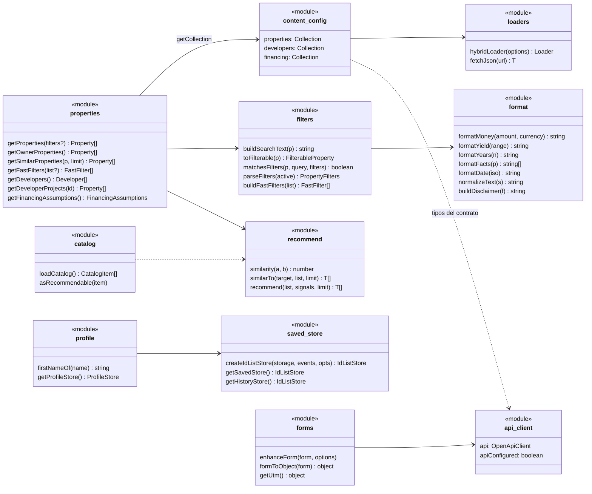
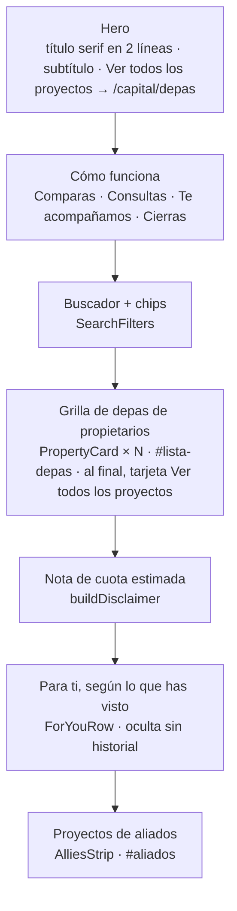

# 02 · Frontend (`depahostcapital`)

## 1. Estructura de carpetas

```text
depahostcapital/
├── astro.config.mjs        sitio, fuentes, variables de entorno, sitemap, redirección /carrito
├── src/
│   ├── content.config.ts   colecciones de datos y su esquema (refleja el API)
│   ├── content/            datos locales cuando no hay API: properties, developers, financing
│   ├── assets/             fotos originales (Astro las optimiza en el build)
│   ├── data/               datos fijos: contacto (WhatsApp), empresa (RUC), distritos
│   ├── layouts/            BaseLayout, LegalLayout, PlaceholderLayout
│   ├── components/         piezas de interfaz (.astro)
│   ├── pages/              una página por archivo (rutas del sitio)
│   ├── lib/                lógica compartida (build y navegador), con pruebas
│   │   └── api/            cliente HTTP, tipos generados y loaders del build
│   ├── scripts/            JavaScript que solo corre en el navegador
│   ├── styles/             tokens.css y global.css
│   └── types/              tipos derivados del esquema (Property, Developer…)
├── openapi/                copia del contrato del API
├── scripts/                sync-openapi.mjs
├── tests/unit, tests/e2e   Vitest y Playwright
└── docs/                   esta documentación y la guía de CSS
```

**Regla de capas:** las páginas solo leen datos con `src/lib/properties.ts`. Nunca importan
`src/content/*.json` ni llaman al API directamente en el build.

## 2. Diagrama de módulos (UML de clases)

Cada "clase" es un módulo de TypeScript. Las flechas indican quién usa a quién.



## 3. Páginas

Para cada página: de dónde salen sus datos en el build y qué scripts corren en el navegador.

| Ruta | Archivo | Datos del build | Scripts en el navegador |
|---|---|---|---|
| `/` | `pages/index.astro` | Ninguno (texto fijo y foto del hero) | Dropdown "Soy propietario" |
| `/capital` | `pages/capital/index.astro` | `getOwnerProperties`, `getFastFilters`, `getDevelopers`, supuestos | Filtros, Me interesa, Para ti |
| `/capital/depas` | `pages/capital/depas.astro` | `getProperties` (todos), `getDevelopers`, supuestos | Búsqueda con facetas, orden y conteos (`lib/catalog-search.ts`); los filtros quedan en la URL. "Cerca de": ubicación del navegador (no va a la URL) o un lugar de `data/lugares.ts` (`?cerca=larcomar&km=2`), orden "Más cercanos" y distancia en cada tarjeta (`lib/geo.ts`) |
| `/capital/{slug}` | `pages/capital/[slug].astro` | Una página por depa de `getProperties`; `getSimilarProperties(p, 4)`; inmobiliaria | Galería (`PropertyGallery`), Me interesa; guarda la visita en el historial. "Contactar" lleva a `/mis-depas?agregar={id}` |
| `/capital/aliados/{slug}` | `pages/capital/aliados/[slug].astro` | Inmobiliarias con proyectos; `getDeveloperProjects` | Filtros con botón Buscar y contador |
| `/mis-depas` | `pages/mis-depas.astro` | Ninguno | Pinta los guardados, resumen y total; agrega `?agregar={id}`; "Empecemos con estos" abre WhatsApp y registra el lead `cart`; Para ti |
| `/propietarios` | `pages/propietarios.astro` | `getDevelopers` (franja de aliados) | Formulario con intención vender, alquilar o Airbnb |
| `/libro-de-reclamaciones` | `pages/libro-de-reclamaciones.astro` | Datos de la empresa | Formulario de reclamo y constancia |
| `/privacidad`, `/terminos` | `pages/*.astro` con `LegalLayout` | Datos de la empresa | — |
| `/estadias`, `/nosotros` | `PlaceholderLayout` | — | — |
| `/404` | `pages/404.astro` | — | — |
| `/data/properties.json` | `pages/data/properties.json.ts` | `getProperties` + `getImage` | — (lo consumen los scripts) |
| `/carrito`, `/capital/empecemos` | redirecciones en `astro.config.mjs` | — | Redirigen a `/mis-depas` |

Páginas sin indexar (`<meta name="robots" content="noindex">` y fuera del sitemap):
`/mis-depas`, `/404`. `robots.txt` además bloquea `/carrito`, `/mis-depas`, `/capital/empecemos`
(hoy una redirección) y `/data/`.

### Detalle de la portada de Capital



## 4. Layouts

| Layout | Usa | Aporta |
|---|---|---|
| `BaseLayout` | Todas las páginas | `<head>` (título, descripción, canonical, Open Graph, `noindex` opcional), fuentes, skip-link, Header, Footer, diálogo "Guarda tus depas", banner de cookies, monitoreo |
| `LegalLayout` | Privacidad, Términos | Ancho de lectura y fecha de actualización |
| `PlaceholderLayout` | Estadías, Nosotros | Título + "Página en construcción" |

## 5. Componentes

| Componente | Props | Qué hace |
|---|---|---|
| `Header` | — | Logo, menú (Inicio, Compra → `/capital`, Vende → `/propietarios`; Compra queda marcado en `/capital/*` y `/mis-depas`), saludo "Hola, {nombre}", acceso a Mis depas con contador, WhatsApp, menú móvil (`<dialog>`) y botón flotante de WhatsApp |
| `Footer` | — | Banda de WhatsApp, links legales, RUC y "Preferencias de cookies" |
| `Logo` | `inverse?` | Marca de Depahost Capital (variante clara para fondos oscuros) |
| `Button` | `href`, `variant?`, `size?`, `block?` | Link con estilo de botón. Si apunta a `wa.me`, siempre sale verde y abre en otra pestaña |
| `Icon` | `name`, `size?`, `strokeWidth?` | Set único de íconos de línea (24×24, trazo 1.6) |
| `PropertyCard` | `property`, `priority?` | Tarjeta de la portada: foto, etiqueta de origen, badge, valor, rentabilidad, plazo, Me interesa |
| `ProjectCard` | `property`, `priority?` | Tarjeta de proyecto: "Precio desde", recuadro de rentabilidad, descripción |
| `MiniCard` | `property?` | Tarjeta chica. Con `property` se pinta en el build (similares); sin `property` es plantilla del navegador (Para ti) |
| `PropertyGrid` | `label?`, `id?` | Grilla de tarjetas: carrusel en móvil, 2 columnas en tablet, 3 en escritorio |
| `PropertyImage` | `image`, `widths`, `sizes`, `priority?` | Foto local o remota, en AVIF/WebP con varios tamaños |
| `SaveButton` | `id`, `name`, `variant?` | Botón "Me interesa" con corazón; alterna guardado y quitado |
| `SearchFilters` | `filters`, `placeholder?`, `withButton?`, `count?` | Buscador, chips, "Limpiar filtros" y contador |
| `ForYouRow` | `title?`, `seeAllHref?` | Fila de recomendaciones; se arma en el navegador |
| `AlliesStrip` | `developers`, `title?`, `id?` | Inmobiliarias como marcas tipográficas; las que tienen proyectos son links |
| `SavedDepa` | — | Plantilla `<template>` de un depa en Mis depas |
| `SaveListDialog` | — | Diálogo "Guarda tus depas" (en todas las páginas) |
| `ConsentBanner` | — | Aviso de cookies; carga Clarity solo si se acepta |
| `Turnstile` | `theme?` | Widget anti-bots; no aparece sin `PUBLIC_TURNSTILE_SITE_KEY` |
| `Step` | `number`, `title`, `text?` | Paso del "Cómo funciona" |
| `OwnerDropdown` | — | Menú "Soy propietario" de la home |
| `LangSwitch` | — | Selector ES · EN (EN deshabilitado: no hay versión en inglés) |
| `HouseIcon`, `CartIcon`, `WhatsAppIcon` | `size?` | Íconos sueltos usados antes del set `Icon` |

## 6. Librerías (`src/lib`)

Se usan en el build y en el navegador. No tocan el DOM, salvo `getSavedStore`,
`getHistoryStore` y `getProfileStore`, que necesitan `window`.

| Módulo | Funciones principales | Para qué |
|---|---|---|
| `properties.ts` | `getProperties`, `getOwnerProperties`, `getSimilarProperties`, `getDevelopers`, `getDeveloperProjects`, `getFastFilters`, `getFinancingAssumptions` | Única puerta a los datos en el build |
| `filters.ts` | `buildSearchText`, `toFilterable`, `matchesFilters`, `parseFilters`, `buildFastFilters` | Búsqueda y filtros (funciones puras) |
| `recommend.ts` | `similarity`, `similarTo`, `recommend` | Similares y "Para ti" |
| `format.ts` | `formatMoney`, `formatPEN`, `formatYield`, `formatYears`, `formatFacts`, `formatDate`, `normalizeText`, `slugify`, `buildDisclaimer` | Textos consistentes en todo el sitio |
| `saved-store.ts` | `createIdListStore`, `getSavedStore`, `getHistoryStore`, `browserStorage` | Listas de IDs en `localStorage` con eventos |
| `profile.ts` | `firstNameOf`, `createProfileStore`, `getProfileStore` | Nombre para el saludo y control del aviso |
| `api/client.ts` | `api`, `apiConfigured`, tipos `LeadCreate`, `ComplaintCreate`, `ApiError` | Cliente HTTP tipado |
| `api/loaders.ts` | `hybridLoader`, `fetchJson` | Leer el API o el JSON local en el build |
| `api/schema.d.ts` | (generado) | Tipos del contrato OpenAPI. No se edita a mano |

## 7. Scripts del navegador (`src/scripts`)

| Script | Lo carga | Qué hace |
|---|---|---|
| `saved-buttons.ts` | `SaveButton` | Escucha clics en `[data-add-property]` (delegación) y alterna Mis depas; actualiza texto y `aria-pressed` |
| `property-filters.ts` | `SearchFilters` | Filtra tarjetas dentro de cada `[data-filter-root]`; contador y "Limpiar filtros" |
| `catalog.ts` | Mis depas, Te acompañamos, Para ti, diálogo | Descarga `/data/properties.json` una sola vez por página |
| `forms.ts` | Todos los formularios | Arma el JSON, valida, envía, muestra errores por campo y ofrece WhatsApp |
| `consent.ts` | `ConsentBanner` | Guarda la elección y carga Clarity |
| `monitoring.ts` | `BaseLayout` | Inicia Sentry solo si hay DSN (descarga diferida) |

Los scripts del Header, Mis depas, Te acompañamos, el detalle y el diálogo están dentro de su
`.astro`. Astro los empaqueta y los carga una sola vez aunque el componente aparezca varias veces.

## 8. Datos de contenido (Content Layer)

`src/content.config.ts` define tres colecciones. Cada una usa `hybridLoader`:

| Colección | Con `API_URL` | Sin `API_URL` |
|---|---|---|
| `properties` | `GET /v1/properties` paginado de a 100 | `src/content/properties.json` |
| `developers` | `GET /v1/developers` | `src/content/developers.json` |
| `financing` | `GET /v1/financing-assumptions` (404 = sin supuestos) | `src/content/financing.json` |

El esquema Zod de cada colección **refleja la respuesta del API**. Si el API cambia de forma, el
build falla aquí y no en una página. Las fotos aceptan una URL (`https://…`, del API) o una ruta
local (`../assets/…`), que Astro optimiza.

## 9. Variables de entorno

Se declaran en `astro.config.mjs` (`env.schema`) y se completan en `.env` (desarrollo),
`.env.preprod` (preproducción, con `--mode preprod`) o en el panel del hosting (producción). Los
valores de cada entorno están en `.env.example`, `.env.preprod.example` y `.env.production.example`.

| Variable | Contexto | Uso |
|---|---|---|
| `PUBLIC_WHATSAPP_NUMBER` | Navegador | Número de todos los links de WhatsApp. Por defecto `51XXXXXXXXX` (relleno) |
| `PUBLIC_API_URL` | Navegador | API de los formularios. Vacío = los formularios ofrecen WhatsApp |
| `API_URL` | Solo build | API de la que se leen los datos. Vacío = JSON locales |
| `PUBLIC_TURNSTILE_SITE_KEY` | Navegador | Widget anti-bots |
| `PUBLIC_CLARITY_ID` | Navegador | Analítica, solo con consentimiento |
| `PUBLIC_SENTRY_DSN` | Navegador | Errores del navegador |
| `PUBLIC_MEDIA_HOST` | Build | Dominio de fotos permitido para optimizar (además de `*.r2.dev`) |

Todas las `PUBLIC_*` terminan en el JavaScript público. Nunca deben contener secretos.

## 10. Sistema de diseño

### Tokens (`src/styles/tokens.css`)

| Grupo | Ejemplos |
|---|---|
| Color de marca | `--color-navy-800` `#012147` (primario), `--color-navy-900` (footer), `--color-navy-50/100` (fondos suaves) |
| WhatsApp | `--color-wa-700` `#094835` (botones), `--color-wa-500` (solo el ícono) |
| Texto | `--color-text-strong`, `--color-text`, `--color-text-muted` |
| Estados | `--color-success` (rentabilidad), `--color-error`, `--color-focus` |
| Tipografía | `--font-sans` (Inter), `--font-display` (Newsreader), escala fluida `--fs-display` a `--fs-xs` |
| Espacio | Base de 4 px: `--space-1` (4) a `--space-24` (96) |
| Forma | Radios `--radius-sm/md/lg/pill`, sombras `--shadow-sm` a `--shadow-dropdown` |
| Capas | `--z-header`, `--z-dropdown`, `--z-fab`, `--z-toast` |

### Clases globales (`src/styles/global.css`)

| Clase | Uso |
|---|---|
| `.container`, `.section` | Ancho máximo y aire vertical |
| `.btn` + `--primary`, `--secondary`, `--whatsapp`, `--sm`, `--block` | Botones |
| `.display` | Títulos en serif (Capital, Propietarios y sus páginas) |
| `.eyebrow` | Etiqueta en mayúsculas: "DE PROPIETARIO", "INMOBILIARIA ALIADA" |
| `.lead`, `.disclaimer` | Subtítulos y notas legales |
| `.form`, `.field`, `.check`, `.field-error`, `.form-status`, `.hp` | Formularios, errores, resultado y honeypot |
| `.sr-only`, `.skip-link` | Accesibilidad |

**Reglas de diseño que conviene mantener:** azul marino como color principal; verde solo para
WhatsApp; serif solo en títulos; íconos de línea del componente `Icon`; sin degradados ni
íconos con fondos de color pastel.

## 11. Accesibilidad, SEO y rendimiento

- **Teclado:** skip-link, foco visible en todo, menú móvil y diálogos con `<dialog>`, que atrapa
  el foco y cierra con Esc.
- **Lectores de pantalla:** títulos ocultos donde el diseño no los muestra, `aria-pressed` en
  "Me interesa", `aria-live` en resultados y formularios, etiquetas en todos los campos.
- **Áreas táctiles:** mínimo 44 px (`--control-h-sm`).
- **Imágenes:** AVIF y WebP en varios tamaños; las 3 primeras tarjetas cargan con prioridad.
- **Fuentes:** autoalojadas, Inter precargada, con respaldo ajustado para no mover el texto.
- **SEO:** canonical, Open Graph, sitemap, `robots.txt` y datos estructurados `Product` en el detalle.
- **Movimiento reducido:** se respetan las preferencias del sistema en animaciones y desplazamiento.
