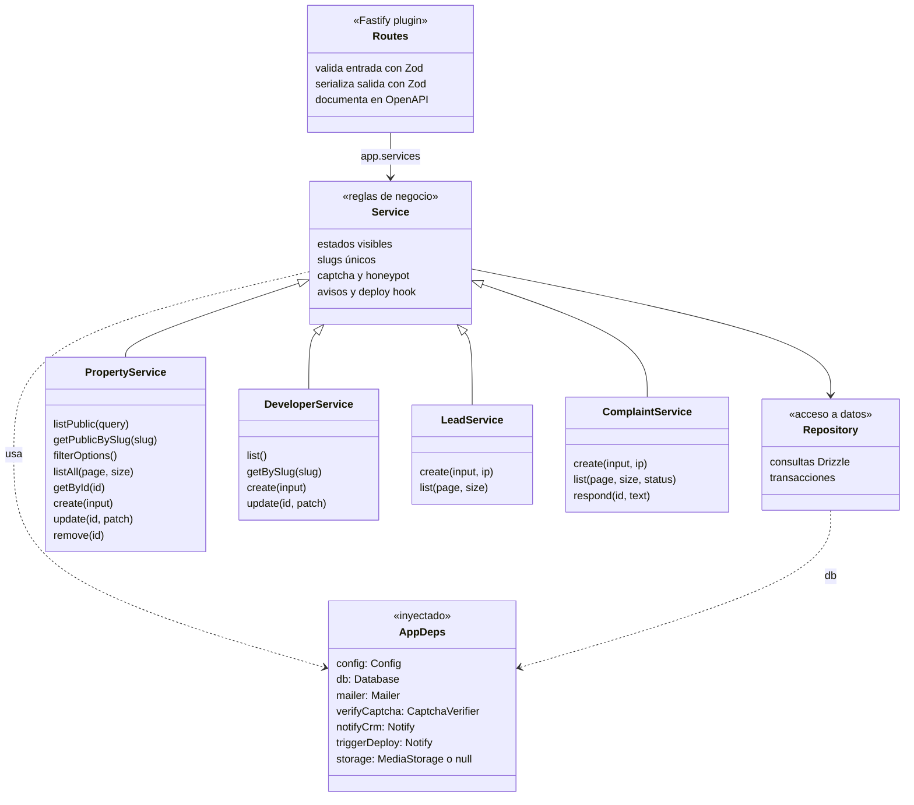
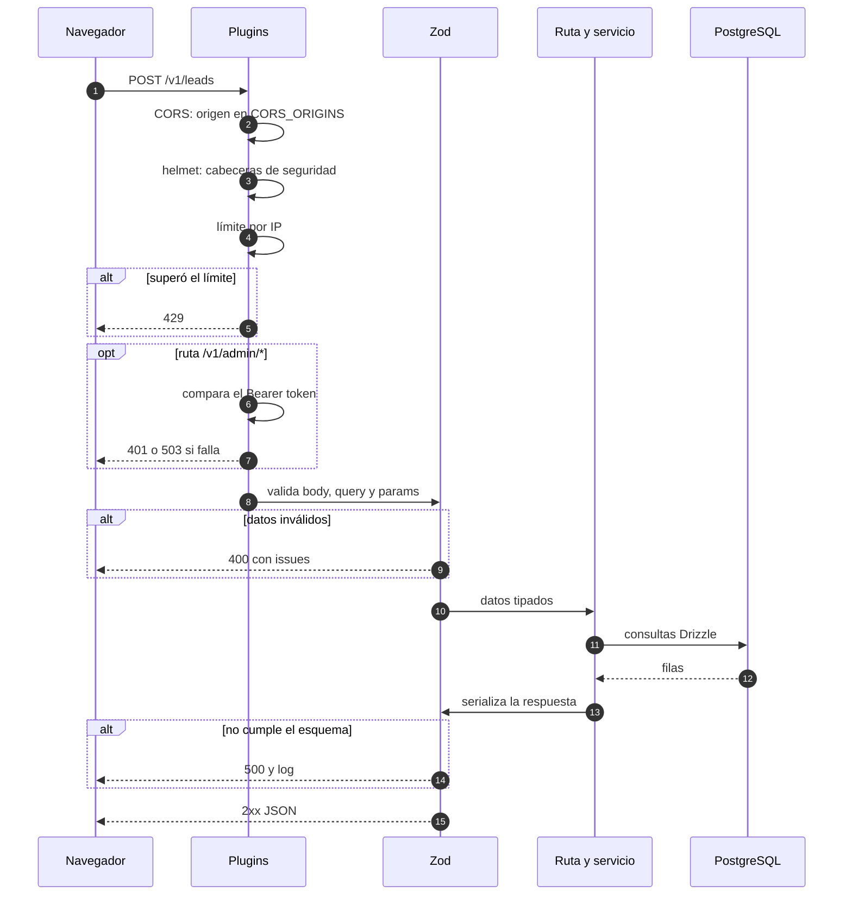

# 03 · API (`depahost-api`)

El API vive en la carpeta hermana `../depahost-api` (`apps/depahost-api` del monorepo). Sirve datos al build del sitio, recibe los
formularios y guarda el Libro de Reclamaciones. Su documentación interactiva está en `/docs`
y su contrato en `/openapi.json`.

## 1. Estructura

```text
depahost-api/
├── src/
│   ├── server.ts           arranque: config → base de datos → migraciones → app → escuchar
│   ├── app.ts              arma Fastify: seguridad, OpenAPI, errores, dependencias y rutas
│   ├── config.ts           variables de entorno validadas con Zod
│   ├── instrument.ts       inicia Sentry antes que todo (solo con SENTRY_DSN)
│   ├── db/schema.ts        tablas, enums y secuencia (Drizzle)
│   ├── db/client.ts        conexión a PostgreSQL o PGlite y migraciones
│   ├── lib/                correo, Turnstile, deploy hook, CRM, R2, días hábiles, slug, errores
│   ├── plugins/auth.ts         sesiones con cookie, CSRF por Origin y requireUser(roles)
│   ├── plugins/admin-auth.ts   protección de /v1/admin/* (sesión de admin o clave)
│   ├── modules/<módulo>/   schema.ts · repository.ts · service.ts · routes.ts
│   │                       (properties, developers, leads, complaints, financing, districts,
│   │                        uploads, accounts, owner-requests, admin, health)
│   └── scripts/            export de OpenAPI, migrate, seed, create-user
├── drizzle/                migraciones SQL versionadas (0000_init … 0003_rls)
├── scripts/pg-local.mjs    Postgres local de desarrollo y preproducción (pnpm db:up)
├── certs/                  certificado de Supabase para verificar el SSL de la base
├── test/                   pruebas con fastify.inject() y PGlite en memoria
├── openapi.json            contrato generado (lo copia el frontend con pnpm api:sync)
└── .env*.example           configuración de desarrollo, preproducción y producción
```

## 2. Capas (UML de clases)

Cada módulo separa el HTTP, las reglas y el SQL. Así la lógica de negocio no depende de Fastify
y se podría portar a otro lenguaje sin tocar el contrato.



Las dependencias externas (`mailer`, `verifyCaptcha`, `notifyCrm`, `triggerDeploy`, `storage`)
se inyectan en `buildApp()`. En las pruebas se reemplazan por versiones en memoria, sin red.

| Dependencia | En producción | Sin configurar | En pruebas |
|---|---|---|---|
| `mailer` | Resend (`RESEND_API_KEY`) | Escribe el correo en el log | Guarda los correos en un arreglo |
| `verifyCaptcha` | Turnstile (`TURNSTILE_SECRET`) | Deja pasar todo, con aviso en el log | `token !== 'invalid'` |
| `notifyCrm` | POST a `CRM_WEBHOOK_URL` | No hace nada | Guarda los avisos |
| `triggerDeploy` | POST a `DEPLOY_HOOK_URL`, agrupado cada 30 s | No hace nada | Guarda los avisos |
| `storage` | R2 con URL prefirmada (`R2_*`) | `null`: subir fotos responde 503 | `null` |

## 3. Ciclo de vida de una petición (UML de secuencia)



Si el origen no está permitido, el API responde sin la cabecera `Access-Control-Allow-Origin`
y es el navegador el que bloquea la respuesta.

Detalles del servidor:

- **Límite de cuerpo:** 100 KB por petición.
- **IP real:** en producción `trustProxy` está activo, para que el límite por IP use la IP del
  visitante y no la del proxy del hosting.
- **Logs:** Pino en JSON. Se ocultan `authorization` y `cookie`.
- **Apagado limpio:** con `SIGINT` o `SIGTERM` cierra Fastify y la base de datos.
- **Arranque:** aplica las migraciones pendientes antes de escuchar.

## 4. Endpoints

### Públicos

| Método | Ruta | Entrada | Respuesta | Notas |
|---|---|---|---|---|
| GET | `/health` | — | `{ status, db }` | 503 si la base no responde |
| GET | `/v1/properties` | `district`, `developer`, `origin`, `maxPrice`, `minYield`, `featured`, `ids`, `page`, `pageSize` | `PropertyPage` | Solo `published` y `reserved`. `pageSize` por defecto 24, máximo 100 |
| GET | `/v1/properties/{slug}` | — | `Property` | Incluye `sold`. Nunca `draft`. 404 si no existe |
| GET | `/v1/filters` | — | `FilterOptions` | Distritos con cantidad, rango de precio y de rentabilidad |
| GET | `/v1/developers` | — | `Developer[]` | Con `projectCount` (publicados y reservados) |
| GET | `/v1/developers/{slug}` | — | `Developer` | 404 si no existe |
| GET | `/v1/financing-assumptions` | — | `FinancingAssumptions` | El más reciente. 404 si no hay ninguno |
| POST | `/v1/leads` | `LeadCreate` | `{ id, createdAt }` 201 | Límite 10 por minuto por IP |
| POST | `/v1/complaints` | `ComplaintCreate` | `{ code, createdAt, responseDeadline }` 201 | Límite 5 por minuto por IP |
| GET | `/openapi.json`, `/docs` | — | Contrato y documentación | — |

### Cuenta (sesión con cookie `dh_session`)

| Método | Ruta | Rol | Qué hace |
|---|---|---|---|
| POST | `/v1/auth/register` | Sin sesión | Crea comprador o propietario e inicia sesión (Turnstile, 5/min) |
| POST | `/v1/auth/login` | Sin sesión | Inicia sesión (10/min) |
| POST | `/v1/auth/logout` | Cualquiera | Cierra la sesión actual |
| GET | `/v1/auth/me` | Con sesión | Quién tiene la sesión (401 si nadie) |
| POST | `/v1/auth/forgot-password` | Sin sesión | Envía enlace de 1 hora; responde 202 siempre |
| POST | `/v1/auth/reset-password` | Sin sesión | Contraseña nueva con el token; cierra todas las sesiones |
| PATCH | `/v1/me` | Con sesión | Nombre, teléfono y rol comprador ↔ propietario |
| POST | `/v1/me/password` | Con sesión | Cambia la contraseña y cierra las demás sesiones |
| GET, PUT | `/v1/me/saved` | Con sesión | Mis inmuebles de la cuenta (PUT reemplaza la lista) |
| GET | `/v1/me/leads` | Con sesión | Leads enviados con la sesión iniciada |
| GET, POST | `/v1/me/owner-requests` | Propietario o admin | Sus solicitudes |
| GET, PATCH, DELETE | `/v1/me/owner-requests/{id}` | Propietario o admin | Una solicitud (editar solo si está enviada o rechazada) |
| POST | `/v1/me/uploads` | Propietario o admin | URL prefirmada de R2 para fotos de su inmueble |

### Administración (sesión de admin o `Authorization: Bearer <ADMIN_API_KEY>`)

| Método | Ruta | Qué hace |
|---|---|---|
| GET | `/v1/admin/properties` | Todos los inmuebles, incluidos borradores y vendidos |
| POST | `/v1/admin/properties` | Crea un inmueble |
| GET | `/v1/admin/properties/{id}` | Un inmueble |
| PATCH | `/v1/admin/properties/{id}` | Edita. Si se envía `images`, reemplaza todas las fotos |
| DELETE | `/v1/admin/properties/{id}` | Borra (las fotos se borran en cascada) |
| GET, POST | `/v1/admin/districts` | Lista y crea distritos (409 si el slug existe) |
| POST | `/v1/admin/developers` | Crea una inmobiliaria (409 si existe) |
| PATCH | `/v1/admin/developers/{id}` | Edita; si cambia el nombre, cambia el slug |
| POST | `/v1/admin/financing-assumptions` | Agrega supuestos (queda el historial) |
| GET | `/v1/admin/leads` | Leads del más nuevo al más viejo, filtrables por `source` y `status` |
| PATCH | `/v1/admin/leads/{id}` | Mueve el lead por el embudo: `new`, `contacted`, `closed` |
| GET | `/v1/admin/owner-requests`, `/{id}` | Solicitudes de propietarios con sus datos de contacto |
| PATCH | `/v1/admin/owner-requests/{id}` | Cambia el estado, deja un comentario o vincula el inmueble publicado (avisa al propietario) |
| GET | `/v1/admin/users` | Cuentas, con búsqueda `q` y filtro `role` |
| PATCH | `/v1/admin/users/{id}` | Cambia el rol (nunca el propio) |
| GET | `/v1/admin/stats` | Indicadores del resumen del panel |
| GET | `/v1/admin/complaints` | Reclamos, filtrables por `status` |
| POST | `/v1/admin/complaints/{id}/response` | Responde un reclamo y avisa por correo |
| POST | `/v1/admin/uploads` | URL prefirmada de R2 para subir una foto |

### Formato de error (todas las rutas)

```json
{
  "statusCode": 400,
  "error": "Bad Request",
  "message": "Revisa los datos enviados",
  "issues": [{ "path": "consumer.email", "message": "Invalid email address" }]
}
```

`issues` solo aparece en errores de validación. El frontend usa `path` para marcar el campo con
el mismo `name` en el formulario.

## 5. Reglas de negocio por módulo

### Inmuebles (`modules/properties`)

| Regla | Detalle |
|---|---|
| Estados | `draft` (borrador), `published`, `reserved`, `sold` |
| Visibilidad | Catálogo: `published` y `reserved`. Detalle: además `sold`. `draft` nunca sale por la API pública |
| Orden | Destacados primero, luego más recientes (`publishedAt`), luego `id` |
| Slug | Si no se envía: `slugify(distrito + dirección)`. Si existe, agrega `-2`, `-3`… |
| `publishedAt` | Se fija la primera vez que el inmueble deja de ser borrador |
| Origen | `owner` (propietario) o `developer` (proyecto). Un proyecto exige `developerId` de una inmobiliaria existente |
| Rentabilidad | `yield.min` no puede ser mayor que `yield.max` |
| Fotos | Se guardan en orden (`position`). Editar `images` reemplaza la lista entera |
| Rebuild | Crear, editar o borrar un inmueble visible llama al deploy hook. Editar un borrador que sigue siendo borrador no lo llama |

### Inmobiliarias (`modules/developers`)

- El slug se arma con el nombre (`Urbana Perú` → `urbana-peru`). Nombres repetidos: 409.
- `projectCount` cuenta solo proyectos `published` o `reserved`.
- Crear o editar una inmobiliaria llama al deploy hook (su nombre aparece en el sitio).

### Leads (`modules/leads`)

| `source` | Lo envía | Contacto obligatorio | Captcha |
|---|---|---|---|
| `intl-form` | Formulario en inglés de Capital | Nombre + correo o teléfono | Sí |
| `owner-sell` | Propietarios con "Vender" | Nombre + correo o teléfono | Sí |
| `owner-rent` | Propietarios con "Alquilar" o "Airbnb" | Nombre + correo o teléfono | Sí |
| `saved-list` | Diálogo "Guarda tus inmuebles" | Nombre + correo o teléfono | Sí |
| `cart` | Clic en WhatsApp de "Te acompañamos" | Ninguno (solo IDs de inmuebles) | No |
| `contact` | Reservado para un contacto general | Nombre + correo o teléfono | Sí |

Reglas comunes:

- Si llegan datos personales, `consent` debe ser `true`.
- `details` acepta hasta 30 campos extra (texto, número o booleano).
- `propertyIds`: hasta 20 IDs.
- **Honeypot:** si `website` viene lleno, responde 201 con un ID falso y no guarda nada.
- **Avisos:** cada lead va al CRM. Si hay `NOTIFY_EMAIL` y el lead no es `cart`, también llega
  un correo al equipo con `Reply-To` del interesado.
- Si el correo o el CRM fallan, el lead ya quedó guardado y el error solo se registra en el log.

### Libro de Reclamaciones (`modules/complaints`)

| Regla | Detalle |
|---|---|
| Código | `LR-{año de Lima}-{correlativo de 6 dígitos}`, por ejemplo `LR-2026-000001`, desde la secuencia `complaint_seq` |
| Plazo | 15 días hábiles desde la fecha de Lima. Solo descuenta sábados y domingos: el plazo calculado queda igual o antes del legal |
| Menores de edad | Si `isMinor` es verdadero, exige `guardianName` |
| Consentimiento | Obligatorio (`consent: true`) |
| Captcha | Siempre obligatorio |
| Honeypot | Responde con un código falso `LR-{año}-000000` y no guarda nada |
| Constancia | Correo al consumidor y a `NOTIFY_EMAIL` con la hoja de reclamación completa y el aviso de INDECOPI |
| Respuesta | `POST /v1/admin/complaints/{id}/response` marca `answered`, guarda la fecha y envía la respuesta por correo |

### Supuestos de financiamiento (`modules/financing`)

- Cada registro guarda tasa, inicial, plazo y fecha. Nunca se edita: se agrega uno nuevo.
- El público ve el de `asOf` más reciente. Sin registros, el sitio muestra `[plazo]`, `[X]` y `[fecha]`.

### Subida de fotos (`modules/uploads`)

1. El panel pide `POST /v1/admin/uploads` con nombre y tipo (JPEG, PNG, WebP o AVIF).
2. El API responde una URL prefirmada de R2 válida 10 minutos y la URL pública final.
3. El panel hace `PUT` del archivo directo a R2. El API nunca recibe el archivo.
4. El panel agrega la URL pública a `images` del inmueble con `PATCH`.

## 6. Seguridad

| Medida | Dónde |
|---|---|
| CORS solo desde `CORS_ORIGINS` (métodos GET, POST, PATCH, DELETE) | `app.ts` |
| Cabeceras de seguridad (helmet; sin CSP porque solo devuelve JSON) | `app.ts` |
| Límite de envíos por IP en leads y reclamos | `routes.ts` de cada módulo |
| Turnstile verificado en el servidor | `lib/turnstile.ts` |
| Honeypot en leads y reclamos | `service.ts` de cada módulo |
| Admin con sesión de rol admin, o con clave de al menos 32 caracteres comparada con SHA-256 en tiempo constante | `plugins/admin-auth.ts` |
| Contraseñas con scrypt, sesiones con token de 256 bits guardado como SHA-256, cookie `httpOnly` y `SameSite=Lax` | `lib/password.ts`, `plugins/auth.ts` |
| Cambios con cookie solo desde orígenes de `CORS_ORIGINS` (CSRF) | `plugins/auth.ts` |
| Login y recuperación no revelan si un correo tiene cuenta | `modules/accounts/service.ts` |
| Producción no arranca sin `ADMIN_API_KEY`, `TURNSTILE_SECRET` y PostgreSQL real | `config.ts` |
| Producción no arranca con una base remota sin `sslmode`: node-postgres se conectaría sin cifrar | `config.ts` |
| RLS activado y sin políticas en todas las tablas: la Data API de Supabase no puede leerlas. El API, dueño de las tablas, no se ve afectado | `db/schema.ts`, `drizzle/0003_rls.sql` |
| Logs sin `authorization` ni `cookie`; Sentry sin datos personales | `app.ts`, `instrument.ts` |
| Fotos por URL prefirmada: el API no procesa archivos | `lib/storage.ts` |

## 7. Configuración

Cada entorno tiene su archivo de ejemplo: `.env.example` (desarrollo), `.env.preprod.example`
(preproducción local) y `.env.production.example` (lo que va en el hosting, con Supabase).

| Variable | Obligatoria en producción | Para qué |
|---|---|---|
| `NODE_ENV` | — | `development`, `test` o `production` (también en preproducción) |
| `HOST`, `PORT` | — | Por defecto `0.0.0.0:3000` |
| `LOG_LEVEL` | — | `info` por defecto |
| `DATABASE_URL` | Sí (PostgreSQL) | `postgres://…`, `pglite://memory` o `pglite://./carpeta`. Si no es local, con `sslmode`: en Supabase, `sslmode=verify-full&sslrootcert=certs/supabase-ca.crt` |
| `CORS_ORIGINS` | Sí, en la práctica | Orígenes del sitio, separados por coma |
| `ADMIN_API_KEY` | Sí | Clave de `/v1/admin/*` para scripts (mínimo 32 caracteres) |
| `COOKIE_DOMAIN` | Sí, para compartir la sesión | `.depahostperu.com`; vacío en local |
| `SESSION_DAYS` | — | Duración de la sesión (30 por defecto) |
| `PANEL_URL` | Sí | URL del panel para los enlaces de los correos |
| `TURNSTILE_SECRET` | Sí | Verificación anti-bots |
| `RESEND_API_KEY`, `MAIL_FROM`, `NOTIFY_EMAIL` | Recomendadas | Correos de constancia y avisos |
| `DEPLOY_HOOK_URL` | Recomendada | Reconstruir el sitio al cambiar inmuebles |
| `CRM_WEBHOOK_URL` | Opcional | Enviar cada lead al CRM |
| `SENTRY_DSN`, `SENTRY_ENVIRONMENT` | Opcional | Errores; el entorno separa preproducción (`preprod`) de producción |
| `R2_ACCOUNT_ID`, `R2_ACCESS_KEY_ID`, `R2_SECRET_ACCESS_KEY`, `R2_BUCKET`, `R2_PUBLIC_URL` | Para subir fotos | Cloudflare R2 |
| `COMPANY_NAME`, `COMPANY_RUC`, `COMPANY_ADDRESS` | Sí, legalmente | Datos del proveedor en la constancia del reclamo |

## 8. Contrato OpenAPI

- Lo genera Fastify desde los esquemas Zod de las rutas (`pnpm openapi:export`).
- Cada esquema con `.meta({ id })` aparece con nombre en `components.schemas`. Las variantes de
  entrada se nombran con el sufijo `Input` (por ejemplo `LeadCreateInput`).
- La CI falla si `openapi.json` quedó desactualizado (`pnpm openapi:check`).
- El frontend lo copia y genera tipos con `pnpm api:sync` (ver [05 · Flujos](05-flujos.md#13-cambiar-el-contrato-del-api)).

## 9. Scripts

| Comando | Qué hace |
|---|---|
| `pnpm dev` | API con recarga automática (`tsx watch`) |
| `pnpm build` / `pnpm start` | Compila a `dist/` y lo ejecuta con Sentry |
| `pnpm test` / `pnpm typecheck` | Pruebas y tipos |
| `pnpm db:up` / `pnpm db:down` / `pnpm db:status` | Inicia (y la primera vez crea), detiene o revisa el Postgres local de `.data/postgres` |
| `pnpm db:psql [base]` | Consola SQL del Postgres local |
| `pnpm db:generate` | Crea una migración SQL desde `schema.ts` |
| `pnpm db:migrate` | Aplica migraciones |
| `pnpm db:seed` | Carga los datos de ejemplo (idempotente) |
| `pnpm db:studio` | Panel web para ver y editar tablas (usa `DATABASE_URL` de `.env`) |
| `pnpm openapi:export` / `pnpm openapi:check` | Genera o verifica el contrato |
| `pnpm user:create --email … --name … --role admin` | Crea una cuenta desde la terminal (la única forma de crear el primer admin) |
| `pnpm preprod` | Compila y arranca con `.env.preprod` (preproducción local) |
| `pnpm preprod:seed` / `pnpm preprod:user …` | Datos de ejemplo y cuentas en la base de preproducción |
