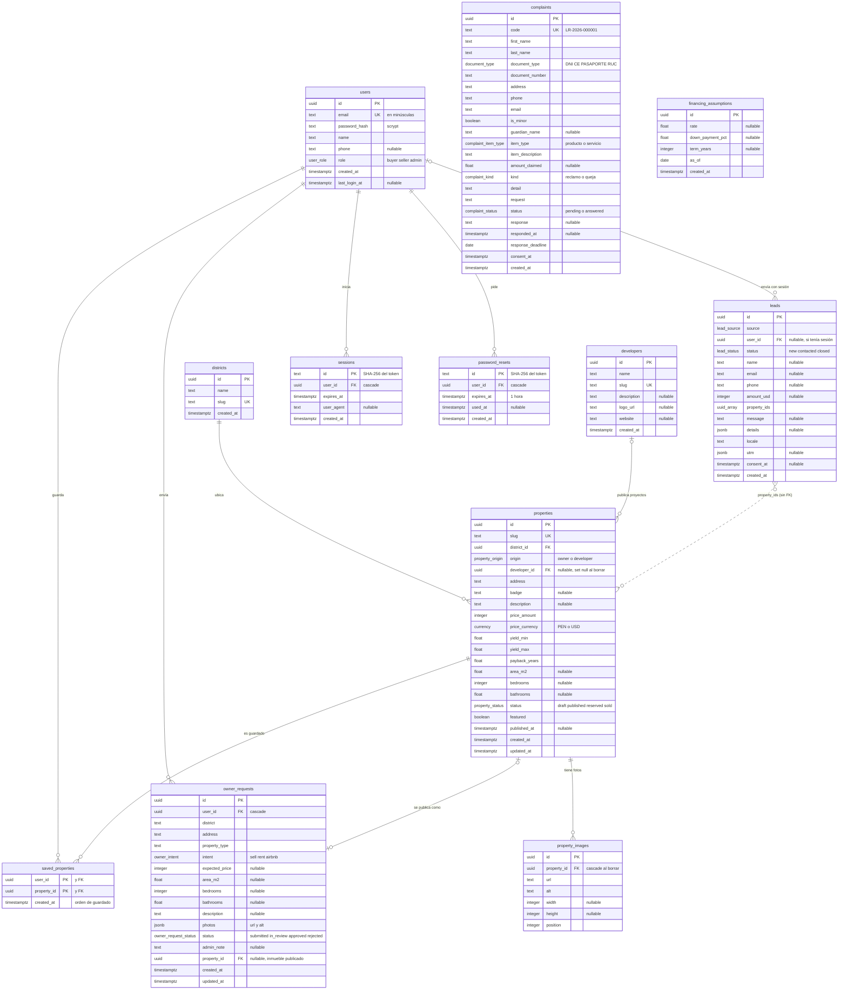
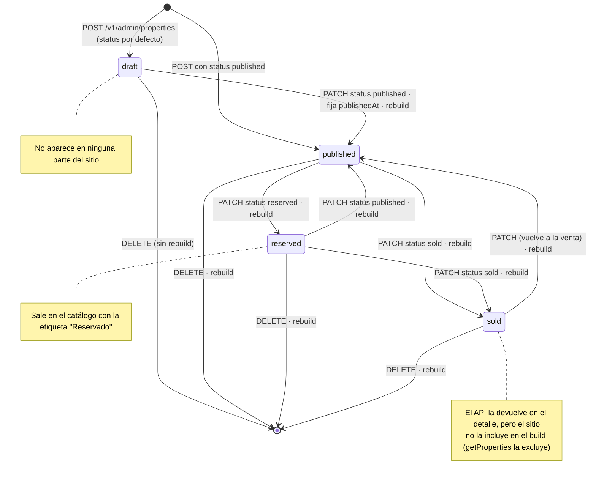
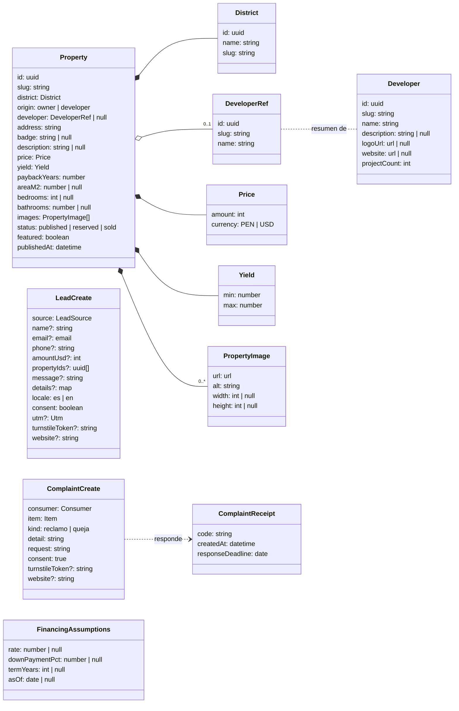
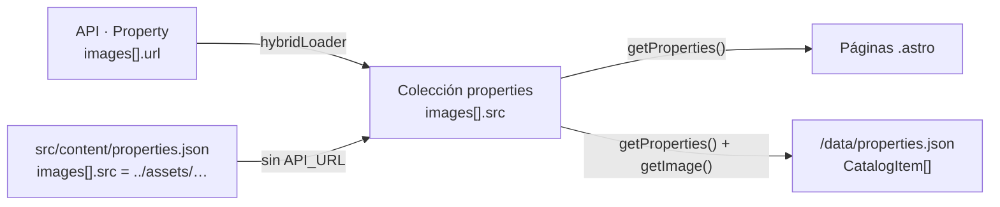

# 04 · Datos

Los datos viven en tres lugares. Cada uno guarda cosas distintas a propósito.

| Lugar | Qué guarda | Quién lo ve |
|---|---|---|
| PostgreSQL (API) | Inmuebles, fotos, distritos, inmobiliarias, leads, reclamos, supuestos | El equipo, vía API |
| HTML y JSON estáticos (build) | Copia pública del catálogo, ya formateada | Todo el mundo |
| Navegador del visitante | Mis inmuebles, historial, nombre, consentimiento, UTM | Solo esa persona, en ese dispositivo |

## 1. Base de datos (diagrama entidad-relación)

Además hay una **secuencia** `complaint_seq` que da el correlativo de los reclamos, y estos enums:

| Enum | Valores |
|---|---|
| `property_status` | `draft`, `published`, `reserved`, `sold` |
| `property_origin` | `owner`, `developer` |
| `currency` | `PEN`, `USD` |
| `lead_source` | `intl-form`, `owner-sell`, `owner-rent`, `cart`, `contact`, `saved-list` |
| `user_role` | `buyer`, `seller`, `admin` |
| `lead_status` | `new`, `contacted`, `closed` |
| `owner_intent` | `sell`, `rent`, `airbnb` |
| `owner_request_status` | `submitted`, `in_review`, `approved`, `rejected` |
| `complaint_kind` | `reclamo`, `queja` |
| `complaint_item_type` | `producto`, `servicio` |
| `complaint_status` | `pending`, `answered` |
| `document_type` | `DNI`, `CE`, `PASAPORTE`, `RUC` |

Índices: `properties` por `status`, `district_id` y `developer_id`; `property_images` por
`property_id`; `leads` por `created_at`; `complaints` por `status`.

### Migraciones

| Archivo | Cambios |
|---|---|
| `drizzle/0000_init.sql` | Tablas base, enums y secuencia |
| `drizzle/0001_developers.sql` | Tabla `developers`, `properties.origin`, `properties.developer_id` y el valor `saved-list` en `lead_source` |
| `drizzle/0002_accounts.sql` | Tablas `users`, `sessions`, `password_resets`, `saved_properties` y `owner_requests`; `leads.user_id` y `leads.status` |
| `drizzle/0003_rls.sql` | RLS activado, sin políticas, en las 12 tablas |

**Por qué RLS:** en Supabase, la Data API publica el esquema `public` a cualquiera con la clave
pública del proyecto. Con RLS activado y sin políticas, esa vía no devuelve nada. El API se conecta
como dueño de las tablas, y a los dueños no se les aplica RLS. Cada tabla nueva lleva `.enableRLS()`
en `schema.ts`; `test/database.test.ts` falla si alguna lo olvida.

## 2. Ciclo de vida de un inmueble (UML de estados)

## 3. Esquemas del contrato (UML de clases)

Estas son las formas que viajan por HTTP. Salen de los esquemas Zod del API.

## 4. Datos en el frontend

### De la API al sitio

El loader del build convierte cada `Property` del API en una entrada de la colección
`properties`. El único cambio es en las fotos: `images[].url` pasa a `images[].src`, porque el
mismo campo también acepta fotos locales (`../assets/…`) cuando no hay API.

### Catálogo liviano (`/data/properties.json`)

Lo genera `src/pages/data/properties.json.ts` en el build. Lo usan Mis inmuebles, Te acompañamos,
"Para ti" y el diálogo "Guarda tus inmuebles". Los textos ya vienen formateados, para que el
navegador no tenga que calcular nada.

| Campo | Ejemplo |
|---|---|
| `id`, `slug`, `url` | `05429e0c-…`, `lince-av-arequipa-cuadra-12`, `/capital/lince-av-arequipa-cuadra-12` |
| `district`, `districtSlug` | `Lince`, `lince` |
| `origin`, `developer` | `owner`, `null` · o `developer`, `{ name: "Urbana", slug: "urbana" }` |
| `address`, `badge`, `description`, `status` | `Av. Arequipa cuadra 12`, `Súper precio`, `null`, `published` |
| `price` | `{ amount: 310000, currency: "PEN", label: "S/ 310,000" }` |
| `yield`, `yieldLabel` | `{ min: 8, max: 10 }`, `8–10% anual` |
| `paybackLabel` | `Se paga en 11 años` |
| `facts` | `["2 dorm.", "2 baños", "68 m²"]` (vacío si no hay datos) |
| `image` | `{ src, srcset, alt }` en WebP de 320, 480 y 640 px, o `null` |

### Lo que se guarda en el navegador

| Clave | Almacenamiento | Contenido | Escribe | Lee |
|---|---|---|---|---|
| `depahost:saved-depas:v2` | localStorage | IDs de Mis inmuebles (máximo 20, el más nuevo al final) | Me interesa, Quitar | Header, Mis inmuebles, Te acompañamos, Para ti, diálogo |
| `depahost:viewed-depas` | localStorage | IDs de inmuebles abiertos (máximo 12, el más reciente al final) | Detalle del inmueble | Para ti |
| `depahost:profile` | localStorage | `{ firstName }` | Diálogo "Guarda tus inmuebles" | Header, Mis inmuebles |
| `depahost:save-prompt-dismissed` | localStorage | Fecha en que se cerró el diálogo | Diálogo | Diálogo (espera 7 días) |
| `depahost:consent` | localStorage | `granted` o `denied` | Banner de cookies | Banner, carga de Clarity |
| `depahost:utm` | sessionStorage | UTM de la primera página de la visita | Formularios | Todos los leads |
| `dh_session` | Cookie `httpOnly` (la pone el API) | Token de sesión. JavaScript no puede leerla | API al ingresar | API en cada llamada con `credentials: 'include'` |
| `dh_has_session` | Cookie legible (la pone el API) | `1` mientras hay sesión, sin secretos | API | Header del sitio: decide si preguntar quién es |

Con sesión iniciada, "Mis inmuebles" también vive en la tabla `saved_properties` y se sincroniza con
el navegador (ver [08 · Panel y cuentas](08-panel-y-cuentas.md#mis-inmuebles-del-navegador-a-la-cuenta)).

Eventos del navegador (`window`):

| Evento | Se dispara | Lo escuchan |
|---|---|---|
| `depahost:saved-depas-updated` | Al cambiar Mis inmuebles | Header, botones Me interesa, Mis inmuebles, Para ti, diálogo |
| `depahost:viewed-depas-updated` | Al abrir un inmueble | — (disponible) |
| `depahost:profile-updated` | Al guardar o borrar el nombre | Header, Mis inmuebles |
| `storage` (nativo) | Al cambiar la clave en otra pestaña | Los mismos suscriptores de Mis inmuebles |

Si `localStorage` no existe o está bloqueado (modo privado), las listas funcionan en memoria
mientras la página esté abierta.

**Privacidad:** el navegador guarda solo el primer nombre. Celular, correo y consentimiento
completo quedan en el API como lead.

## 5. Datos de ejemplo (demostración)

Mientras no haya datos reales, el sitio y el seed del API usan los mismos datos de ejemplo:

| Tipo | Contenido | Estado |
|---|---|---|
| Inmuebles de propietarios | Lince, Surquillo y Magdalena con fotos | Precios, rentabilidad y plazos de ejemplo |
| Inmobiliarias | Urbana, Lima Sur, Andes, Miraflores Hotel, Nova | Nombres provisionales, sin logos ni descripción |
| Proyectos de Urbana | San Miguel, Miraflores y Surquillo | Precios y textos del mock. Las fotos son las de otros inmuebles |
| Supuestos de financiamiento | Vacíos | El sitio muestra `[plazo]`, `[X]` y `[fecha]` |

Todo esto debe reemplazarse antes de publicar. Ver [07 · Pendientes](07-decisiones-y-pendientes.md#pendientes).
