# 05 · Flujos detalle a detalle

Cada flujo indica qué archivo hace cada paso, para que puedas seguirlo en el código.

Los flujos de cuentas y del panel (crear cuenta, ingresar, recuperar la contraseña, sincronizar
Mis depas con la cuenta y publicar un depa como propietario) están en
[08 · Panel y cuentas](08-panel-y-cuentas.md#4-flujos-de-cuenta).

**Índice**

1. [Recorrido completo del visitante](#1-recorrido-completo-del-visitante)
2. [Generar el sitio (build)](#2-generar-el-sitio-build)
3. [Publicar o editar un depa](#3-publicar-o-editar-un-depa)
4. [Subir fotos](#4-subir-fotos)
5. [Buscar y filtrar](#5-buscar-y-filtrar)
6. [Me interesa](#6-me-interesa)
7. [Guarda tus depas](#7-guarda-tus-depas)
8. [Ver el detalle de un depa](#8-ver-el-detalle-de-un-depa)
9. [Para ti, según lo que has visto](#9-para-ti-según-lo-que-has-visto)
10. [Mis depas](#10-mis-depas)
11. [Te acompañamos y WhatsApp](#11-te-acompañamos-y-whatsapp)
12. [Formularios: inglés, propietarios y Libro de Reclamaciones](#12-formularios)
13. [Cambiar el contrato del API](#13-cambiar-el-contrato-del-api)
14. [Cookies y analítica](#14-cookies-y-analítica)
15. [Qué pasa cuando algo falla](#15-qué-pasa-cuando-algo-falla)

---

## 1. Recorrido completo del visitante

Este es el recorrido que diseñaste en el mock 5, con las páginas que lo implementan.

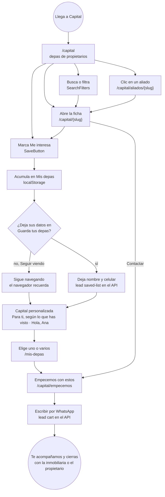

Puntos de registro en el API durante el recorrido:

| Momento | Lead | Datos personales |
|---|---|---|
| Deja sus datos en "Guarda tus depas" | `saved-list` | Nombre, celular, correo opcional |
| Hace clic en "Escribir por WhatsApp" en Te acompañamos | `cart` | Ninguno: solo los IDs de los depas |
| Envía el formulario en inglés | `intl-form` | Nombre, correo, monto |
| Envía el formulario de propietarios | `owner-sell` u `owner-rent` | Nombre, celular, datos del depa |

---

## 2. Generar el sitio (build)

Pasa al publicar el frontend, al subir cambios a `main` y cada vez que el API llama al deploy hook.

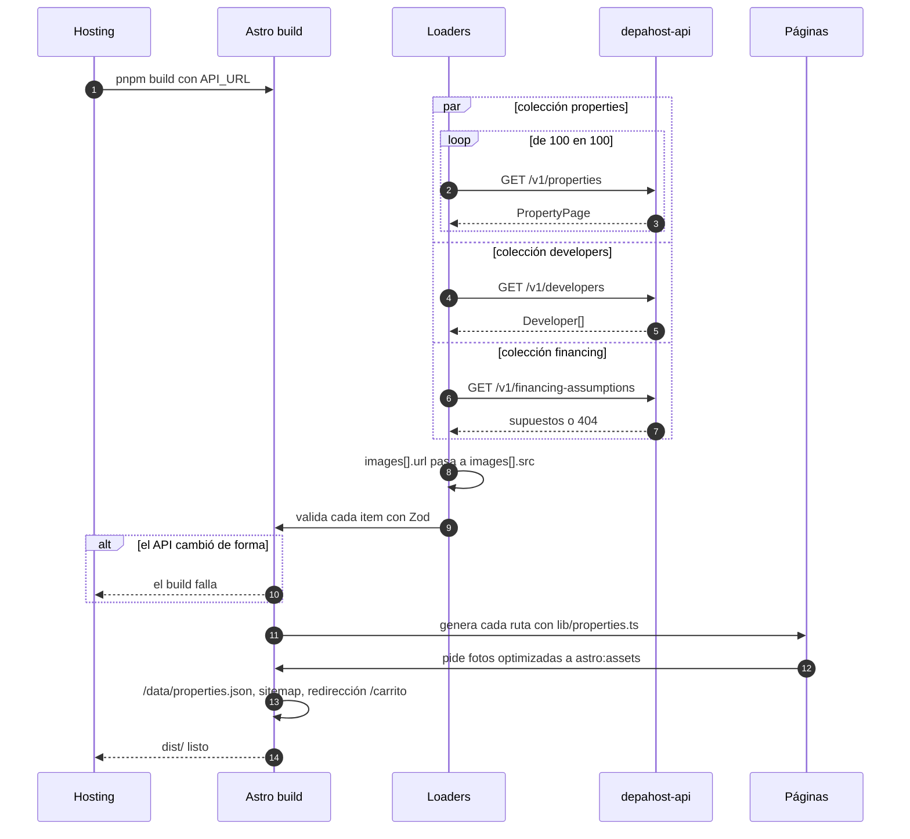

Reglas importantes:

- **Sin `API_URL`:** los loaders leen `src/content/*.json`. En desarrollo, editar esos JSON
  recarga el sitio solo.
- **Si el API falla durante el build, el build falla.** Es a propósito: es mejor no publicar que
  publicar datos viejos o de ejemplo.
- **Páginas que se generan:** una por depa visible, una por inmobiliaria con proyectos, y el resto
  de rutas fijas. Los depas vendidos no generan página.

---

## 3. Publicar o editar un depa

Hoy no hay panel visual: se usa `/docs` del API, Drizzle Studio o cualquier cliente HTTP con la
clave de administración.

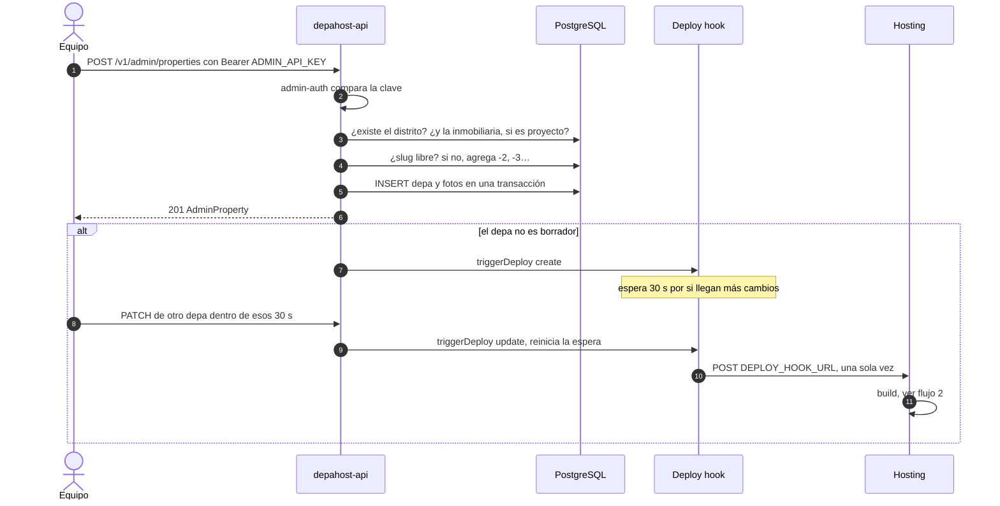

El mismo patrón aplica a editar (`PATCH`), borrar (`DELETE`), crear o editar inmobiliarias y
agregar supuestos de financiamiento. Editar un borrador que sigue siendo borrador no reconstruye
el sitio, porque no cambia nada visible.

---

## 4. Subir fotos

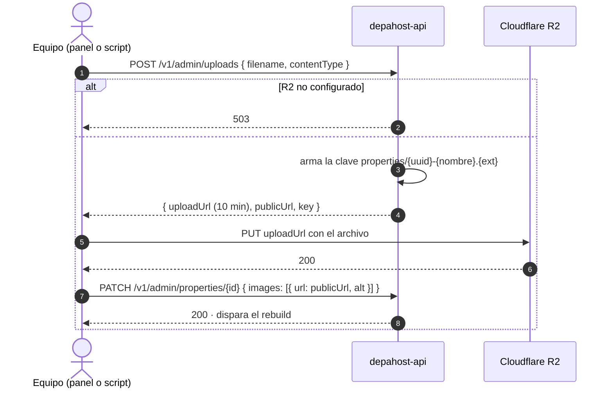

En el build, Astro descarga la foto desde R2 y la sirve optimizada desde el hosting. Para que
lo permita, el dominio de las fotos debe estar en `image.remotePatterns` (`*.r2.dev` o
`PUBLIC_MEDIA_HOST`).

---

## 5. Buscar y filtrar

Funciona igual en la portada de Capital y en la página de cada inmobiliaria. No llama al API:
todas las tarjetas ya están en el HTML y el script solo las muestra u oculta.

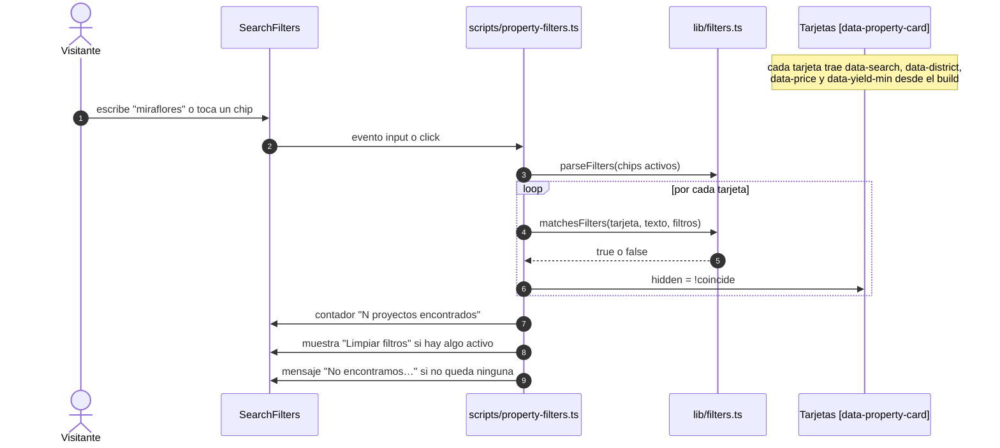

Cómo se decide si una tarjeta coincide:

1. **Texto:** se normaliza sin tildes, en minúsculas y solo letras y números. "S/ 310,000" queda
   "s310000", así que buscar "310 000" o "310,000" encuentra el depa.
2. **Distrito:** el slug del chip debe ser igual al de la tarjeta.
3. **Precio máximo:** el precio de la tarjeta debe ser menor o igual.
4. **Rentabilidad mínima:** la rentabilidad mínima de la tarjeta debe ser mayor o igual.
5. Todos los criterios activos se combinan con "y".

Cómo se arman los chips (en el build, `buildFastFilters`):

- Un chip por distrito presente, en orden alfabético.
- Hasta 2 topes de precio, redondeados hacia arriba a S/ 50,000, solo si dejan fuera algún depa.
- Hasta 2 rentabilidades mínimas, solo si dejan fuera algún depa.

---

## 6. Me interesa

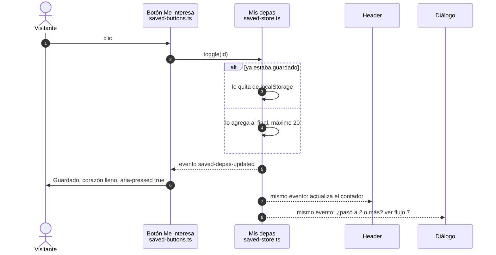

Si la persona tiene el sitio abierto en otra pestaña, el evento nativo `storage` actualiza esa
pestaña también.

---

## 7. Guarda tus depas

### Cuándo aparece (UML de estados)

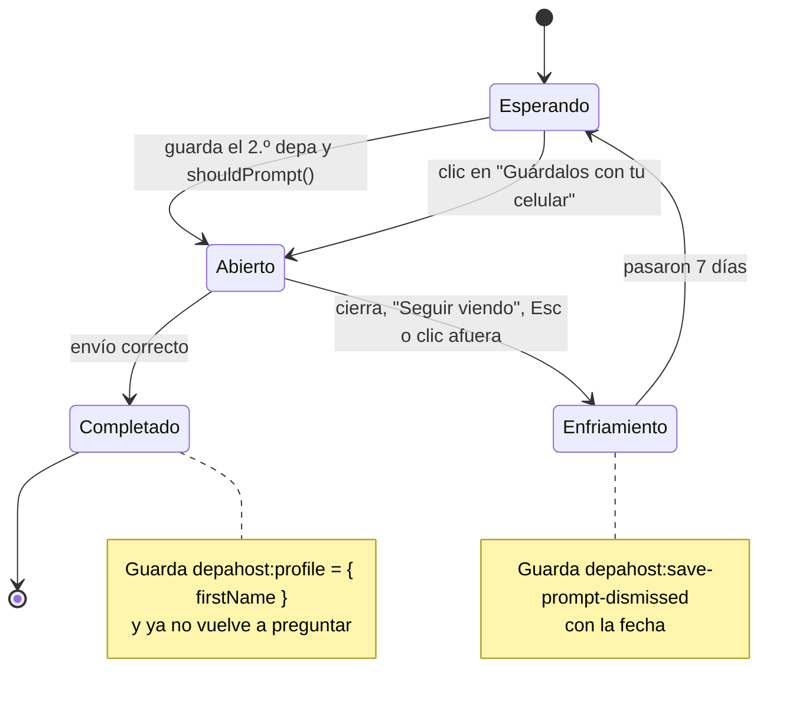

`shouldPrompt()` (en `lib/profile.ts`) responde **no** si ya hay perfil o si el aviso se cerró hace
menos de 7 días. El botón "Guárdalos con tu celular" de Mis depas abre el diálogo siempre.

### Envío (UML de secuencia)

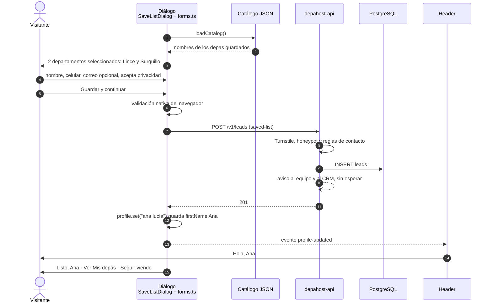

El cuerpo del `POST` lleva `source: saved-list`, `name`, `phone`, `email` (opcional),
`propertyIds`, `consent`, `utm` y `turnstileToken`.

---

## 8. Ver el detalle de un depa

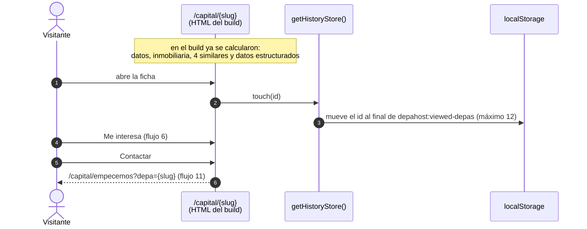

Qué muestra el detalle:

- **Etiqueta:** "De propietario" o "De proyecto · Urbana", más "Reservado" o el badge.
- **Tres datos con ícono:** valor ("Precio de compra" o "Precio desde"), rentabilidad en verde
  ("Estimada") y plazo ("Plazo de inversión").
- **Características:** dormitorios, baños y m², solo si existen.
- **Bloque de aliado:** la inmobiliaria con link a sus proyectos, o "Te acompaña · DepaHost
  Capital" si es de propietario.
- **Depas similares:** los 4 más parecidos según `similarTo` (ver flujo 9).

---

## 9. Para ti, según lo que has visto

Aparece en `/capital` y, con el título "Parecidos a los que guardaste", en `/mis-depas`.

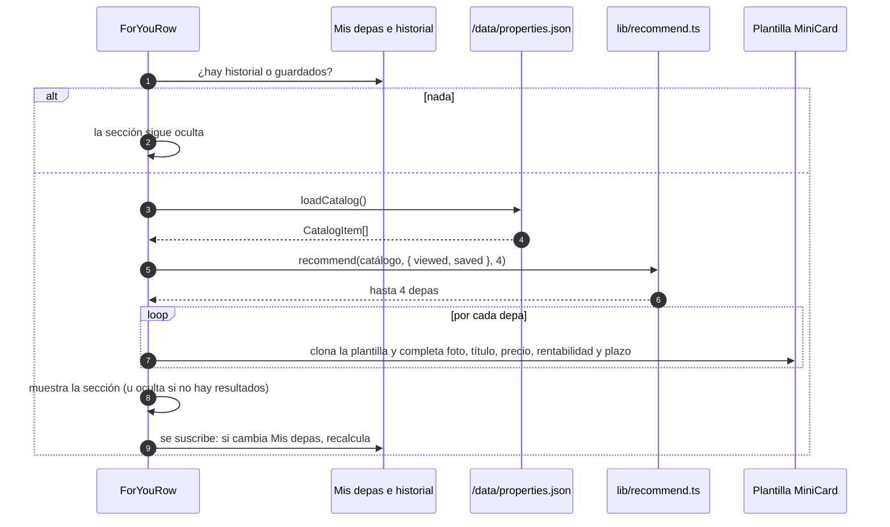

### Cómo se calcula (UML de actividad)

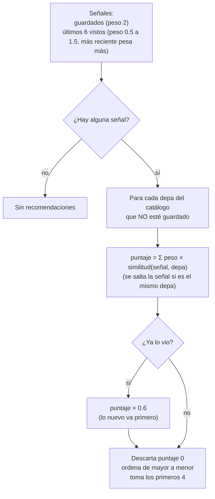

**Similitud entre dos depas** (`similarity` en `lib/recommend.ts`), de 0 a 7 puntos:

| Criterio | Puntos |
|---|---|
| Mismo distrito | 3 |
| Mismo origen (propietario o proyecto) | 1 |
| Precio cercano: `2 − 4 × diferencia relativa`, mínimo 0 | 0 a 2 |
| Rentabilidad cercana: `1 − diferencia en puntos / 3`, mínimo 0 | 0 a 1 |

Los "Depas similares" del detalle usan la misma función, pero en el build y con un solo depa
como referencia (`similarTo`).

---

## 10. Mis depas

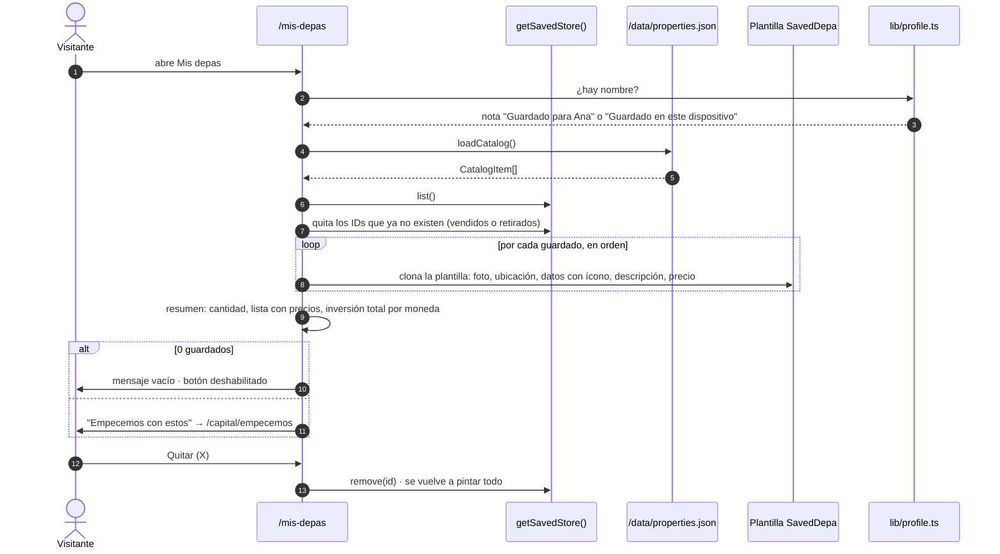

La inversión total suma por moneda. Si hay depas en soles y en dólares, muestra
"S/ 595,000 + US$ 80,000".

---

## 11. Te acompañamos y WhatsApp

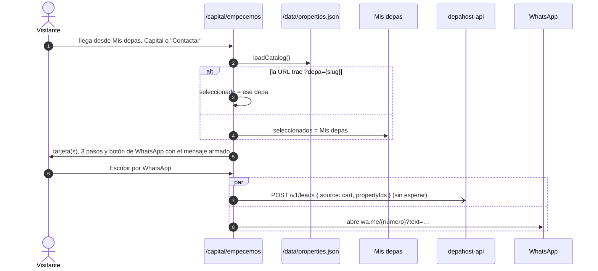

- El mensaje incluye cada depa con distrito, dirección y precio.
- Si no hay nada seleccionado, la página invita a ver depas y el mensaje de WhatsApp es genérico.
- El lead `cart` no lleva datos personales ni captcha. Si el API falla, WhatsApp se abre igual.

---

## 12. Formularios

### Flujo común (`scripts/forms.ts`, UML de actividad)

Todos los formularios que envían al API usan `enhanceForm`.

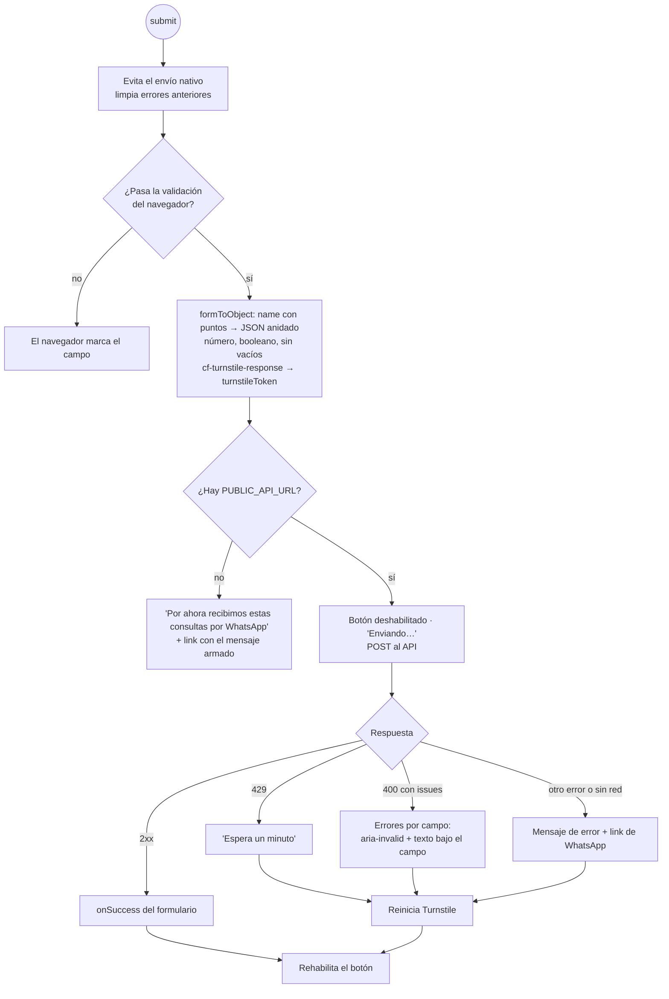

### Los formularios

| Formulario | Página | Payload | Al terminar |
|---|---|---|---|
| Inglés | `/capital` | `source: intl-form`, `locale: en`, `name`, `email`, `amountUsd` | "Thanks!" + link de WhatsApp en inglés |
| Propietarios | `/propietarios` | `owner-sell` si "Vender"; `owner-rent` si "Alquilar" o "Airbnb"; `details: { district, propertyType, intent, expectedPrice }` | "Te escribimos por WhatsApp" + link |
| Guarda tus depas | Diálogo global | `saved-list` + `propertyIds` | Saludo y paso "Listo" (flujo 7) |
| Libro de Reclamaciones | `/libro-de-reclamaciones` | `consumer`, `item`, `kind`, `detail`, `request`, `consent` | Constancia en pantalla e imprimible |

En Propietarios, los botones "Quiero vender" y "Poner en alquiler" eligen la opción del select y
llevan el foco al nombre. Las URLs `/propietarios#vender` y `#alquiler` también la preseleccionan.
Si eligen alquiler o Airbnb, el campo de precio pasa a "Alquiler mensual esperado".

### Libro de Reclamaciones (UML de secuencia)

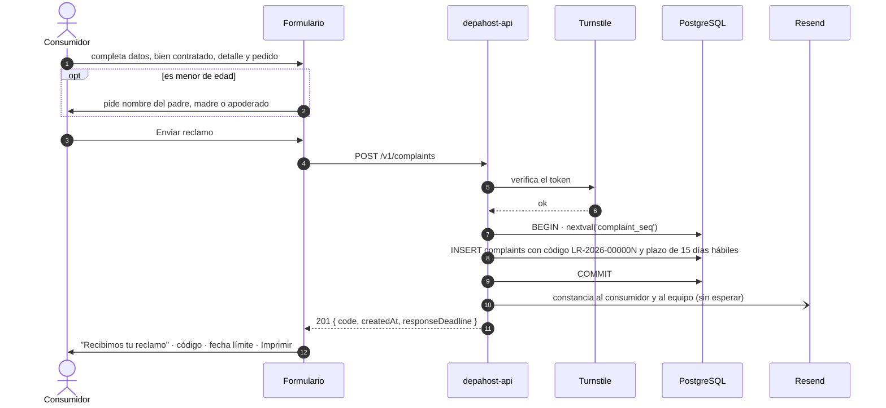

### Estados de un reclamo

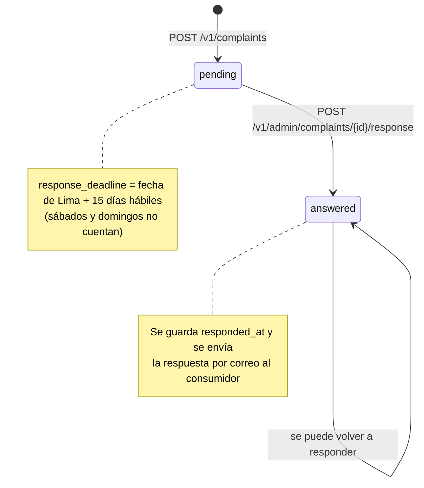

---

## 13. Cambiar el contrato del API

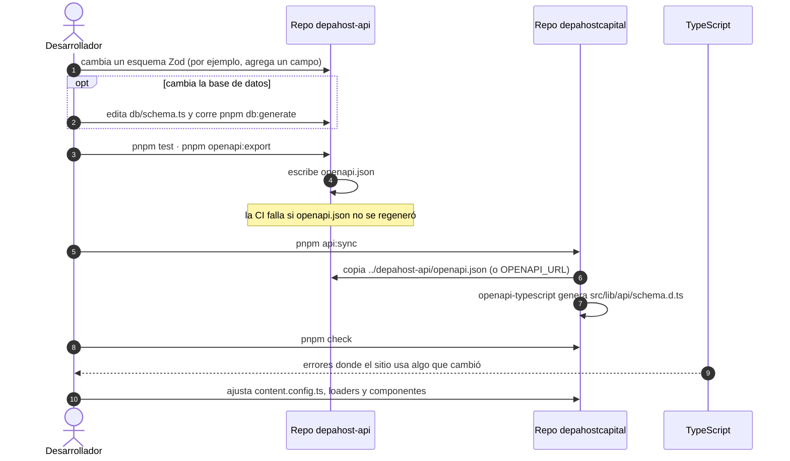

---

## 14. Cookies y analítica

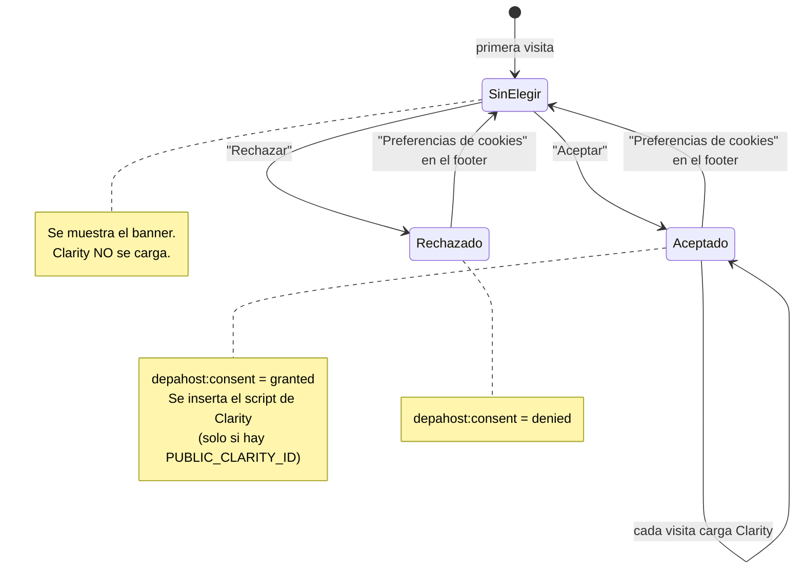

Sentry (errores del navegador) no depende del consentimiento: no envía datos personales y solo
se carga si hay `PUBLIC_SENTRY_DSN`.

---

## 15. Qué pasa cuando algo falla

| Situación | Qué pasa | Qué ve la persona |
|---|---|---|
| El API no responde durante el build | El build falla y el hosting mantiene la versión anterior | Nada cambia |
| El API cambió de forma | El esquema de `content.config.ts` rechaza los datos y el build falla | Nada cambia |
| `PUBLIC_API_URL` vacío | Los formularios no envían y ofrecen WhatsApp | "Por ahora recibimos estas consultas por WhatsApp" |
| El API cae mientras alguien llena un formulario | Error de red | Mensaje de error + link de WhatsApp con su mensaje |
| Envía demasiadas veces | 429 | "Espera un minuto" |
| Un campo no pasa la validación del API | 400 con `issues` | El campo se marca con el mensaje del API |
| Falla Turnstile | 400 | "No pudimos verificar que no eres un robot…" |
| No carga `/data/properties.json` | Mis depas muestra un aviso; Para ti queda oculta | "No pudimos cargar tus depas guardados" |
| Un depa guardado ya no existe | Se quita solo de Mis depas | No aparece |
| `localStorage` bloqueado | Las listas funcionan en memoria en esa página | Mis depas se vacía al recargar |
| Falla el correo o el CRM | El lead o reclamo ya quedó guardado; se registra en el log | Nada |
| Falla el deploy hook | Se registra en el log | El cambio no aparece hasta el próximo build |
