# 05 · Flujos detalle a detalle

Cada flujo indica qué archivo hace cada paso, para que puedas seguirlo en el código.

El sitio no tiene cuentas ni login. Mis inmuebles, el historial de vistos y el nombre del saludo viven
solo en el navegador (`localStorage`). Los datos que deja la persona llegan como leads al panel de
DepaHost (repo `DH_panel`), que también es la fuente del catálogo. El API que usa el sitio está en
[03 · API](03-api.md).

**Índice**

1. [Recorrido completo del visitante](#1-recorrido-completo-del-visitante)
2. [Generar el sitio (build)](#2-generar-el-sitio-build)
3. [Publicar o editar un inmueble](#3-publicar-o-editar-un-inmueble)
4. [Buscar y filtrar](#4-buscar-y-filtrar)
5. [Me interesa](#5-me-interesa)
6. [Guarda tus inmuebles](#6-guarda-tus-inmuebles)
7. [Ver el detalle de un inmueble](#7-ver-el-detalle-de-un-inmueble)
8. [Para ti, según lo que has visto](#8-para-ti-según-lo-que-has-visto)
9. [Mis inmuebles](#9-mis-inmuebles)
10. [WhatsApp y sesión desde Mis inmuebles](#10-whatsapp-y-sesión-desde-mis-inmuebles)
11. [Formularios: propietarios y Libro de Reclamaciones](#11-formularios)
12. [Cambiar el contrato del API](#12-cambiar-el-contrato-del-api)
13. [Cookies y analítica](#13-cookies-y-analítica)
14. [Qué pasa cuando algo falla](#14-qué-pasa-cuando-algo-falla)

---

## 1. Recorrido completo del visitante

Este es el recorrido que diseñaste en el mock 5, con las páginas que lo implementan.

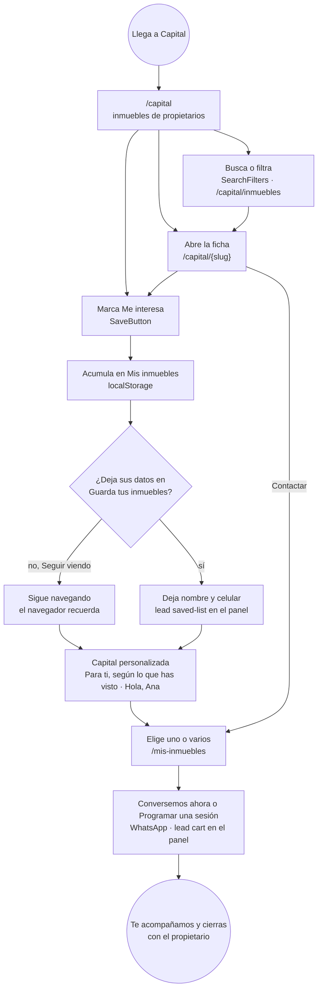

Puntos de registro en el panel durante el recorrido (todos por `POST /api/v1/leads`):

| Momento | Lead | Datos personales |
|---|---|---|
| Deja sus datos en "Guarda tus inmuebles" | `saved-list` | Nombre, celular, correo opcional |
| Hace clic en "Conversemos ahora" en Mis inmuebles | `cart` | Ninguno: solo los IDs de los inmuebles |
| Envía "Programar una sesión" en Mis inmuebles | `cart` | Nombre, celular, día, horario y modalidad |
| Envía el formulario de propietarios | `owner-sell` | Nombre, celular, datos del inmueble |

`owner-rent` (alquiler o Airbnb) responde 201 pero el panel no lo registra: la persona sigue por
WhatsApp.

---

## 2. Generar el sitio (build)

Pasa cada vez que GitHub Actions mueve la rama `deploy/sitio` y cada vez que el panel llama al deploy
hook ("Actualizar web", flujo 3).

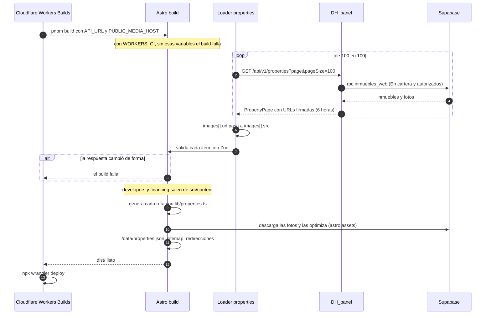

Reglas importantes:

- **Sin `API_URL`:** el loader lee `src/content/properties.json`, que está vacío: el sitio funciona,
  pero sin inmuebles. Las pruebas e2e usan su propio catálogo con `CATALOG_DIR=tests/e2e/catalogo`.
- **Si el API falla durante el build, el build falla.** Es a propósito: es mejor no publicar que
  publicar un catálogo vacío. Cloudflare mantiene la versión anterior.
- **Fotos:** son URLs firmadas de Supabase Storage que caducan a las 6 horas. Por eso el build las
  descarga y las sirve optimizadas desde el sitio; necesita `PUBLIC_MEDIA_HOST` en
  `image.remotePatterns`.
- **Caché:** el panel responde con `s-maxage=300`. Un rebuild inmediato puede leer el catálogo
  anterior hasta 5 minutos.
- **Páginas que se generan:** una por inmueble que entrega el panel, una por inmobiliaria con
  proyectos (hoy ninguna) y el resto de rutas fijas.

---

## 3. Publicar o editar un inmueble

Se hace en el panel de DepaHost. El sitio no cambia hasta que alguien presiona "Actualizar web".

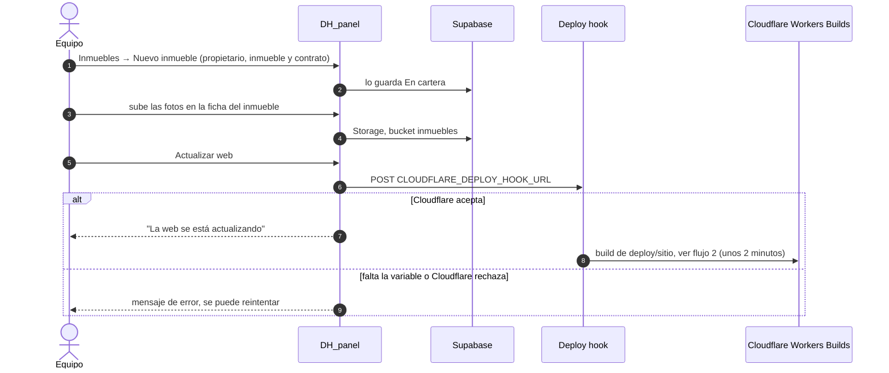

- Solo se publican los inmuebles En cartera con autorización para publicar (rpc `inmuebles_web`).
- Editar o retirar un inmueble sigue el mismo camino: el cambio en el panel y luego "Actualizar web".
- El sitio nunca muestra la dirección exacta: en su lugar va el tipo de inmueble.

---

## 4. Buscar y filtrar

Funciona igual en la portada de Capital y en la página de cada inmobiliaria. No llama al API:
todas las tarjetas ya están en el HTML y el script solo las muestra u oculta.

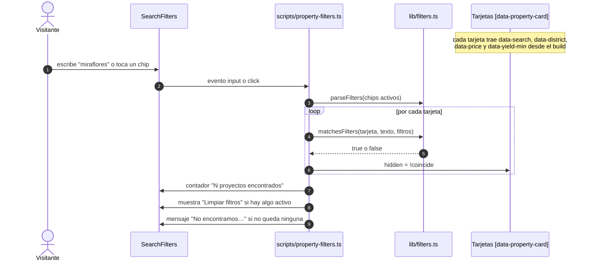

Cómo se decide si una tarjeta coincide:

1. **Texto:** se normaliza sin tildes, en minúsculas y solo letras y números. "S/ 310,000" queda
   "s310000", así que buscar "310 000" o "310,000" encuentra el inmueble.
2. **Distrito:** el slug del chip debe ser igual al de la tarjeta.
3. **Precio máximo:** el precio de la tarjeta debe ser menor o igual.
4. Todos los criterios activos se combinan con "y".

La rentabilidad no es filtro rápido: está con el resto de filtros en "Todos los inmuebles" (`/capital/inmuebles`).

Cómo se arman los chips (en el build, `buildFastFilters`):

- Los 4 distritos con más inmuebles (a igualdad, los de mejor rentabilidad).
- Un tope de precio redondeado a S/ 50,000, cerca de la mediana, solo si deja fuera algún inmueble.

---

## 5. Me interesa

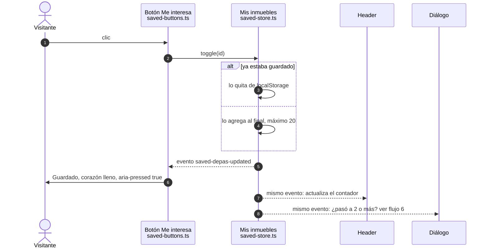

Si la persona tiene el sitio abierto en otra pestaña, el evento nativo `storage` actualiza esa
pestaña también. La lista no se sincroniza con ningún servidor: en otro navegador empieza vacía.

---

## 6. Guarda tus inmuebles

### Cuándo aparece (UML de estados)

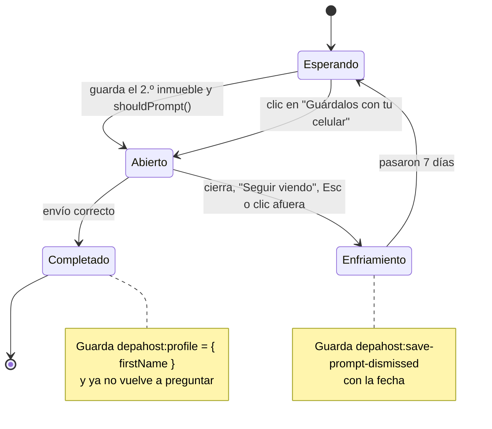

`shouldPrompt()` (en `lib/profile.ts`) responde **no** si ya hay perfil o si el aviso se cerró hace
menos de 7 días. El botón "Guárdalos con tu celular" de Mis inmuebles abre el diálogo siempre.

### Envío (UML de secuencia)

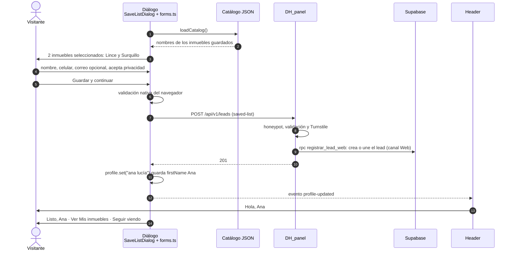

El cuerpo del `POST` lleva `source: saved-list`, `name`, `phone`, `email` (opcional),
`propertyIds`, `consent`, `utm` y `turnstileToken`.

### Reglas del panel para cualquier lead

- `source` debe ser `saved-list`, `cart`, `contact`, `intl-form`, `owner-sell` u `owner-rent`.
- Valida nombre, celular (obligatorio si hay nombre), correo, `propertyIds` (UUID, máximo 20),
  `details` y `utm`. Un error responde 400 con `issues` por campo.
- **Honeypot:** si llega el campo oculto `website`, responde 201 sin registrar.
- **Turnstile:** si hay celular y el panel tiene `TURNSTILE_SECRET_KEY`, verifica el token.
- **CORS:** solo para los orígenes de `WEB_ORIGINS`.
- Sin celular solo guarda el interés por los inmuebles. No hay límite de envíos por IP (pendiente).

---

## 7. Ver el detalle de un inmueble

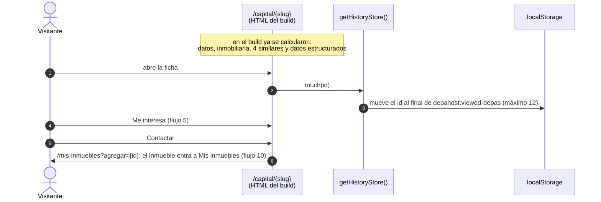

Qué muestra el detalle:

- **Etiqueta:** "De propietario" (hoy todos los del panel) o "De proyecto · {inmobiliaria}", más
  "Reservado" o el badge.
- **Tres datos con ícono:** valor ("Precio de compra" o "Precio desde"), rentabilidad en verde
  ("Estimada") y plazo ("Plazo de inversión").
- **Características:** dormitorios, baños y m², solo si existen.
- **Bloque de aliado:** la inmobiliaria con link a sus proyectos, o "Te acompaña · DepaHost
  Capital" si es de propietario.
- **Inmuebles similares:** los 4 más parecidos según `similarTo` (ver flujo 8).

---

## 8. Para ti, según lo que has visto

Aparece en `/capital` y, con el título "Parecidos a los que guardaste", en `/mis-inmuebles`.

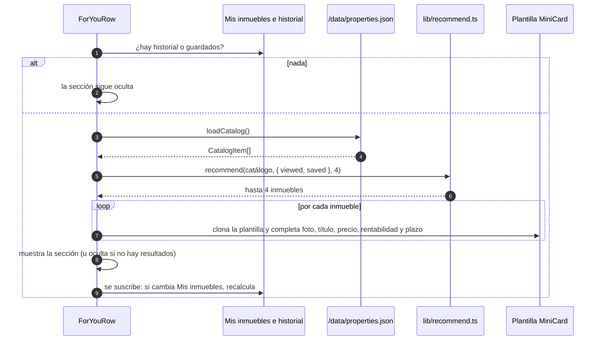

### Cómo se calcula (UML de actividad)

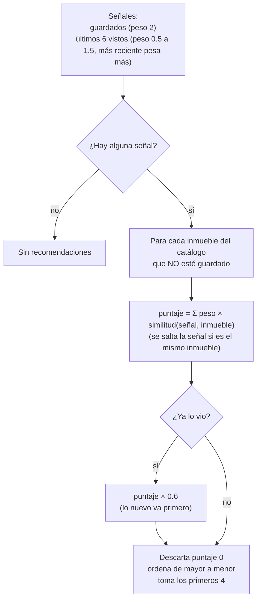

**Similitud entre dos inmuebles** (`similarity` en `lib/recommend.ts`), de 0 a 7 puntos:

| Criterio | Puntos |
|---|---|
| Mismo distrito | 3 |
| Mismo origen (propietario o proyecto) | 1 |
| Precio cercano: `2 − 4 × diferencia relativa`, mínimo 0 | 0 a 2 |
| Rentabilidad cercana: `1 − diferencia en puntos / 3`, mínimo 0 | 0 a 1 |

Los "Inmuebles similares" del detalle usan la misma función, pero en el build y con un solo inmueble
como referencia (`similarTo`).

---

## 9. Mis inmuebles

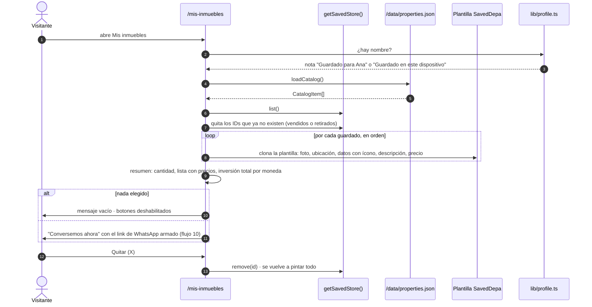

La inversión total suma por moneda. Si hay inmuebles en soles y en dólares, muestra
"S/ 595,000 + US$ 80,000".

---

## 10. WhatsApp y sesión desde Mis inmuebles

"Te acompañamos" (`/capital/empecemos`) se unió a Mis inmuebles: la lista es el último paso y desde ahí
se escribe por WhatsApp o se pide una sesión. `/capital/empecemos` y `/carrito` redirigen a
`/mis-inmuebles`.

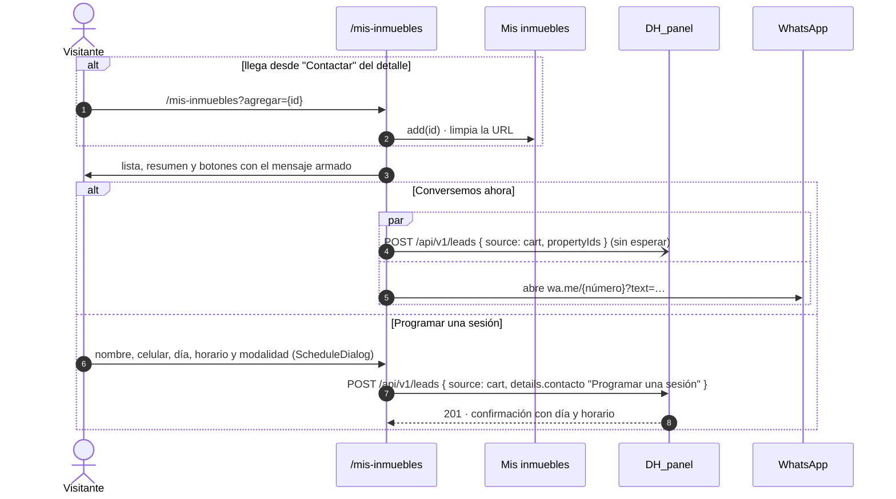

- El mensaje de WhatsApp incluye cada inmueble con distrito, dirección y precio.
- Sin inmuebles elegidos los botones están deshabilitados y la página invita a explorar.
- El lead de "Conversemos ahora" no lleva datos personales ni captcha. Si el panel falla, WhatsApp se
  abre igual.

---

## 11. Formularios

### Flujo común (`scripts/forms.ts`, UML de actividad)

Todos los formularios que envían al API usan `enhanceForm`.

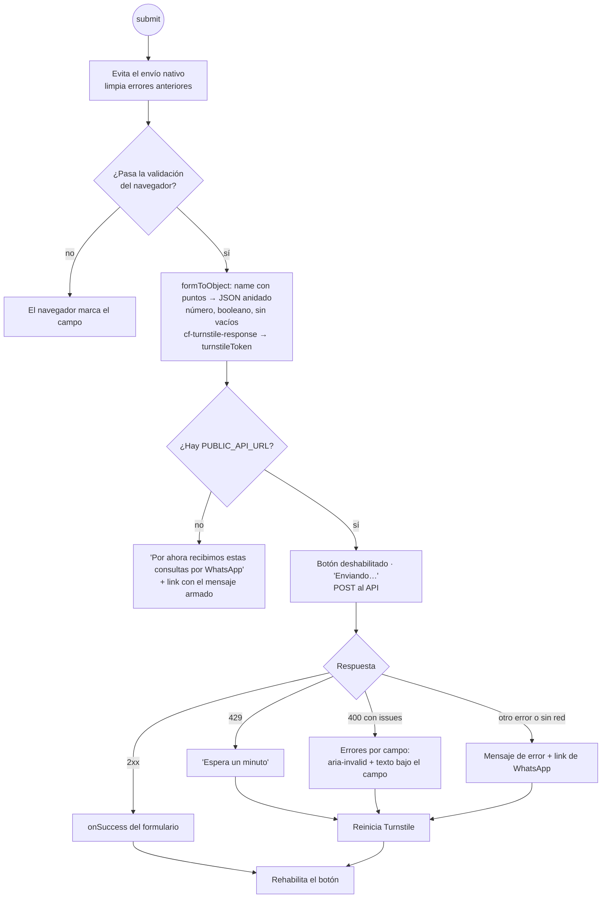

El panel hoy no responde 429 (no limita por IP), pero el sitio ya maneja ese caso.

### Los formularios

| Formulario | Página | Payload | Al terminar |
|---|---|---|---|
| Propietarios | `/propietarios` | `owner-sell` si "Vender"; `owner-rent` si "Alquilar" o "Airbnb"; `details: { district, propertyType, intent, expectedPrice }` | "Te escribimos por WhatsApp" + link |
| Guarda tus inmuebles | Diálogo global | `saved-list` + `propertyIds` | Saludo y paso "Listo" (flujo 6) |
| Programar una sesión | Diálogo de `/mis-inmuebles` | `cart` + `details: { contacto, fecha, horario, modalidad }` | Confirmación con el día y el horario (flujo 10) |
| Libro de Reclamaciones | `/libro-de-reclamaciones` | `consumer`, `item`, `kind`, `detail`, `request`, `consent` | Hoy falla: ver abajo |

En Propietarios, los botones "Quiero vender" y "Poner en alquiler" eligen la opción del select y
llevan el foco al nombre. Las URLs `/propietarios#vender` y `#alquiler` también la preseleccionan.
Si eligen alquiler o Airbnb, el campo de precio pasa a "Alquiler mensual esperado". El panel responde
201 a `owner-rent` pero no lo registra.

### Libro de Reclamaciones

El formulario envía `POST /v1/complaints`, pero el panel todavía no implementa esa ruta. Hoy el envío
termina en error y el sitio ofrece WhatsApp con el mensaje armado. Es un pendiente legal: INDECOPI
exige un código correlativo y una constancia.

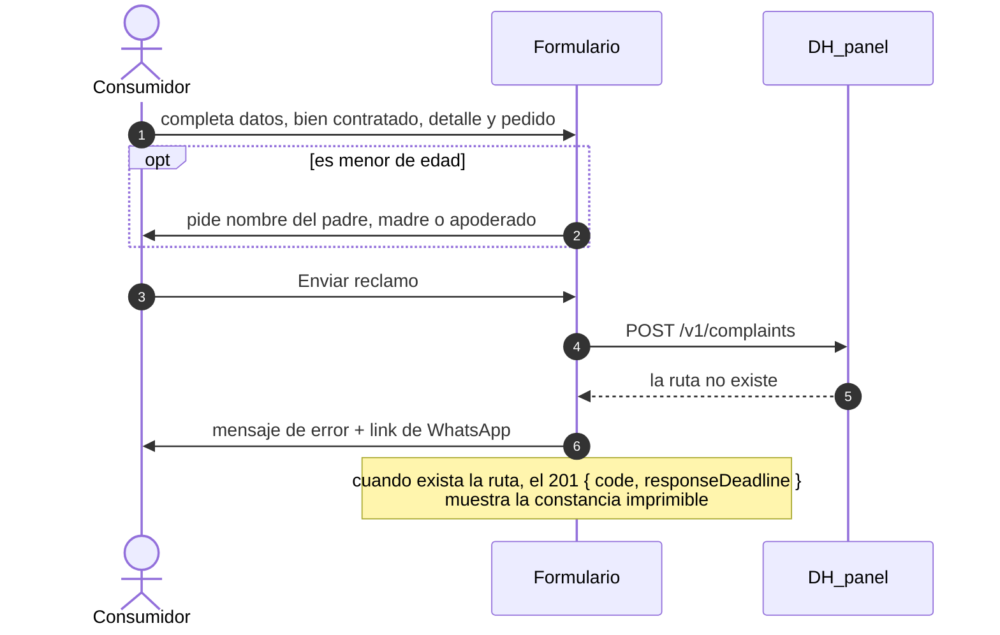

---

## 12. Cambiar el contrato del API

El contrato vive en este repo, en `openapi/depahost-api.json`, y es la fuente de verdad. El panel
implementa a mano la parte que el sitio usa.

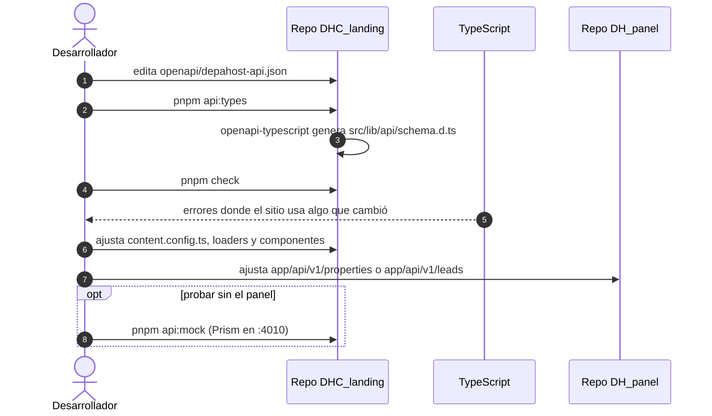

---

## 13. Cookies y analítica

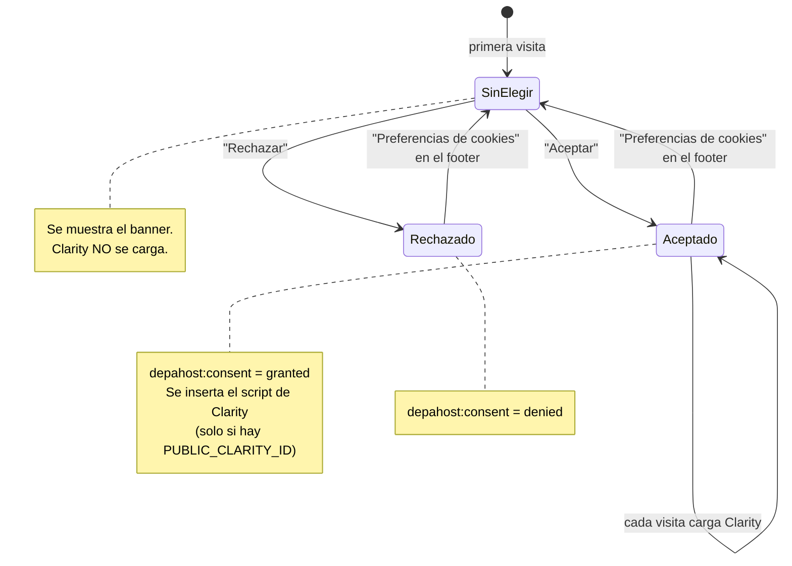

Sentry (errores del navegador) no depende del consentimiento: no envía datos personales y solo
se carga si hay `PUBLIC_SENTRY_DSN`.

---

## 14. Qué pasa cuando algo falla

| Situación | Qué pasa | Qué ve la persona |
|---|---|---|
| El panel no responde durante el build | El build falla y Cloudflare mantiene la versión anterior | Nada cambia |
| La respuesta del panel cambió de forma | El esquema de `content.config.ts` rechaza los datos y el build falla | Nada cambia |
| Faltan `API_URL` o `PUBLIC_MEDIA_HOST` en Cloudflare | El build falla a propósito (`WORKERS_CI`) | Nada cambia |
| `PUBLIC_API_URL` vacío | Los formularios no envían y ofrecen WhatsApp | "Por ahora recibimos estas consultas por WhatsApp" |
| El panel cae mientras alguien llena un formulario | Error de red | Mensaje de error + link de WhatsApp con su mensaje |
| Un campo no pasa la validación del panel | 400 con `issues` | El campo se marca con el mensaje del panel |
| Falla Turnstile | 400 | "No pudimos verificar que no eres un robot…" |
| Envía un reclamo | La ruta no existe en el panel | Mensaje de error + link de WhatsApp |
| No carga `/data/properties.json` | Mis inmuebles muestra un aviso; Para ti queda oculta | "No pudimos cargar tus inmuebles guardados" |
| Un inmueble guardado ya no existe | Se quita solo de Mis inmuebles | No aparece |
| `localStorage` bloqueado | Las listas funcionan en memoria en esa página | Mis inmuebles se vacía al recargar |
| "Actualizar web" falla | El panel muestra el error (falta `CLOUDFLARE_DEPLOY_HOOK_URL` o Cloudflare lo rechazó) | El cambio no aparece hasta el próximo build |
| Rebuild justo después de un cambio | La caché del panel (`s-maxage=300`) puede servir el catálogo anterior | El cambio aparece en el siguiente build |
