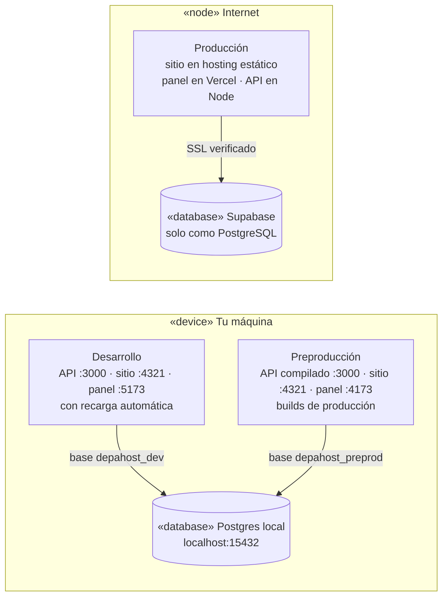
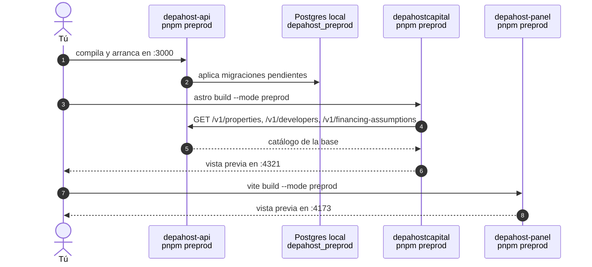
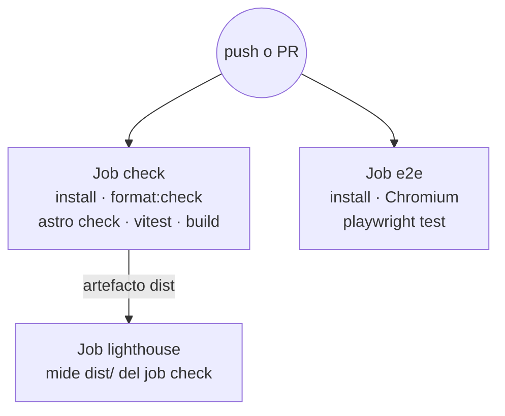
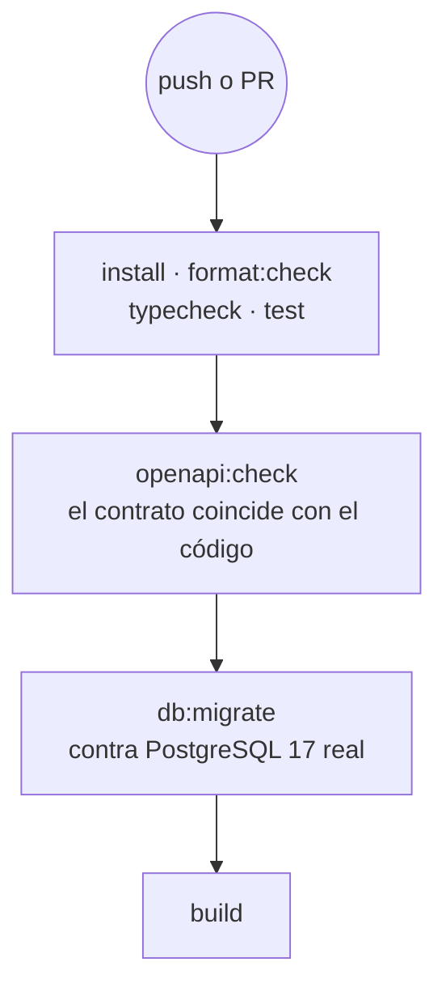
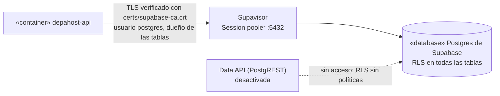

# 06 · Desarrollo y operación

## 1. Requisitos

- Node 24 y pnpm 11. La CI, el hosting del API y el `.nvmrc` de la raíz del monorepo usan
  Node 24 (`nvm install 24`, y luego `nvm use` en la raíz). Node 22.12 también funciona (`engines`
  en `package.json`), pero lo que se valida es la 24. El `package.json` de la raíz fija pnpm con
  `packageManager`.
- PostgreSQL 16 o superior instalado en la máquina (en Ubuntu: `sudo apt install postgresql`). No
  hace falta tenerlo encendido como servicio ni usar `sudo` después: el API levanta su propio
  servidor con esos programas (ver [Postgres local](#postgres-local)).
- Un solo repo (monorepo con workspaces de pnpm). Las tres apps están lado a lado en `apps/`, y así
  `pnpm api:sync` y las pruebas del panel encuentran el API:

```text
DepaHost/
├── package.json         scripts de todo el monorepo
├── pnpm-workspace.yaml
├── pnpm-lock.yaml       un solo lockfile para las tres apps
├── .github/workflows/   web.yml · api.yml · panel.yml
└── apps/
    ├── depahostcapital/   sitio
    ├── depahost-api/      API
    └── depahost-panel/    panel
```

## 2. Entornos

Desarrollo y preproducción corren en tu máquina, con un mismo PostgreSQL local y una base para cada
uno. Producción corre en internet, con Supabase como base de datos.



| | Desarrollo | Preproducción | Producción |
|---|---|---|---|
| Para qué | Programar, con recarga automática | Probar tal cual lo que se va a publicar | El sitio real |
| Dónde corre | Tu máquina | Tu máquina | Internet |
| Base de datos | Postgres local, base `depahost_dev` | Postgres local, base `depahost_preprod` | Supabase |
| API | `pnpm dev` en `:3000` | Compilado, `NODE_ENV=production`, en `:3000` | App de Node, `api.depahostperu.com` |
| Sitio | `astro dev` en `:4321`, con los JSON locales | Build que lee el catálogo del API, en `:4321` | Hosting estático, `depahostperu.com` |
| Panel | `vite` en `:5173` | Build servido en `:4173` | Vercel, `app.depahostperu.com` |
| Cookie de sesión | Sin `Secure` | `Secure` | `Secure`, dominio `.depahostperu.com` |
| Turnstile | Apagado | Claves de prueba (siempre pasan) | Claves reales |
| Correos, fotos (R2) y deploy hook | Apagados: los correos quedan en el log | Apagados | Activos |
| Configuración | `.env` | `.env.preprod` | Panel de cada hosting |

Desarrollo y preproducción usan los mismos puertos: se corre uno o el otro, no los dos a la vez.

### Archivos de configuración

Las tres apps tienen los mismos tres ejemplos:

| Archivo | Entorno | En git |
|---|---|---|
| `.env.example` → copiar como `.env` | Desarrollo | Solo el ejemplo |
| `.env.preprod.example` → copiar como `.env.preprod` | Preproducción | Solo el ejemplo |
| `.env.production.example` | Producción: lista de lo que va en el panel del hosting | Sí, sin valores reales |

Los `.env` y `.env.preprod` reales nunca se suben. El sitio y el panel eligen `.env.preprod` con
`--mode preprod` (Vite y Astro lo cargan encima de `.env`); el API, con `node --env-file=.env.preprod`.

## 3. Desarrollo

### Primera vez

En `depahost-api`:

```bash
cp .env.example .env
```

```bash
pnpm install
```

```bash
pnpm db:up
```

```bash
pnpm db:seed
```

```bash
pnpm user:create --email tu@correo.com --name "Tu nombre" --role admin
```

`db:up` crea el Postgres local y la base `depahost_dev`. `db:seed` aplica las migraciones y carga
los datos de ejemplo. `user:create` muestra una vez una contraseña temporal.

En `depahostcapital` y en `depahost-panel`:

```bash
cp .env.example .env
```

```bash
pnpm install
```

### Cada día

| App | Comando | Abre |
|---|---|---|
| `depahost-api` | `pnpm db:up` (solo después de reiniciar la máquina) y `pnpm dev` | `http://localhost:3000`, documentación en `/docs` |
| `depahostcapital` | `pnpm dev` | `http://localhost:4321` |
| `depahost-panel` | `pnpm dev` | `http://localhost:5173` |

**Usa `localhost` en todas las URLs, nunca `127.0.0.1`**: si no, la cookie de sesión no se comparte
entre sitio, panel y API.

### Variantes

| Quiero… | Cambia |
|---|---|
| Trabajar solo en el sitio, sin API | `PUBLIC_API_URL=` vacío en el `.env` del sitio: los formularios ofrecen WhatsApp |
| Probar formularios sin base de datos | `pnpm api:mock` y `PUBLIC_API_URL=http://127.0.0.1:4010` en el sitio |
| Ver en el sitio los depas de la base | `API_URL=http://localhost:3000` en el `.env` del sitio. El API debe estar encendido, y los depas de ejemplo de la base no tienen fotos |
| Desarrollar sin PostgreSQL instalado | `DATABASE_URL=pglite://./.data/pglite` en el `.env` del API |

### Postgres local

`scripts/pg-local.mjs`, en el API, crea un servidor PostgreSQL propio del proyecto. No necesita
Docker ni `sudo`:

- Usa los programas de PostgreSQL instalados en la máquina; en Ubuntu, la versión más nueva de
  `/usr/lib/postgresql`.
- Guarda los datos en `.data/postgres`, que git ignora, y el log en `.data/postgres.log`.
- Escucha solo en `localhost:15432`, con contraseña y en hora UTC, como Supabase.
- Toma usuario, clave y base de `DATABASE_URL` en `.env`, y crea también la base de `.env.preprod`.

| Comando | Qué hace |
|---|---|
| `pnpm db:up` | Lo crea la primera vez, lo inicia y crea las bases que falten. Se puede repetir |
| `pnpm db:down` | Lo detiene |
| `pnpm db:status` | Dice si está corriendo y qué bases tiene |
| `pnpm db:psql` | Consola SQL en la base de `.env`; `pnpm db:psql depahost_preprod` para la otra |
| `pnpm db:studio` | Drizzle Studio sobre la base de `.env` |

Para abrirla con DBeaver, pgAdmin o TablePlus: host `localhost`, puerto `15432`, y el usuario y la
clave de `DATABASE_URL`.

Para empezar de cero, lo que borra los datos locales:

```bash
pnpm db:down && rm -rf .data/postgres && pnpm db:up
```

Después, otra vez `pnpm db:seed` y `pnpm user:create`.

Si prefieres el PostgreSQL del sistema (servicio en el puerto 5432), crea el usuario y la base una
vez y cambia `DATABASE_URL`. En ese caso no se usa `pnpm db:up`:

```bash
sudo -u postgres createuser --pwprompt depahost
```

```bash
sudo -u postgres createdb -O depahost depahost_dev
```

```text
DATABASE_URL=postgres://depahost:<clave>@localhost:5432/depahost_dev
```

### Arranque en segundo plano

Astro 7 detecta cuando lo ejecuta un agente y pasa el servidor a segundo plano. Los comandos
`astro dev --background`, `astro dev status`, `astro dev logs` y `astro dev stop` lo controlan.
Para forzar primer plano, por ejemplo en Playwright, se usa `--ignore-lock`.

## 4. Preproducción

Es el mismo código que va a producción, compilado y con su configuración: `NODE_ENV=production`,
cookie `Secure`, clave de admin y Turnstile obligatorios, y el sitio generado desde el API. Usa su
propia base, `depahost_preprod`, así que lo que pruebes ahí no ensucia la de desarrollo.

### Primera vez

En las tres apps, copia el ejemplo:

```bash
cp .env.preprod.example .env.preprod
```

En el `.env.preprod` del API, completa `ADMIN_API_KEY` con el resultado de `openssl rand -hex 32`.
Después, en `depahost-api`:

```bash
pnpm db:up
```

```bash
pnpm preprod:seed
```

```bash
pnpm preprod:user --email tu@correo.com --name "Tu nombre" --role admin
```

### Levantarla

El orden importa, porque el build del sitio lee el API:



| App | Comando | Abre |
|---|---|---|
| `depahost-api` | `pnpm preprod` | `http://localhost:3000` |
| `depahostcapital` | `pnpm preprod` | `http://localhost:4321` |
| `depahost-panel` | `pnpm preprod` | `http://localhost:4173` |

### Qué revisar

- [ ] El sitio muestra los depas de la base (sin fotos hasta que haya R2).
- [ ] Ingresar en el panel y ver "Hola, …" en el sitio.
- [ ] Enviar un formulario: aparece el widget de Turnstile y el lead llega a Leads del panel.
- [ ] Un reclamo devuelve su código `LR-…`.
- [ ] Un depa editado en el panel aparece en el sitio después de volver a correr `pnpm preprod` en
  el sitio. En local no hay deploy hook.

### Diferencias con producción

| | Preproducción local | Producción |
|---|---|---|
| Base | Postgres local, sin SSL | Supabase, con SSL verificado |
| Turnstile | Claves de prueba (necesita internet) | Claves reales |
| Correos | Quedan en el log del API | Resend |
| Fotos | Sin R2: no se pueden subir | Cloudflare R2 |
| Cambios de depas | Volver a construir el sitio a mano | Deploy hook |

La cookie `Secure` funciona en `http://localhost` porque los navegadores tratan `localhost` como
un origen seguro. Está probado en Chrome.

### Preproducción en internet (más adelante)

Cuando exista el hosting de producción, preproducción puede pasar a la nube sin cambiar código, solo
con los valores de `.env.preprod` en los paneles de cada hosting:

- **Base:** un segundo proyecto de Supabase, con los mismos pasos de la [sección 8](#base-de-datos-en-supabase).
  El plan gratuito sirve, pero se pausa tras una semana sin uso.
- **API:** una segunda app en el mismo hosting.
- **Sitio y panel:** despliegues de vista previa con subdominios propios, por ejemplo
  `preprod.depahostperu.com`, `app.preprod.depahostperu.com` y `api.preprod.depahostperu.com`.
- **Pendiente antes de hacerlo:** la cookie de sesión se llama igual en los dos entornos, y la de
  producción (dominio `.depahostperu.com`) también llegaría a los subdominios de preproducción.
  Hace falta un nombre de cookie configurable o un dominio aparte para preproducción.

## 5. Comandos

### Sitio

| Comando | Qué hace |
|---|---|
| `pnpm dev` | Servidor de desarrollo |
| `pnpm build` / `pnpm preview` | Build de producción y vista previa |
| `pnpm build:preprod` / `pnpm preprod` | Build con `.env.preprod` (lee el API) y vista previa en `:4321` |
| `pnpm check` | Tipos de TypeScript y de los `.astro` |
| `pnpm test` | Pruebas unitarias |
| `pnpm test:e2e` | Pruebas en navegador (construye y sirve el sitio solo) |
| `pnpm format` / `pnpm format:check` | Prettier |
| `pnpm api:sync` | Copia el contrato y regenera tipos |
| `pnpm api:types` | Solo regenera tipos desde `openapi/depahost-api.json` |
| `pnpm api:mock` | API falsa con Prism |

### Panel

| Comando | Qué hace |
|---|---|
| `pnpm dev` | Servidor de desarrollo en `:5173` |
| `pnpm build` / `pnpm preview` | Build de producción y vista previa en `:4173` |
| `pnpm build:preprod` / `pnpm preprod` | Build con `.env.preprod` y vista previa en `:4173` |
| `pnpm typecheck`, `pnpm test`, `pnpm test:e2e` | Tipos, pruebas unitarias y de punta a punta |
| `pnpm sync:brand` / `pnpm sync:api` | Copia la identidad visual o el contrato desde las apps hermanas |

### API

Ver [03 · API, sección 9](03-api.md#9-scripts).

## 6. Pruebas


### Unitarias del frontend (`tests/unit`)

| Archivo | Prueba |
|---|---|
| `format.test.ts` | Moneda, rentabilidad, plazos, normalización, disclaimer con y sin supuestos |
| `filters.test.ts` | Búsqueda con y sin tildes, filtros combinados, chips derivados |
| `saved-store.test.ts` | Agregar, quitar, alternar, `touch`, máximo, datos corruptos, eventos entre pestañas |
| `recommend.test.ts` | Similares, sin historial, no repetir guardados, lo nuevo antes que lo visto |
| `profile.test.ts` | Primer nombre, enfriamiento de 7 días del aviso |
| `forms.test.ts` | `formToObject`: anidado, tipos, vacíos, deshabilitados, token de Turnstile |

### En navegador (`tests/e2e`)

Construyen el sitio con `PUBLIC_API_URL=https://api.test.local` y responden esas llamadas con
`page.route()`. No necesitan el API real. `playwright.config.ts` fija también `API_URL`,
`PUBLIC_PANEL_URL` y las demás variables, para que el `.env` de cada máquina no cambie el resultado.

| Archivo | Recorre |
|---|---|
| `capital.spec.ts` | Filtros y "Limpiar filtros", anclas, "Para ti" tras ver un depa, detalle con similares, Contactar, página de Urbana con Buscar y contador, 404 |
| `mis-depas.spec.ts` | Recorrido completo: Me interesa → Guarda tus depas → Mis depas → Te acompañamos → WhatsApp; redirección `/carrito`; "Seguir viendo" |
| `forms.spec.ts` | Formulario en inglés (éxito y errores por campo), Libro de Reclamaciones, Propietarios (vender y `#alquiler`), banner de cookies |

### API (`depahost-api/test`)

| Archivo | Prueba |
|---|---|
| `properties.test.ts` | Visibilidad por estado, filtros, errores de validación, detalle, opciones de filtro, admin, slugs únicos, rebuild, fotos, financiamiento |
| `developers.test.ts` | Inmobiliarias y conteo, origen y filtros, proyecto sin inmobiliaria, cambio de origen, duplicados, lead `saved-list` |
| `leads.test.ts` | Lead completo con avisos, reglas de contacto, captcha, `cart` anónimo, honeypot, límite por minuto, CORS, health |
| `complaints.test.ts` | Códigos correlativos y constancia, menores de edad, respuesta del admin, días hábiles en hora de Lima |
| `accounts.test.ts` | Registro y cookie, roles permitidos, login sin revelar cuentas, cierre de sesión, CSRF, perfil, cambio y restablecimiento de contraseña, Mis depas de la cuenta, leads vinculados |
| `owner-requests.test.ts` | Solo propietarios, ciclo enviada → revisión → publicada con avisos e interés, solicitudes ajenas, subida no configurada |
| `admin-panel.test.ts` | Acceso con sesión o clave, indicadores del resumen, usuarios y roles, embudo de leads |
| `config.test.ts` | Producción exige claves, rechaza PGlite y una base remota sin `sslmode`; acepta Supabase con SSL y el Postgres local |
| `database.test.ts` | Todas las tablas tienen RLS activado |

Las pruebas del API corren como máximo dos archivos a la vez (`maxWorkers: 2`): cada uno usa
cerca de 1 GB entre PGlite y scrypt.

### Panel (`depahost-panel/tests`)

| Archivo | Prueba |
|---|---|
| `unit/access.test.ts` | Reglas de acceso por rol, inicio de cada rol, "volver" solo a rutas internas |
| `unit/contact.test.ts` | Links de WhatsApp a celulares peruanos, días hasta un plazo en hora de Lima |
| `unit/use-form.test.ts` | Errores por campo del API, mensajes, campos numéricos |
| `e2e/panel.spec.ts` | Sin sesión, comprador, propietario, administración completa, propietario publicado, menú en teléfono, cierre de sesión |

Las pruebas de punta a punta del panel levantan el API desde `../depahost-api` con una base PGlite
nueva y un admin de prueba, y construyen el panel apuntando a ese API. No usan el Postgres local.

## 7. Integración continua (GitHub Actions)

Hay un workflow por app en `.github/workflows/` de la raíz. Cada uno corre en los push a `main` y
en los pull request que tocan su carpeta en `apps/`, el lockfile o el propio workflow. Todos los jobs usan Node 24, y también las
acciones corren sobre Node 24: `actions/checkout@v7`, `actions/setup-node@v7`,
`pnpm/action-setup@v6`, `actions/upload-artifact@v7` y `actions/download-artifact@v8`. Con las
versiones `@v4`, GitHub avisa que se ejecutan en Node 20, que ya está obsoleto.

**Frontend** (`.github/workflows/web.yml`):



**API** (`.github/workflows/api.yml`):



**Panel** (`.github/workflows/panel.yml`): formato, tipos, pruebas y build; y un job de punta a
punta que levanta el API desde `apps/depahost-api`, en el mismo checkout. También corre cuando
cambia el API.

Umbrales de Lighthouse (`lighthouserc.json`): accesibilidad 95 y SEO 90 hacen fallar; rendimiento
90 y buenas prácticas 90 solo advierten. Se miden `/` y `/capital`.

## 8. Publicar en producción

### Base de datos en Supabase

Supabase se usa solo como PostgreSQL gestionado: el API se conecta con `DATABASE_URL` y nada más. No
se usan Supabase Auth, Storage ni su Data API (ver [07 · Decisiones](07-decisiones-y-pendientes.md),
decisión 20).

1. **Proyecto:** crearlo en la región **South America (São Paulo)**, la más cercana a Lima. El API
   conviene en la misma región; Fly.io, por ejemplo, tiene `gru` en São Paulo. Para producción,
   el plan Pro: el gratuito se pausa tras una semana sin actividad y sus respaldos son limitados.
2. **Data API:** desactivarla en la configuración del proyecto (Project Settings → Data API). Si
   quedara activa, igual no expone nada: todas las tablas tienen RLS activado y sin políticas
   (migración `0003_rls.sql`), y el API no se ve afectado porque se conecta como dueño de las tablas.
3. **Certificado:** Project Settings → Database → SSL Configuration → Download certificate. Guardarlo
   en el API como `certs/supabase-ca.crt` y subirlo al repo; es público. Conviene activar ahí
   mismo "Enforce SSL".
4. **Cadena de conexión:** botón Connect → **Session pooler**, que funciona con IPv4; la conexión
   directa es solo IPv6. A esa URI se le agrega
   `?sslmode=verify-full&sslrootcert=certs/supabase-ca.crt`. Si la clave tiene símbolos, va
   codificada como en una URL. El modo transacción (puerto 6543) no hace falta: el API es un
   servidor que vive todo el tiempo, no una función.
5. **En el hosting del API:** poner esa cadena en `DATABASE_URL`. Al arrancar, el API aplica las
   migraciones. Sin `sslmode`, no arranca: node-postgres se conectaría sin cifrar.

El API abre hasta 10 conexiones (`max: 10` en `src/db/client.ts`). Con dos instancias durante un
despliegue son 20: hay que tenerlo en cuenta frente al límite de conexiones del plan de Supabase.



### Primera vez

Los valores de cada variable están en los `.env.production.example` de las tres apps.

1. **Base de datos:** Supabase, como en la sección anterior.
2. **API:** crear una app de Node 24 desde el monorepo: instalar con `pnpm install --frozen-lockfile`
   en la raíz, construir con `pnpm --filter depahost-api build`, arrancar con
   `pnpm --filter depahost-api start` y chequeo de salud en `/health`. Usa las variables de
   `.env.production.example` y lee `certs/` desde `apps/depahost-api`. Al arrancar aplica las
   migraciones.
3. **Dominio del API:** apuntar `api.depahostperu.com` a la app.
4. **Datos:** cargar inmobiliarias, distritos, depas, fotos y supuestos desde el panel o con las
   rutas de admin (o `pnpm db:seed` solo para una demo).
5. **Frontend:** crear el sitio en el hosting desde el monorepo, con carpeta raíz
   `apps/depahostcapital`, comando `pnpm build`,
   carpeta de salida `dist` y las variables de `.env.production.example`.
6. **Deploy hook:** crearlo en el hosting y ponerlo en `DEPLOY_HOOK_URL` del API.
7. **CORS:** `CORS_ORIGINS` con el sitio y el panel:
   `https://depahostperu.com,https://www.depahostperu.com,https://app.depahostperu.com`.
8. **Turnstile:** registrar el dominio y poner la clave pública en el sitio y el panel, y la secreta
   en el API.
9. **Resend:** verificar el dominio con sus registros DNS y poner la clave en el API.
10. **Panel:** importar el monorepo en Vercel con Root Directory `apps/depahost-panel` (ya trae
    `vercel.json`), definir las variables de
    su `.env.production.example` y asignar `app.depahostperu.com`.
11. **Cuentas:** en el API, `COOKIE_DOMAIN=.depahostperu.com` y `PANEL_URL=https://app.depahostperu.com`.
    En el sitio, `PUBLIC_PANEL_URL=https://app.depahostperu.com`.
12. **Primer administrador:** desde tu máquina, contra la base de producción:
    `DATABASE_URL='<cadena de Supabase>' pnpm user:create --email … --name … --role admin`.

### Cada cambio

| Cambio | Qué hacer | Se publica |
|---|---|---|
| Código del sitio | Merge a `main` | El hosting reconstruye solo |
| Código del API | Merge a `main` | El hosting construye y arranca la nueva versión |
| Un depa, foto, inmobiliaria o supuesto | Panel o rutas de admin | El deploy hook reconstruye el sitio en unos 30 s + el tiempo del build |
| El contrato del API | API primero, luego `pnpm api:sync` en el sitio y en el panel | En ese orden |

Antes de publicar un cambio grande, conviene probarlo en preproducción.

### Antes de publicar, revisar

- [ ] `PUBLIC_WHATSAPP_NUMBER` real (hoy `51XXXXXXXXX`).
- [ ] Razón social, RUC y dirección en `src/data/empresa.ts` y `COMPANY_*` del API.
- [ ] Privacidad y términos revisados por un abogado.
- [ ] Datos de ejemplo reemplazados (ver [04 · Datos, sección 5](04-datos.md#5-datos-de-ejemplo-demostración)).
- [ ] Inmobiliarias reales, con permiso para usar su nombre y logo.
- [ ] `NOTIFY_EMAIL` apuntando a un buzón que alguien revise: ahí llegan los reclamos.
- [ ] Data API de Supabase desactivada y `certs/supabase-ca.crt` en el repo del API.

## 9. Monitoreo

| Qué | Dónde |
|---|---|
| ¿El API responde y la base también? | `GET /health` (también sirve como chequeo de salud del hosting) |
| Errores del API | Logs del proveedor (JSON de Pino) y Sentry si hay `SENTRY_DSN`; `SENTRY_ENVIRONMENT` separa preproducción de producción |
| Errores del navegador | Sentry si hay `PUBLIC_SENTRY_DSN`; el entorno es el modo del build (`production` o `preprod`) |
| Uso del sitio | Microsoft Clarity, solo de quienes aceptan cookies y solo en producción |
| Leads y reclamos | Panel, `GET /v1/admin/leads`, `GET /v1/admin/complaints?status=pending` y el correo de `NOTIFY_EMAIL` |
| La base de producción | Panel de Supabase: uso, conexiones, respaldos y Security Advisor |

## 10. Problemas conocidos y soluciones

| Síntoma | Causa | Solución |
|---|---|---|
| El API dice `ECONNREFUSED 127.0.0.1:15432` | El Postgres local está detenido | `pnpm db:up` en el API |
| `password authentication failed` al levantar el API | Cambiaste usuario o clave en `.env` después de crear el Postgres local | Volver a los valores anteriores, o empezar de cero (sección 3) |
| `pnpm db:up` dice que el puerto está ocupado | Otro programa usa el 15432 | Cambiar el puerto en `DATABASE_URL` de `.env` y `.env.preprod` antes de crear el servidor |
| En producción el API no arranca: "Falta sslmode" | `DATABASE_URL` remota sin `sslmode` | Agregar `?sslmode=verify-full&sslrootcert=certs/supabase-ca.crt` |
| `self-signed certificate in certificate chain` | Falta `sslrootcert` o el archivo no está en `certs/` | Descargar el certificado de Supabase (sección 8) |
| `Hostname/IP does not match certificate's altnames` | El certificado del pooler no nombra ese host | Usar `sslmode=verify-ca&uselibpqcompat=true&sslrootcert=certs/supabase-ca.crt`: verifica el certificado, no el nombre |
| En preproducción el build del sitio falla con `fetch failed` | El API de preproducción no está encendido | `pnpm preprod` en el API antes que en el sitio |
| En desarrollo, un script falla con "504 Outdated Optimize Dep" | Vite optimizó una dependencia nueva después de cargar la página | Recargar o reiniciar `pnpm dev`. `openapi-fetch` ya está en `vite.optimizeDeps.include` |
| Playwright dice que el servidor "terminó antes de tiempo" | Astro pasó `astro preview` a segundo plano | El comando ya usa `--ignore-lock` |
| `pnpm openapi:export` no termina | PGlite no cierra si nunca se usó | El script ya no abre base de datos |
| El build falla con un error de esquema | El API cambió de forma | Correr `pnpm api:sync` y ajustar `content.config.ts` |
| Un cambio en el admin no aparece | Falta `DEPLOY_HOOK_URL` o el build falló | Revisar el log del API y el historial de builds del hosting |
| Los formularios dicen "por ahora por WhatsApp" | Falta `PUBLIC_API_URL` en el build | Definirla y reconstruir |
| El navegador bloquea las llamadas al API | El origen no está en `CORS_ORIGINS` | Agregarlo en el API |
