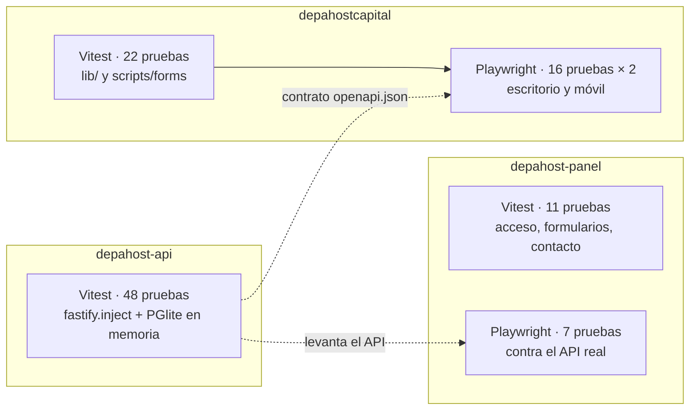
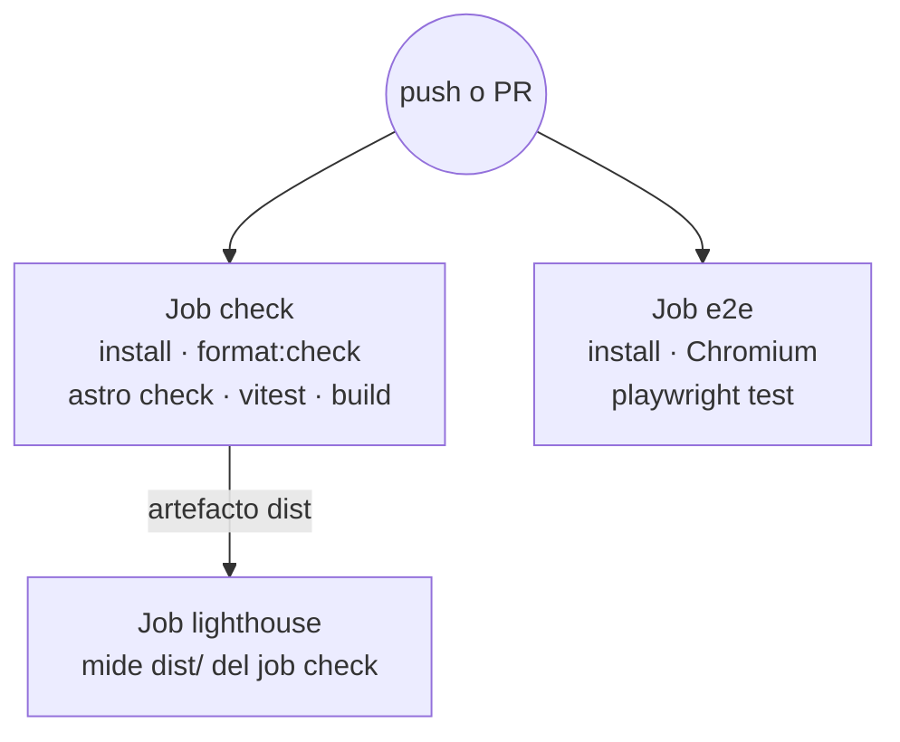
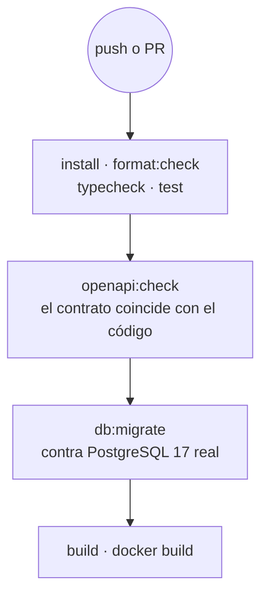

# 06 · Desarrollo y operación

## 1. Requisitos

- Node 22.12 o superior y pnpm 11 (los dos repos fijan `packageManager`).
- Para el API en producción: PostgreSQL 16 o superior. En desarrollo no hace falta: se usa PGlite.
- Los dos repos deben estar lado a lado para que `pnpm api:sync` encuentre el contrato:

```text
DepaHost/
├── depahostcapital/   frontend
└── depahost-api/      API
```

## 2. Levantar el proyecto

### Opción A · Solo el sitio, con datos locales

Es lo más rápido para trabajar en diseño o contenido.

```bash
pnpm install
```

```bash
pnpm dev
```

El sitio abre en `http://localhost:4321` con `src/content/*.json`. Los formularios ofrecen
WhatsApp porque no hay API.

### Opción B · Sitio + API falsa (mock)

Sirve para probar formularios sin levantar el API real.

```bash
pnpm api:mock
```

En `.env` del frontend: `PUBLIC_API_URL=http://127.0.0.1:4010`. Prism responde ejemplos que
cumplen el contrato.

### Opción C · Plataforma completa en local

En `depahost-api`:

```bash
cp .env.example .env
```

```bash
pnpm install
```

```bash
pnpm db:seed
```

```bash
pnpm dev
```

El API queda en `http://127.0.0.1:3000`, con documentación en `/docs`. Para usar rutas de
administración, define `ADMIN_API_KEY` en su `.env` (mínimo 32 caracteres).

En `depahostcapital/.env`:

```text
API_URL=http://127.0.0.1:3000
PUBLIC_API_URL=http://127.0.0.1:3000
```

Y en `depahost-api/.env`, `CORS_ORIGINS` debe incluir `http://localhost:4321`.

### Opción D · Con el panel y cuentas

Con el API corriendo como en la opción C:

```bash
pnpm --dir ../depahost-api user:create --email tu@correo.com --name "Tu nombre" --role admin
```

```bash
pnpm --dir ../depahost-panel dev
```

El panel abre en `http://localhost:5173`. En el `.env` del sitio agrega
`PUBLIC_PANEL_URL=http://localhost:5173` para ver "Ingresar". **Usa `localhost` en todas las URLs,
nunca `127.0.0.1`**: si no, la cookie de sesión no se comparte entre sitio, panel y API.

### Arranque en segundo plano

Astro 7 detecta cuando lo ejecuta un agente y pasa el servidor a segundo plano. Los comandos
`astro dev --background`, `astro dev status`, `astro dev logs` y `astro dev stop` lo controlan.
Para forzar primer plano, por ejemplo en Playwright, se usa `--ignore-lock`.

## 3. Comandos

### Frontend

| Comando | Qué hace |
|---|---|
| `pnpm dev` | Servidor de desarrollo |
| `pnpm build` / `pnpm preview` | Build de producción y vista previa |
| `pnpm check` | Tipos de TypeScript y de los `.astro` |
| `pnpm test` | Pruebas unitarias |
| `pnpm test:e2e` | Pruebas en navegador (construye y sirve el sitio solo) |
| `pnpm format` / `pnpm format:check` | Prettier |
| `pnpm api:sync` | Copia el contrato y regenera tipos |
| `pnpm api:types` | Solo regenera tipos desde `openapi/depahost-api.json` |
| `pnpm api:mock` | API falsa con Prism |

### API

Ver [03 · API, sección 9](03-api.md#9-scripts).

## 4. Pruebas



### Unitarias del frontend (`tests/unit`)

| Archivo | Prueba |
|---|---|
| `format.test.ts` | Moneda, rentabilidad, plazos, normalización, disclaimer con y sin supuestos |
| `filters.test.ts` | Búsqueda con y sin tildes, filtros combinados, chips derivados |
| `saved-store.test.ts` | Agregar, quitar, alternar, `touch`, máximo, datos corruptos, eventos entre pestañas |
| `recommend.test.ts` | Similares, sin historial, no repetir guardados, lo nuevo antes que lo visto |
| `profile.test.ts` | Primer nombre, enfriamiento de 7 días del aviso |
| `forms.test.ts` | `formToObject`: anidado, tipos, vacíos, deshabilitados, token de Turnstile |

### En navegador (`tests/e2e`)

Construyen el sitio con `PUBLIC_API_URL=https://api.test.local` y responden esas llamadas con
`page.route()`. No necesitan el API real.

| Archivo | Recorre |
|---|---|
| `capital.spec.ts` | Filtros y "Limpiar filtros", anclas, "Para ti" tras ver un depa, detalle con similares, Contactar, página de Urbana con Buscar y contador, 404 |
| `mis-depas.spec.ts` | Recorrido completo: Me interesa → Guarda tus depas → Mis depas → Te acompañamos → WhatsApp; redirección `/carrito`; "Seguir viendo" |
| `forms.spec.ts` | Formulario en inglés (éxito y errores por campo), Libro de Reclamaciones, Propietarios (vender y `#alquiler`), banner de cookies |

### API (`depahost-api/test`)

| Archivo | Prueba |
|---|---|
| `properties.test.ts` | Visibilidad por estado, filtros, errores de validación, detalle, opciones de filtro, admin, slugs únicos, rebuild, fotos, financiamiento |
| `developers.test.ts` | Inmobiliarias y conteo, origen y filtros, proyecto sin inmobiliaria, cambio de origen, duplicados, lead `saved-list` |
| `leads.test.ts` | Lead completo con avisos, reglas de contacto, captcha, `cart` anónimo, honeypot, límite por minuto, CORS, health |
| `complaints.test.ts` | Códigos correlativos y constancia, menores de edad, respuesta del admin, días hábiles en hora de Lima |
| `accounts.test.ts` | Registro y cookie, roles permitidos, login sin revelar cuentas, cierre de sesión, CSRF, perfil, cambio y restablecimiento de contraseña, Mis depas de la cuenta, leads vinculados |
| `owner-requests.test.ts` | Solo propietarios, ciclo enviada → revisión → publicada con avisos e interés, solicitudes ajenas, subida no configurada |
| `admin-panel.test.ts` | Acceso con sesión o clave, indicadores del resumen, usuarios y roles, embudo de leads |

Las pruebas del API corren como máximo dos archivos a la vez (`maxWorkers: 2`): cada uno usa
cerca de 1 GB entre PGlite y scrypt.

### Panel (`depahost-panel/tests`)

| Archivo | Prueba |
|---|---|
| `unit/access.test.ts` | Reglas de acceso por rol, inicio de cada rol, "volver" solo a rutas internas |
| `unit/contact.test.ts` | Links de WhatsApp a celulares peruanos, días hasta un plazo en hora de Lima |
| `unit/use-form.test.ts` | Errores por campo del API, mensajes, campos numéricos |
| `e2e/panel.spec.ts` | Sin sesión, comprador, propietario, administración completa, propietario publicado, menú en teléfono, cierre de sesión |

Las pruebas de punta a punta del panel levantan el API desde `../depahost-api` con una base PGlite
nueva y un admin de prueba, y construyen el panel apuntando a ese API.

## 5. Integración continua (GitHub Actions)

Corre en cada push a `main` y en cada pull request.

**Frontend** (`depahostcapital/.github/workflows/ci.yml`):



**API** (`depahost-api/.github/workflows/ci.yml`):



**Panel** (`depahost-panel/.github/workflows/ci.yml`): formato, tipos, pruebas y build; y un job
de punta a punta que descarga también `depahost-api` (secreto `API_REPO_TOKEN` si es privado).

Umbrales de Lighthouse (`lighthouserc.json`): accesibilidad 95 y SEO 90 hacen fallar; rendimiento
90 y buenas prácticas 90 solo advierten. Se miden `/` y `/capital`.

## 6. Publicar en producción

### Primera vez

1. **Base de datos:** crear un PostgreSQL gestionado.
2. **API:** crear la app desde el repo `depahost-api` (usa el `Dockerfile`) con `NODE_ENV=production`
   y todas las variables de [03 · API, sección 7](03-api.md#7-configuración). Al arrancar aplica
   las migraciones.
3. **Dominio del API:** apuntar `api.depahostperu.com` a la app.
4. **Datos:** cargar inmobiliarias, distritos, depas, fotos y supuestos con las rutas de admin
   (o `pnpm db:seed` solo para una demo).
5. **Frontend:** crear el sitio en el hosting desde `depahostcapital`, con comando `pnpm build`,
   carpeta de salida `dist` y las variables de [02 · Frontend, sección 9](02-frontend.md#9-variables-de-entorno).
6. **Deploy hook:** crearlo en el hosting y ponerlo en `DEPLOY_HOOK_URL` del API.
7. **CORS:** `CORS_ORIGINS=https://depahostperu.com` en el API.
8. **Turnstile:** registrar el dominio y poner la clave pública en el sitio y la secreta en el API.
9. **Resend:** verificar el dominio con sus registros DNS y poner la clave en el API.
10. **Panel:** importar `depahost-panel` en Vercel (ya trae `vercel.json`), definir `VITE_API_URL`,
    `VITE_SITE_URL` y `VITE_TURNSTILE_SITE_KEY`, y asignar `app.depahostperu.com`.
11. **Cuentas:** en el API, `COOKIE_DOMAIN=.depahostperu.com`, `PANEL_URL=https://app.depahostperu.com`
    y agregar el panel a `CORS_ORIGINS`. En el sitio, `PUBLIC_PANEL_URL=https://app.depahostperu.com`.
12. **Primer administrador:** `pnpm user:create --email … --name … --role admin` en el API.

### Cada cambio

| Cambio | Qué hacer | Se publica |
|---|---|---|
| Código del sitio | Merge a `main` | El hosting reconstruye solo |
| Código del API | Merge a `main` | El proveedor despliega la nueva imagen |
| Un depa, foto, inmobiliaria o supuesto | Rutas de admin | El deploy hook reconstruye el sitio en unos 30 s + el tiempo del build |
| El contrato del API | API primero, luego `pnpm api:sync` en el sitio | En ese orden |

### Antes de publicar, revisar

- [ ] `PUBLIC_WHATSAPP_NUMBER` real (hoy `51XXXXXXXXX`).
- [ ] Razón social, RUC y dirección en `src/data/empresa.ts` y `COMPANY_*` del API.
- [ ] Privacidad y términos revisados por un abogado.
- [ ] Datos de ejemplo reemplazados (ver [04 · Datos, sección 5](04-datos.md#5-datos-de-ejemplo-demostración)).
- [ ] Inmobiliarias reales, con permiso para usar su nombre y logo.
- [ ] `NOTIFY_EMAIL` apuntando a un buzón que alguien revise: ahí llegan los reclamos.

## 7. Monitoreo

| Qué | Dónde |
|---|---|
| ¿El API responde y la base también? | `GET /health` (también lo usa el `HEALTHCHECK` del Dockerfile) |
| Errores del API | Logs del proveedor (JSON de Pino) y Sentry si hay `SENTRY_DSN` |
| Errores del navegador | Sentry si hay `PUBLIC_SENTRY_DSN` |
| Uso del sitio | Microsoft Clarity, solo de quienes aceptan cookies |
| Leads y reclamos | `GET /v1/admin/leads`, `GET /v1/admin/complaints?status=pending` y el correo de `NOTIFY_EMAIL` |

## 8. Problemas conocidos y soluciones

| Síntoma | Causa | Solución |
|---|---|---|
| En desarrollo, un script falla con "504 Outdated Optimize Dep" | Vite optimizó una dependencia nueva después de cargar la página | Recargar o reiniciar `pnpm dev`. `openapi-fetch` ya está en `vite.optimizeDeps.include` |
| Playwright dice que el servidor "terminó antes de tiempo" | Astro pasó `astro preview` a segundo plano | El comando ya usa `--ignore-lock` |
| `pnpm openapi:export` no termina | PGlite no cierra si nunca se usó | El script ya no abre base de datos |
| El build falla con un error de esquema | El API cambió de forma | Correr `pnpm api:sync` y ajustar `content.config.ts` |
| Un cambio en el admin no aparece | Falta `DEPLOY_HOOK_URL` o el build falló | Revisar el log del API y el historial de builds del hosting |
| Los formularios dicen "por ahora por WhatsApp" | Falta `PUBLIC_API_URL` en el build | Definirla y reconstruir |
| El navegador bloquea las llamadas al API | El origen no está en `CORS_ORIGINS` | Agregarlo en el API |
