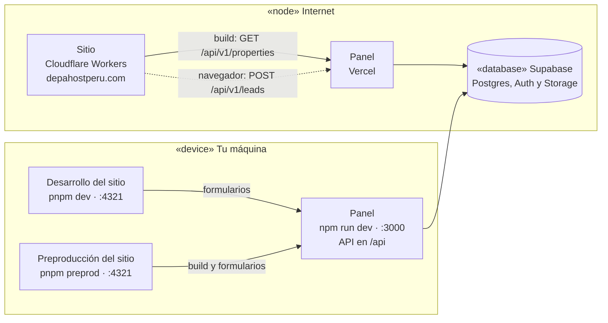
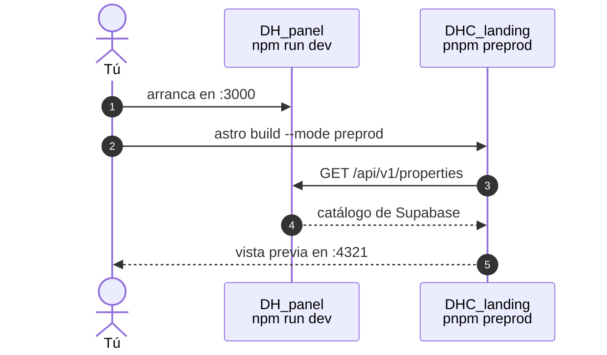
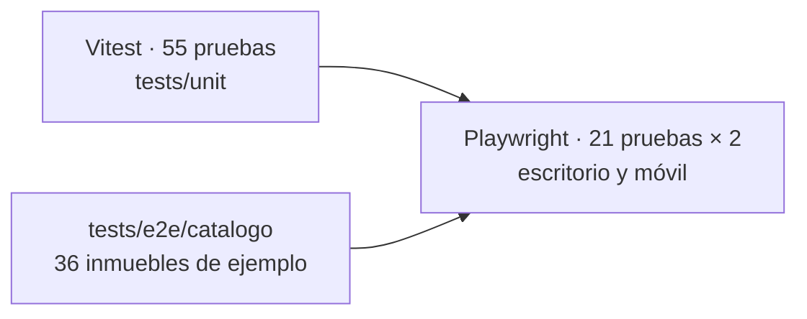
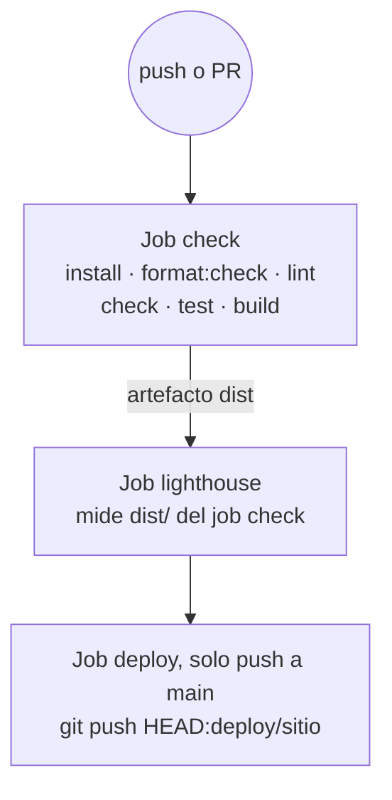

# 06 · Desarrollo y operación

## 1. Requisitos

- Node 24 (`.nvmrc`; `nvm install 24` y luego `nvm use` en la raíz). Node 22.12 también funciona
  (`engines` en `package.json`), pero la CI valida con la 24.
- pnpm 11 para el sitio. `package.json` lo fija con `packageManager` (`pnpm@11.24.0`).
- Dos repos hermanos, clonados lado a lado:

```text
DepaHost/
├── DHC_landing/   sitio Astro, 100 % estático (este repo)
└── DH_panel/      panel de DepaHost: CRM interno y backend del sitio (Next.js + Supabase)
```

El panel usa npm y necesita su propio proyecto de Supabase. Cómo instalarlo y correrlo está en
`DH_panel/README.md`; este capítulo no lo repite.

## 2. Entornos

Desarrollo y preproducción del sitio corren en tu máquina. Para ver inmuebles o enviar formularios
necesitan el panel encendido en `http://localhost:3000`. Producción corre en internet.



| | Desarrollo | Preproducción | Producción |
|---|---|---|---|
| Para qué | Programar, con recarga automática | Probar tal cual el build que se publica | El sitio real |
| Sitio | `pnpm dev` en `:4321` | `pnpm preprod`: build + vista previa en `:4321` | Cloudflare Workers, `depahostperu.com` |
| Panel | `npm run dev` en `:3000` | `npm run dev` en `:3000` | Vercel |
| Catálogo (`API_URL`) | Vacío: sin inmuebles. O `http://localhost:3000/api` | `http://localhost:3000/api` | `https://<dominio del panel>/api` |
| Formularios (`PUBLIC_API_URL`) | `http://localhost:3000/api` | `http://localhost:3000/api` | `https://<dominio del panel>/api` |
| Turnstile | Apagado | Clave de prueba (siempre pasa) | Clave real |
| Cambios de inmuebles | Reiniciar `pnpm dev` | Volver a correr `pnpm preprod` | "Actualizar web" en el panel (deploy hook) |
| Configuración | `.env` | `.env.preprod` | Variables del Worker en Cloudflare |

Desarrollo y preproducción usan el mismo puerto: se corre uno o el otro, no los dos a la vez.

### Archivos de configuración

| Archivo | Entorno | En git |
|---|---|---|
| `.env.example` → copiar como `.env` | Desarrollo | Solo el ejemplo |
| `.env.preprod.example` → copiar como `.env.preprod` | Preproducción | Solo el ejemplo |
| `.env.production.example` | Producción: lista de lo que va en Cloudflare | Sí, sin valores reales |

Los `.env` y `.env.preprod` reales nunca se suben. `--mode preprod` hace que Astro cargue
`.env.preprod` encima de `.env`.

| Variable | Para qué |
|---|---|
| `PUBLIC_WHATSAPP_NUMBER` | Número de WhatsApp (por defecto `51981352247` en `astro.config.mjs`) |
| `PUBLIC_API_URL` | Base del API a la que el navegador envía los formularios. Vacía: ofrecen WhatsApp |
| `API_URL` | Base del API de la que el build lee los inmuebles. No llega al navegador |
| `PUBLIC_MEDIA_HOST` | Dominio de Supabase del panel, para que el build optimice las fotos |
| `PUBLIC_TURNSTILE_SITE_KEY` | Clave pública de Turnstile |
| `PUBLIC_CLARITY_ID`, `PUBLIC_SENTRY_DSN` | Analítica y errores del navegador (opcionales) |
| `PUBLIC_MAP_TILE_URL`, `PUBLIC_MAP_ATTRIBUTION` | Mosaicos del mapa. Vacías: OpenStreetMap |
| `CATALOG_DIR` | Solo pruebas e2e: carpeta del catálogo de ejemplo |

## 3. Desarrollo

### Primera vez

1. Prepara y levanta el panel según `DH_panel/README.md` (`npm run dev`, `http://localhost:3000`).
2. En `DHC_landing`:

```bash
cp .env.example .env
```

```bash
pnpm install
```

### Cada día

| Repo | Comando | Abre |
|---|---|---|
| `DH_panel` | `npm run dev` | `http://localhost:3000` |
| `DHC_landing` | `pnpm dev` | `http://localhost:4321` |

### Variantes

| Quiero… | Cambia en el `.env` del sitio |
|---|---|
| Trabajar solo en el sitio, sin panel | `PUBLIC_API_URL=` vacío: los formularios ofrecen WhatsApp. El sitio no tiene inmuebles |
| Probar formularios sin panel | `pnpm api:mock` y `PUBLIC_API_URL=http://127.0.0.1:4010` |
| Ver los inmuebles del panel | `API_URL=http://localhost:3000/api` y `PUBLIC_MEDIA_HOST` con el dominio de Supabase. El panel debe estar encendido |
| Ver el sitio con el catálogo de ejemplo | `CATALOG_DIR=tests/e2e/catalogo pnpm dev` (36 inmuebles y 5 aliadas de prueba) |

### Arranque en segundo plano

Astro 7 detecta cuando lo ejecuta un agente y pasa el servidor a segundo plano. Los comandos
`astro dev --background`, `astro dev status`, `astro dev logs` y `astro dev stop` lo controlan.
Para forzar primer plano, por ejemplo en Playwright, se usa `--ignore-lock`.

## 4. Preproducción

Es el mismo build que va a producción, con el catálogo leído del panel local y la clave de prueba de
Turnstile.

### Primera vez

```bash
cp .env.preprod.example .env.preprod
```

Completa `PUBLIC_MEDIA_HOST` con el dominio de Supabase que usa tu panel local (sin `https://`).

### Levantarla

El orden importa, porque el build del sitio lee el panel:



### Qué revisar

- [ ] El sitio muestra los inmuebles En cartera del panel, con sus fotos.
- [ ] Enviar un formulario: aparece el widget de Turnstile y el lead llega al panel con canal Web.
- [ ] Un inmueble editado en el panel aparece después de volver a correr `pnpm preprod`. En local no
  hay deploy hook.

Para que el panel acepte los formularios, `WEB_ORIGINS` del panel debe incluir `http://localhost:4321`.

## 5. Comandos

| Comando | Qué hace |
|---|---|
| `pnpm dev` | Servidor de desarrollo en `:4321` |
| `pnpm build` / `pnpm preview` | Build de producción y vista previa |
| `pnpm build:preprod` / `pnpm preprod` | Build con `.env.preprod` y vista previa en `:4321` |
| `pnpm check` | Tipos de TypeScript y de los `.astro` |
| `pnpm lint` / `pnpm lint:fix` | ESLint (antes corre `astro sync`) |
| `pnpm format` / `pnpm format:check` | Prettier |
| `pnpm test` / `pnpm test:watch` | Pruebas unitarias |
| `pnpm test:e2e` | Pruebas en navegador (construye y sirve el sitio solo) |
| `pnpm api:types` | Regenera `src/lib/api/schema.d.ts` desde `openapi/depahost-api.json` |
| `pnpm api:mock` | API falsa con Prism en `http://127.0.0.1:4010` |

Los comandos del panel están en `DH_panel/README.md`.

## 6. Pruebas



### Unitarias (`tests/unit`)

Prueban `src/lib` (`facts`, `filters`, `format`, `media`, `profile`, `recommend`, `saved-store`) y
`src/scripts/forms`. No necesitan navegador ni red.

### En navegador (`tests/e2e`)

La primera vez hay que instalar el navegador de Playwright:

```bash
pnpm exec playwright install chromium
```

`pnpm test:e2e` construye el sitio y lo sirve con `astro preview` en el puerto 4329. Corre cada
prueba en escritorio (Desktop Chrome) y en móvil (Pixel 7). `playwright.config.ts` fija las variables
para que el `.env` de cada máquina no cambie el resultado:

- `PUBLIC_API_URL=https://api.test.local`: un dominio falso. Cada prueba responde esas llamadas con
  `mockApi` (`tests/e2e/fixtures.ts`), que usa `page.route()`. No hace falta el panel.
- `API_URL` vacío y `CATALOG_DIR=tests/e2e/catalogo`: el build lee el catálogo de ejemplo de las
  pruebas, con 12 inmuebles de propietarios y 24 proyectos de 5 aliadas, y sus fotos en
  `tests/e2e/catalogo/fotos`. Ese catálogo existe solo para las pruebas.

| Archivo | Recorre |
|---|---|
| `capital.spec.ts` | Filtros, anclas, menú, detalle y galería, Contactar, Todos los inmuebles (orden, páginas de 12), página de una aliada, 404 |
| `mis-inmuebles.spec.ts` | Me interesa → Guarda tus inmuebles → Mis inmuebles → WhatsApp; redirecciones viejas con sus filtros; "Seguir viendo" |
| `forms.spec.ts` | Propietarios (errores por campo, vender, `#alquiler`), Libro de Reclamaciones con respuesta simulada, banner de cookies |

## 7. Integración continua (GitHub Actions)

`.github/workflows/ci.yml` corre en cada pull request y en cada push a `main`. Usa Node 24 y las
acciones `actions/checkout@v7`, `actions/setup-node@v7`, `pnpm/action-setup@v6`,
`actions/upload-artifact@v7` y `actions/download-artifact@v8`.



- El job `check` guarda en caché `node_modules/.astro` (fotos ya optimizadas) para que el build no
  tarde minutos.
- El job `deploy` empuja sin `--force`: si una ejecución vieja termina después de una nueva, falla
  en vez de volver atrás.
- Las pruebas e2e no corren en la CI: se corren a mano con `pnpm test:e2e`.
- Lighthouse (`lighthouserc.json`) mide `/` y `/capital`. Accesibilidad 95 y SEO 90 hacen fallar;
  rendimiento 90 y buenas prácticas 90 solo advierten.

## 8. Publicar en producción

### Hostings

| App | Hosting | Dominio |
|---|---|---|
| Sitio | Cloudflare Workers con archivos estáticos (Workers Builds) | `depahostperu.com` |
| Panel | Vercel (ver `DH_panel/README.md`) | El del panel |
| Base, autenticación y fotos | Supabase del panel | — |

### Sitio en Cloudflare Workers

`wrangler.jsonc` define el Worker `depahost-monorepo`: sirve `./dist` y responde `404.html` con
estado 404 a las rutas que no existen. No hay código de servidor.

| Ajuste de Workers Builds | Valor |
|---|---|
| Rama de producción | `deploy/sitio` |
| Build command | `pnpm build` |
| Deploy command | `npx wrangler deploy` |
| Variables (Settings → Build → Variables and secrets) | Las de `.env.production.example` |

Variables de producción:

| Variable | Valor |
|---|---|
| `PNPM_VERSION` | `11.24.0` (sin ella Cloudflare usa otra versión) |
| `PUBLIC_WHATSAPP_NUMBER` | `51` y el número, sin `+` ni espacios |
| `PUBLIC_CLARITY_ID` | ID de Microsoft Clarity |
| `PUBLIC_API_URL` y `API_URL` | `https://<dominio del panel>/api` |
| `PUBLIC_TURNSTILE_SITE_KEY` | Site key de Turnstile |
| `PUBLIC_SENTRY_DSN` | Opcional |
| `PUBLIC_MEDIA_HOST` | `<proyecto>.supabase.co` |

- **Se publica después de las validaciones.** Workers Builds sigue `deploy/sitio`, no `main`. Esa
  rama solo la mueve el job `deploy` de la CI. Nadie hace push a mano.
- **Guardia `WORKERS_CI`:** Workers Builds define `WORKERS_CI=1`. Con ella, `astro.config.mjs` hace
  fallar el build si faltan `API_URL` o `PUBLIC_MEDIA_HOST`: sin ellas el sitio saldría sin inmuebles
  o con fotos que caducan a las 6 horas.
- **Cabeceras:** `public/_headers` pone `X-Frame-Options`, `nosniff`, `Referrer-Policy`, HSTS de un
  año, caché inmutable para `/_astro/*` y `noindex` en `*.workers.dev`.
- **Deploy hook:** se crea en el Worker (Settings → Builds → Deploy Hooks) para la rama
  `deploy/sitio`. Su URL va en `CLOUDFLARE_DEPLOY_HOOK_URL` del panel, que la llama con POST al
  presionar "Actualizar web". La URL es la credencial: se trata como un secreto.
- **En el panel:** `WEB_ORIGINS` con los orígenes del sitio (por ejemplo `https://depahostperu.com`)
  y `TURNSTILE_SECRET_KEY` con la clave secreta del mismo widget.

### Base de datos en Supabase

Supabase es del panel: base, autenticación y fotos (bucket `inmuebles`). Su configuración está en
`DH_panel/README.md`. El sitio solo necesita su dominio en `PUBLIC_MEDIA_HOST`.

### Cada cambio

| Cambio | Qué hacer | Se publica |
|---|---|---|
| Código del sitio | Merge a `main` | Si la CI pasa, mueve `deploy/sitio` y Workers Builds publica |
| Un inmueble o sus fotos | Panel y luego "Actualizar web" | Unos 2 minutos (ver [05 · Flujos](05-flujos.md#3-publicar-o-editar-un-inmueble)) |
| El contrato del API | `openapi/depahost-api.json`, `pnpm api:types` y luego `DH_panel` | Ver [05 · Flujos](05-flujos.md#12-cambiar-el-contrato-del-api) |

### Antes de publicar, revisar

- [ ] `PUBLIC_WHATSAPP_NUMBER` confirmado.
- [ ] Razón social, RUC y dirección en `src/data/empresa.ts` (hoy "[pendiente]" en el footer).
- [ ] Privacidad y términos revisados por un abogado.
- [ ] Libro de Reclamaciones: falta `POST /v1/complaints` en el panel.
- [ ] Inmobiliarias aliadas reales, con permiso para usar su nombre y logo.
- [ ] `WEB_ORIGINS`, `TURNSTILE_SECRET_KEY` y `CLOUDFLARE_DEPLOY_HOOK_URL` definidas en el panel.

## 9. Monitoreo

| Qué | Dónde |
|---|---|
| Builds y publicaciones del sitio | Historial de Workers Builds en Cloudflare y jobs de GitHub Actions |
| Errores del navegador | Sentry si hay `PUBLIC_SENTRY_DSN`; el entorno es el modo del build (`production` o `preprod`) |
| Uso del sitio | Microsoft Clarity, solo de quienes aceptan cookies |
| Leads | Panel de DepaHost (canal Web) |
| Panel y base | Logs de Vercel y panel de Supabase |

## 10. Problemas conocidos y soluciones

| Síntoma | Causa | Solución |
|---|---|---|
| El build de Cloudflare dice "Faltan variables de entorno en Cloudflare" | Falta `API_URL` o `PUBLIC_MEDIA_HOST` | Definirlas en el Worker y volver a construir |
| El build falla con `fetch failed` | El panel no responde (en local: no está encendido) | `npm run dev` en `DH_panel` antes de construir el sitio |
| El build falla con un error de esquema | La respuesta del panel cambió de forma | Ajustar el contrato y `content.config.ts` (ver [05 · Flujos](05-flujos.md#12-cambiar-el-contrato-del-api)) |
| El sitio no tiene inmuebles | `API_URL` vacío: `src/content/properties.json` está vacío | Definir `API_URL`, o `CATALOG_DIR=tests/e2e/catalogo` para ver el catálogo de prueba |
| Las fotos dejan de verse horas después del build | Falta `PUBLIC_MEDIA_HOST`: quedan las URLs firmadas, que caducan a las 6 horas | Definirla y reconstruir |
| Un cambio del panel no aparece | No se presionó "Actualizar web", falta `CLOUDFLARE_DEPLOY_HOOK_URL` o el build falló | Revisar el mensaje del panel y el historial de Workers Builds |
| Un cambio no aparece aunque el build pasó | El panel responde con `s-maxage=300` y el build leyó el catálogo anterior | Esperar 5 minutos y "Actualizar web" otra vez |
| Los formularios dicen "por ahora por WhatsApp" | Falta `PUBLIC_API_URL` en el build | Definirla y reconstruir |
| El navegador bloquea las llamadas al panel | El origen del sitio no está en `WEB_ORIGINS` | Agregarlo en el panel |
| El Libro de Reclamaciones muestra error | El panel no implementa `POST /v1/complaints` | Pendiente; mientras tanto el formulario ofrece WhatsApp |
| Playwright dice que falta el ejecutable del navegador | Chromium de Playwright no está instalado | `pnpm exec playwright install chromium` |
| Playwright dice que el servidor "terminó antes de tiempo" | Astro pasó `astro preview` a segundo plano | El comando ya usa `--ignore-lock` |
| En desarrollo, un script falla con "504 Outdated Optimize Dep" | Vite optimizó una dependencia nueva después de cargar la página | Recargar o reiniciar `pnpm dev`. `openapi-fetch` y `leaflet` ya están en `vite.optimizeDeps.include` |
