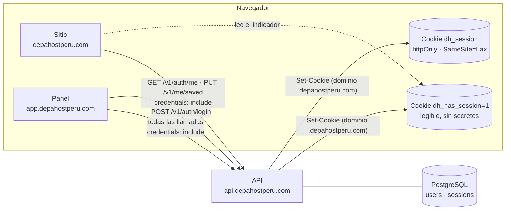
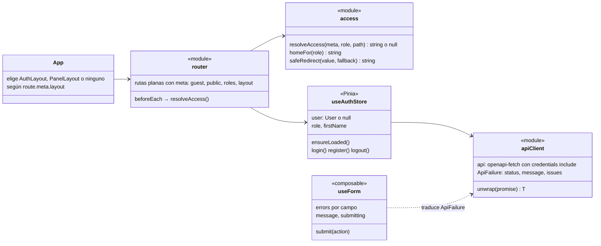
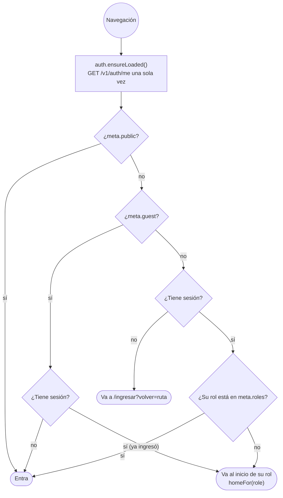
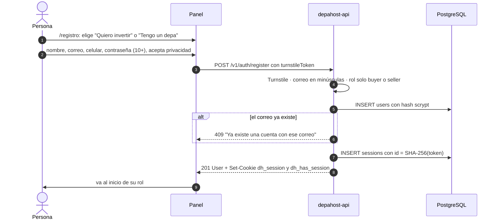
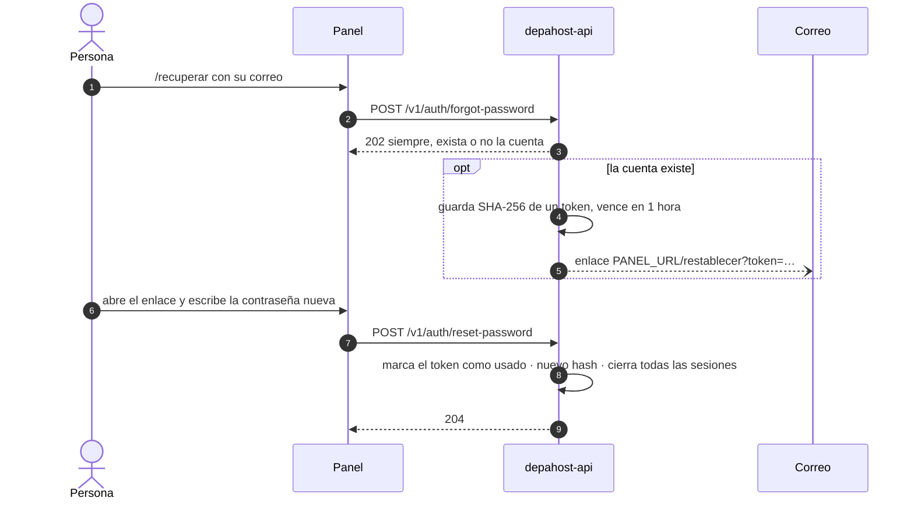
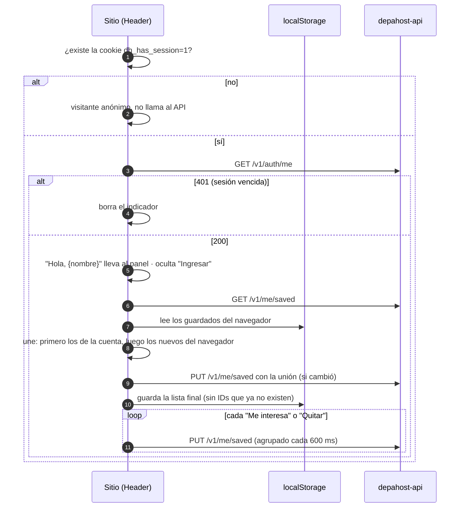
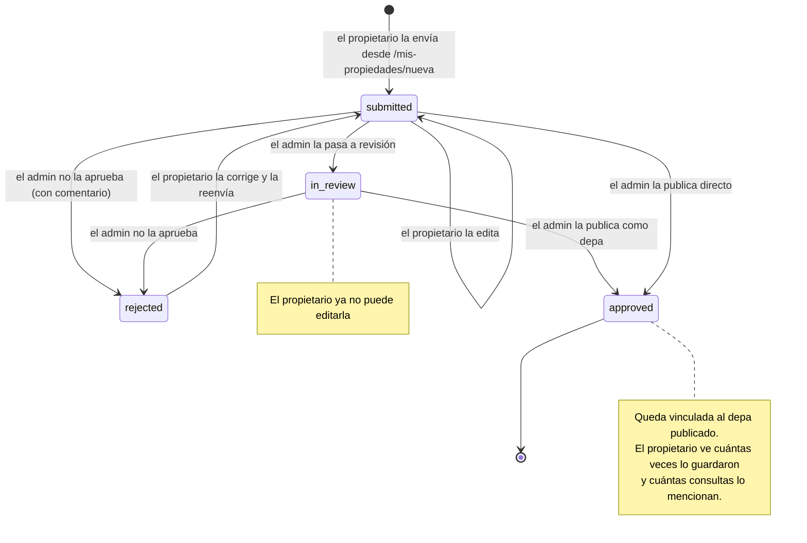
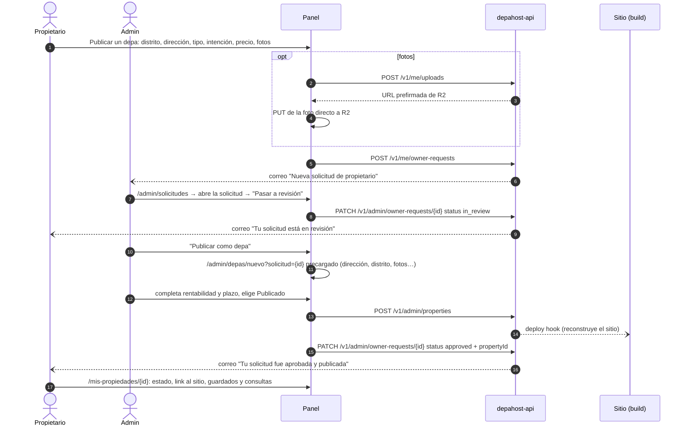

# 08 · Panel y cuentas

Desde esta etapa la plataforma tiene **cuentas de usuario** y un **panel** para tres roles. El panel
es una app Vue en su propio repo, `depahost-panel`, servida en `app.depahostperu.com`.

| Rol | Valor en el API | Qué hace en el panel |
|---|---|---|
| Comprador | `buyer` | Mis depas (sincronizado con el sitio), Mis consultas, Perfil |
| Propietario | `seller` | Publicar su depa, seguir la revisión y el interés que genera, más lo del comprador |
| Administrador | `admin` | Resumen, depas, solicitudes de propietarios, leads, reclamos, inmobiliarias, usuarios y configuración |

## 1. Las tres apps y la sesión



- **La sesión la crea el panel y la guarda el API** en la cookie `dh_session`. JavaScript no puede
  leerla (`httpOnly`), así que un script malicioso no puede robarla.
- **El dominio de la cookie es `.depahostperu.com`** (`COOKIE_DOMAIN`). Así la reciben el sitio, el
  panel y el API.
- **El sitio no consulta al API en cada visita anónima.** Solo pregunta "¿quién es?" si existe la
  cookie `dh_has_session=1`, que el API crea y borra junto con la sesión.
- **En la base solo se guarda el SHA-256 del token** de sesión. Si alguien lee la base, no puede
  usar las sesiones.

## 2. Estructura del panel

```text
depahost-panel/
├── index.html, vite.config.ts
├── public/_headers         cabeceras de Cloudflare Pages
├── scripts/sync.mjs        sync:brand (identidad del sitio) y sync:api (contrato)
├── src/
│   ├── main.ts, App.vue     arranque; App elige el layout según la ruta
│   ├── api/                 cliente tipado y schema.d.ts generado del contrato
│   ├── brand/               ⚠️ copiado del sitio: icons.ts, format.ts, distritos.ts
│   ├── styles/brand/        ⚠️ copiado del sitio: tokens.css, global.css
│   ├── styles/panel.css     lo propio del panel: tarjetas, tablas, insignias
│   ├── router/              rutas, reglas de acceso (access.ts) y menú por rol (nav.ts)
│   ├── stores/auth.ts       sesión (Pinia)
│   ├── composables/         useForm, useToast, textos y helpers de contacto
│   ├── layouts/             AuthLayout (ingresar) y PanelLayout (menú lateral)
│   ├── components/          AppIcon, AppLogo, PageHeader, StatCard, StatusBadge, AppDialog…
│   └── views/               auth/, account/, buyer/, seller/, admin/
└── tests/unit, tests/e2e
```

### Módulos (UML de clases)



## 3. Rutas y acceso

| Ruta | Rol | Pantalla |
|---|---|---|
| `/ingresar`, `/registro`, `/recuperar` | Sin sesión | Ingreso, registro (elige comprador o propietario), recuperar contraseña |
| `/restablecer?token=` | Cualquiera | Contraseña nueva desde el correo |
| `/` | Con sesión | Lleva al inicio de su rol |
| `/mis-depas`, `/mis-consultas`, `/perfil` | Cualquier rol | Cuenta |
| `/mis-propiedades`, `/mis-propiedades/nueva`, `/mis-propiedades/:id`, `/:id/editar` | Propietario o admin | Sus solicitudes |
| `/admin`, `/admin/depas`, `/admin/depas/nuevo`, `/admin/depas/:id` | Admin | Resumen y catálogo |
| `/admin/solicitudes`, `/admin/solicitudes/:id` | Admin | Revisión de propietarios |
| `/admin/leads`, `/admin/reclamos`, `/admin/inmobiliarias`, `/admin/usuarios`, `/admin/configuracion` | Admin | Gestión |



Inicio de cada rol: comprador → `/mis-depas`, propietario → `/mis-propiedades`, admin → `/admin`.
`volver` solo acepta rutas internas: un link `?volver=https://otro-sitio` no redirige afuera.

**La seguridad real está en el API.** El panel oculta lo que no corresponde, pero cada endpoint
vuelve a comprobar la sesión y el rol.

## 4. Flujos de cuenta

### Crear cuenta e ingresar



`POST /v1/auth/login` hace lo mismo sin crear la cuenta. Si el correo no existe, verifica
igual contra un hash de relleno: la respuesta tarda lo mismo y dice lo mismo, así no revela qué
correos tienen cuenta.

### Recuperar la contraseña



### Mis depas: del navegador a la cuenta



El panel lee la misma lista con `GET /v1/me/saved` y los datos de cada depa con
`GET /v1/properties?ids=`. Quitar un depa en el panel hace `PUT` sin ese ID.

Los leads que se envían con sesión iniciada (Guarda tus depas, Te acompañamos, formularios)
quedan vinculados a la cuenta y aparecen en **Mis consultas** con su estado.

## 5. Solicitudes de propietarios

### Estados (UML)



Cada cambio de estado envía un correo al propietario con el comentario del equipo.

### Del envío a la publicación



## 6. Pantallas de administración

| Pantalla | Qué muestra | Acciones |
|---|---|---|
| Resumen | Leads sin contactar, reclamos pendientes y por vencer, solicitudes por revisar, depas publicados, cuentas por rol | Ir a cada lista |
| Depas | Todo el catálogo con búsqueda y filtros por estado y origen | Crear, editar, borrar, ver en el sitio |
| Formulario de depa | Ubicación y origen, números, presentación y fotos (con orden y portada) | Guardar como borrador o publicar |
| Solicitudes | Por estado, con datos del propietario | Pasar a revisión, publicar como depa, no aprobar con comentario, escribir por WhatsApp |
| Leads | Por estado y origen, con contacto y detalle desplegable | Mover por el embudo: sin contactar, en conversación, cerrado |
| Reclamos | Pendientes primero, con plazo y alerta de vencidos | Leer la hoja completa y responder por correo |
| Inmobiliarias | Nombre, descripción y proyectos | Crear y editar |
| Usuarios | Búsqueda por nombre o correo y filtro por rol | Cambiar el rol (nunca el propio) |
| Configuración | Supuestos de financiamiento con vista previa del texto del sitio, y distritos | Agregar supuestos y distritos |

## 7. Identidad visual

El panel usa el sistema de diseño del sitio, copiado con `pnpm sync:brand`:

| Del sitio | En el panel |
|---|---|
| `src/styles/tokens.css` | Colores, tipografías, espacios, radios, sombras |
| `src/styles/global.css` | `.btn`, `.form`, `.display`, `.eyebrow`, `.form-status`, `.sr-only` |
| `src/lib/icons.ts` | `AppIcon.vue` con los mismos trazos |
| `src/lib/format.ts` | Moneda, rentabilidad, años, fechas, nota de financiamiento |
| `src/data/distritos.ts` | Selector de distrito del propietario |
| `Logo.astro` | `AppLogo.vue` (copia manual del SVG) |

Decisiones visuales propias del panel: menú lateral blanco con el ítem activo en azul marino
claro y una barra a la izquierda; títulos de página en serif como Capital; la pantalla de ingreso
usa el azul marino del footer del sitio; las insignias de estado copian el estilo de las
etiquetas "DE PROPIETARIO".

## 8. Seguridad de las cuentas

| Medida | Detalle |
|---|---|
| Contraseñas | scrypt (N = 2^15, r = 8, p = 1) con sal aleatoria; mínimo 10 caracteres |
| Sesiones | Token aleatorio de 256 bits; en la base solo su SHA-256; 30 días, se extienden con el uso |
| Cookie | `httpOnly`, `SameSite=Lax`, `Secure` en producción, dominio `.depahostperu.com` |
| CSRF | Además de SameSite: los cambios con cookie deben venir de un origen de `CORS_ORIGINS` (si no, 403) |
| Enumeración de cuentas | Login y recuperación responden igual exista o no el correo |
| Límites | Registro 5/min, login 10/min, recuperar 5/min, cambio de contraseña 5/min por IP |
| Cambio o restablecimiento de contraseña | Cierra todas las demás sesiones |
| Roles | El registro solo crea compradores y propietarios; admin solo por otro admin o por `pnpm user:create` |
| Admin | Sesión con rol admin **o** la clave `ADMIN_API_KEY` (para scripts) |
| Panel | `noindex`, `X-Frame-Options: DENY`, sin almacenamiento de datos personales en el navegador |
