# 09 · Manual funcional del usuario

> Estado descrito: 21 de octubre de 2026, actualizado el 13 de noviembre de 2026. Desde esa
> actualización el sitio no tiene cuentas ni login, y los inmuebles y contactos se manejan en el
> panel interno del equipo (DH_panel). Algunas pantallas de las secciones 1 a 5 cambiaron después
> del 21 de octubre (por ejemplo, "Te acompañamos" se unió a "Mis inmuebles" y el formulario en inglés ya no está en Capital) y están pendientes de
> revisar. Si cambias una pantalla, un texto o una regla, actualiza aquí la sección que corresponda
> en el mismo cambio.

## Para quién es este manual

Este manual explica cómo usa el sitio de Depa Host Perú una persona común: qué ve en cada pantalla, qué puede hacer, qué reglas se aplican y qué pasa después. Está pensado para el equipo comercial, QA y los dueños del negocio. No hace falta saber de programación para leerlo.

**Qué cubre.**

- El sitio público **depahostperu.com**: inicio, Capital, fichas de inmuebles, inmobiliarias aliadas, "Mis inmuebles", "Te acompañamos al proyecto", formularios y páginas legales.
- En resumen, cómo publica el equipo un inmueble en la web (sección 6).

**Qué no cubre.**

- El panel interno del equipo, **DH_panel**: inmuebles, propietarios, interesados (leads), citas y usuarios. Tiene su propia documentación (`DH_panel/README.md` y `DH_panel/docs/`). El manual solo menciona al equipo para contar qué pasa del otro lado, por ejemplo "el equipo lo ve como lead en su panel".
- Cómo funciona el sitio por dentro. Eso está en los capítulos técnicos de esta misma carpeta.

**Cómo está organizado.**

| Parte | Qué explica |
|---|---|
| [Quién usa la plataforma](#quién-usa-la-plataforma) | El visitante, el equipo y qué puede hacer el visitante |
| [El recorrido completo](#el-recorrido-completo) | El camino típico, de la primera visita a WhatsApp |
| [Mapa de pantallas](#mapa-de-pantallas) | Todas las direcciones del sitio, con la sección que las explica |
| [1](#1-navegar-el-sitio) a [5](#5-formularios-propietarios-y-libro-de-reclamaciones) | El sitio: navegar, buscar inmuebles, ver fichas, guardar inmuebles, pedir acompañamiento y formularios |
| [6](#6-cómo-se-publica-un-inmueble-en-la-web) | Cómo se publica un inmueble en la web |
| [7](#7-preguntas-frecuentes) | Preguntas frecuentes |
| [8](#8-escenarios-de-aceptación) | Escenarios de aceptación |

Cada pantalla o función sigue, cuando aplica, el mismo orden: **Para qué sirve**, **Cómo se llega**, **Qué se ve**, **Qué puede hacer** (pasos numerados), **Reglas y validaciones**, **Qué pasa después** y **Casos especiales**.

**Convenciones.**

- Los textos de la interfaz van entre comillas dobles y se copian tal como aparecen en pantalla. Por ejemplo: el botón "Me interesa" o el mensaje "Revisa los campos marcados.". Si un mensaje sale en inglés o con un error de redacción, se copia igual y se avisa.
- Entre llaves va lo que cambia en cada caso. Por ejemplo: "Hola, {tu nombre}" o `/capital/{slug}`.
- "Depende de la configuración" quiere decir que el comportamiento cambia según cómo esté preparado cada entorno: WhatsApp, API (el panel DH_panel), Turnstile y analítica.
- Lo que es de relleno o está pendiente se marca como tal. Por ejemplo: el número de WhatsApp por confirmar, los textos legales en borrador, las páginas en construcción y los datos de la empresa "[pendiente]".
- "Teléfono", "tablet" y "escritorio" se refieren al ancho de pantalla. Cada sección indica los cortes exactos (640 px, 1024 px, etc.).

**Sobre las capturas.** Las capturas se tomaron en el entorno local de desarrollo, con datos de ejemplo: inmuebles en Lince, Surquillo y Magdalena, la inmobiliaria "Urbana" y nombres de personas inventados. Esos datos ya no están en el sitio: hoy el catálogo sale solo del panel y el catálogo de ejemplo existe solo para las pruebas automáticas. En producción los inmuebles, precios y nombres serán otros.

**Referencia técnica:** [README.md](README.md), [01-arquitectura.md](01-arquitectura.md), [06-desarrollo-y-operacion.md](06-desarrollo-y-operacion.md)

## Quién usa la plataforma

El sitio no tiene cuentas ni login. Todos los visitantes ven lo mismo y pueden hacer lo mismo.

### Visitante

Cualquier persona que entra a depahostperu.com. No necesita registrarse para:

- buscar y filtrar inmuebles;
- abrir las fichas;
- guardar inmuebles con "Me interesa";
- pedir acompañamiento por WhatsApp;
- enviar los formularios.

Lo que guarda vive **solo en su navegador**: "Mis inmuebles", el historial de fichas vistas y el nombre que deja en "Guarda tus inmuebles". El equipo recibe sus datos solo cuando envía un formulario, llena "Guarda tus inmuebles" o toca "Escribir por WhatsApp" en "Te acompañamos al proyecto".

### El equipo de Depa Host

Usa el panel interno DH_panel, que no es parte del sitio. Ahí publica los inmuebles (sección 6) y ve como **leads con canal Web** los contactos que dejan los visitantes. Los usuarios del panel los crea un administrador: no hay registro público.

### Qué puede hacer el visitante

| Función | Notas |
|---|---|
| Navegar el sitio y escribir por WhatsApp | El número de WhatsApp está por confirmar |
| Buscar, filtrar y ver fichas de inmuebles | Todos ven lo mismo |
| Ver los proyectos de una inmobiliaria aliada | Hoy no hay aliadas: se verá cuando las haya |
| Guardar inmuebles con "Me interesa" | Solo en ese navegador y hasta 20 |
| Dejar nombre y celular en "Guarda tus inmuebles" | Llega al panel como lead |
| Pedir acompañamiento ("Te acompañamos al proyecto") | Se registra al tocar "Escribir por WhatsApp" |
| Formulario de Propietarios ("Recibir propuesta") | Llega al panel como lead |
| Libro de Reclamaciones | Hoy no registra el reclamo: muestra un error y ofrece WhatsApp (ver 5.4) |
| Reservar una estadía | No se puede: "Estadías" está en construcción |
| Saludo "Hola, {nombre}" en el sitio | Solo si dejó su nombre en "Guarda tus inmuebles". No se ve en pantallas de menos de 640 px |

**Referencia técnica:** [Header.astro](../../src/components/Header.astro), [saved-store.ts](../../src/lib/saved-store.ts), [profile.ts](../../src/lib/profile.ts)

## El recorrido completo

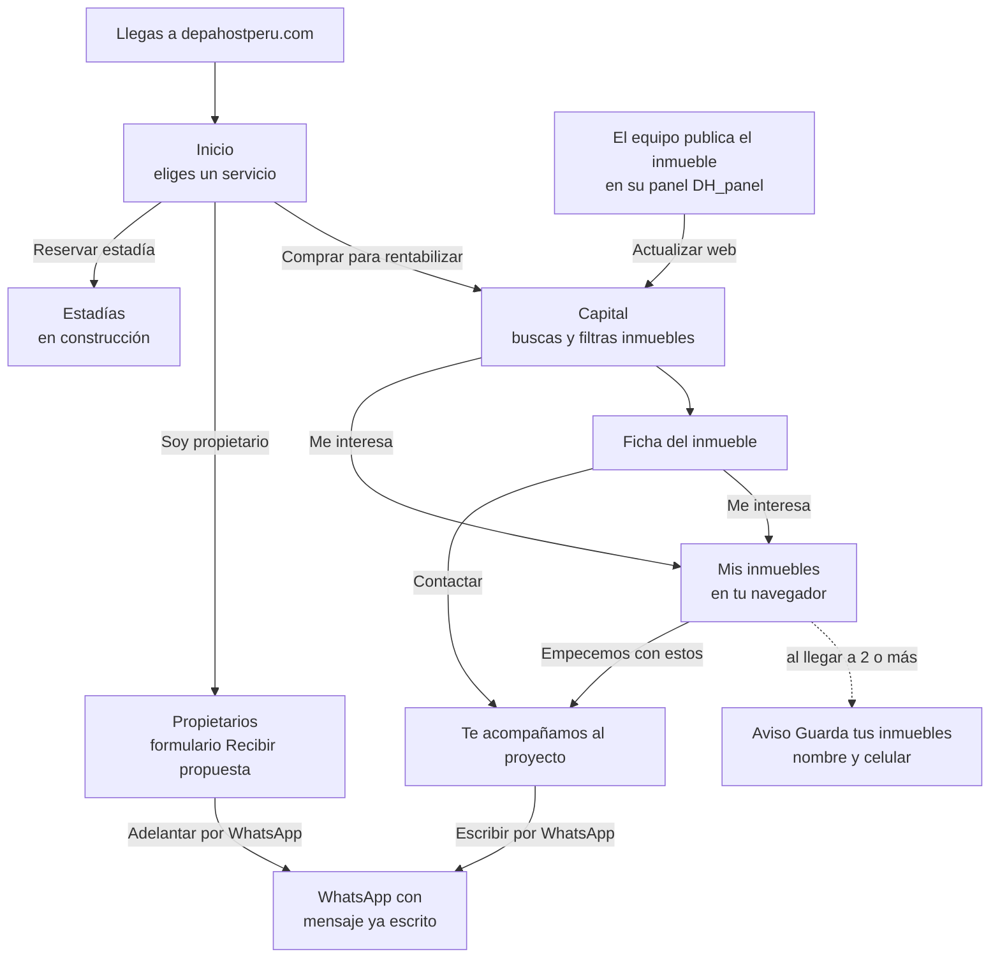

La mayoría de las personas llega al inicio y elige un servicio. Quien busca invertir entra a Capital. Ahí busca y filtra inmuebles, abre las fichas y marca con "Me interesa" los que le gustan. Esos inmuebles forman su lista "Mis inmuebles", que se guarda en el navegador sin pedir cuenta. Cuando la lista llega a 2 o más inmuebles, puede abrirse el aviso "Guarda tus inmuebles", que pide nombre y celular para que el equipo le haga seguimiento.

Cuando está lista, la persona toca "Empecemos con estos" en "Mis inmuebles", o "Contactar" en una ficha, y llega a "Te acompañamos al proyecto". Allí toca "Escribir por WhatsApp" y se abre la conversación con un mensaje ya escrito que lista sus inmuebles. El propietario hace un camino más corto: llena el formulario de Propietarios y sigue la conversación por WhatsApp. "Estadías" todavía no permite reservar.

Los inmuebles los publica el equipo desde su panel interno (sección 6). Los contactos que dejan las personas llegan a ese panel como leads.

**Referencia técnica:** [05-flujos.md](05-flujos.md)

## Mapa de pantallas

**Sitio público (depahostperu.com)**

| Dirección | Qué es | Sección del manual |
|---|---|---|
| `/` | Inicio con los tres servicios | [1.2](#12-página-de-inicio) |
| `/estadias` | Estadías, en construcción | [1.10](#110-páginas-en-construcción-estadías-y-nosotros) |
| `/nosotros` | Nosotros, en construcción | [1.10](#110-páginas-en-construcción-estadías-y-nosotros) |
| `/capital` | Portada de Capital: buscador, filtros, inmuebles de propietarios, aliados y ranking | [2](#2-buscar-inmuebles-en-depahost-capital) |
| `/capital/inmuebles` | "Todos los inmuebles" | Pendiente de describir |
| `/capital/{slug}` | Ficha de un inmueble o de un proyecto | [3.1](#31-la-ficha-de-un-inmueble) |
| `/capital/aliados/{slug}` | Proyectos de una inmobiliaria aliada. Hoy no hay aliadas, así que no hay ninguna de estas páginas | [3.8](#38-página-de-una-inmobiliaria-aliada) |
| `/mis-inmuebles` | Lista de inmuebles guardados con "Me interesa" | [4.5](#45-página-mis-inmuebles) |
| `/capital/empecemos` | Dirección antigua de "Te acompañamos al proyecto": hoy lleva sola a `/mis-inmuebles` | [4.7](#47-página-te-acompañamos) |
| `/carrito`, `/mis-depas` y `/capital/depas` | Direcciones antiguas: las dos primeras llevan solas a `/mis-inmuebles`; `/capital/depas`, a `/capital/inmuebles` | [4.6](#46-dirección-antigua-carrito) |
| `/propietarios` | Formulario para vender o alquilar ("Recibir propuesta") | [5.2](#52-propietarios-vender-o-poner-en-alquiler-propietarios) |
| `/libro-de-reclamaciones` | Libro de Reclamaciones virtual | [5.4](#54-libro-de-reclamaciones-libro-de-reclamaciones) |
| `/privacidad` | Política de privacidad, en borrador | [1.11](#111-política-de-privacidad-y-términos) |
| `/terminos` | Términos y condiciones, en borrador | [1.11](#111-política-de-privacidad-y-términos) |
| Cualquier otra dirección | Página 404 "No encontramos esta página" | [1.9](#19-página-no-encontrada-404) |

**Referencia técnica:** [src/pages/](../../src/pages/), [astro.config.mjs](../../astro.config.mjs) · Capítulo: [02-frontend.md](02-frontend.md)

## 1. Navegar el sitio

Esta sección explica las partes comunes de depahostperu.com: la página de inicio, el encabezado, el pie de página, el aviso de cookies, los botones de WhatsApp y las páginas de apoyo. Todo lo que se describe aquí funciona sin cuenta.

### 1.1 Mapa del sitio

| Página | Dirección | Estado |
|---|---|---|
| Inicio | `/` | Lista |
| Estadías | `/estadias` | En construcción |
| Propietarios | `/propietarios` | Lista. Tiene su propia sección |
| Capital | `/capital` | Lista. Tiene su propia sección |
| Nosotros | `/nosotros` | En construcción |
| Mis inmuebles | `/mis-inmuebles` | Lista. No sale en el menú, se entra por el ícono "Mis inmuebles" |
| Política de privacidad | `/privacidad` | Borrador |
| Términos y condiciones | `/terminos` | Borrador |
| Libro de Reclamaciones | `/libro-de-reclamaciones` | Lista. Tiene su propia sección |
| Página no encontrada | Cualquier dirección que no existe | Lista |

Los enlaces viejos a `/carrito` llevan solos a `/mis-inmuebles`.

En la pestaña del navegador cada página se titula "Nombre de la página | Depa Host Perú". Por ejemplo: "Inicio | Depa Host Perú".

### 1.2 Página de inicio

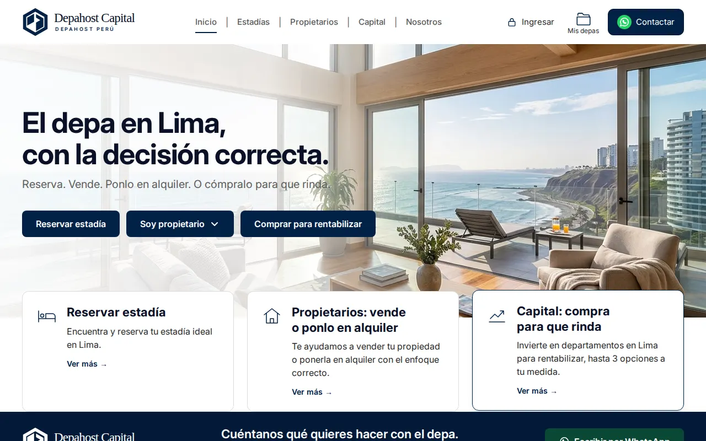

*Página de inicio.*

**Para qué sirve.** Presenta los tres servicios de Depa Host Perú y lleva a cada uno.

**Cómo se llega.** Entra a depahostperu.com (`/`). Desde cualquier página, toca el logo "Depahost Capital" o "Inicio" en el menú.

**Qué se ve.**
- Una foto de una sala con vista al mar.
- El título "El inmueble en Lima, con la decisión correcta."
- La frase "Reserva. Vende. Ponlo en alquiler. O cómpralo para que rinda."
- Tres botones: "Reservar estadía", "Soy propietario" (con una flecha hacia abajo) y "Comprar para rentabilizar".
- Tres tarjetas de servicios. Cada una tiene un dibujo, un título, un texto corto y "Ver más →".

| Tarjeta | Texto | A dónde lleva |
|---|---|---|
| "Reservar estadía" | "Encuentra y reserva tu estadía ideal en Lima." | `/estadias` (en construcción) |
| "Propietarios: vende o ponlo en alquiler" | "Te ayudamos a vender tu propiedad o ponerla en alquiler con el enfoque correcto." | `/propietarios` |
| "Capital: compra para que rinda" | "Invierte en inmuebles en Lima para rentabilizar, hasta 3 opciones a tu medida." | `/capital` |

**Qué puede hacer.**
1. Toca "Reservar estadía" para ir a Estadías.
2. Toca "Comprar para rentabilizar" para ir a Capital.
3. Toca "Soy propietario". Se abre un menú con dos opciones:
   - "Vender mi propiedad" lleva a `/propietarios#vender`.
   - "Poner en alquiler mi propiedad" lleva a `/propietarios#alquiler`.
4. Para cerrar ese menú sin elegir, toca otra vez "Soy propietario", toca fuera del menú o presiona Esc.
5. También puedes tocar cualquier parte de una tarjeta de servicio, no solo "Ver más →".

**Qué pasa después.** Si eliges una opción de "Soy propietario", el formulario de Propietarios se abre con "Vender" o "Alquilar (largo plazo)" ya elegido en "Qué quieres hacer". La home no guarda datos ni consulta nada al sistema: todos sus textos son fijos.

**Casos especiales.**
- "Reservar estadía", tanto el botón como la tarjeta, lleva a una página en construcción. Hoy no se puede reservar desde el sitio.
- **Teléfono:** primero va el texto y debajo la foto. Los botones van uno debajo del otro, a todo el ancho. El menú de "Soy propietario" se abre debajo del botón y empuja el contenido hacia abajo.
- **Desde 640 px:** los botones van en fila y el menú de "Soy propietario" flota debajo del botón.
- **Escritorio (1024 px o más):** la foto ocupa todo el fondo y el texto va encima, a la izquierda. Los tres botones van en una sola fila. Las tarjetas se ponen en tres columnas, montadas sobre el borde inferior de la foto.

### 1.3 Encabezado

**Para qué sirve.** Te deja moverte entre páginas, ver tus inmuebles guardados y escribir por WhatsApp.

**Cómo se llega.** Aparece arriba en todas las páginas. Queda fijo cuando bajas, y al bajar un poco se le ve una sombra.

**Qué se ve, de izquierda a derecha.**
- **Logo** "Depahost Capital" / "DEPAHOST PERÚ". Lleva al inicio.
- **Menú:** "Inicio" | "Estadías" | "Propietarios" | "Capital" | "Nosotros". La página en la que estás aparece subrayada. Solo se marca en esas páginas principales: dentro del detalle de un inmueble, por ejemplo, no se subraya "Capital".
- **Saludo "Hola, …"**, con un círculo que muestra la inicial. Solo aparece si dejaste tu nombre en "Guarda tus inmuebles" (ver 4.4).
- **"Mis inmuebles"**, con un ícono de carpeta. Muestra un número cuando tienes inmuebles guardados.
- **"Contactar"**, un botón azul oscuro con el ícono verde de WhatsApp.
- **Botón de menú** (tres rayas). Solo aparece en pantallas de menos de 1024 px.

**Qué puede hacer.**
1. Toca un enlace del menú para ir a esa página. En computadora, la página se empieza a cargar apenas pasas el mouse por encima, así que abre más rápido.
2. Toca el saludo "Hola, …" para ir a "Mis inmuebles" (`/mis-inmuebles`).
3. Toca "Mis inmuebles" para ver los inmuebles que marcaste con "Me interesa".
4. Toca "Contactar" para abrir WhatsApp con un mensaje ya escrito (ver 1.8).
5. Si usas teclado, presiona Tab al entrar a una página. Aparece "Saltar al contenido", que te lleva directo al contenido sin pasar por el menú.

**Reglas.**

| Elemento | Regla | Si no se cumple |
|---|---|---|
| Saludo | Solo aparece si la persona dejó su nombre en "Guarda tus inmuebles" en ese navegador | No hay saludo |
| Nombre del saludo | Solo el primer nombre, con la primera letra en mayúscula (máximo 40 caracteres) | — |
| Contador de "Mis inmuebles" | Muestra cuántos inmuebles guardaste. Con 0 no se ve ningún número | — |
| Límite de "Mis inmuebles" | Hasta 20 inmuebles en el navegador | Si guardas uno más, se quita el más antiguo sin aviso |

**Qué pasa después.**
- "Mis inmuebles" se guarda solo en el navegador de la persona. El contador cambia al instante, también si tienes el sitio abierto en otra pestaña.

**Casos especiales.**
- **En teléfono (menos de 640 px) el saludo no se ve en ningún lado**, ni en la barra ni en el menú. Ya está anotado como pendiente.

### 1.4 Menú en el teléfono y cambios por ancho de pantalla

<p>
  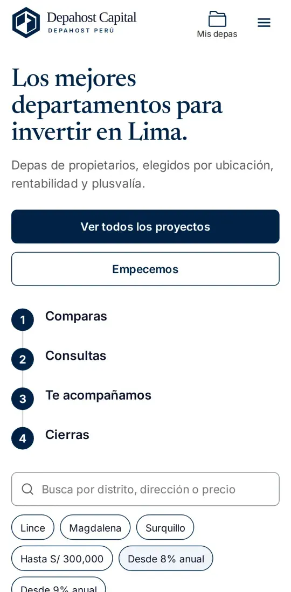
  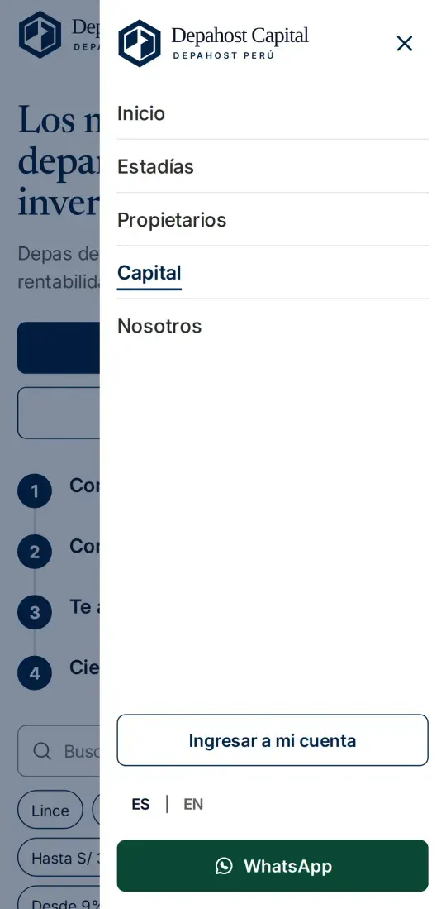
</p>

*Capital en un teléfono · Menú abierto en el teléfono.*

**Para qué sirve.** En pantallas chicas, el menú y algunos accesos se pasan a un panel lateral.

**Cómo se llega.** En pantallas de menos de 1024 px, toca el botón de tres rayas ("Abrir menú") arriba a la derecha.

**Qué se ve en el menú.**
- Arriba: el logo y una "✕" ("Cerrar menú").
- La lista "Inicio", "Estadías", "Propietarios", "Capital", "Nosotros". La página actual aparece subrayada.
- Abajo: el selector "ES | EN" y el botón verde "WhatsApp".

**Qué puede hacer.**
1. Toca el botón de tres rayas. El panel entra desde la derecha y el resto de la página se oscurece.
2. Toca la página a la que quieres ir.
3. Para cerrar el menú, toca la "✕", toca la parte oscura de la página o presiona Esc.

**Qué pasa después.** Con el menú abierto no puedes desplazarte por la página de atrás y se esconde el botón flotante de WhatsApp. Al cerrarlo, todo vuelve como estaba.

**Cómo cambia el encabezado según el ancho.**

| Elemento | Teléfono (menos de 640 px) | Tablet (640 a 1023 px) | Laptop (1024 a 1279 px) | Escritorio (1280 px o más) |
|---|---|---|---|---|
| Menú de páginas | Dentro del botón de tres rayas | Dentro del botón de tres rayas | En la barra | En la barra |
| Saludo "Hola, …" | No se ve | Círculo con la inicial y texto | Solo el círculo con la inicial | Círculo con la inicial y texto |
| "Mis inmuebles" | Sí | Sí | Sí | Sí |
| WhatsApp | Botón flotante verde, y "WhatsApp" en el menú | "Contactar", y "WhatsApp" en el menú | "Contactar" | "Contactar" |
| Selector "ES \| EN" | En el menú | En el menú | No se ve | No se ve |
| Botón de tres rayas | Sí | Sí | No | No |

**Casos especiales.**
- **Botón flotante de WhatsApp (solo teléfono):** es un círculo verde abajo a la derecha ("Escríbenos por WhatsApp").
  - En Inicio y Capital aparece recién cuando bajas más allá de la parte de arriba de la página. En las demás páginas se ve desde el principio.
  - Se esconde cuando aparece en pantalla la franja azul del pie de página y cuando abres el menú.
  - La página deja un espacio abajo para que el botón no tape el contenido.
- Si agrandas la ventana a 1024 px o más con el menú abierto, el menú se cierra solo.

### 1.5 Pie de página

**Para qué sirve.** Ofrece una última forma de contacto y reúne los enlaces legales.

**Cómo se llega.** Está al final de todas las páginas.

**Qué se ve.**
- **Franja azul oscuro:**
  - El logo en blanco, que lleva al inicio.
  - El título "Cuéntanos qué quieres hacer con el inmueble." y el texto "Reserva, vende, alquila o invierte: te respondemos por WhatsApp."
  - El botón verde "Escribir por WhatsApp".
- **Fila legal:**
  - Los enlaces "Nosotros", "Política de privacidad", "Términos" y "Libro de Reclamaciones".
  - La línea "© [año] Depa Host Perú · RUC [pendiente] · depahostperu.com ·" y, al final, "Preferencias de cookies".

**Qué puede hacer.**
1. Toca "Escribir por WhatsApp" para abrir WhatsApp con el mensaje "Hola, les cuento qué quiero hacer con mi inmueble."
2. Toca un enlace legal para ir a esa página.
3. Toca "Preferencias de cookies" para volver a ver el aviso de cookies y cambiar tu elección (ver 1.7).

**Casos especiales.**
- El RUC aparece literalmente como "[pendiente]" porque los datos de la empresa aún no están cargados.
- El año que se muestra es el de la última vez que se generó el sitio.
- **Teléfono:** el botón de WhatsApp ocupa todo el ancho y los enlaces legales van uno debajo del otro.
- **Escritorio:** logo, textos y botón van en una sola fila. Los enlaces legales también van en fila.

### 1.6 Selector de idioma ES | EN

**Para qué sirve.** Está pensado para cambiar de idioma. Hoy el sitio solo está en español.

**Cómo se llega.** Solo aparece dentro del menú de tres rayas, en pantallas de menos de 1024 px. En pantallas más grandes no se ve.

**Qué se ve.** "ES | EN". "ES" está resaltado y "EN" está en gris.

**Qué puede hacer.**
1. Toca "ES": vuelve a cargar la misma página en español.
2. "EN" no se puede tocar. Si pasas el mouse por encima, muestra "Próximamente".

**Casos especiales.** No existen páginas en inglés. La versión en inglés figura como pendiente.

### 1.7 Aviso de cookies

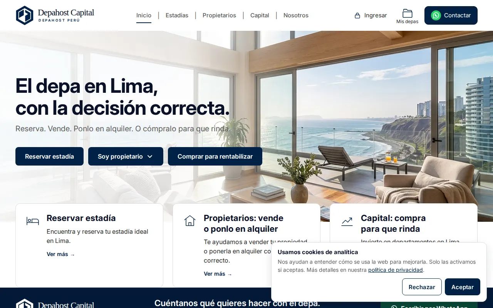

*Aviso de cookies en la primera visita.*

**Para qué sirve.** Pide permiso antes de activar la analítica del sitio (Microsoft Clarity), como manda la Ley N.° 29733 de Protección de Datos Personales.

**Cómo se llega.**
- Aparece solo en la primera visita.
- Vuelve a aparecer si tocas "Preferencias de cookies" en el pie de página.

**Qué se ve.** Una tarjeta blanca abajo de la pantalla:
- El título "Usamos cookies de analítica".
- El texto "Nos ayudan a entender cómo se usa la web para mejorarla. Solo las activamos si aceptas. Más detalles en nuestra política de privacidad." El enlace lleva a `/privacidad`.
- Los botones "Rechazar" y "Aceptar".

En teléfono ocupa todo el ancho. Desde 640 px queda en la esquina inferior derecha.

**Qué puede hacer.**
1. Toca "Aceptar" para activar la analítica, o "Rechazar" para no activarla.
2. El aviso se cierra.
3. Para cambiar de opinión, toca "Preferencias de cookies" en el pie de página y elige otra vez.

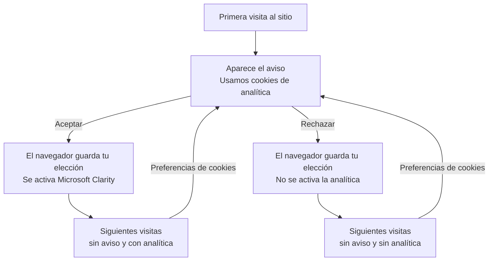

**Qué implica cada opción.**

| Opción | Qué pasa |
|---|---|
| "Aceptar" | Se activa Microsoft Clarity, que registra de forma agregada cómo se navega el sitio: clics, desplazamiento y tipo de dispositivo. En las siguientes visitas se activa sola y el aviso ya no aparece |
| "Rechazar" | No se activa ninguna analítica. El aviso ya no aparece en las siguientes visitas |
| No elegir | El aviso no bloquea la página: puedes seguir navegando. Pero aparece de nuevo en cada página hasta que elijas. No tiene botón para cerrarlo sin elegir |

**Qué pasa después.** La elección se guarda solo en el navegador de la persona. No pasa a otros dispositivos.

**Casos especiales.**
- **Si aceptaste y luego rechazas:** la analítica deja de activarse desde la siguiente página que abras. En la página donde cambiaste, la analítica que ya estaba cargada sigue activa hasta que cambies de página o recargues. El sitio no borra lo que Clarity ya haya registrado.
- **Si borras los datos del navegador**, el aviso vuelve a aparecer.
- **Si el navegador no permite guardar datos**, la elección vale solo para esa página y el aviso reaparece en cada página.
- **Depende de la configuración:** Clarity solo se activa si el sitio tiene configurado su identificador. En local y en preproducción está vacío, así que "Aceptar" se guarda pero no activa nada. En producción sí está configurado.
- El registro de errores técnicos del navegador (Sentry) no depende de esta elección. Solo funciona si está configurado, y hoy está vacío en todos los entornos.

### 1.8 Botones de WhatsApp

**Para qué sirve.** WhatsApp es el canal final de contacto en todo el sitio. Cada botón abre una conversación con Depa Host Perú con un mensaje ya escrito. Cada lugar usa un mensaje distinto, para que el equipo sepa desde dónde escribe la persona.

**Cómo se reconocen.** Los botones que abren WhatsApp son verdes y tienen el ícono de WhatsApp. La excepción es "Contactar" del encabezado: es azul oscuro, con el ícono en un círculo verde.

Ojo con dos casos:
- "Recibir propuesta" (Propietarios) tiene el ícono de WhatsApp, pero envía el formulario. No abre WhatsApp.
- Los enlaces a WhatsApp que aparecen después de enviar un formulario, o cuando no se pudo enviar, son texto subrayado dentro del mensaje, no botones verdes.

**Qué puede hacer.**
1. Toca el botón de WhatsApp.
2. WhatsApp se abre en una pestaña nueva, con el mensaje ya escrito.
3. Revisa o cambia el mensaje y envíalo. El sitio no envía nada por su cuenta.

**Mensajes prellenados.**

| Dónde | Botón | Mensaje |
|---|---|---|
| Encabezado (desde 640 px) | "Contactar" | "Hola, les escribo desde la web de Depa Host Perú." |
| Menú de tres rayas | "WhatsApp" | "Hola, les escribo desde la web de Depa Host Perú." |
| Botón flotante (teléfono) | Círculo verde | "Hola, les escribo desde la web de Depa Host Perú." |
| Pie de página | "Escribir por WhatsApp" | "Hola, les cuento qué quiero hacer con mi inmueble." |
| Formulario de Propietarios | "Adelantar por WhatsApp" (al enviar) o "Escribir por WhatsApp" (si no se pudo enviar) | "Hola, soy [nombre]. Quiero [vender / poner en alquiler / operar en Airbnb] mi inmueble en [distrito]." |
| Te acompañamos (`/capital/empecemos`) | "Escribir por WhatsApp" | Con inmuebles elegidos: "Hola, quiero que me acompañen con este inmueble:" o "…con estos inmuebles:", y la lista "- Distrito (dirección): precio". Sin inmuebles: "Hola, quiero invertir en un inmueble en Lima y me gustaría que me acompañen." |
| "Guarda tus inmuebles" (si no se pudo enviar) | "Escribir por WhatsApp" | "Hola, quiero que me ayuden con los inmuebles que guardé en DepaHost Capital." |
| Libro de Reclamaciones (si no se pudo enviar) | "Escribir por WhatsApp" | "Hola, quiero registrar un reclamo en el Libro de Reclamaciones." |

**Qué pasa después.**
- Los botones generales (encabezado, menú, botón flotante y pie de página) no guardan nada en el sistema: solo abren WhatsApp.
- En "Te acompañamos", el sitio registra qué inmuebles elegiste, sin datos personales, antes de abrir WhatsApp. Si ese registro falla, WhatsApp se abre igual.
- Cuando un formulario no se puede enviar, muestra un mensaje y un enlace "Escribir por WhatsApp" con los datos que ya escribiste:
  - Si el sitio no está conectado al API: "Por ahora recibimos estas consultas por WhatsApp."
  - Si falla la conexión: "No pudimos enviar tus datos. Revisa tu conexión o escríbenos por WhatsApp."
  - Si el sistema rechaza el envío por otro motivo, se muestra el mensaje del sistema y el mismo enlace. Si esa respuesta no trae mensaje, se muestra el de conexión de arriba.
- Si hay campos con error, sale "Revisa los campos marcados." y no se ofrece WhatsApp.

**Casos especiales.**
- **Número por confirmar:** el número por defecto es 51981352247 y falta confirmar que sea el definitivo. En preproducción se usa el relleno "51XXXXXXXXX", que no lleva a ningún chat real. En producción el número se configura en Cloudflare.

### 1.9 Página no encontrada (404)

**Para qué sirve.** Avisa que la dirección no existe y te da una salida.

**Cómo se llega.** Aparece al abrir cualquier dirección del sitio que no existe. En la pestaña dice "Página no encontrada | Depa Host Perú".

**Qué se ve.** Un "404" grande, el título "No encontramos esta página" y el texto "Puede que el inmueble ya no esté disponible o que el link tenga un error." Debajo van dos botones. El encabezado y el pie de página son los de siempre.

**Qué puede hacer.**
1. Toca "Ver inmuebles para invertir" para ir a Capital.
2. Toca "Ir al inicio" para volver a la home.

**Casos especiales.**
- Un enlace a un inmueble vendido lleva a esta página, porque los inmuebles vendidos no tienen página. Los inmuebles reservados sí la tienen.
- Un inmueble recién publicado tarda unos 2 minutos en tener su página: el sitio se vuelve a generar cuando el equipo toca "Actualizar web" en su panel.
- Esta página no aparece en Google.

### 1.10 Páginas en construcción: Estadías y Nosotros

**Para qué sirven.** Reservan el lugar de dos secciones que todavía no tienen contenido.

**Cómo se llega.**
- **Estadías** (`/estadias`): desde "Estadías" en el menú, y desde el botón y la tarjeta "Reservar estadía" de la home.
- **Nosotros** (`/nosotros`): desde "Nosotros" en el menú y en el pie de página.

**Qué se ve.** Solo el título ("Estadías" o "Nosotros") y el texto "Página en construcción." No hay botones ni formularios. El encabezado y el pie de página siguen disponibles.

**Casos especiales.** Hoy no se puede reservar una estadía desde el sitio, aunque la home lo ofrece. Para consultas, la persona solo puede usar WhatsApp desde el encabezado, el botón flotante o el pie de página.

### 1.11 Política de privacidad y Términos

**Para qué sirven.** Explican cómo se tratan los datos personales y cuáles son las condiciones de uso del sitio.

**Cómo se llega.**
- Desde el pie de página: "Política de privacidad" (`/privacidad`) y "Términos" (`/terminos`).
- La política de privacidad también se enlaza desde el aviso de cookies y desde la casilla de aceptación de los formularios.

**Qué se ve.** Un texto largo con el título ("Política de privacidad" o "Términos y condiciones"), la línea "Última actualización: [fecha pendiente]" y secciones numeradas.

| Página | Qué dice, en resumen |
|---|---|
| Política de privacidad | Quién es responsable de los datos. Qué datos se recogen: formularios, Libro de Reclamaciones, Mis inmuebles (solo en el navegador) y analítica (solo si se acepta). Para qué se usan y con qué proveedores se comparten. Cuánto tiempo se guardan. Cómo pedir acceso, rectificación, cancelación u oposición escribiendo a admin@depahostperu.com con copia del documento de identidad. Cómo cambiar la elección de cookies |
| Términos y condiciones | La información del sitio es referencial y no es una oferta. Las rentabilidades y cuotas son estimaciones, no garantías. Precios y disponibilidad pueden cambiar. Un inmueble reservado o vendido puede seguir apareciendo un tiempo. Uso permitido, propiedad intelectual y responsabilidad. Los reclamos van por el Libro de Reclamaciones. Rige la ley peruana, con jueces de Lima |

**Casos especiales.**
- **Ambos textos son borradores.** Debe revisarlos un abogado antes de publicarse.
- Tienen datos sin completar que se muestran tal cual: "[Razón social pendiente]", RUC "[pendiente]", "[Dirección fiscal pendiente]", "[fecha pendiente]" y, en privacidad, "[plazo pendiente]" para el tiempo de conservación.

### 1.12 Qué depende de la configuración

| Ajuste del sitio | Si está vacío o de relleno | Estado hoy |
|---|---|---|
| Número de WhatsApp (`PUBLIC_WHATSAPP_NUMBER`) | Se usa el número por defecto, 51981352247 | Relleno "51XXXXXXXXX" en preproducción. Falta confirmar el número de producción |
| Catálogo de inmuebles (`API_URL`, solo al generar el sitio) | El sitio no tiene inmuebles. En Cloudflare, el sitio no se publica | La dirección del panel DH_panel, terminada en `/api` |
| Envío de formularios (`PUBLIC_API_URL`) | Los formularios no envían nada y ofrecen WhatsApp | La misma dirección del panel |
| Fotos (`PUBLIC_MEDIA_HOST`) | Las fotos no se optimizan y sus enlaces vencen a las 6 horas. En Cloudflare, el sitio no se publica | El dominio de Supabase del panel |
| Verificación anti-robots (`PUBLIC_TURNSTILE_SITE_KEY`) | No aparece el recuadro de Cloudflare | Vacía en local. Clave de prueba en preproducción. Clave real en producción |
| Microsoft Clarity (`PUBLIC_CLARITY_ID`) | "Aceptar" se guarda, pero no se activa ninguna analítica | Vacío en local y preproducción. Configurado en producción |
| Registro de errores (`PUBLIC_SENTRY_DSN`) | No se registran errores del navegador | Vacío en todos los entornos |
| Mapa (`PUBLIC_MAP_TILE_URL` y `PUBLIC_MAP_ATTRIBUTION`) | Se usa el mapa de OpenStreetMap | Vacíos |
| Datos de la empresa | Se ven textos entre corchetes, como "[pendiente]", en el pie de página y en las páginas legales | Pendientes |

**Referencia técnica:**
- Páginas: [index.astro](../../src/pages/index.astro), [estadias.astro](../../src/pages/estadias.astro), [nosotros.astro](../../src/pages/nosotros.astro), [404.astro](../../src/pages/404.astro), [privacidad.astro](../../src/pages/privacidad.astro), [terminos.astro](../../src/pages/terminos.astro)
- Plantillas: [BaseLayout.astro](../../src/layouts/BaseLayout.astro), [PlaceholderLayout.astro](../../src/layouts/PlaceholderLayout.astro), [LegalLayout.astro](../../src/layouts/LegalLayout.astro)
- Componentes: [Header.astro](../../src/components/Header.astro), [Footer.astro](../../src/components/Footer.astro), [LangSwitch.astro](../../src/components/LangSwitch.astro), [ConsentBanner.astro](../../src/components/ConsentBanner.astro), [OwnerDropdown.astro](../../src/components/OwnerDropdown.astro), [Logo.astro](../../src/components/Logo.astro), [Button.astro](../../src/components/Button.astro)
- Scripts y datos: [consent.ts](../../src/scripts/consent.ts), [forms.ts](../../src/scripts/forms.ts), [contacto.ts](../../src/data/contacto.ts), [empresa.ts](../../src/data/empresa.ts), [profile.ts](../../src/lib/profile.ts), [saved-store.ts](../../src/lib/saved-store.ts), [astro.config.mjs](../../astro.config.mjs)
- Capítulos técnicos: [02-frontend.md](02-frontend.md), [05-flujos.md](05-flujos.md) (flujos 10, 13 y 14), [07-decisiones-y-pendientes.md](07-decisiones-y-pendientes.md)

## 2. Buscar inmuebles en DepaHost Capital

### 2.1 La portada de Capital

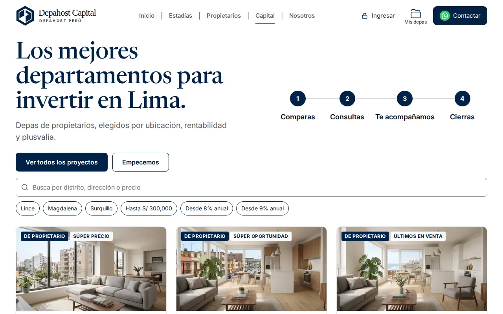

*Portada de Capital.*

**Para qué sirve.** En la portada de Capital la persona encuentra inmuebles para invertir en Lima. Puede buscarlos, filtrarlos, compararlos y marcar los que le gustan. No necesita cuenta.

**Cómo se llega.**
- Entra a `depahostperu.com/capital`.
- O toca "Capital" en el menú del encabezado.
- Desde el detalle de un inmueble, toca "Capital" en la ruta de navegación de arriba.
- En la pestaña del navegador se lee "Capital | Depa Host Perú".

**Qué se ve (de arriba hacia abajo).**

| Bloque | Qué muestra |
|---|---|
| Título y pasos | El título, los botones "Ver todos los proyectos" y "Empecemos", y los 4 pasos de "Cómo funciona" |
| Buscador y filtros | La caja de búsqueda, los chips de filtros rápidos y "Limpiar filtros" |
| Tarjetas de inmuebles | Solo inmuebles **de propietarios**. Los proyectos de inmobiliarias no salen aquí, están en la página de cada inmobiliaria |
| "Para ti, según lo que has visto" | Hasta 4 recomendaciones. Solo aparece si este navegador tiene historial |
| "Proyectos de aliados" | La franja de inmobiliarias aliadas. Hoy no hay aliadas, así que no aparece |
| Barra del Top 10 | "Los 10 inmuebles para invertir ahora" |
| Ranking | Los inmuebles con mayor rentabilidad, de propietarios y de proyectos |

**De dónde salen los inmuebles.**
- En la portada salen los inmuebles de propietarios que el equipo publicó desde su panel (sección 6). Son los que están "En cartera" y tienen autorización para publicar.
- Cuando un inmueble deja de estar "En cartera", desaparece de todo el sitio con la siguiente actualización.
- Van primero los destacados y después los más recientes.
- El panel no envía la dirección exacta: donde el manual habla de la "dirección", hoy se ve el tipo de inmueble (por ejemplo, "Departamento"). Los precios llegan en soles.
- El sitio es estático: las tarjetas se arman cuando se genera el sitio, no cuando la persona entra. El equipo pide esa regeneración con el botón "Actualizar web" de su panel, y tarda unos 2 minutos.
- Problema conocido: el panel guarda el catálogo hasta 5 minutos. Si se actualiza la web justo después de un cambio, puede salir el catálogo anterior.
- Si el panel falla mientras se genera el sitio, no se publica una versión nueva y queda la anterior.
- **Sin API configurada** (por ejemplo, en desarrollo), el sitio no tiene inmuebles. El catálogo de ejemplo existe solo para las pruebas automáticas.

**Móvil frente a escritorio.**

| Ancho de pantalla | Tarjetas de inmuebles | Pasos |
|---|---|---|
| Celular (menos de 640 px) | Carrusel horizontal. Desliza con el dedo; cada tarjeta ocupa casi todo el ancho | En vertical, uno debajo de otro |
| Tablet (640 px a 1023 px) | 2 columnas | En horizontal, 4 columnas |
| Escritorio (1024 px o más) | 3 columnas | A la derecha del título |

### 2.2 Título, pasos y botones principales

**Qué se ve.**
- Título: "Los mejores inmuebles para invertir en Lima."
- Subtítulo: "Inmuebles de propietarios, elegidos por ubicación, rentabilidad y plusvalía."
- Pasos numerados: "Comparas", "Consultas", "Te acompañamos" y "Cierras". Solo muestran el título de cada paso, sin descripción, y no se pueden tocar. Son informativos.

**Qué puede hacer.**

| Botón | A dónde lleva |
|---|---|
| "Ver todos los proyectos" | Baja en la misma página hasta la franja "Proyectos de aliados". **No abre una lista con todos los proyectos.** Desde la franja se entra a la página de cada inmobiliaria |
| "Empecemos" | Abre la página "Te acompañamos al proyecto" (`/capital/empecemos`). Muestra los inmuebles guardados en "Mis inmuebles" y el botón "Escribir por WhatsApp". Si no hay ninguno guardado, aparece el aviso "Todavía no elegiste un inmueble. Marca **Me interesa** en los que te gusten o escríbenos y te ayudamos a elegir." |

**Casos especiales.**
- Hoy no hay inmobiliarias aliadas: la franja de aliados no aparece y "Ver todos los proyectos" no hace nada.

### 2.3 Buscador

**Para qué sirve.** Sirve para encontrar rápido un inmueble por su distrito, su dirección o su precio.

**Qué se ve.** Una caja con una lupa y el texto guía "Busca por distrito, dirección o precio". En la portada no hay botón "Buscar" ni contador de resultados. Las páginas de cada inmobiliaria sí los tienen.

**Qué puede hacer.**
1. Toca la caja de búsqueda.
2. Escribe lo que buscas. Las tarjetas se filtran **mientras escribes**, sin esperar.
3. Si quieres, presiona Enter. La página no se recarga; en el celular solo se cierra el teclado.

**Cómo compara el texto.**
- No importan las tildes ni las mayúsculas: "ejercito" encuentra "Av. del Ejército".
- No importan los espacios ni los signos: "310000", "310,000", "310 000" y "S/ 310" encuentran el inmueble de S/ 310,000.
- Encuentra partes de palabras: "surq" encuentra Surquillo.
- Busca en el distrito, la dirección, la etiqueta de la tarjeta (por ejemplo "super precio" encuentra "Súper precio") y el precio.
- **No busca** por rentabilidad ni por años de recupero. Para eso usa los chips.
- Un número corto puede coincidir con la cuadra o con parte del precio. Por ejemplo, "20" encuentra "Av. Angamos Este cuadra 20".
- Solo busca entre las tarjetas de esta página, es decir, entre los inmuebles de propietarios. Para buscar proyectos de inmobiliarias, entra a la página de la inmobiliaria desde "Proyectos de aliados".

### 2.4 Filtros rápidos (chips)

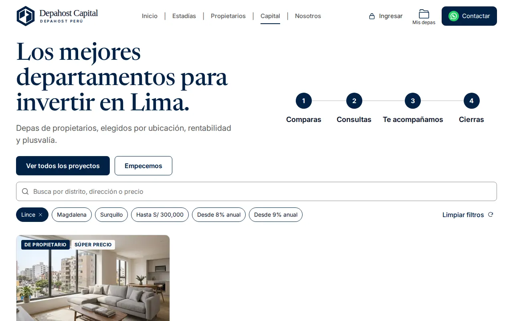

*Filtro rápido "Lince" activo.*

**Para qué sirven.** Con un toque dejan ver solo un distrito o un tope de precio. La rentabilidad se filtra en "Todos los inmuebles".

**De dónde salen.** Nadie los escribe a mano. Se calculan solos cada vez que se genera el sitio, a partir de los inmuebles de la portada:

| Tipo de chip | Cómo se arma | Ejemplo con los datos de ejemplo |
|---|---|---|
| Distrito | Los 4 distritos con más inmuebles | "Lince", "Miraflores", "Surquillo", "Barranco" |
| Precio máximo | Un tope cerca del precio del medio, redondeado hacia arriba a múltiplos de S/ 50,000, que deja fuera al menos un inmueble | "Hasta S/ 350,000" |

Si solo hay un inmueble, aparece solo el chip de su distrito, sin chip de precio. Si no hay ningún inmueble, no aparece ningún chip.

**Qué puede hacer.**
1. Toca un chip para activarlo. Se pinta de azul oscuro y muestra una "x".
2. Toca otro chip **de otro tipo** para sumar condiciones.
3. Toca otro chip **del mismo tipo** para cambiar el anterior. Solo puede haber un distrito y un tope de precio a la vez.
4. Toca de nuevo un chip activo para quitarlo.

**Cómo se combinan.**

| Combinación | Resultado | Ejemplo con los datos de ejemplo |
|---|---|---|
| Chips de tipos distintos | Se tienen que cumplir todos | "Lince" + "Hasta S/ 350,000": quedan los de Lince que cuestan hasta S/ 350,000 |
| Dos chips del mismo tipo | El nuevo reemplaza al anterior | Con "Lince" activo, tocar "Magdalena" deja solo Magdalena |
| Buscador + chips | Se tienen que cumplir el texto y todos los chips | "Lince" + "Hasta S/ 300,000": no queda ninguno |

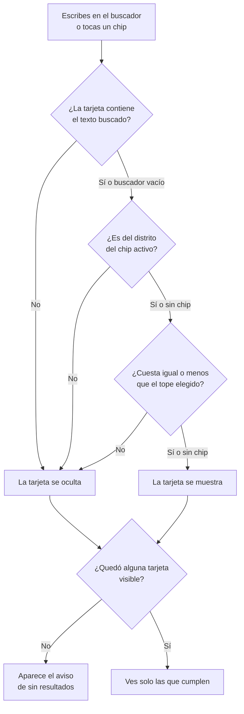

### 2.5 "Limpiar filtros" y resultados vacíos

**"Limpiar filtros".**
- Aparece al lado de los chips solo cuando hay un chip activo o texto en el buscador.
- Al tocarlo, apaga todos los chips, borra el texto y vuelven a verse todas las tarjetas.
- El cursor queda en el buscador. En el celular puede abrirse el teclado.

**Resultados vacíos.** Si ninguna tarjeta cumple, aparece el texto "No encontramos inmuebles con esos criterios." Para salir de ahí, toca "Limpiar filtros" o cambia la búsqueda.

**Reglas y validaciones.**

| Campo | Regla | Mensaje si falla |
|---|---|---|
| Buscador | Busca en distrito, dirección, etiqueta y precio. Ignora tildes, mayúsculas, espacios y signos | "No encontramos inmuebles con esos criterios." |
| Chip de distrito | Solo inmuebles de ese distrito. Un distrito a la vez | "No encontramos inmuebles con esos criterios." |
| Chip "Hasta S/ …" | Precio igual o menor al tope | "No encontramos inmuebles con esos criterios." |
| Chip "Desde …% anual" | La rentabilidad mínima del inmueble es igual o mayor | "No encontramos inmuebles con esos criterios." |

**Qué pasa después.**
- No se guarda nada.
- Los filtros no cambian la dirección (URL), así que no se pueden compartir.
- Al recargar la página vuelven a verse todos los inmuebles.

**Casos especiales.**
- Si no hay ningún inmueble de propietario publicado, la página muestra "No encontramos inmuebles con esos criterios." apenas carga.
- Si el navegador no ejecuta JavaScript, se ven todas las tarjetas, pero el buscador, los chips y "Me interesa" no funcionan.

### 2.6 Tarjetas de inmueble

**Qué se ve en cada tarjeta.**

| Parte | Qué muestra |
|---|---|
| Foto | La primera foto del inmueble. Si no tiene foto, se ve un bloque azul con una casita |
| Etiquetas sobre la foto | "De propietario" (en la portada siempre es esta). Al lado va "Reservado" si el inmueble está reservado. Si no, va la etiqueta comercial que le puso el equipo, por ejemplo "Súper precio", "Súper oportunidad" o "Últimos en venta" en los datos de ejemplo |
| Título | El distrito, por ejemplo "Lince" |
| Dirección | Por ejemplo "Av. Arequipa cuadra 12" |
| "valor" | El precio, por ejemplo "S/ 310,000" |
| "rentabilidad" | La rentabilidad anual estimada: "8–10% anual", o "8% anual" si no es un rango |
| "se paga en" | Los años de recupero, por ejemplo "11 años" (o "1 año") |
| Botones | "Me interesa" y "Ver más detalle" |

**Qué puede hacer.**
1. Toca cualquier parte de la tarjeta, o el botón "Ver más detalle", para abrir el detalle del inmueble (`/capital/{nombre-del-depa}`).
2. Toca "Me interesa" para guardarlo en "Mis inmuebles" (ver 2.7).
3. Para contactar, abre el detalle y toca "Contactar". **La tarjeta no tiene botón de contacto.** "Contactar" lleva a "Te acompañamos al proyecto" con ese inmueble ya elegido.

**Cuota estimada.** Hoy el sitio no muestra cuota estimada ni la nota de sus supuestos: los supuestos de financiamiento no están cargados.

**Casos especiales.**
- La tarjeta, el buscador y el Top 10 muestran el precio siempre con "S/", aunque el inmueble esté cargado en dólares. Las tarjetas chicas de "Para ti, según lo que has visto" y el detalle sí muestran la moneda correcta.
- Los chips de precio y el orden del Top 10 usan el monto tal como está cargado, sin convertir dólares a soles. Por ejemplo, un inmueble de USD 90,000 pasa el chip "Hasta S/ 300,000".
- Los inmuebles reservados siguen en la lista con la etiqueta "Reservado".

### 2.7 Botón "Me interesa"

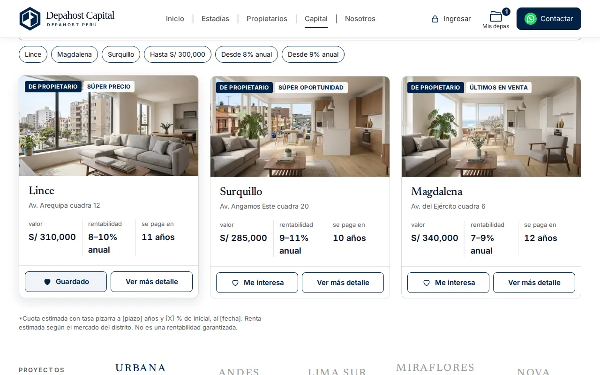

*Tarjeta guardada: el botón cambia a "Guardado" y el contador de "Mis inmuebles" muestra 1.*

**Para qué sirve.** Guarda el inmueble en "Mis inmuebles" para compararlo o consultarlo después. No hace falta tener cuenta.

**Qué puede hacer.**
1. Toca "Me interesa" en la tarjeta.
2. El botón cambia a "Guardado" y el corazón se rellena.
3. Para quitarlo, toca otra vez "Guardado". Vuelve a decir "Me interesa".

**Qué pasa después.**
- El contador de "Mis inmuebles" en el encabezado sube. Se oculta cuando no hay ninguno guardado.
- Todos los botones del mismo inmueble se actualizan juntos: tarjeta, detalle y otras pestañas abiertas.
- "Mis inmuebles" **se guarda en el navegador de la persona**. Si entra desde otro celular o computadora, no ve lo que guardó aquí.
- El aviso "Guarda tus inmuebles", que pide nombre y celular, se abre cuando la lista de "Mis inmuebles" crece y queda con 2 o más inmuebles (normalmente, al guardar el segundo). No se abre si la persona ya dejó sus datos en este navegador ni si lo cerró en los últimos 7 días; pasado ese plazo vuelve a abrirse con el siguiente inmueble que guarde. El detalle está en la sección de "Mis inmuebles".

**Reglas y validaciones.**

| Campo | Regla | Mensaje si falla |
|---|---|---|
| "Me interesa" | Máximo 20 inmuebles en el navegador | Ninguno. Al guardar el número 21, se quita sin aviso el más antiguo |

**Casos especiales.**
- Si el navegador bloquea el almacenamiento (por ejemplo, con las cookies y los datos de sitios bloqueados), lo guardado dura solo mientras la página está abierta. Se pierde al recargar o al cambiar de página.
- En una ventana privada de los navegadores actuales, lo guardado sí se conserva entre páginas, pero se borra al cerrar la ventana privada.

### 2.8 "Para ti, según lo que has visto"

**Para qué sirve.** Recomienda hasta 4 inmuebles parecidos a los que la persona abrió o guardó.

**Cuándo aparece.** Aparece debajo de las tarjetas solo si se cumplen las dos condiciones:
- Este navegador tiene al menos un inmueble abierto en su detalle o guardado con "Me interesa".
- Hay al menos una recomendación.

Para quien entra por primera vez, la fila no existe. Aparece un instante después de que carga la página, así que puede mover un poco lo que está debajo (problema conocido).

**De dónde salen las recomendaciones.**
- **Del navegador de la persona.** Se usan:
  - el historial: los últimos 12 inmuebles abiertos en su detalle, de los cuales cuentan los 6 más recientes;
  - la lista de "Mis inmuebles".
- Se elige entre **todos** los inmuebles publicados o reservados: de propietarios **y** proyectos de inmobiliarias.
- Qué hace que un inmueble se parezca más:
  1. Que esté en el mismo distrito. Es lo que más pesa.
  2. Que tenga un precio cercano.
  3. Que sea del mismo tipo (de propietario o de proyecto).
  4. Que tenga una rentabilidad parecida.
- Lo guardado pesa más que lo visto. Entre lo visto, lo más reciente pesa más.
- Nunca recomienda un inmueble que ya está en "Mis inmuebles".
- Los inmuebles ya vistos pueden salir, pero con menos prioridad que los nuevos.

**Qué se ve.**
- Cada recomendación es una tarjeta chica con:
  - la foto (o la casita);
  - el título "Distrito · calle", sin la cuadra, por ejemplo "Lince · Av. Arequipa";
  - "Distrito, Lima", más el nombre de la inmobiliaria si es un proyecto;
  - el precio, la rentabilidad sin la palabra "anual" y los años de recupero.
- Las tarjetas chicas no tienen botón "Me interesa" ni etiqueta "Reservado".
- Distribución: 1 columna en el celular, 2 en tablet y 4 en escritorio.

**Qué puede hacer.**
1. Toca una recomendación para abrir su detalle.
2. Toca "Ver todos" para bajar a la lista de inmuebles de la misma página.

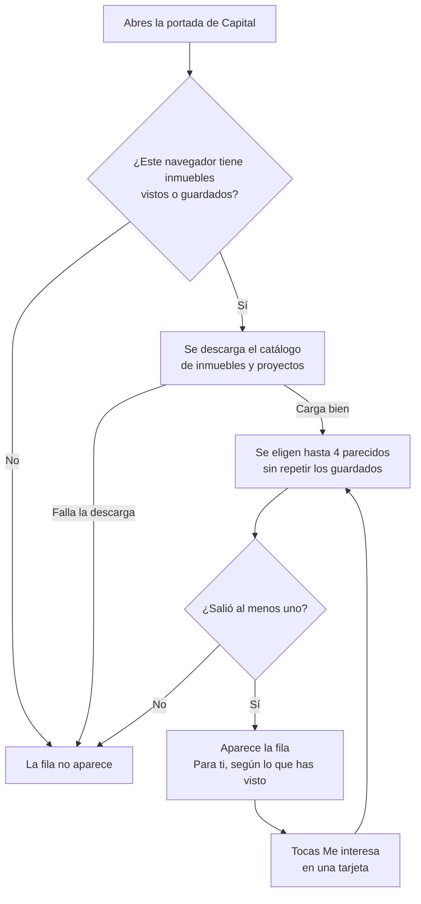

**Casos especiales.**
- Si la persona llega sin historial y marca "Me interesa" en la portada, la fila **no aparece hasta que recarga** la página o vuelve a entrar.
- Si ya había historial, la fila se recalcula sola cada vez que toca "Me interesa". Un inmueble recién guardado sale de la fila.
- Si la persona abre inmuebles en otra pestaña, la fila se actualiza al recargar la portada.
- Si falla la descarga del catálogo, la fila no aparece y no se muestra ningún error.

### 2.9 "Proyectos de aliados"

**Para qué sirve.** Muestra las inmobiliarias aliadas y lleva a sus proyectos.

**Hoy no hay inmobiliarias aliadas**, así que la franja no aparece. Lo que sigue describe cómo se verá cuando las haya.

**Qué se ve.**
- El título "Proyectos de aliados" y el nombre de cada inmobiliaria en letras grandes.
- **Todavía no hay logos.** Están pendientes hasta tener permiso de uso.
- Las inmobiliarias con al menos un proyecto publicado o reservado se pueden tocar y muestran la cantidad: "1 proyecto" o "3 proyectos".
- Las que no tienen proyectos se ven en gris claro y no se pueden tocar.
- Van primero las que tienen más proyectos y después en orden alfabético.
- Distribución: 2 columnas en el celular, 3 en tablet y una sola fila en escritorio.

**Qué puede hacer.**
1. Toca el nombre de una inmobiliaria con proyectos.
2. Se abre "Proyectos de {nombre}". Esa página tiene su propio buscador ("Buscar por distrito, proyecto o palabra clave"), el botón "Buscar" y el contador "N proyectos encontrados".

**Casos especiales.**
- Si no hay inmobiliarias registradas, la franja no aparece.

### 2.10 Top 10

**Para qué sirve.** Ordena los inmuebles con mejor rentabilidad estimada, para decidir rápido.

**Cómo se llega.**
- Toca la barra "Los 10 inmuebles para invertir ahora". Toda la barra es un enlace.
- El botón de la barra dice "Ver el top 10 →" en tablet y escritorio, y "Ver →" en el celular.
- Al tocarla, la página baja hasta el ranking.

**Qué se ve.**
- El título es "Los 10 inmuebles para invertir ahora" solo si hay exactamente 10. Si hay menos, dice "Los inmuebles para invertir ahora".
- Debajo dice "Ordenados por rentabilidad anual estimada."
- Cada fila muestra:
  - su número de puesto;
  - el distrito;
  - la dirección, el precio y, si es un proyecto, la inmobiliaria. Por ejemplo "Calle Schell cuadra 3 · S/ 789,000 · Urbana";
  - a la derecha, la rentabilidad.

**Qué entra y cómo se ordena.**
- Entran inmuebles de propietarios **y** proyectos de inmobiliarias.
- Solo los **publicados**. Los reservados no entran.
- El orden:
  1. Primero la rentabilidad máxima más alta.
  2. Si empatan, la rentabilidad mínima más alta.
  3. Si siguen empatados, el precio más bajo.

**Qué puede hacer.**
1. Toca cualquier fila para abrir el detalle de ese inmueble. El enlace es el nombre del distrito, pero toda la fila responde al toque: el número, la dirección y la rentabilidad también abren el detalle. Al pasar el mouse, la fila entera se resalta.

**Casos especiales.**
- Si no hay ningún inmueble publicado, el ranking no aparece, pero la barra sí. En ese caso tocarla no lleva a ningún lado.
- El precio se muestra siempre con "S/", y el desempate por precio usa el monto sin convertir la moneda (ver 2.6).

**Referencia técnica:** [src/pages/capital/index.astro](../../src/pages/capital/index.astro), [SearchFilters.astro](../../src/components/SearchFilters.astro), [PropertyCard.astro](../../src/components/PropertyCard.astro), [PropertyGrid.astro](../../src/components/PropertyGrid.astro), [SaveButton.astro](../../src/components/SaveButton.astro), [SaveListDialog.astro](../../src/components/SaveListDialog.astro), [ForYouRow.astro](../../src/components/ForYouRow.astro), [MiniCard.astro](../../src/components/MiniCard.astro), [AlliesStrip.astro](../../src/components/AlliesStrip.astro), [Step.astro](../../src/components/Step.astro), [property-filters.ts](../../src/scripts/property-filters.ts), [saved-buttons.ts](../../src/scripts/saved-buttons.ts), [catalog.ts](../../src/scripts/catalog.ts), [filters.ts](../../src/lib/filters.ts), [recommend.ts](../../src/lib/recommend.ts), [saved-store.ts](../../src/lib/saved-store.ts), [profile.ts](../../src/lib/profile.ts), [properties.ts](../../src/lib/properties.ts), [format.ts](../../src/lib/format.ts). Capítulos: [02 · Frontend](../plataforma/02-frontend.md#detalle-de-la-portada-de-capital), [05 · Flujos, apartados 4, 5 y 8](../plataforma/05-flujos.md#4-buscar-y-filtrar).

## 3. Ver un inmueble y los proyectos de una inmobiliaria

Esta sección explica la ficha de cada inmueble y la página con los proyectos de cada inmobiliaria aliada. Ninguna de las dos pide cuenta y todos ven lo mismo.

### 3.1 La ficha de un inmueble

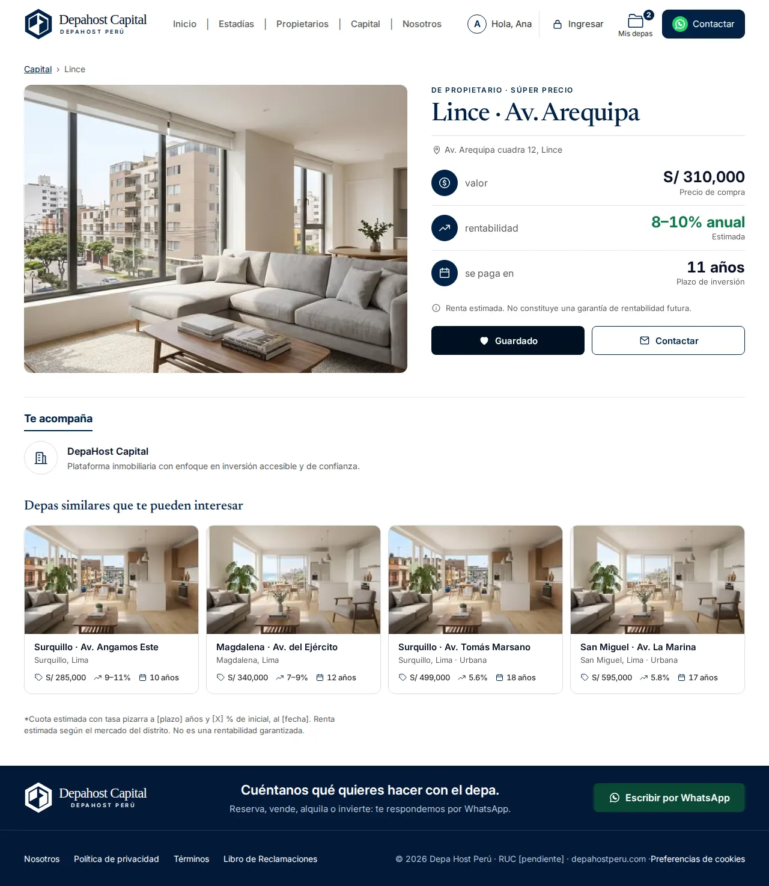

*Ficha de un inmueble.*

**Para qué sirve.** Reúne todo lo que se sabe de un inmueble para que decidas si te interesa: precio, rentabilidad estimada, en cuántos años se paga, fotos, características y quién lo ofrece. Desde la ficha lo guardas en "Mis inmuebles" o pides que te acompañen.

**Cómo se llega.**

- **URL:** `depahostperu.com/capital/{slug}`. El slug viene del panel del equipo. Por ejemplo, en las capturas: `lince-av-arequipa-cuadra-12`.
- **Desde el sitio:**

| Desde | Qué tocas |
|---|---|
| `/capital`, lista de inmuebles de propietarios | La tarjeta o "Ver más detalle" |
| `/capital`, "Los 10 inmuebles para invertir ahora" (si hay menos de 10, el título es "Los inmuebles para invertir ahora") | Cualquier parte de la fila. El enlace es el nombre del distrito, pero toda la fila responde al toque |
| `/capital`, "Para ti, según lo que has visto" | La tarjeta |
| `/capital/aliados/{slug}` | La tarjeta del proyecto o "Ver más detalle" |
| Otra ficha, "Inmuebles similares que te pueden interesar" | La tarjeta |
| `/mis-inmuebles` y "Te acompañamos al proyecto" | El nombre del distrito |

- **Desde un enlace compartido** (WhatsApp, redes).

**Qué se ve.** De arriba hacia abajo:

| Parte | Qué muestra | Cuándo aparece |
|---|---|---|
| Miga de pan | "Capital" › nombre de la inmobiliaria › distrito | La inmobiliaria aparece solo en los proyectos |
| Fotos | Una foto grande y, debajo, las demás en miniatura | Si no hay fotos, sale un recuadro con el dibujo de una casa |
| Etiqueta superior (en mayúsculas) | Estado, origen e insignia. En los proyectos, el origen incluye el nombre de la inmobiliaria: "De proyecto · {inmobiliaria}". Por ejemplo: "De propietario · Súper precio" (datos de ejemplo) o, en un proyecto reservado de Urbana, "Reservado · De proyecto · Urbana" | El estado sale solo si el inmueble está reservado. La insignia sale solo si está publicado |
| Título | "{Distrito} · {calle}", sin el número de cuadra. Por ejemplo: "Lince · Av. Arequipa" | Siempre |
| Dirección | La dirección completa y el distrito, con un ícono de ubicación. Por ejemplo: "Av. Arequipa cuadra 12, Lince" | Siempre |
| Tres datos | "valor", "rentabilidad" y "se paga en" (ver 3.2) | Siempre |
| Características | "2 dorm.", "1 baño" o "2 baños", "68 m²" | Solo las que cargó el equipo. Si no hay ninguna, la fila no aparece |
| Aviso | "Renta estimada. No constituye una garantía de rentabilidad futura." | Siempre |
| Botones | "Me interesa" y "Contactar" | Siempre |
| Descripción | Texto libre, con sus saltos de línea | Solo si existe |
| Bloque del aliado | Ver 3.3 | Siempre |
| Inmuebles similares | Hasta 4 tarjetas (ver 3.6) | Si hay otros inmuebles en el sitio |

**Qué puedes hacer.**

1. Mira las fotos. Las miniaturas no se agrandan al tocarlas: no hay visor de fotos.
2. Toca "Me interesa" para guardar el inmueble (ver 3.4).
3. Toca "Contactar" para pedir acompañamiento por WhatsApp (ver 3.5).
4. Toca el nombre de la inmobiliaria en la miga de pan, o "Ver sus N proyectos", para ver sus otros proyectos (ver 3.3 y 3.8).
5. Toca una tarjeta de "Inmuebles similares que te pueden interesar" para abrir otra ficha (ver 3.6).
6. Toca "Capital" en la miga de pan para volver a la lista.

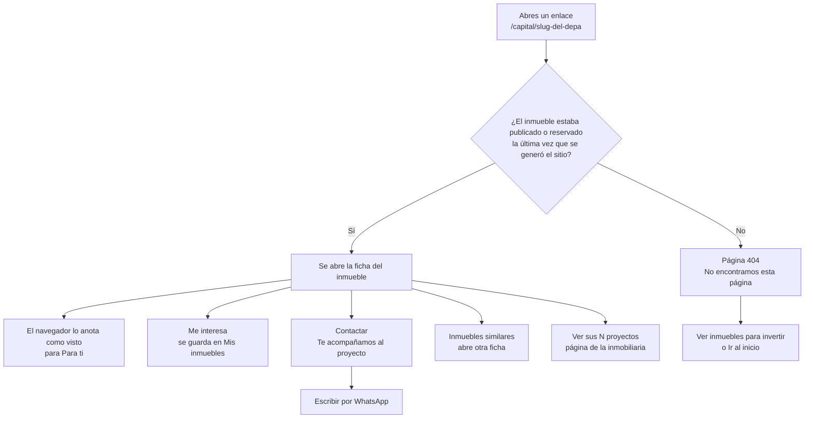

### 3.2 Precio, rentabilidad y recupero

**Los tres datos principales.**

| Etiqueta | Qué muestra | Nota debajo | Formato |
|---|---|---|---|
| "valor" | El precio, en la moneda del inmueble | "Precio de compra" si es de propietario. "Precio desde" si es de proyecto | "S/ 310,000" o "US$ 50,000", sin decimales |
| "rentabilidad" | La rentabilidad anual estimada, en verde | "Estimada" | Un rango, como "8–10% anual", o un solo valor, como "5.8% anual" |
| "se paga en" | En cuántos años se recupera la inversión | "Plazo de inversión" | "11 años" o "1 año" |

**Cuota estimada.**

- La ficha **no calcula ni muestra una cuota mensual**. Hoy tampoco muestra la nota con los supuestos de financiamiento (tasa, plazo e inicial), porque no están cargados.
- **Pendiente:** los términos (todavía en borrador) hablan de "cuotas que mostramos", pero hoy el sitio no muestra ninguna cuota.

### 3.3 Bloque del aliado

| Origen del inmueble | Título | Nombre | Texto | Enlace |
|---|---|---|---|---|
| Proyecto de inmobiliaria | "Aliado del proyecto" | Nombre de la inmobiliaria | Su descripción. Si no tiene: "Inmobiliaria aliada de DepaHost Capital." | "Ver sus N proyectos", solo si tiene más de 1 proyecto visible |
| Propietario | "Te acompaña" | "DepaHost Capital" | "Plataforma inmobiliaria con enfoque en inversión accesible y de confianza." | Ninguno |

- No se muestra el logo de la inmobiliaria, solo un ícono de edificio. Mientras no haya logos con permiso de uso, el sitio usa solo nombres.
- La web de la inmobiliaria no sale en la ficha. Sale en su página (ver 3.8).
- Si la inmobiliaria tiene un solo proyecto, el enlace "Ver sus N proyectos" no aparece. Su nombre en la miga de pan igual lleva a su página.
- N cuenta los proyectos publicados y reservados, incluido el que estás viendo.

### 3.4 "Me interesa" en la ficha

**Para qué sirve.** Guarda el inmueble en "Mis inmuebles" para compararlo después y pedir acompañamiento con varios a la vez.

**Qué puedes hacer.**

1. Toca "Me interesa". El corazón se rellena, el botón cambia a "Guardado" y sube el contador de "Mis inmuebles" en el encabezado.
2. Para quitarlo, toca "Guardado". El botón vuelve a "Me interesa".

**Reglas y validaciones.**

| Campo | Regla | Mensaje si falla |
|---|---|---|
| "Me interesa" | Funciona como interruptor: un toque guarda y el siguiente quita | — |
| Mis inmuebles en el navegador | Guarda como máximo 20 inmuebles | Sin mensaje. Al guardar el número 21 se quita el más antiguo |
| Almacenamiento del navegador bloqueado | La lista vive solo mientras la página esté abierta | Sin mensaje |

**Qué pasa después.**

- "Mis inmuebles" se guarda en el navegador de la persona. Solo lo ves en ese dispositivo y en ese navegador. Si tienes otras pestañas abiertas del sitio, se actualizan solas.
- **Cuando guardas un inmueble y ya tienes al menos 2 en Mis inmuebles** (el segundo, el tercero, etc.), puede abrirse la ventana "Guarda tus inmuebles", que pide nombre y celular. Aparece si nunca dejaste tu nombre ahí y no la cerraste en los últimos 7 días. Los detalles están en la sección de Mis inmuebles.
- Guardar no avisa al equipo por sí solo.

### 3.5 "Contactar"

**Para qué sirve.** Pide que el equipo te acompañe con este inmueble en particular. La conversación sigue por WhatsApp.

**Cómo se llega.** Es el botón "Contactar", con ícono de sobre, al lado de "Me interesa". Lleva a `/capital/empecemos?depa={slug}`.

**Qué puedes hacer.**

1. Toca "Contactar".
2. Se abre "Te acompañamos al proyecto". En "Inmueble seleccionado" aparece **solo este inmueble**, aunque tengas otros en Mis inmuebles. El subtítulo dice "Estamos de tu lado para que encuentres el inmueble ideal en {distrito}."
3. Revisa los tres pasos: "Entramos juntos", "Coordinamos la visita" y "Cierras la compra".
4. Si prefieres consultar por varios inmuebles, toca "Cambiar selección". Te lleva a `/mis-inmuebles`.
5. Toca "Escribir por WhatsApp". WhatsApp se abre con este mensaje ya escrito:
   ```
   Hola, quiero que me acompañen con este inmueble:
   - {Distrito} ({dirección}): {precio}
   ```
6. Envía el mensaje desde WhatsApp.

**Qué pasa después.**

- Si el API está configurado, al tocar "Escribir por WhatsApp" el sitio registra una consulta **sin nombre, correo ni teléfono**: guarda qué inmueble pediste y de qué campaña llegaste (UTM). El equipo lo ve en su panel como interés por ese inmueble. Se registra aunque después no envíes el mensaje.
- Solo ese toque registra la consulta. Abrir "Te acompañamos al proyecto", tocar "Contactar" o "Cambiar selección", o llegar desde "Empecemos con estos" de Mis inmuebles no envía nada.
- Si el API falla, WhatsApp se abre igual.

**Casos especiales.**

- **Número de WhatsApp:** está por confirmar (ver 1.8).
- **Dos botones con el mismo nombre:** el "Contactar" del encabezado es otro botón. Aparece desde 640 px de ancho y abre WhatsApp directo con "Hola, les escribo desde la web de Depa Host Perú.". En celulares, en su lugar está el botón flotante de WhatsApp.
- **El catálogo no carga:** la tarjeta de selección queda vacía, el mensaje pasa a ser genérico ("Hola, quiero invertir en un inmueble en Lima y me gustaría que me acompañen.") y no se registra ninguna consulta.
- **El inmueble ya no está en el catálogo:** la página muestra lo que tengas en Mis inmuebles en lugar de ese inmueble.

### 3.6 Inmuebles similares

**Qué se ve.** Bajo el título "Inmuebles similares que te pueden interesar" aparecen hasta 4 tarjetas pequeñas. Cada una muestra:

- la foto, o el dibujo de la casa si no hay foto;
- "{Distrito} · {calle}";
- "{Distrito}, Lima", más " · {inmobiliaria}" si es un proyecto;
- el precio, la rentabilidad sin la palabra "anual" (por ejemplo "8–10%") y los años de recupero.

Toda la tarjeta es un enlace a su ficha. Estas tarjetas no tienen botón "Me interesa".

**Cómo se eligen.** Se comparan todos los inmuebles visibles con el que estás viendo:

| Criterio | Puntos |
|---|---|
| Mismo distrito | 3 |
| Precio parecido | 0 a 2 |
| Mismo origen (propietario o proyecto) | 1 |
| Rentabilidad parecida | 0 a 1 |

**Reglas.**

- Se calculan cuando se genera el sitio. Todos ven los mismos similares: no dependen de tu historial.
- Mezclan inmuebles de propietarios y proyectos. Nunca incluyen el mismo inmueble ni los vendidos.
- Pueden incluir inmuebles reservados, y en estas tarjetas no se marcan como "Reservado".
- No hay un mínimo de parecido. Con pocos inmuebles en el sitio, igual salen 4 aunque no se parezcan mucho. La sección solo desaparece si no hay otros inmuebles.

### 3.7 El inmueble queda como "visto" para "Para ti"

- Al abrir la ficha, el navegador anota el inmueble como visto. No aparece ningún aviso.
- Guarda los últimos 12 inmuebles vistos. Si vuelves a abrir uno, pasa a ser el más reciente.
- Con esa lista se arman "Para ti, según lo que has visto" en `/capital` y "Parecidos a los que guardaste" en `/mis-inmuebles`:
  - se usan los 6 últimos vistos más lo que tienes en Mis inmuebles;
  - lo más reciente pesa más;
  - nunca te recomienda lo que ya está en Mis inmuebles;
  - lo que ya viste sale después de lo nuevo;
  - si solo viste un inmueble, ese no aparece en sus propias recomendaciones.
- La lista de vistos **vive solo en ese navegador**. No se envía al API y no pasa a otros dispositivos.
- No hay botón para borrarla. Se borra solo si se eliminan los datos del sitio en el navegador. Si el navegador bloquea el almacenamiento, la visita no se recuerda.

### 3.8 Página de una inmobiliaria aliada

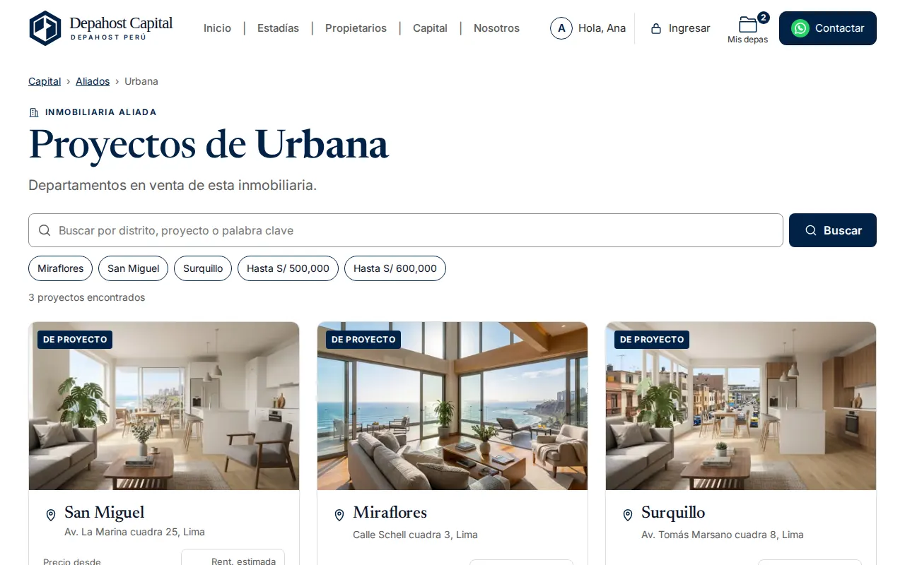

*Proyectos de una inmobiliaria aliada.*

**Para qué sirve.** Muestra juntos todos los proyectos de una inmobiliaria, con un buscador y filtros rápidos para encontrarlos.

**Hoy no hay inmobiliarias aliadas ni proyectos** (el panel todavía no envía proyectos), así que no existe ninguna de estas páginas. Lo que sigue describe cómo se verán cuando las haya.

**Cómo se llega.** La URL es `depahostperu.com/capital/aliados/{slug}`.

- En `/capital`, en la franja "Proyectos de aliados", toca el nombre de la inmobiliaria. El botón "Ver todos los proyectos" de la parte de arriba de `/capital` baja hasta esa franja.
- En `/propietarios`, en la franja "Aliados", toca el nombre.
- En la ficha de un proyecto, toca el nombre de la inmobiliaria en la miga de pan o "Ver sus N proyectos".

En las franjas, cada inmobiliaria con proyectos muestra su nombre y "N proyecto" o "N proyectos". Las que no tienen proyectos visibles muestran solo el nombre, atenuado (en gris), sin contador y sin enlace.

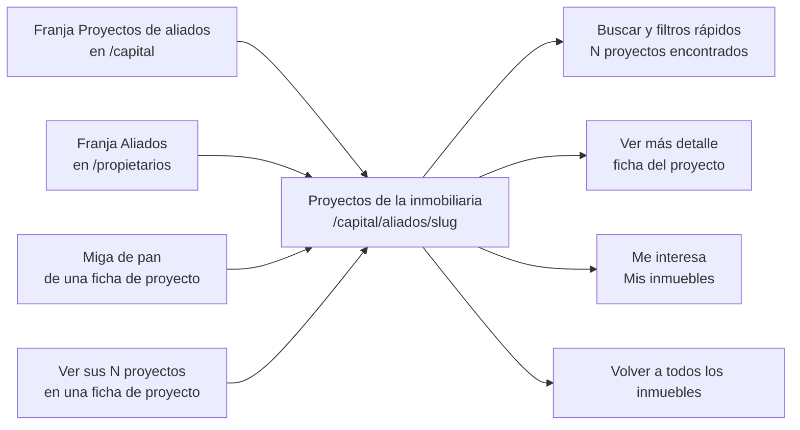

**Qué se ve.**

| Parte | Qué muestra |
|---|---|
| Miga de pan | "Capital" › "Aliados" › nombre. "Aliados" lleva a la franja de aliados de `/capital` |
| Encabezado | "Inmobiliaria aliada" y el título "Proyectos de {nombre}" |
| Descripción | La descripción de la inmobiliaria. Si no tiene: "Inmuebles en venta de esta inmobiliaria." |
| Web | "Sitio web de {nombre}", que se abre en otra pestaña. Solo aparece si el equipo cargó la web |
| Buscador | La caja "Buscar por distrito, proyecto o palabra clave" y el botón "Buscar" |
| Filtros rápidos | Botones redondos (chips) con distritos, topes de precio ("Hasta S/ …") y rentabilidad mínima ("Desde …% anual") |
| "Limpiar filtros" | Solo aparece si hay texto escrito o un chip activo |
| Contador | "1 proyecto encontrado" o "N proyectos encontrados" |
| Tarjetas de proyecto | Ver la tabla siguiente. Los destacados van primero y luego los más nuevos |
| Sin resultados | "No encontramos proyectos con esos criterios." |
| "Volver a todos los inmuebles" | Lleva a la lista de inmuebles de `/capital` |

Cada tarjeta de proyecto muestra:

| Elemento | Detalle |
|---|---|
| Foto | La primera foto, o el dibujo de la casa |
| Etiqueta sobre la foto | "De proyecto", o "Reservado" si está reservado |
| Ubicación | El distrito y "{dirección}, Lima" |
| "Precio desde" | El precio, en su moneda |
| "Rent. estimada" | La rentabilidad sin "anual", por ejemplo "5.8%" |
| Descripción | Solo si existe |
| Botones | "Me interesa" (igual que en 3.4) y "Ver más detalle" |

Si tocas cualquier parte de la tarjeta que no sea un botón, se abre la ficha.

**Qué puedes hacer.**

1. Escribe en "Buscar por distrito, proyecto o palabra clave". La lista se filtra mientras escribes.
2. Toca "Buscar" o presiona Enter para aplicar la búsqueda y cerrar el teclado del celular.
3. Toca un chip para filtrar. El chip activo se pinta de azul y muestra una "x". Tócalo otra vez para quitarlo.
4. Mira el contador para saber cuántos proyectos quedan.
5. Toca "Limpiar filtros" para borrar el texto y los chips a la vez. El cursor vuelve a la caja de búsqueda.
6. Toca "Ver más detalle" o la tarjeta para abrir la ficha del proyecto.

**Reglas y validaciones.**

| Campo | Regla | Mensaje si falla |
|---|---|---|
| "Buscar por distrito, proyecto o palabra clave" | No distingue mayúsculas ni tildes e ignora espacios y signos. Busca en el distrito, la dirección, la insignia y el precio ("595000" o "S/ 595,000" encuentran lo mismo) | "No encontramos proyectos con esos criterios." y el contador en "0 proyectos encontrados" |
| Chips de distrito | Hay uno por cada distrito con proyectos, en orden alfabético. Solo puede haber un distrito activo: tocar otro reemplaza al anterior | Igual que arriba |
| Chips "Hasta S/ …" | Cada precio se redondea hacia arriba al múltiplo de S/ 50,000 siguiente. Solo quedan los topes menores al precio más alto, es decir, los que dejan fuera al menos un proyecto. Se muestran como máximo los 2 más altos de ellos. Muestran los proyectos con precio menor o igual al tope | Igual que arriba |
| Chips "Desde …% anual" | Solo aparecen si la inmobiliaria tiene más de 3 proyectos. Son las 2 rentabilidades mínimas más bajas que superan a la menor de todas. Muestran los proyectos cuya rentabilidad mínima es igual o mayor | Igual que arriba |
| Combinación | El texto y un chip de cada tipo se suman: el proyecto debe cumplir todo | Igual que arriba |

**Qué pasa después.** No se envía nada al servidor. El buscador y los filtros no se recuerdan: si recargas la página, vuelven a cero. "Me interesa" funciona igual que en la ficha (ver 3.4).

**Casos especiales.**

- La página existe solo para inmobiliarias con al menos un proyecto publicado o reservado. Si no tiene ninguno, la dirección da la página 404 y en las franjas su nombre sale atenuado y sin enlace.
- **La búsqueda no revisa todo lo que dice la caja:** el texto de ayuda menciona "proyecto o palabra clave", pero no se busca en la descripción ni en el nombre de la inmobiliaria. Los proyectos no tienen un nombre propio en el sistema: se identifican por su dirección.
- **Buscar un precio en dólares:** en proyectos en dólares, buscar el precio como aparece en la tarjeta ("US$ 50,000") no da resultados. Hay que escribir solo el número ("50000").
- **Topes de precio en soles:** los chips "Hasta S/ …" comparan el número del precio sin convertir la moneda. Un proyecto en dólares se compara como si su precio estuviera en soles.
- Los proyectos reservados aparecen con la etiqueta "Reservado" y sí cuentan en el contador.
- **Móvil frente a escritorio:** las tarjetas van en 1 columna en celular, 2 desde 640 px y 3 desde 1024 px. En pantallas de menos de 480 px el botón "Buscar" muestra solo la palabra, sin ícono.

### 3.9 Inmuebles reservados, vendidos y enlaces que ya no existen

El equipo es quien cambia el estado de cada inmueble desde su panel. Hoy el panel envía todos los inmuebles como publicados y sin insignia: "Reservado" y las insignias no aparecen, y un inmueble que deja de estar "En cartera" desaparece del sitio como si se hubiera vendido.

| Estado | Ficha `/capital/{slug}` | Tarjetas y listas | Mis inmuebles | Página de la inmobiliaria |
|---|---|---|---|---|
| Publicado | Se ve completa, con la insignia si tiene | Aparece en todas | Se muestra | Cuenta como proyecto |
| Reservado | Se abre. La etiqueta empieza con "Reservado · " y no muestra insignia. Igual puedes usar "Me interesa" y "Contactar" | En `/capital` y en las tarjetas de proyecto sale la etiqueta "Reservado". En similares y "Para ti" no se marca. No entra en "Los 10 inmuebles para invertir ahora" | Se muestra con "Reservado" | Cuenta, con la etiqueta "Reservado" |
| Vendido | No se genera: da 404 | Desaparece de todo | Se quita de la lista al abrir `/mis-inmuebles`. Hasta entonces, el contador del encabezado lo sigue contando | No cuenta. Si era su último proyecto, la página desaparece |
| Borrador | Nunca se ve: da 404 | No aparece | No aparece | No cuenta |

- **Pendiente:** el código de la ficha ya contempla la etiqueta "Vendido · ", pero no se ve nunca, porque los inmuebles vendidos no generan página. Mostrar la ficha con "Vendido" está anotado como pendiente.
- **Reservados en Google:** la ficha lleva datos para buscadores con el precio y la disponibilidad. Un inmueble publicado se marca como disponible y uno reservado como agotado. Por eso, en los resultados de Google un inmueble reservado puede aparecer como agotado, aunque su ficha siga abierta y acepte "Me interesa" y "Contactar".

**Cuándo se ven los cambios.** El sitio se genera de antemano, así que un cambio de estado, precio o fotos aparece recién cuando el sitio se vuelve a generar.

- El equipo pide la regeneración con "Actualizar web" en su panel. Tarda unos 2 minutos.
- Mientras tanto se sigue viendo el estado anterior. Los términos (en borrador) lo advierten: un inmueble reservado o vendido "puede seguir apareciendo por un tiempo".

**Enlace que ya no existe (página 404).**

- **Qué se ve:** un "404" grande, el título "No encontramos esta página" y el texto "Puede que el inmueble ya no esté disponible o que el link tenga un error.". Hay dos botones: "Ver inmuebles para invertir", que lleva a `/capital`, y "Ir al inicio", que lleva a `/`. Google no indexa esta página.
- **Cuándo sale:**
  - el slug está mal escrito;
  - el inmueble se vendió, volvió a borrador o se eliminó;
  - el equipo cambió el slug: el enlace antiguo deja de funcionar y no redirige al nuevo;
  - el inmueble se acaba de publicar, pero el sitio todavía no se regeneró.

### 3.10 Otros casos especiales

- **Móvil frente a escritorio:**
  - En celular y tablet (menos de 1024 px), la ficha va en una sola columna: primero las fotos y luego los datos. "Me interesa" y "Contactar" quedan lado a lado.
  - En escritorio, las fotos van a la izquierda y los datos a la derecha. El bloque de datos se queda fijo mientras bajas.
  - Los similares van en 1 columna en celular, 2 desde 640 px y 4 desde 1024 px.
- **Sin API:** si el sitio se genera sin el catálogo del panel, no tiene inmuebles ni fichas.
- **Fotos:** vienen del almacenamiento del panel (Supabase) y el sitio las descarga y optimiza al generarse. Un inmueble sin fotos muestra el dibujo de la casa.
- **Precio en dólares:** la ficha, los similares y las tarjetas de proyecto muestran "US$". En cambio, la tarjeta de `/capital` y "Los 10 inmuebles para invertir ahora" siempre muestran el precio con "S/".
- **Al compartir el enlace:** la vista previa (en WhatsApp, por ejemplo) muestra el título "{Distrito} · {calle} | Depa Host Perú" y el texto "Inmueble en {distrito} desde {precio}. Rentabilidad {rentabilidad}.". La imagen es una genérica del sitio, no la foto del inmueble, y todavía está pendiente la imagen final de marca. En la página de una inmobiliaria, el título es "Proyectos de {nombre} | Depa Host Perú".
- **Observación para QA:** los íconos de las características se asignan por posición: cama, baño y área. Si falta un dato, los siguientes se corren y toman el ícono equivocado. Por ejemplo, si solo hay metros cuadrados, salen con el ícono de cama.

**Referencia técnica:** [`src/pages/capital/[slug].astro`](../../src/pages/capital/%5Bslug%5D.astro) · [`src/pages/capital/aliados/[slug].astro`](../../src/pages/capital/aliados/%5Bslug%5D.astro) · [`src/pages/capital/index.astro`](../../src/pages/capital/index.astro) · [`src/pages/404.astro`](../../src/pages/404.astro) · [`src/components/SaveButton.astro`](../../src/components/SaveButton.astro) · [`src/components/SaveListDialog.astro`](../../src/components/SaveListDialog.astro) · [`src/components/MiniCard.astro`](../../src/components/MiniCard.astro) · [`src/components/ProjectCard.astro`](../../src/components/ProjectCard.astro) · [`src/components/AlliesStrip.astro`](../../src/components/AlliesStrip.astro) · [`src/components/SearchFilters.astro`](../../src/components/SearchFilters.astro) · [`src/lib/properties.ts`](../../src/lib/properties.ts) · [`src/lib/recommend.ts`](../../src/lib/recommend.ts) · [`src/lib/format.ts`](../../src/lib/format.ts) · [`src/lib/filters.ts`](../../src/lib/filters.ts) · [`src/lib/saved-store.ts`](../../src/lib/saved-store.ts) · [`src/scripts/saved-buttons.ts`](../../src/scripts/saved-buttons.ts) · [`src/scripts/property-filters.ts`](../../src/scripts/property-filters.ts) · [`src/content/financing.json`](../../src/content/financing.json) · Capítulos: [05-flujos.md](05-flujos.md) (flujos 5, 6, 8, 9 y 11), [07-decisiones-y-pendientes.md](07-decisiones-y-pendientes.md)

## 4. Guardar inmuebles y pedir acompañamiento

Aquí se explica cómo la persona arma su lista de inmuebles favoritos, cómo deja sus datos para que el equipo le haga seguimiento y cómo pide acompañamiento por WhatsApp. Todo funciona sin cuenta.

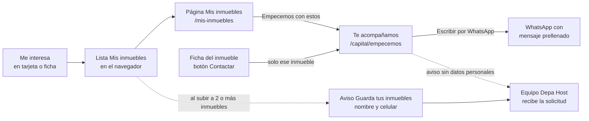

### 4.1 Botón "Me interesa"

**Para qué sirve.** Marca un inmueble para revisarlo después en "Mis inmuebles". No pide datos ni cuenta.

**Dónde está.**

| Lugar | Ruta |
|---|---|
| Tarjetas de inmuebles de propietarios | `/capital` |
| Tarjetas de proyectos de una inmobiliaria aliada | `/capital/aliados/{inmobiliaria}` |
| Ficha del inmueble, junto al botón "Contactar" | `/capital/{depa}` |

No aparece en las tarjetas pequeñas ("Inmuebles similares", "Para ti, según lo que has visto", "Parecidos a los que guardaste"). Para guardar uno de esos, abre su ficha.

**Qué se ve.** Un corazón vacío con el texto "Me interesa". Cuando el inmueble ya está guardado, el corazón se rellena y el texto cambia a "Guardado".

**Qué puede hacer.**
1. Toca "Me interesa" en la tarjeta o en la ficha.
2. Fíjate que el botón cambie a "Guardado" y que suba el contador "Mis inmuebles" del encabezado.
3. Para quitarlo, toca otra vez "Guardado".

**Reglas.**

| Regla | Detalle |
|---|---|
| Máximo 20 inmuebles | Si ya tienes 20 y guardas otro, el más antiguo sale de la lista sin aviso. |
| Sin repetidos | Cada inmueble aparece una sola vez. |
| Orden | Del más antiguo al más reciente. |
| Mismo inmueble en varios lugares | Si el mismo inmueble aparece dos veces en la página, todos sus botones cambian a la vez. |

**Qué pasa después.** Si la lista llega a 2 o más inmuebles, puede abrirse el aviso "Guarda tus inmuebles" (4.3).

### 4.2 La lista "Mis inmuebles"

**Dónde se guarda.** En el navegador del dispositivo de la persona. El equipo no la recibe hasta que la persona llena "Guarda tus inmuebles" o toca "Escribir por WhatsApp" en "Te acompañamos". La lista no vence. Funciona aunque la persona rechace las cookies de analítica.

**Contador del encabezado.**
- Es un ícono de carpeta con el texto "Mis inmuebles". Se ve en celular y en escritorio.
- Muestra un círculo con el número de inmuebles guardados. Si no hay ninguno, el círculo no aparece.
- Al tocarlo, lleva a `/mis-inmuebles`.
- Cuenta todo lo guardado en el navegador, incluidos los inmuebles que ya no están publicados. El número se corrige al abrir `/mis-inmuebles` (ver 4.5).

**Casos especiales.**

| Situación | Qué pasa |
|---|---|
| El sitio está abierto en otra pestaña | El contador, los botones "Me interesa", la lista y el resumen de la página "Mis inmuebles" y "Parecidos a los que guardaste" se actualizan solos. El saludo "Hola, …", la nota final de "Mis inmuebles" ("Guardado en este dispositivo…" / "Guardado para {nombre}…") y la página "Te acompañamos" no se actualizan: muestran lo último al recargar. El aviso "Guarda tus inmuebles" puede abrirse también en la otra pestaña. |
| Otro navegador u otro dispositivo | No se ve la lista. Cada navegador tiene la suya. |
| La persona borra los datos del navegador | Se pierden la lista, el nombre del saludo, la pausa del aviso (que puede volver a salir) y el historial de fichas vistas. Lo que ya se envió al equipo se conserva. |
| El navegador no deja guardar datos del sitio | La lista funciona, pero solo hasta que la persona cambia de página. |

### 4.3 Aviso "Guarda tus inmuebles"

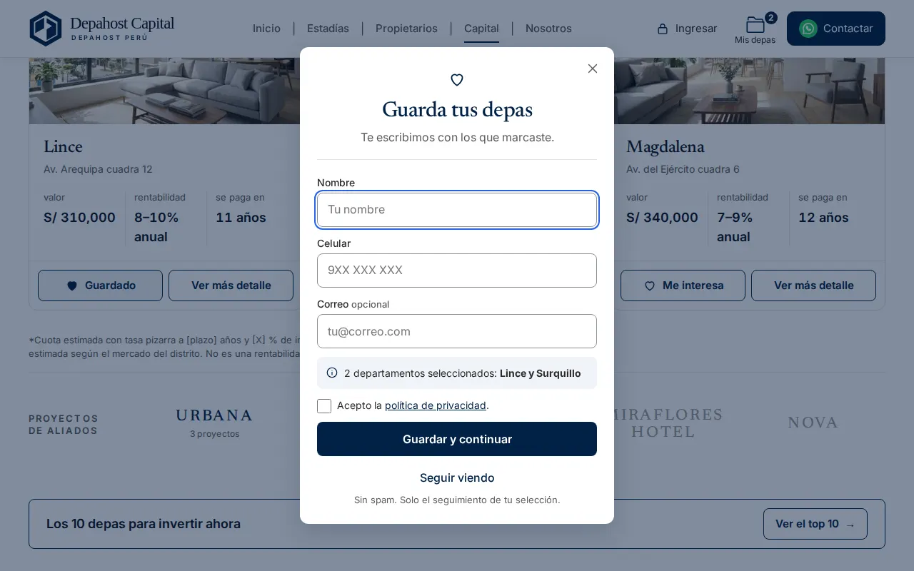

*Aviso "Guarda tus inmuebles" al guardar el segundo inmueble.*

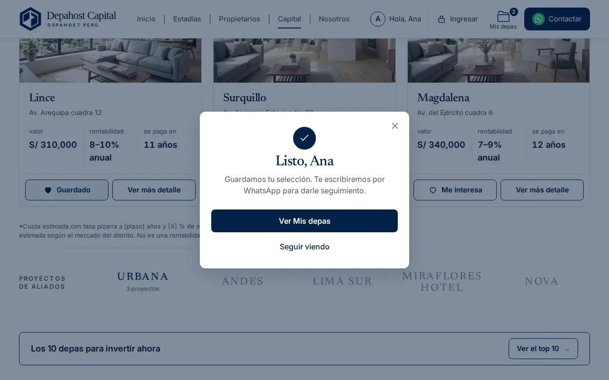

*Confirmación después de dejar nombre y celular.*

**Para qué sirve.** Pide nombre y celular para que el equipo le escriba por WhatsApp sobre los inmuebles que marcó.

**Cómo se llega.**
- **Solo:** se abre en cualquier página cuando la lista sube a 2 o más inmuebles al tocar "Me interesa". No sale si en ese navegador la persona ya dejó sus datos, ni si cerró el aviso hace menos de 7 días.
- **A pedido:** con el enlace "Guárdalos con tu celular" de la página `/mis-inmuebles`. Así se abre siempre, aunque esté en pausa. El enlace solo se ve mientras la persona no haya dejado su nombre.

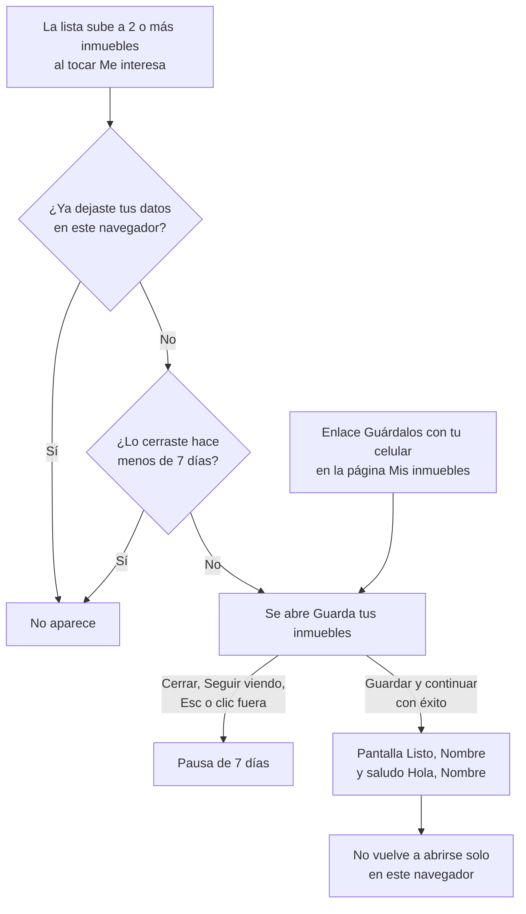

**Qué se ve.**
- Título "Guarda tus inmuebles" y el texto "Te escribimos con los que marcaste.".
- Campos "Nombre" ("Tu nombre"), "Celular" ("9XX XXX XXX") y "Correo" con la marca "opcional" ("tu@correo.com").
- Un resumen de lo guardado, por ejemplo "2 inmuebles seleccionados: Lince y Surquillo" (los distritos son de ejemplo). Con uno solo dice "1 inmueble seleccionado". Si la lista está vacía, el resumen no aparece.
- La casilla "Acepto la política de privacidad.", que enlaza a `/privacidad`.
- La verificación anti-robots de Cloudflare, solo si está configurada.
- El botón "Guardar y continuar", el enlace "Seguir viendo", la "X" para cerrar y el texto "Sin spam. Solo el seguimiento de tu selección.".

**Cómo se arma el resumen.**
- El número cuenta todo lo que está guardado en el navegador. Eso incluye inmuebles vendidos o retirados que siguen en la lista porque la persona todavía no abrió `/mis-inmuebles`, que es donde se limpian (4.5).
- Los distritos salen solo de los inmuebles que siguen en el catálogo, sin repetir. Por eso puede decir, por ejemplo, "3 inmuebles seleccionados: Lince y Surquillo" aunque uno de los tres ya no esté publicado.
- Si el catálogo no carga, el resumen muestra solo el número, sin distritos (por ejemplo "2 inmuebles seleccionados").

**Qué puede hacer.**
1. Escribe tu nombre en "Nombre".
2. Escribe tu número en "Celular".
3. Si quieres, escribe tu correo en "Correo".
4. Revisa el resumen de inmuebles seleccionados.
5. Marca "Acepto la política de privacidad.".
6. Si aparece la verificación anti-robots, complétala.
7. Toca "Guardar y continuar". El botón se bloquea y aparece "Enviando…".
8. En la pantalla "Listo, {tu primer nombre}" (por ejemplo, "Listo, Ana" si escribiste "ana lucía"), toca "Ver Mis inmuebles" para ir a tu lista o "Seguir viendo" para cerrar.

Para cerrar sin dejar datos, toca la "X", "Seguir viendo", la tecla Esc o fuera del aviso. Los inmuebles siguen guardados y el aviso queda en pausa 7 días.

**Reglas y validaciones.**

| Campo | Regla | Mensaje si falla |
|---|---|---|
| "Nombre" | Obligatorio. Mínimo 2 caracteres (sin contar espacios al inicio y al final) y máximo 120. | Si está vacío o tiene menos de 2 caracteres, avisa el navegador con su propio mensaje. Un nombre como " a" (cuenta el espacio) o de más de 120 caracteres pasa el navegador, pero el panel responde "Escribe tu nombre". |
| "Celular" | Obligatorio. De 6 a 20 caracteres: números, espacios, guiones o paréntesis, con un "+" opcional al inicio. | Si está vacío, avisa el navegador. El formato lo revisa solo el panel: aparece "Revisa los campos marcados." y, debajo del campo, "Celular no válido". |
| "Correo" | Opcional. Si se llena, debe ser un correo válido. El panel exige un dominio completo, por ejemplo ".com". | Primero avisa el navegador. Un correo como `ana@correo` pasa el navegador, pero el panel responde "Correo no válido". |
| Casilla de privacidad | Obligatoria. | Si no se marca, avisa el navegador. |
| Verificación anti-robots (si está activa) | Debe completarse. | "No pudimos verificar que no eres un robot. Inténtalo de nuevo." más el enlace "Escribir por WhatsApp". |
| Sin conexión | — | "No pudimos enviar tus datos. Revisa tu conexión o escríbenos por WhatsApp." más el enlace "Escribir por WhatsApp". |
| Falla del servidor | — | Se muestra el mensaje que manda el servidor (por ejemplo "No pudimos registrar tus datos") más el enlace "Escribir por WhatsApp". Si la respuesta no trae mensaje, se muestra "No pudimos enviar tus datos. Revisa tu conexión o escríbenos por WhatsApp.". |

Cuando el servidor marca errores por campo, aparece "Revisa los campos marcados." y el mensaje se muestra debajo de "Nombre", "Celular" o "Correo". La verificación anti-robots se reinicia después de cada error.

**Qué pasa después.**
- El panel del equipo registra un lead con canal Web y origen "Guardó inmuebles". Lleva el nombre, el celular, el correo si se puso, los inmuebles de la lista en ese momento y los datos de campaña si la persona llegó desde un anuncio en esa misma pestaña del navegador. Si ya había un lead con ese celular, se une a él.
- Los inmuebles se envían tal como están en el navegador. Si quedaba alguno vendido o retirado, también va en el envío.
- La persona no recibe ningún correo ni mensaje automático. El seguimiento por WhatsApp lo hace el equipo a mano.
- En pantalla sale "Listo, {primer nombre}" con el texto "Guardamos tu selección. Te escribiremos por WhatsApp para darle seguimiento.".
- El navegador guarda solo el primer nombre, para el saludo (4.4). El aviso ya no se abre solo en ese navegador.

**Casos especiales.**
- **La API no está configurada:** al tocar "Guardar y continuar" aparece "Por ahora recibimos estas consultas por WhatsApp." con el enlace "Escribir por WhatsApp". Ese enlace abre WhatsApp con el mensaje "Hola, quiero que me ayuden con los inmuebles que guardé en DepaHost Capital.". No se guarda el nombre y, al cerrar, el aviso entra en pausa de 7 días.
- **La verificación anti-robots depende de la configuración:** si el panel la exige y el sitio no muestra el recuadro, todos los envíos fallan con el mensaje del robot.
- **El envío es una foto del momento:** los inmuebles que la persona guarde o quite después no se envían de nuevo.
- **Inmuebles que ya no están en el catálogo:** como la lista solo se limpia al abrir `/mis-inmuebles`, el resumen puede contar un inmueble vendido o retirado sin nombrarlo, y el envío lo incluye (ver "Cómo se arma el resumen").
- **La política de privacidad es un borrador:** el texto de `/privacidad` está pendiente de revisión legal y su fecha de actualización dice "[fecha pendiente]".
- **En celular** el aviso ocupa casi todo el ancho de la pantalla.

### 4.4 Saludo "Hola, …"

- Después de enviar "Guarda tus inmuebles", el encabezado muestra "Hola, {nombre}" con un círculo que lleva la inicial. Al tocarlo, lleva a `/mis-inmuebles`.
- Usa solo la primera palabra del nombre, con mayúscula inicial. Por ejemplo, "ana lucía" se muestra como "Ana".
- Se ve en pantallas desde 640 px de ancho. En celulares angostos no aparece. Entre 1024 y 1279 px solo se ve el círculo con la inicial.
- En `/mis-inmuebles`, la nota final cambia a "Guardado para {nombre}. La próxima vez te mostramos inmuebles parecidos.".
- Si la persona borra los datos del navegador, el saludo desaparece.

### 4.5 Página "Mis inmuebles"

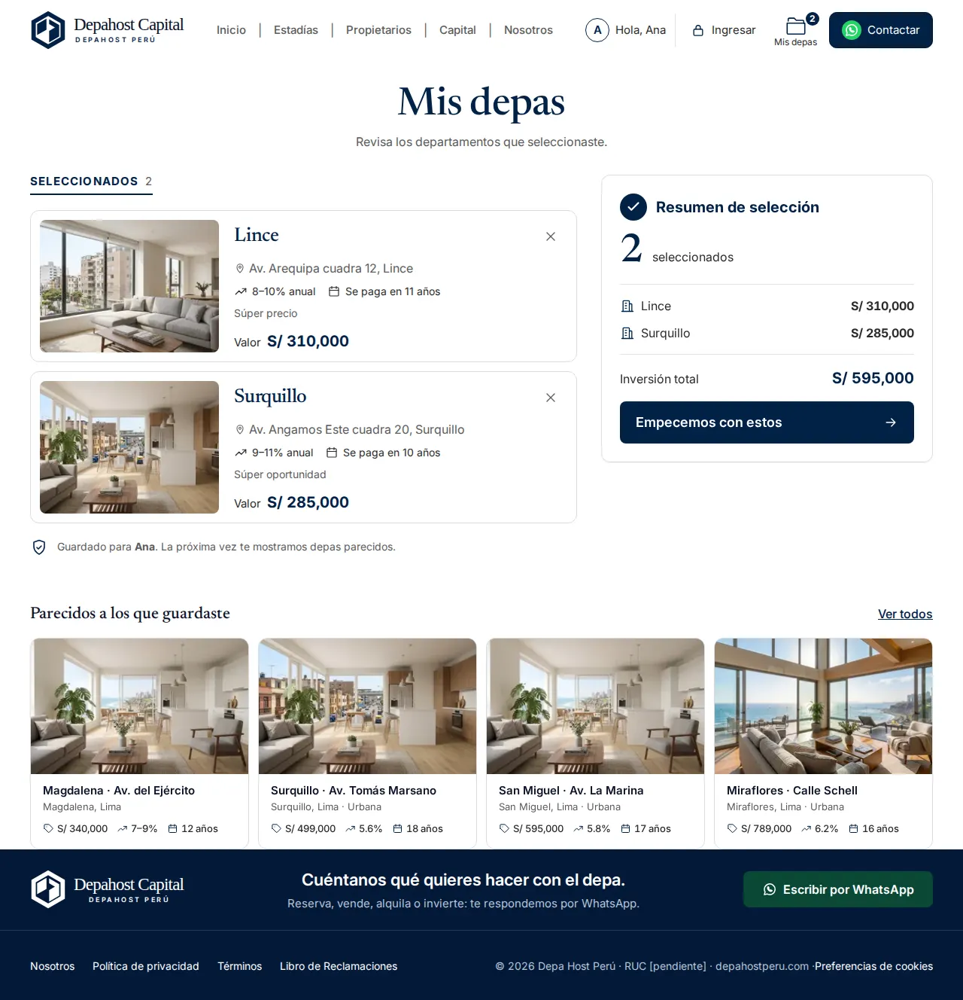

*Página "Mis inmuebles" con dos inmuebles guardados.*

**Para qué sirve.** Revisar y comparar los inmuebles guardados, ver cuánto suman y pasar a pedir acompañamiento.

**Cómo se llega.** Por el ícono "Mis inmuebles" del encabezado, por el saludo "Hola, …", por "Ver Mis inmuebles" en el aviso o por "Cambiar selección" en "Te acompañamos". La ruta es `/mis-inmuebles`. La página no sale en Google.

**Qué se ve.**

| Parte | Contenido |
|---|---|
| Encabezado | "Mis inmuebles" y "Revisa los inmuebles que seleccionaste." |
| "Seleccionados" | Cuántos inmuebles guardados se encontraron en el catálogo. |
| Tarjeta de cada inmueble | Foto (o un ícono de casa si no tiene foto); el distrito como título, con enlace a la ficha; la "X" para quitar; la dirección y el distrito; dormitorios, baños y m² si existen, y si no, la rentabilidad y "Se paga en …"; una línea con la inmobiliaria y la descripción o etiqueta del inmueble ("Reservado" si está reservado); y "Valor" (inmueble de propietario) o "Desde" (proyecto) con el precio. |
| "Resumen de selección" | El número de inmuebles con "seleccionados", la lista de distritos con su precio, la "Inversión total" y el botón "Empecemos con estos". |
| Nota final | Sin nombre guardado: "Guardado en este dispositivo. Guárdalos con tu celular y te escribimos con los que marcaste." ("Guárdalos con tu celular" abre el aviso de 4.3). Con nombre: "Guardado para {nombre}. La próxima vez te mostramos inmuebles parecidos." |
| "Parecidos a los que guardaste" | Hasta 4 inmuebles sugeridos, con el enlace "Ver todos" a la lista de `/capital`. |

**Qué puede hacer.**
1. Toca el distrito de una tarjeta para abrir su ficha.
2. Toca la "X" de una tarjeta para quitar ese inmueble. No pide confirmación y no se puede deshacer. Para recuperarlo, vuelve a tocar "Me interesa" en su ficha.
3. Revisa la "Inversión total" en el resumen.
4. Toca "Empecemos con estos" para ir a "Te acompañamos" (4.7).
5. Si aún no dejaste tus datos, toca "Guárdalos con tu celular".

**Reglas.**
- **Inversión total:** suma los precios por moneda, por ejemplo "S/ 595,000" o "S/ 595,000 + US$ 80,000".
- **"Empecemos con estos":** se ve apagado y no responde mientras no haya ningún inmueble.
- **Inmuebles que ya no están en el catálogo:** se quitan solos de la lista al abrir la página, sin aviso. Son los vendidos o retirados. Los reservados se quedan, marcados como "Reservado".
- **"Parecidos a los que guardaste":** se arma con los inmuebles guardados (pesan más) y con las últimas 6 fichas que la persona abrió. Nunca sugiere un inmueble ya guardado. A los que ya vio les baja la prioridad, pero pueden salir antes que otros si se parecen mucho. Se recalcula al quitar un inmueble. Si no hay nada guardado ni visto, o no hay sugerencias, la sección no aparece.

**Casos especiales.**
- **Lista vacía:** aparece "Aún no guardaste inmuebles. Toca Me interesa en los que te gusten." con el botón "Explorar inmuebles" (va a `/capital`). Si la persona abrió fichas antes, igual pueden salir sugerencias abajo.
- **No hay botón "Seguir viendo" en esta página.** "Seguir viendo" solo existe en el aviso "Guarda tus inmuebles". Para seguir explorando desde aquí se usan "Explorar inmuebles", "Ver todos" o el menú "Capital".
- **Solo inmuebles en dólares:** la inversión total igual muestra soles en cero, por ejemplo "S/ 0 + US$ 80,000".
- **El catálogo no carga:** aparece "No pudimos cargar tus inmuebles guardados. Recarga la página.".
- **Celular frente a escritorio:** desde 900 px de ancho, el resumen va a la derecha y acompaña al bajar la página. En pantallas más angostas va debajo de la lista. Hasta 480 px, cada tarjeta pone la foto arriba. Las sugerencias se ven en 1 columna en celular, en 2 desde 640 px y en 4 desde 1024 px.

### 4.6 Dirección antigua `/carrito`

"Mis inmuebles" antes estaba en `/carrito` y en `/mis-depas`. Quien abra esas direcciones, por ejemplo desde un enlace viejo, pasa automáticamente a `/mis-inmuebles`. Lo mismo pasa con `/capital/empecemos` (ver 4.7). Esas direcciones tampoco salen en Google.

### 4.7 Página "Te acompañamos"

> **Pendiente de actualizar.** Desde el 24 de octubre, `/capital/empecemos` lleva sola a `/mis-inmuebles`: "Te acompañamos" se unió a "Mis inmuebles". Esta sección describe la página anterior.

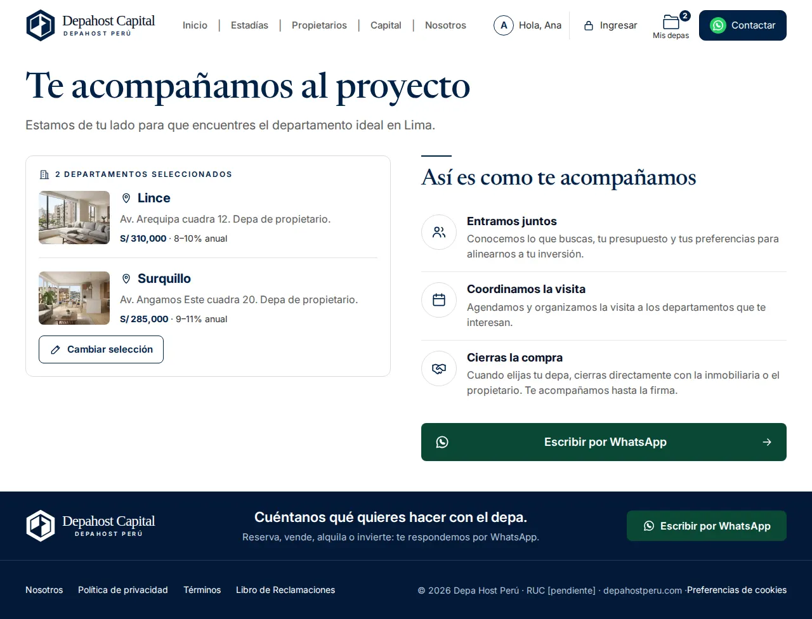

*Página "Te acompañamos" con los inmuebles elegidos.*

**Para qué sirve.** Es el paso previo a WhatsApp. Muestra los inmuebles elegidos, explica cómo acompaña el equipo y abre WhatsApp con un mensaje ya escrito.

**Cómo se llega.** La ruta es `/capital/empecemos` (en la pestaña dice "Te acompañamos"). La página no sale en Google.

| Desde | Botón | Qué inmuebles muestra |
|---|---|---|
| Página "Mis inmuebles" | "Empecemos con estos" | Todos los de Mis inmuebles |
| Portada de Capital (`/capital`) | "Empecemos" | Todos los de Mis inmuebles, o ninguno |
| Ficha de un inmueble | "Contactar" | Solo ese inmueble, aunque haya otros guardados. Ese inmueble no se agrega a Mis inmuebles. |

Estos botones solo llevan a la página. No envían nada al equipo. La solicitud se registra recién al tocar "Escribir por WhatsApp".

**Qué se ve.**
- El título "Te acompañamos al proyecto" y el texto "Estamos de tu lado para que encuentres el inmueble ideal en Lima.". Con un solo inmueble, el texto termina con su distrito, por ejemplo "… ideal en Lince.".
- Una tarjeta titulada "Inmueble seleccionado" o "{n} inmuebles seleccionados". El título en singular se usa con un inmueble y también cuando no hay ninguno. Cada inmueble lleva foto, distrito (con enlace a la ficha), "{dirección}. Proyecto de {inmobiliaria}." o "{dirección}. Inmueble de propietario.", y el precio con la rentabilidad (por ejemplo "S/ 310,000 · 8–10% anual"). Con varios inmuebles, la foto se achica a la izquierda.
- El botón "Cambiar selección", que vuelve a `/mis-inmuebles`. Se ve siempre, haya o no inmuebles.
- La sección "Así es como te acompañamos", con tres pasos:
  - "Entramos juntos": "Conocemos lo que buscas, tu presupuesto y tus preferencias para alinearnos a tu inversión."
  - "Coordinamos la visita": "Agendamos y organizamos la visita a los inmuebles que te interesan."
  - "Cierras la compra": "Cuando elijas tu inmueble, cierras directamente con la inmobiliaria o el propietario. Te acompañamos hasta la firma."
- El botón verde "Escribir por WhatsApp".

**Qué puede hacer.**
1. Revisa los inmuebles de la tarjeta. Si quieres cambiarlos, toca "Cambiar selección".
2. Toca "Escribir por WhatsApp".
3. En WhatsApp, que se abre en una pestaña nueva con el mensaje ya escrito, revisa el texto y envíalo. El sitio no lo envía por ti.

**Mensaje prellenado de WhatsApp.**

| Selección | Texto |
|---|---|
| Ningún inmueble | "Hola, quiero invertir en un inmueble en Lima y me gustaría que me acompañen." |
| Un inmueble | "Hola, quiero que me acompañen con este inmueble:" y debajo una línea como "- Lince (Av. Arequipa cuadra 12): S/ 310,000" |
| Varios inmuebles | "Hola, quiero que me acompañen con estos inmuebles:" y debajo una línea por inmueble con distrito, dirección y precio |

Los distritos, direcciones y precios del cuadro son de ejemplo.

**Qué se envía al equipo.** Al tocar "Escribir por WhatsApp" con al menos un inmueble, el sitio envía al panel qué inmuebles eligió la persona (origen "Mis inmuebles") y los datos de campaña: no lleva nombre ni teléfono. El panel lo guarda como interés por esos inmuebles. No pide aceptar la privacidad ni pasa por la verificación anti-robots.
- El equipo lo ve en su panel. Sabe quién es la persona cuando le llega su mensaje de WhatsApp.
- Cada toque del botón vuelve a enviar el interés. WhatsApp se abre igual, aunque el envío falle.

**Casos especiales.**
- **Sin inmuebles elegidos:** la tarjeta mantiene el título "Inmueble seleccionado" (en singular) y muestra a la vez el aviso "Todavía no elegiste un inmueble. Marca Me interesa en los que te gusten o escríbenos y te ayudamos a elegir.", el botón "Ver inmuebles" (va a `/capital`) y el botón "Cambiar selección" (va a `/mis-inmuebles`). WhatsApp se abre con el mensaje general y no se registra nada.
- **La API no está configurada o falla:** WhatsApp se abre igual. La solicitud simplemente no se registra.
- **El enlace de "Contactar" apunta a un inmueble que ya no está publicado:** la página muestra los inmuebles de Mis inmuebles.
- **Botón tocado antes de tiempo:** el botón queda listo cuando la página termina de cargar los inmuebles. Si se toca antes, abre una pestaña sin WhatsApp.
- **El catálogo no carga:** la tarjeta queda con el título "Inmueble seleccionado" y el botón "Cambiar selección", sin inmuebles y sin el aviso "Todavía no elegiste un inmueble…" ni el botón "Ver inmuebles". WhatsApp se abre con el mensaje general y no se registra nada.
- **Número de WhatsApp:** sale de la configuración del sitio y está por confirmar (ver 1.8).
- **No se actualiza sola:** la página muestra la lista tal como estaba al abrirla. Los cambios hechos en otra pestaña se ven al recargar.
- **Celular frente a escritorio:** desde 1024 px de ancho, la selección va a la izquierda y los pasos con el botón a la derecha. En pantallas más angostas va todo en una columna.

**Referencia técnica:** [`src/components/SaveButton.astro`](../../src/components/SaveButton.astro), [`src/scripts/saved-buttons.ts`](../../src/scripts/saved-buttons.ts), [`src/lib/saved-store.ts`](../../src/lib/saved-store.ts), [`src/components/Header.astro`](../../src/components/Header.astro), [`src/components/SaveListDialog.astro`](../../src/components/SaveListDialog.astro), [`src/scripts/forms.ts`](../../src/scripts/forms.ts), [`src/lib/profile.ts`](../../src/lib/profile.ts), [`src/pages/mis-inmuebles.astro`](../../src/pages/mis-inmuebles.astro), [`src/components/SavedDepa.astro`](../../src/components/SavedDepa.astro), [`src/components/ForYouRow.astro`](../../src/components/ForYouRow.astro), [`src/lib/recommend.ts`](../../src/lib/recommend.ts), [`src/data/contacto.ts`](../../src/data/contacto.ts), [`astro.config.mjs`](../../astro.config.mjs) · Capítulos: [05-flujos.md](05-flujos.md) (flujos 6, 7, 9, 10 y 11).

## 5. Formularios: propietarios y Libro de Reclamaciones

El sitio tiene dos formularios propios, además de "Guarda tus inmuebles" (4.3). Funcionan de la misma forma. Lo que cambia es qué datos piden y qué pasa al final.

| Formulario | Dónde está | Botón de envío |
|---|---|---|
| Propietarios | `/propietarios` | "Recibir propuesta" |
| Libro de Reclamaciones | `/libro-de-reclamaciones` | "Enviar reclamo" |

### 5.1 Lo que tienen en común todos los formularios

**Qué pasa cuando tocas el botón de envío**

1. Completa los campos y toca el botón de envío.
2. Primero revisa el navegador. Si falta un campo obligatorio o un dato tiene mal formato, el navegador pone su propio aviso sobre el primer campo con problema y no envía nada. El texto de ese aviso depende del navegador y de su idioma. El navegador revisa los campos obligatorios y la mayoría de los formatos (correo, documento, montos). El formato del teléfono lo revisa solo el API.
3. Si todo está bien, el botón se bloquea, se ve más tenue y debajo aparece "Enviando…". Así no se puede enviar dos veces seguidas.
4. Debajo del botón aparece el resultado: fondo verde si salió bien, rojo si hubo error y claro si es un aviso.
5. Si hubo error, el botón se desbloquea y puedes corregir e intentar otra vez.

**Errores por campo que devuelve el API**

El API revisa otra vez todos los datos. Si algo no pasa:

- El campo se marca con borde rojo.
- El motivo aparece en rojo debajo del campo, si ese campo tiene espacio para mensaje. Las listas desplegables ("Distrito", "Tipo", "Tipo de documento"…) solo se marcan con el borde.
- El cursor salta al primer campo marcado.
- Debajo del botón aparece "Revisa los campos marcados.".

Los mensajes del panel son "Escribe tu nombre", "Celular no válido", "El celular es obligatorio" y "Correo no válido".

**Mensajes de resultado**

| Situación | Mensaje | ¿Trae enlace a WhatsApp? |
|---|---|---|
| El sitio se publicó sin la dirección del API | "Por ahora recibimos estas consultas por WhatsApp." | Sí: "Escribir por WhatsApp" |
| Enviando | "Enviando…" | No |
| Un dato no pasa la revisión del panel | "Revisa los campos marcados." | No |
| Falla la verificación anti-robots | "No pudimos verificar que no eres un robot. Inténtalo de nuevo." | Sí |
| Sin conexión o el panel no responde | "No pudimos enviar tus datos. Revisa tu conexión o escríbenos por WhatsApp." | Sí |
| El panel rechaza el envío por otro motivo | El mensaje que manda el panel, por ejemplo "No pudimos registrar tus datos". Si no manda ninguno, sale "No pudimos enviar tus datos…" | Sí |
| Envío correcto | Depende del formulario (ver 5.2 y 5.4) | Depende |

El sitio también tiene listo el mensaje "Hiciste varios envíos seguidos. Espera un minuto e inténtalo otra vez.", pero hoy el panel no limita los envíos, así que no aparece.

El enlace a WhatsApp se abre en una pestaña nueva y trae un mensaje ya escrito con lo que llenaste. Así la persona no pierde la consulta aunque el envío falle. El número de WhatsApp está por confirmar (ver 1.8).

**Depende de la configuración:** el panel solo acepta envíos de las direcciones web de su lista de orígenes permitidos (`WEB_ORIGINS`). Si la dirección del sitio no está en esa lista, el navegador bloquea el envío y todas las personas ven "No pudimos enviar tus datos…" con el enlace a WhatsApp. No se guarda nada.

**Verificación anti-bots (Cloudflare Turnstile)**

- Es un recuadro de Cloudflare que aparece encima del botón de envío o del mensaje de resultado. Sale en español y con tema claro.
- A veces se resuelve solo. Otras veces pide que marques una casilla. Espera a que termine antes de enviar.
- Si el envío falla, el recuadro se reinicia solo. Complétalo otra vez antes de reenviar.
- **Depende de la configuración:**
  - Si el sitio no tiene la clave de Turnstile, el recuadro no aparece.
  - El panel la exige solo en los envíos que llevan celular, y solo si tiene su clave de Turnstile (debe tenerla en producción). Si la exige y el sitio no muestra el recuadro, esos envíos fallan con el mensaje "No pudimos verificar que no eres un robot…".
  - En desarrollo local, sin claves, todo pasa sin verificación.

**Casilla de consentimiento**

- Los formularios tienen una casilla obligatoria para aceptar la política de privacidad, con enlace a `/privacidad`.
- Si no la marcas, el navegador no deja enviar. El panel guarda que la persona aceptó.
- La página de privacidad es un **borrador** que aún debe revisar un abogado. Tiene la fecha de actualización y algunos plazos "[pendiente]".

**Campo oculto contra bots**

Cada formulario tiene un campo "Sitio web" que las personas no ven. Si un programa lo llena, el panel responde como si todo hubiera salido bien, pero no guarda nada ni avisa al equipo. En las pruebas con herramientas automáticas, deja ese campo vacío.

**Límite de envíos**

Hoy el panel no limita cuántos envíos llegan desde una misma conexión. Está anotado como pendiente.

**De qué campaña vienes**

Si llegaste por un enlace de campaña (con parámetros `utm_` en la dirección), el sitio lo recuerda mientras la pestaña siga abierta. Lo manda junto con los formularios de contacto. Así el equipo sabe de qué campaña viene cada contacto.

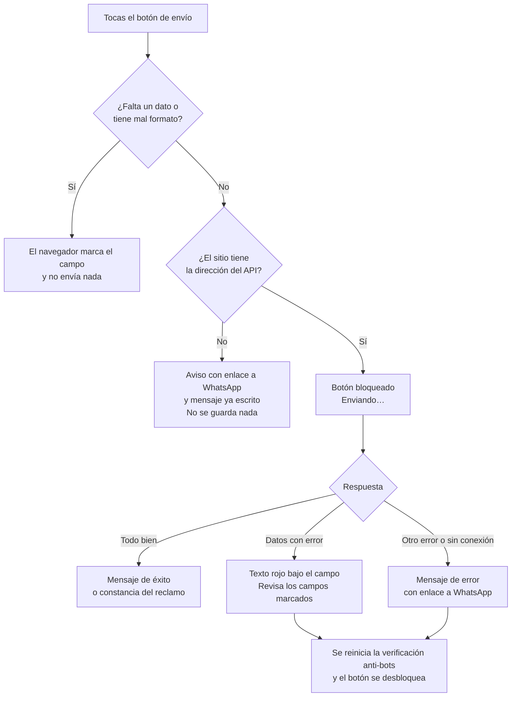

### 5.2 Propietarios: vender o poner en alquiler (`/propietarios`)

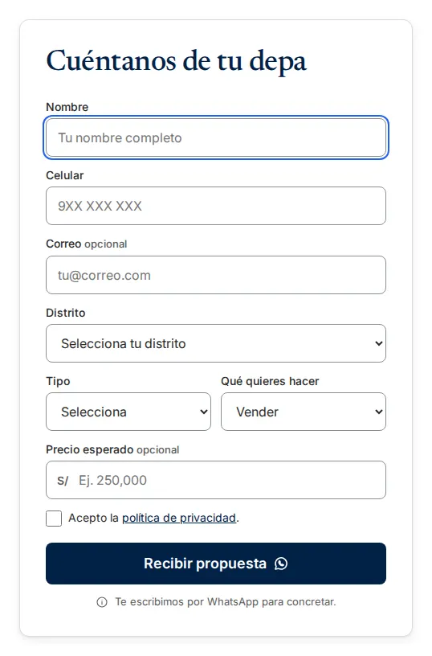

*Formulario de Propietarios con "Vender" elegido.*

**Para qué sirve**

Es para el dueño de un inmueble que quiere venderlo, alquilarlo a largo plazo o que Depa Host lo opere en Airbnb. Es un contacto rápido: no pide cuenta y el equipo sigue la conversación por WhatsApp.

**Cómo se llega**

- Menú principal: "Propietarios".
- Inicio: botón "Soy propietario". Se abre un menú con dos opciones:
  - "Vender mi propiedad" lleva a `/propietarios#vender` y deja elegido "Vender".
  - "Poner en alquiler mi propiedad" lleva a `/propietarios#alquiler` y deja elegido "Alquilar (largo plazo)".
  - En el celular, el menú se abre debajo del botón y empuja el contenido. Desde 640 px de ancho se abre como panel flotante. Se cierra con Esc o tocando fuera.
- Inicio: tarjeta "Propietarios: vende o ponlo en alquiler".
- Dirección directa: `depahostperu.com/propietarios`.

**Qué se ve**

- Título "Vende o alquila tu inmueble en Lima" y el texto "Te sugerimos el precio para venderlo en máximo 2 meses, o lo operamos en Airbnb."
- Botones "Quiero vender" y "Poner en alquiler".
- El formulario "Cuéntanos de tu inmueble". Debajo del botón dice "Te escribimos por WhatsApp para concretar."
- Tres pasos numerados, cada uno con su texto:

  | Paso | Texto |
  |---|---|
  | 1. "Precio" | "Te sugerimos el valor con el que tu inmueble se mueve." |
  | 2. "Pauta" | "Lo publicamos en portales, medios y redes." |
  | 3. "Cierre" | "Te acompañamos hasta la firma o el primer huésped." |

- La franja "Aliados" con las inmobiliarias, si hay alguna cargada.
- En el celular, el formulario va debajo del título. Desde 1024 px va a la derecha del título.

**Qué puede hacer**

1. Si quieres, toca "Quiero vender" o "Poner en alquiler". Eso elige la opción en "Qué quieres hacer" y te lleva al campo "Nombre".
2. Escribe tu nombre en "Nombre".
3. Escribe tu número en "Celular".
4. Si quieres, escribe tu "Correo" (es opcional).
5. Elige tu "Distrito". La lista trae 36 distritos de Lima y Callao en orden alfabético. Si el tuyo no está, elige "Otro".
6. Elige el "Tipo": "Departamento", "Dúplex o penthouse", "Casa" u "Otro".
7. Elige "Qué quieres hacer": "Vender", "Alquilar (largo plazo)" u "Operarlo en Airbnb".
8. Si quieres, escribe el monto en soles. El campo se llama "Precio esperado" si eliges vender, o "Alquiler mensual esperado" si eliges alquilar o Airbnb.
9. Marca "Acepto la política de privacidad."
10. Completa la verificación anti-bots, si aparece.
11. Toca "Recibir propuesta".

**Reglas y validaciones**

| Campo | Regla | Mensaje si falla |
|---|---|---|
| "Nombre" | Obligatorio. Mínimo 2 caracteres, máximo 120 | Aviso del navegador. Si el panel no lo acepta: "Escribe tu nombre" |
| "Celular" | Obligatorio. De 6 a 20 caracteres: números, espacios, paréntesis, guiones y un "+" opcional al inicio | Aviso del navegador si está vacío. Si el formato no es válido, el navegador no lo detecta: el panel responde "Celular no válido", que aparece en rojo bajo el campo junto con "Revisa los campos marcados." |
| "Correo" | Opcional. Si lo escribes, debe tener formato de correo (máximo 200 caracteres) | Aviso del navegador. En el panel: "Correo no válido" |
| "Distrito" | Obligatorio. Una opción de la lista | Aviso del navegador |
| "Tipo" | Obligatorio | Aviso del navegador |
| "Qué quieres hacer" | Obligatorio | Aviso del navegador |
| "Precio esperado" / "Alquiler mensual esperado" | Opcional. Solo números, espacios, comas y puntos. Se guarda como número, en soles | Aviso del navegador si escribes letras |
| Casilla de privacidad | Obligatoria | Aviso del navegador |
| Verificación anti-bots | Debe completarse, si está activa | "No pudimos verificar que no eres un robot. Inténtalo de nuevo." |

**Qué pasa después**

1. Aparece "¡Listo! Te escribimos por WhatsApp para concretar." con el enlace "Adelantar por WhatsApp".
2. El enlace abre WhatsApp con este mensaje ya escrito: "Hola, soy [nombre]. Quiero [vender / poner en alquiler / operar en Airbnb] mi inmueble en [distrito]."
3. El formulario se vacía.
4. Si eligió "Vender", el panel del equipo registra un lead con canal Web y origen "Quiere vender": nombre, celular, correo, distrito, tipo, precio y campaña. Si ya había un lead con ese celular, se une a él.
5. Si eligió "Alquilar (largo plazo)" u "Operarlo en Airbnb", el sitio muestra el mismo mensaje de éxito, pero **el panel no registra el contacto**: los alquileres están fuera de su alcance. La conversación sigue solo por WhatsApp.
6. La persona **no** recibe correo de confirmación. El siguiente paso es el WhatsApp del equipo.

**Casos especiales**

- **Sin API:** sale "Por ahora recibimos estas consultas por WhatsApp." con "Escribir por WhatsApp" y el mismo mensaje armado. No se guarda nada.
- **Puntos de miles:** usa coma o ningún separador. Si escribes "250.000", el punto se toma como decimal y se guarda **250**.
- **Segundo envío sin recargar:** la verificación anti-bots no se reinicia después de un envío correcto. Un segundo envío seguido puede fallar con el mensaje del robot. Vuelve a completar el recuadro (se reinicia tras el error) o recarga la página.
- **Etiqueta del precio:** después de enviar, "Qué quieres hacer" vuelve a "Selecciona". Si antes elegiste alquiler, el campo de precio puede seguir diciendo "Alquiler mensual esperado".
- **Airbnb:** no tiene enlace directo. `#alquiler` elige el alquiler a largo plazo y "Operarlo en Airbnb" se elige en la lista.

### 5.3 Inversionistas del extranjero: formulario en inglés

Ya no existe: el rediseño del 24 de octubre lo quitó de `/capital`. La versión en inglés del sitio está pendiente.

### 5.4 Libro de Reclamaciones (`/libro-de-reclamaciones`)

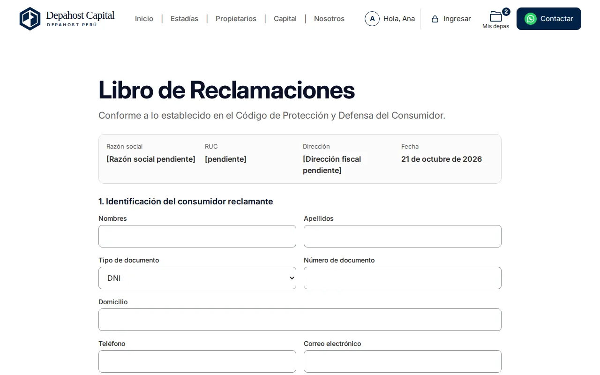

*Libro de Reclamaciones.*

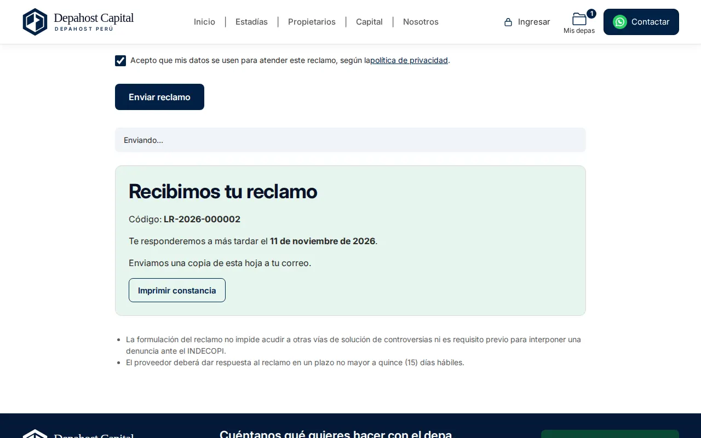

*Así se verá la constancia cuando el panel registre los reclamos. Hoy todavía no los registra (ver abajo).*

**Para qué sirve**

Es el Libro de Reclamaciones virtual que pide el Código de Protección y Defensa del Consumidor. Cualquier persona puede registrar un reclamo o una queja, sin cuenta.

**Hoy el envío no funciona.** El panel del equipo todavía no implementa el registro de reclamos (`POST /v1/complaints`). Al tocar "Enviar reclamo", el sitio muestra un error (por lo general "No pudimos enviar tus datos. Revisa tu conexión o escríbenos por WhatsApp.") con el enlace "Escribir por WhatsApp", que trae el mensaje "Hola, quiero registrar un reclamo en el Libro de Reclamaciones.". No se registra nada ni se da código. Es un pendiente legal (INDECOPI: código y constancia).

**Cómo se llega**

- Pie de página de cualquier página: "Libro de Reclamaciones".
- Página "Términos", sección "7. Reclamos".
- Dirección directa: `depahostperu.com/libro-de-reclamaciones`.

**Qué se ve**

- Título "Libro de Reclamaciones" y el texto "Conforme a lo establecido en el Código de Protección y Defensa del Consumidor."
- Un recuadro con los datos del proveedor: "Razón social", "RUC", "Dirección" y "Fecha". Hoy muestran datos **pendientes**: "[Razón social pendiente]", "[pendiente]" y "[Dirección fiscal pendiente]".
- El formulario, en tres bloques:
  - "1. Identificación del consumidor reclamante"
  - "2. Identificación del bien contratado"
  - "3. Detalle de la reclamación y pedido del consumidor"
- Dos notas al final:
  - "La formulación del reclamo no impide acudir a otras vías de solución de controversias ni es requisito previo para interponer una denuncia ante el INDECOPI."
  - "El proveedor deberá dar respuesta al reclamo en un plazo no mayor a quince (15) días hábiles."
- En el celular, todo va en una columna. Desde 640 px, los campos van de dos en dos.

**Reclamo o queja**

| Opción | Cuándo usarla (texto de la pantalla) |
|---|---|
| "Reclamo" (viene marcada) | "disconformidad con el producto o servicio." |
| "Queja" | "malestar con la atención recibida, no relacionado con el producto o servicio." |

**Qué puede hacer**

Bloque 1, tus datos:

1. Escribe tus "Nombres" y "Apellidos".
2. Elige el "Tipo de documento": "DNI" (viene elegido), "Carné de extranjería", "Pasaporte" o "RUC".
3. Escribe el "Número de documento".
4. Escribe tu "Domicilio".
5. Escribe tu "Teléfono" y tu "Correo electrónico". Bajo el correo dice "Aquí te enviaremos la constancia y la respuesta."
6. Si eres menor de edad, marca "Soy menor de edad". Aparece el campo "Nombre del padre, madre o apoderado": complétalo.

Bloque 2, el bien contratado:

7. Elige "Servicio" (viene marcado) o "Producto".
8. Escribe la "Descripción". Ejemplo de la pantalla: "p. ej. Estadía en inmueble de Lince del 10 al 12 de octubre".
9. Si quieres, escribe el "Monto reclamado (S/)" (es opcional).

Bloque 3, el detalle:

10. Elige "Reclamo" o "Queja".
11. En "Detalle", cuenta qué pasó.
12. En "Pedido", escribe qué solicitas.

Para terminar:

13. Marca "Acepto que mis datos se usen para atender este reclamo, según la política de privacidad."
14. Completa la verificación anti-bots, si aparece.
15. Toca "Enviar reclamo". El botón dice lo mismo aunque elijas "Queja".

**Reglas y validaciones**

| Campo | Regla | Mensaje si falla |
|---|---|---|
| "Nombres" / "Apellidos" | Obligatorios. De 2 a 100 caracteres | Aviso del navegador |
| "Tipo de documento" | Uno de los cuatro de la lista | — |
| "Número de documento" | Obligatorio. De 6 a 20 caracteres: letras, números o guiones. Es la misma regla para los cuatro tipos (no revisa, por ejemplo, que un DNI tenga 8 dígitos) | Aviso del navegador |
| "Domicilio" | Obligatorio. De 5 a 300 caracteres | Aviso del navegador |
| "Teléfono" | Obligatorio. De 6 a 20 caracteres: números, espacios, paréntesis, guiones y un "+" opcional al inicio | Aviso del navegador si está vacío. El formato no lo revisa el navegador |
| "Correo electrónico" | Obligatorio. Formato de correo, máximo 200 caracteres | Aviso del navegador |
| "Nombre del padre, madre o apoderado" | Obligatorio solo si marcas "Soy menor de edad". De 2 a 200 caracteres | Aviso del navegador si está vacío |
| "Servicio" / "Producto" | Uno de los dos | — |
| "Descripción" | Obligatoria. De 3 a 1000 caracteres | Aviso del navegador |
| "Monto reclamado (S/)" | Opcional. Número de 0 o más, con hasta 2 decimales, máximo 100,000,000 | Aviso del navegador si es negativo o tiene más de 2 decimales |
| "Reclamo" / "Queja" | Uno de los dos | — |
| "Detalle" | Obligatorio. De 10 a 3000 caracteres (no deja escribir más de 3000) | Aviso del navegador |
| "Pedido" | Obligatorio. De 5 a 2000 caracteres (no deja escribir más de 2000) | Aviso del navegador |
| Casilla de consentimiento | Obligatoria | Aviso del navegador |
| Verificación anti-bots | Debe completarse, si está activa | — |

**Qué pasa después**

- **Hoy:** el error con el enlace a WhatsApp descrito arriba. El reclamo se atiende por WhatsApp.
- **Cuando el panel registre los reclamos:** el formulario desaparece y se ve la constancia de la captura: "Recibimos tu reclamo" (o "Recibimos tu queja"), "Código: LR-…", "Te responderemos a más tardar el [fecha].", "Enviamos una copia de esta hoja a tu correo." y el botón "Imprimir constancia". El plazo legal de respuesta es de 15 días hábiles. Cómo se arma el código, la constancia por correo y la respuesta del equipo lo definirá el panel.

**Casos especiales**

- **Sin API:** sale "Por ahora recibimos estas consultas por WhatsApp." con "Escribir por WhatsApp" y el mismo mensaje. No se registra nada.
- **Datos del proveedor pendientes:** "[Razón social pendiente]", "[pendiente]" y "[Dirección fiscal pendiente]". Hay que completarlos antes del lanzamiento.
- **La "Fecha" del recuadro del proveedor** es la fecha en que se publicó el sitio por última vez, no necesariamente la de hoy.
- **Menor de edad:** si desmarcas "Soy menor de edad", el campo del apoderado se oculta y no se envía.

**Referencia técnica:** [propietarios.astro](../../src/pages/propietarios.astro), [libro-de-reclamaciones.astro](../../src/pages/libro-de-reclamaciones.astro), [forms.ts](../../src/scripts/forms.ts), [api/client.ts](../../src/lib/api/client.ts), [Turnstile.astro](../../src/components/Turnstile.astro), [OwnerDropdown.astro](../../src/components/OwnerDropdown.astro), [SaveListDialog.astro](../../src/components/SaveListDialog.astro), [empresa.ts](../../src/data/empresa.ts), [contacto.ts](../../src/data/contacto.ts) · Panel: `DH_panel/app/api/v1/leads/route.ts` · Capítulos técnicos: [05-flujos.md](05-flujos.md) (secciones 12 y 15).

## 6. Cómo se publica un inmueble en la web

El sitio no tiene cuentas ni un panel para el público. Los inmuebles los publica el equipo de Depa Host en su panel interno, **DH_panel**:

1. En el panel, abre "Inmuebles" → "Nuevo inmueble". Registra al propietario, el inmueble y el contrato. El inmueble queda "En cartera".
2. En la ficha del inmueble, sube las fotos.
3. Toca "Actualizar web". El sitio se vuelve a generar y el inmueble aparece en Capital en unos 2 minutos.

Solo salen en la web los inmuebles "En cartera" con autorización para publicar. El detalle está en la documentación de DH_panel (`DH_panel/README.md` y `DH_panel/docs/`).

## 7. Preguntas frecuentes

**1. ¿Necesito una cuenta para ver o guardar inmuebles?**
No. El sitio no tiene cuentas. Sin registrarte puedes buscar inmuebles, abrir fichas, tocar "Me interesa", pedir acompañamiento y enviar formularios. Ver [4.2](#42-la-lista-mis-inmuebles).

**2. Guardé inmuebles en mi celular y no los veo en mi computadora. ¿Por qué?**
"Mis inmuebles" se guarda solo en el navegador donde tocaste "Me interesa". Cada navegador tiene su propia lista. Ver [4.2](#42-la-lista-mis-inmuebles).

**3. ¿Cuántos inmuebles puedo guardar?**
Hasta 20. Si guardas uno más, se quita el más antiguo, sin aviso. Ver [4.1](#41-botón-me-interesa).

**4. ¿Cómo pido que me acompañen a comprar?**
Toca "Empecemos con estos" en "Mis inmuebles", o "Contactar" en la ficha de un inmueble. En "Te acompañamos al proyecto", toca "Escribir por WhatsApp" y envía el mensaje que se abre ya escrito. El sitio no envía el mensaje por ti. Ver [4.7](#47-página-te-acompañamos).

**5. Toqué un botón de WhatsApp y no llegó a nadie. ¿Qué pasó?**
El número de WhatsApp está por confirmar. En preproducción se usa el relleno "51XXXXXXXXX", que no abre un chat real. Ver [1.8](#18-botones-de-whatsapp).

**6. ¿Puedo reservar una estadía desde el sitio?**
Todavía no. "Estadías" es una página en construcción, aunque el inicio ofrezca "Reservar estadía". Por ahora la única forma de consultar es WhatsApp. Ver [1.10](#110-páginas-en-construcción-estadías-y-nosotros).

**7. Cerré el aviso "Guarda tus inmuebles". ¿Vuelve a aparecer?**
Sí, pero no antes de 7 días, y solo cuando guardes otro inmueble y la lista tenga 2 o más. Si quieres abrirlo antes, toca "Guárdalos con tu celular" en "Mis inmuebles". Si ya dejaste tus datos en ese navegador, no se vuelve a abrir solo. Ver [4.3](#43-aviso-guarda-tus-inmuebles).

**8. Un enlace a un inmueble muestra "No encontramos esta página". ¿Por qué?**
Puede ser que el inmueble ya no esté publicado, que cambiara su dirección web, o que se haya publicado hace poco y la web todavía no se haya actualizado. Ver [3.9](#39-inmuebles-reservados-vendidos-y-enlaces-que-ya-no-existen).

**9. Soy propietario. ¿Cómo publico mi inmueble?**
Llena el formulario de `/propietarios` o escribe por WhatsApp. El equipo te contacta y, si corresponde, publica el inmueble desde su panel. Ver [5.2](#52-propietarios-vender-o-poner-en-alquiler-propietarios) y [6](#6-cómo-se-publica-un-inmueble-en-la-web).

**10. ¿Cuánto tarda en verse un inmueble que publicó el equipo?**
Unos 2 minutos después de que el equipo toca "Actualizar web" en su panel. Ver [6](#6-cómo-se-publica-un-inmueble-en-la-web).

**11. ¿Puedo registrar un reclamo en el Libro de Reclamaciones?**
Hoy no por la web: el envío muestra un error y ofrece WhatsApp, porque el panel todavía no registra reclamos. Ver [5.4](#54-libro-de-reclamaciones-libro-de-reclamaciones).

**Referencia técnica:** [05-flujos.md](05-flujos.md), [07-decisiones-y-pendientes.md](07-decisiones-y-pendientes.md)

## 8. Escenarios de aceptación

Estos casos sirven para comprobar que el sitio se comporta como dice este manual. Cada fila es un escenario. Salvo que se diga otra cosa, se prueban en preproducción. Ahí el WhatsApp usa el número de relleno "51XXXXXXXXX", Clarity está vacío y la verificación anti-robots depende de la clave configurada. Si un escenario dice "sin API", el sitio se genera sin `API_URL` ni `PUBLIC_API_URL`: no tiene inmuebles y los formularios ofrecen WhatsApp. Los escenarios que citan inmuebles o inmobiliarias de ejemplo (Lince, "Urbana"…) necesitan datos equivalentes: inmuebles cargados en el panel o el catálogo de ejemplo de las pruebas automáticas (`tests/e2e/catalogo`).

### 8.1 Navegar el sitio (sección 1)

| ID | Dado | Cuando | Entonces |
|---|---|---|---|
| ESC-1.1 | Una persona en escritorio | Abre `/` | Ve el título "El inmueble en Lima, con la decisión correcta.", los botones "Reservar estadía", "Soy propietario" y "Comprar para rentabilizar", y tres tarjetas de servicios. La pestaña dice "Inicio \| Depa Host Perú" |
| ESC-1.2 | La home abierta | Toca "Comprar para rentabilizar" | Llega a `/capital` |
| ESC-1.3 | La home abierta | Toca "Reservar estadía", el botón o la tarjeta | Llega a `/estadias` y ve solo "Estadías" y "Página en construcción." |
| ESC-1.4 | La home abierta | Toca "Soy propietario" y luego "Vender mi propiedad" | Llega a `/propietarios#vender`. En "Qué quieres hacer" ya está elegido "Vender" |
| ESC-1.5 | La home abierta | Toca "Soy propietario" y luego "Poner en alquiler mi propiedad" | Llega a `/propietarios#alquiler`. En "Qué quieres hacer" ya está elegido "Alquilar (largo plazo)" |
| ESC-1.6 | El menú de "Soy propietario" abierto | Presiona Esc, toca fuera o toca otra vez "Soy propietario" | El menú se cierra sin navegar |
| ESC-1.7 | Una tarjeta de servicio en la home | Toca el texto de la tarjeta, no "Ver más →" | Navega igual a la página de esa tarjeta |
| ESC-1.8 | Cualquier página principal | Mira el menú del encabezado | La página actual aparece subrayada. En el detalle de un inmueble no se subraya "Capital" |
| ESC-1.9 | Navegación con teclado | Presiona Tab al cargar una página | Aparece "Saltar al contenido" y lleva directo al contenido |
| ESC-1.12 | Un navegador que dejó el nombre "ana lucía" en "Guarda tus inmuebles" | Abre una página en 1280 px | Ve "Hola, Ana" con el círculo "A". El saludo lleva a `/mis-inmuebles` |
| ESC-1.16 | Un navegador con nombre guardado, en un teléfono de menos de 640 px | Revisa la barra y el menú de tres rayas | El saludo no aparece en ningún lado (pendiente conocido) |
| ESC-1.18 | Pantalla entre 1024 y 1279 px, con nombre guardado | Mira el encabezado | El saludo es solo el círculo con la inicial |
| ESC-1.19 | 0 inmuebles guardados | Mira "Mis inmuebles" del encabezado | No se ve ningún número |
| ESC-1.20 | Dos pestañas del sitio abiertas | Guarda un inmueble en una pestaña | El contador de "Mis inmuebles" sube también en la otra |
| ESC-1.21 | Pantalla de menos de 1024 px | Toca "Abrir menú" | El panel entra por la derecha, el fondo se oscurece y no se puede desplazar la página de atrás. Muestra "Inicio", "Estadías", "Propietarios", "Capital", "Nosotros", "ES \| EN" y "WhatsApp" |
| ESC-1.22 | El menú de tres rayas abierto | Toca la "✕", toca la zona oscura o presiona Esc | El menú se cierra y el scroll vuelve |
| ESC-1.23 | El menú abierto en una ventana angosta | Agranda la ventana a 1024 px o más | El menú se cierra solo |
| ESC-1.24 | El menú de tres rayas abierto | Pasa el mouse sobre "EN" y luego toca "ES" | "EN" no responde y muestra "Próximamente". "ES" recarga la misma página en español |
| ESC-1.25 | Un teléfono de menos de 640 px, en `/` o `/capital` | Carga la página y luego baja | El botón flotante de WhatsApp aparece recién al pasar la parte de arriba de la página |
| ESC-1.26 | Un teléfono, en `/propietarios` | Carga la página | El botón flotante se ve desde el principio. Se esconde al aparecer la franja azul del pie y al abrir el menú |
| ESC-1.27 | Cualquier página desde 640 px | Toca "Contactar" del encabezado | WhatsApp se abre en una pestaña nueva con "Hola, les escribo desde la web de Depa Host Perú." |
| ESC-1.28 | Cualquier página | Toca "Escribir por WhatsApp" del pie | WhatsApp se abre con "Hola, les cuento qué quiero hacer con mi inmueble." |
| ESC-1.29 | Preproducción | Abre cualquier enlace de WhatsApp del sitio | El enlace va al número "51XXXXXXXXX" |
| ESC-1.30 | El pie de página | Revisa la fila legal | Ve "Nosotros", "Política de privacidad", "Términos", "Libro de Reclamaciones", "RUC [pendiente]" y "Preferencias de cookies" |
| ESC-1.31 | Primera visita, con los datos del navegador limpios | Abre cualquier página | Aparece "Usamos cookies de analítica" con "Rechazar" y "Aceptar", sin botón de cerrar. La página se puede seguir usando |
| ESC-1.32 | El aviso de cookies visible | Navega a otra página sin elegir | El aviso aparece de nuevo |
| ESC-1.33 | El aviso de cookies visible, en producción | Toca "Aceptar" | El aviso se cierra y se carga Microsoft Clarity. En la siguiente visita no hay aviso y Clarity se carga solo |
| ESC-1.34 | El aviso de cookies visible | Toca "Rechazar" | El aviso se cierra, no se carga Clarity y no vuelve a salir |
| ESC-1.35 | Preproducción, con `PUBLIC_CLARITY_ID` vacío | Toca "Aceptar" | La elección se guarda, pero no se carga ninguna analítica |
| ESC-1.36 | Ya se eligió una opción | Toca "Preferencias de cookies" en el pie | El aviso vuelve a aparecer y se puede cambiar la elección |
| ESC-1.37 | Se aceptó antes y Clarity está activo | Cambia a "Rechazar" y luego abre otra página | En la página actual Clarity sigue cargado. En la siguiente ya no se carga |
| ESC-1.38 | Un navegador que bloquea el almacenamiento | Elige una opción y cambia de página | El aviso reaparece en cada página |
| ESC-1.39 | Cualquier dirección inexistente, por ejemplo `/xyz` | La abre | Ve "404", "No encontramos esta página", "Ver inmuebles para invertir" (a `/capital`) e "Ir al inicio" (a `/`). La pestaña dice "Página no encontrada \| Depa Host Perú" |
| ESC-1.40 | Un enlace viejo a `/carrito` | Lo abre | Pasa solo a `/mis-inmuebles` |
| ESC-1.41 | El pie de página | Toca "Política de privacidad" y "Términos" | Se ven los borradores con "Última actualización: [fecha pendiente]", "[Razón social pendiente]" y RUC "[pendiente]" |
| ESC-1.42 | El pie de página | Toca "Nosotros" | Ve "Nosotros" y "Página en construcción." |

### 8.2 Buscar inmuebles en DepaHost Capital (sección 2)

Los ejemplos usan los datos de las capturas: Lince S/ 310,000, Surquillo y Magdalena.

| ID | Dado | Cuando | Entonces |
|---|---|---|---|
| ESC-2.1 | Una persona sin cuenta | Abre `/capital` | La pestaña dice "Capital \| Depa Host Perú". Ve "Los mejores inmuebles para invertir en Lima.", los pasos "Comparas", "Consultas", "Te acompañamos", "Cierras" y solo tarjetas "De propietario" |
| ESC-2.2 | El sitio sin API | Abre `/capital` | No hay inmuebles ni franja de aliados |
| ESC-2.3 | La portada de Capital | Toca "Ver todos los proyectos" | La página baja hasta "Proyectos de aliados". No abre otra página |
| ESC-2.4 | Ningún inmueble en "Mis inmuebles" | Toca "Empecemos" | Se abre `/capital/empecemos` con "Todavía no elegiste un inmueble. Marca **Me interesa** en los que te gusten o escríbenos y te ayudamos a elegir." |
| ESC-2.5 | La portada de Capital | Escribe "surq" en "Busca por distrito, dirección o precio" | Mientras escribe, queda solo Surquillo |
| ESC-2.6 | La portada de Capital | Busca "310000", "310,000", "310 000" o "S/ 310" | Cada vez aparece el inmueble de S/ 310,000 |
| ESC-2.7 | La portada de Capital | Busca "ejercito", sin tilde | Encuentra el inmueble de "Av. del Ejército" |
| ESC-2.8 | La portada de Capital | Busca "super precio" | Encuentra la tarjeta con la etiqueta "Súper precio" |
| ESC-2.9 | La portada de Capital | Busca un texto que no coincide con ningún inmueble | Se ocultan todas las tarjetas y aparece "No encontramos inmuebles con esos criterios." |
| ESC-2.10 | El buscador con texto | Presiona Enter | La página no se recarga. En el celular se cierra el teclado |
| ESC-2.11 | Los datos de ejemplo | Revisa los chips | Ve "Lince", "Magdalena", "Surquillo", "Hasta S/ 300,000", "Desde 8% anual" y "Desde 9% anual". No ve "Hasta S/ 350,000" |
| ESC-2.12 | Ningún chip activo | Toca "Lince" | El chip se pinta de azul oscuro con una "x" y queda solo Lince. Aparece "Limpiar filtros" |
| ESC-2.13 | "Lince" activo | Toca "Magdalena" | Queda solo Magdalena. "Lince" se apaga |
| ESC-2.14 | La portada | Activa "Surquillo" y "Desde 9% anual" | Queda Surquillo |
| ESC-2.15 | La portada | Escribe "Lince" y activa "Hasta S/ 300,000" | No queda ninguno. Aparece "No encontramos inmuebles con esos criterios." |
| ESC-2.16 | Un inmueble de "7–9% anual" | Activa "Desde 8% anual" | Ese inmueble no aparece, porque se compara su mínimo |
| ESC-2.17 | Un chip activo | Lo toca otra vez | Se quita el filtro |
| ESC-2.18 | Un chip activo y texto en el buscador | Toca "Limpiar filtros" | Se apagan los chips, se borra el texto, vuelven todas las tarjetas, el cursor queda en el buscador y el botón se oculta |
| ESC-2.19 | Filtros aplicados | Recarga la página | Vuelven a verse todos los inmuebles. La URL no cambió |
| ESC-2.20 | El sitio generado con un solo inmueble de propietario | Abre `/capital` | Solo aparece el chip de su distrito, sin chips de precio ni de rentabilidad |
| ESC-2.21 | Ningún inmueble de propietario publicado | Abre `/capital` | Aparece "No encontramos inmuebles con esos criterios." al cargar y no hay chips |
| ESC-2.22 | JavaScript desactivado | Abre `/capital` | Se ven todas las tarjetas, pero el buscador, los chips y "Me interesa" no responden |
| ESC-2.23 | Una tarjeta de inmueble | Revisa su contenido | Ve "De propietario", el distrito, la dirección, "valor", "rentabilidad", "se paga en", "Me interesa" y "Ver más detalle". No tiene botón de contacto |
| ESC-2.24 | Un inmueble reservado | Mira su tarjeta en `/capital` | Ve "De propietario" y "Reservado" en lugar de la etiqueta comercial |
| ESC-2.25 | Un inmueble cargado en USD 90,000 | Mira su tarjeta y activa "Hasta S/ 300,000" | La tarjeta muestra "S/" y el inmueble pasa el chip |
| ESC-2.26 | Una tarjeta | Toca fuera de los botones o "Ver más detalle" | Abre `/capital/{slug}` |
| ESC-2.27 | Una tarjeta | Toca "Me interesa" y luego "Guardado" | Primero cambia a "Guardado" con el corazón relleno y el contador sube. Después vuelve a "Me interesa" y el contador baja |
| ESC-2.28 | 20 inmuebles guardados | Guarda uno más | El contador sigue en 20. Sale el más antiguo, sin aviso |
| ESC-2.29 | Supuestos de cuota sin cargar | Mira debajo de las tarjetas | No hay nota de cuota estimada |
| ESC-2.30 | Un navegador sin historial ni inmuebles guardados | Abre `/capital` | La fila "Para ti, según lo que has visto" no aparece |
| ESC-2.31 | Un navegador sin historial, en `/capital` | Toca "Me interesa" en una tarjeta | La fila no aparece hasta recargar |
| ESC-2.32 | Un navegador que ya abrió fichas | Abre `/capital` | Aparecen hasta 4 tarjetas chicas, sin "Me interesa" ni "Reservado". Ninguna está en "Mis inmuebles" |
| ESC-2.33 | La fila "Para ti" visible | Toca "Me interesa" en una tarjeta de la lista | La fila se recalcula y el inmueble guardado no sale en ella |
| ESC-2.34 | Hay historial, pero falla la descarga del catálogo | Abre `/capital` | La fila no aparece y no se muestra ningún error |
| ESC-2.35 | La franja "Proyectos de aliados" con los datos de ejemplo | Toca "Urbana" y luego "Andes" | "Urbana" abre "Proyectos de Urbana". "Andes" está en gris y no responde |
| ESC-2.36 | Ninguna inmobiliaria registrada | Abre `/capital` y toca "Ver todos los proyectos" | La franja no aparece y el botón no hace nada |
| ESC-2.37 | Los datos de ejemplo (6 inmuebles) | Mira la barra y el ranking | El título es "Los inmuebles para invertir ahora". Debajo dice "Ordenados por rentabilidad anual estimada." |
| ESC-2.38 | Hay exactamente 10 inmuebles publicados | Mira el ranking | El título es "Los 10 inmuebles para invertir ahora" |
| ESC-2.39 | Hay un inmueble reservado | Revisa el ranking | El reservado no aparece |
| ESC-2.40 | El ranking visible | Toca el número o la rentabilidad de una fila | Abre el detalle de ese inmueble |
| ESC-2.41 | Un celular | Mira la barra del Top 10 | El botón dice "Ver →". En tablet y escritorio dice "Ver el top 10 →" |
| ESC-2.42 | Ningún inmueble publicado | Toca la barra del Top 10 | El ranking no aparece y tocar la barra no lleva a ningún lado |
| ESC-2.43 | Un celular de menos de 640 px | Abre `/capital` | Las tarjetas forman un carrusel horizontal. Hay 2 columnas en tablet y 3 desde 1024 px |

### 8.3 Ver un inmueble y los proyectos de una inmobiliaria (sección 3)

| ID | Dado | Cuando | Entonces |
|---|---|---|---|
| ESC-3.1 | Los datos de ejemplo | Abre `/capital/lince-av-arequipa-cuadra-12` | El título es "Lince · Av. Arequipa", la dirección "Av. Arequipa cuadra 12, Lince" y la etiqueta "De propietario · Súper precio". Ve "valor" con "Precio de compra", "rentabilidad" con "Estimada" y "se paga en" con "Plazo de inversión" |
| ESC-3.2 | La ficha de un inmueble de propietario | Revisa el bloque del aliado | Ve "Te acompaña", "DepaHost Capital" y "Plataforma inmobiliaria con enfoque en inversión accesible y de confianza.", sin enlace |
| ESC-3.3 | La ficha de un proyecto de Urbana | Revisa la miga de pan y el bloque | La miga es "Capital" › "Urbana" › distrito. Ve "Aliado del proyecto", "Inmobiliaria aliada de DepaHost Capital." y "Ver sus 3 proyectos". La nota de "valor" dice "Precio desde" |
| ESC-3.4 | Una inmobiliaria con un solo proyecto | Abre la ficha de ese proyecto | No aparece "Ver sus N proyectos". El nombre de la miga lleva a su página |
| ESC-3.5 | Un proyecto reservado de Urbana | Abre su ficha | La etiqueta es "Reservado · De proyecto · Urbana", sin insignia. "Me interesa" y "Contactar" funcionan |
| ESC-3.6 | Un inmueble vendido o en borrador | Abre su `/capital/{slug}` | Ve la página 404 |
| ESC-3.7 | El equipo cambió el slug de un inmueble | Abre el enlace con el slug antiguo | Ve la 404, sin redirección |
| ESC-3.8 | Un inmueble sin dormitorios, baños ni m² | Abre su ficha | No aparece la fila de características |
| ESC-3.9 | Un inmueble con solo los m² cargados | Abre su ficha | Los m² salen con el ícono de cama (observación conocida) |
| ESC-3.10 | Un inmueble sin fotos | Abre su ficha | Ve un recuadro con el dibujo de una casa |
| ESC-3.11 | Un inmueble con varias fotos | Toca una miniatura | No se abre ningún visor |
| ESC-3.12 | Un inmueble en dólares | Mira la ficha, la tarjeta de `/capital` y el Top 10 | La ficha muestra "US$". La tarjeta de `/capital` y el Top 10 muestran "S/" |
| ESC-3.13 | Cualquier ficha | Revisa el aviso | Ve "Renta estimada. No constituye una garantía de rentabilidad futura." |
| ESC-3.14 | Una ficha sin "Mis inmuebles" | Toca "Me interesa" y luego "Guardado" | Primero cambia a "Guardado" y el contador sube. Después vuelve a "Me interesa" |
| ESC-3.15 | Una ficha, con 2 inmuebles en "Mis inmuebles" | Toca "Contactar" | Se abre `/capital/empecemos?depa={slug}` con "Inmueble seleccionado", solo ese inmueble y "… ideal en {distrito}." |
| ESC-3.16 | La página abierta desde "Contactar", con API | Toca "Escribir por WhatsApp" | WhatsApp se abre con "Hola, quiero que me acompañen con este inmueble:" y "- {Distrito} ({dirección}): {precio}". Se registra una consulta sin datos personales |
| ESC-3.17 | Una ficha | Revisa "Inmuebles similares que te pueden interesar" | Hay hasta 4 tarjetas chicas sin "Me interesa". No está el mismo inmueble ni ningún vendido |
| ESC-3.18 | Un inmueble reservado entre los similares | Mira su tarjeta | No dice "Reservado" |
| ESC-3.19 | El sitio con un único inmueble visible | Abre su ficha | No aparece la sección de similares |
| ESC-3.20 | Un navegador limpio | Abre 13 fichas distintas | El historial guarda solo las últimas 12. No se envía nada al API |
| ESC-3.21 | Los datos de ejemplo | Abre `/capital/aliados/urbana` | Ve "Inmobiliaria aliada", "Proyectos de Urbana", "Inmuebles en venta de esta inmobiliaria.", "3 proyectos encontrados" y ningún chip "Desde …% anual". La pestaña dice "Proyectos de Urbana \| Depa Host Perú" |
| ESC-3.22 | `/capital/aliados/urbana` | Escribe un texto que no coincide | Ve "No encontramos proyectos con esos criterios." y "0 proyectos encontrados" |
| ESC-3.23 | `/capital/aliados/urbana` | Busca "595000" o "S/ 595,000" | Encuentra el mismo proyecto |
| ESC-3.24 | Un proyecto en US$ 50,000 | Busca "US$ 50,000" y luego "50000" | La primera búsqueda no da resultados. La segunda sí |
| ESC-3.25 | La página de una inmobiliaria | Busca por una palabra de la descripción | No la encuentra |
| ESC-3.26 | La página con texto escrito | Toca "Buscar" o presiona Enter | Se aplica la búsqueda y en el celular se cierra el teclado |
| ESC-3.27 | La página con un chip activo y texto | Toca "Limpiar filtros" | Se borran el texto y los chips, el contador vuelve al total y el cursor queda en la caja |
| ESC-3.28 | Una inmobiliaria con más de 3 proyectos | Abre su página | Aparecen chips "Desde …% anual" |
| ESC-3.29 | Una inmobiliaria sin proyectos publicados ni reservados | Abre `/capital/aliados/{slug}` | Ve la 404 |
| ESC-3.30 | La página de una inmobiliaria | Toca "Volver a todos los inmuebles" y "Aliados" de la miga | El primero lleva a la lista de `/capital`. El segundo, a la franja de aliados |
| ESC-3.31 | La inmobiliaria con web cargada | Toca "Sitio web de {nombre}" | Se abre en una pestaña nueva. Sin web cargada, el enlace no aparece |
| ESC-3.32 | Un proyecto reservado | Mira la página de su inmobiliaria | La tarjeta dice "Reservado" y cuenta en el contador |
| ESC-3.33 | Un inmueble publicado | El equipo lo saca de cartera en su panel y toca "Actualizar web" | Unos 2 minutos después, la ficha da 404 y el inmueble desaparece de las listas |
| ESC-3.34 | Una pantalla de menos de 480 px | Abre la página de una inmobiliaria | El botón "Buscar" muestra solo la palabra, sin ícono |

### 8.4 Guardar inmuebles y pedir acompañamiento (sección 4)

| ID | Dado | Cuando | Entonces |
|---|---|---|---|
| ESC-4.1 | Un navegador limpio | Toca "Me interesa" en un inmueble | Cambia a "Guardado", el contador muestra 1 y no se abre ningún aviso |
| ESC-4.2 | 1 inmueble guardado y nunca se dejaron datos | Guarda un segundo inmueble | Se abre "Guarda tus inmuebles" con "2 inmuebles seleccionados: {distritos}" |
| ESC-4.3 | "Guarda tus inmuebles" abierto | Toca la "X", "Seguir viendo", Esc o fuera | Se cierra, los inmuebles siguen guardados y no vuelve a abrirse solo durante 7 días |
| ESC-4.4 | El aviso cerrado hace menos de 7 días | Guarda otro inmueble | No se abre el aviso |
| ESC-4.5 | El aviso en pausa | Toca "Guárdalos con tu celular" en `/mis-inmuebles` | El aviso se abre igual |
| ESC-4.6 | El aviso abierto | Toca "Guardar y continuar" con "Nombre" vacío o la casilla sin marcar | El navegador avisa y no se envía nada |
| ESC-4.7 | El aviso abierto, con API | Envía "Celular" = "abc123" con lo demás válido | Ve "Revisa los campos marcados." y, bajo "Celular", "Celular no válido" |
| ESC-4.8 | El aviso abierto, con API | Envía "Correo" = `ana@correo` | El navegador lo acepta y el panel responde "Correo no válido" bajo "Correo" |
| ESC-4.9 | El aviso abierto, con API | Envía "Nombre" = " a" | El panel lo rechaza con "Escribe tu nombre" |
| ESC-4.10 | El aviso abierto, con API | Envía "ana lucía", un celular válido y la casilla marcada | El botón se bloquea con "Enviando…". Luego aparece "Listo, Ana" con "Guardamos tu selección. Te escribiremos por WhatsApp para darle seguimiento.", "Ver Mis inmuebles" y "Seguir viendo" |
| ESC-4.11 | Un envío correcto de "Guarda tus inmuebles" | Revisa el encabezado en 1280 px | Ve "Hola, Ana", que lleva a `/mis-inmuebles`. El aviso no vuelve a abrirse solo en ese navegador |
| ESC-4.12 | Un envío correcto | El equipo revisa su panel | Hay un lead con canal Web y origen "Guardó inmuebles", con los inmuebles de ese momento |
| ESC-4.13 | El sitio sin API | Toca "Guardar y continuar" | Ve "Por ahora recibimos estas consultas por WhatsApp." y "Escribir por WhatsApp", con "Hola, quiero que me ayuden con los inmuebles que guardé en DepaHost Capital.". No se guarda el nombre |
| ESC-4.14 | El API caído o sin conexión | Envía el aviso | Ve "No pudimos enviar tus datos. Revisa tu conexión o escríbenos por WhatsApp." y el enlace "Escribir por WhatsApp" |
| ESC-4.16 | El panel exige Turnstile, pero el sitio no tiene la clave | Envía el aviso | Ve "No pudimos verificar que no eres un robot. Inténtalo de nuevo." y "Escribir por WhatsApp" |
| ESC-4.17 | 3 inmuebles guardados, uno de ellos ya vendido, sin haber abierto `/mis-inmuebles` | Se abre el aviso | El resumen dice "3 inmuebles seleccionados" y nombra solo los distritos que siguen en el catálogo |
| ESC-4.18 | Lista vacía | Abre `/mis-inmuebles` | Ve "Aún no guardaste inmuebles. Toca Me interesa en los que te gusten." con "Explorar inmuebles". "Empecemos con estos" está apagado |
| ESC-4.19 | Un inmueble de S/ 310,000 y otro de S/ 285,000 guardados | Abre `/mis-inmuebles` | El resumen muestra "Inversión total" "S/ 595,000" |
| ESC-4.20 | Solo inmuebles en dólares | Abre `/mis-inmuebles` | La inversión total sale como "S/ 0 + US$ 80,000" |
| ESC-4.21 | Un inmueble vendido en la lista | Abre `/mis-inmuebles` | Se quita solo, sin aviso, y el contador del encabezado se corrige. Un reservado se queda con "Reservado" |
| ESC-4.22 | `/mis-inmuebles` con inmuebles | Toca la "X" de una tarjeta | Se quita sin confirmación. "Parecidos a los que guardaste" se recalcula |
| ESC-4.23 | Sin datos dejados en el aviso | Mira la nota final de `/mis-inmuebles` | Ve "Guardado en este dispositivo. Guárdalos con tu celular y te escribimos con los que marcaste." |
| ESC-4.24 | Datos dejados como "Ana" | Mira la nota final | Ve "Guardado para Ana. La próxima vez te mostramos inmuebles parecidos." y no aparece "Guárdalos con tu celular" |
| ESC-4.25 | Falla la descarga del catálogo | Abre `/mis-inmuebles` | Ve "No pudimos cargar tus inmuebles guardados. Recarga la página." |
| ESC-4.26 | 2 inmuebles en "Mis inmuebles" | Toca "Empecemos con estos" | Ve "2 inmuebles seleccionados", los pasos "Entramos juntos", "Coordinamos la visita", "Cierras la compra" y "Cambiar selección". No se registra nada |
| ESC-4.27 | 2 inmuebles elegidos, con API | Toca "Escribir por WhatsApp" | WhatsApp se abre con "Hola, quiero que me acompañen con estos inmuebles:" y una línea por inmueble. El panel guarda el interés por esos inmuebles, sin nombre ni teléfono |
| ESC-4.28 | Ningún inmueble elegido | Abre `/capital/empecemos` y toca "Escribir por WhatsApp" | Ve "Inmueble seleccionado", "Todavía no elegiste un inmueble…", "Ver inmuebles" y "Cambiar selección". WhatsApp se abre con "Hola, quiero invertir en un inmueble en Lima y me gustaría que me acompañen." y no se registra nada |
| ESC-4.29 | El sitio sin API | Toca "Escribir por WhatsApp" con inmuebles | WhatsApp se abre igual y no se registra nada |
| ESC-4.30 | Falla la descarga del catálogo | Abre `/capital/empecemos` | La tarjeta queda con "Inmueble seleccionado" y "Cambiar selección", sin el aviso ni "Ver inmuebles". WhatsApp usa el mensaje general |
| ESC-4.31 | El enlace `?depa=` de un inmueble ya no publicado | Abre la página | Muestra los inmuebles de "Mis inmuebles" |
| ESC-4.32 | "Te acompañamos" abierta | Guarda otro inmueble en otra pestaña | La página no cambia hasta recargarla |

### 8.5 Formularios (sección 5)

| ID | Dado | Cuando | Entonces |
|---|---|---|---|
| ESC-5.1 | `/propietarios` | Toca "Quiero vender" | Queda elegido "Vender" y el cursor pasa a "Nombre". "Poner en alquiler" elige "Alquilar (largo plazo)" |
| ESC-5.2 | El formulario de Propietarios | Elige "Vender" y luego "Operarlo en Airbnb" | El campo de precio cambia de "Precio esperado" a "Alquiler mensual esperado" |
| ESC-5.3 | El formulario de Propietarios | Envía sin "Distrito", "Tipo" o la casilla de privacidad | El navegador marca el primer campo con problema y no envía nada |
| ESC-5.4 | El formulario de Propietarios, con API | Envía "Celular" = "abc" con lo demás válido | El campo queda con borde rojo y "Celular no válido", y aparece "Revisa los campos marcados." |
| ESC-5.5 | El formulario de Propietarios | Escribe letras en el precio | El navegador no deja enviar |
| ESC-5.6 | El formulario de Propietarios, con API | Envía datos válidos | El botón se bloquea con "Enviando…". Luego aparece "¡Listo! Te escribimos por WhatsApp para concretar." con "Adelantar por WhatsApp" y el formulario se vacía |
| ESC-5.7 | El éxito anterior con "Ana", "Vender" y "Lince" | Toca "Adelantar por WhatsApp" | El mensaje es "Hola, soy Ana. Quiero vender mi inmueble en Lince." |
| ESC-5.8 | Un envío correcto con "Vender" | El equipo revisa su panel | Hay un lead con canal Web y origen "Quiere vender". La persona no recibe correo |
| ESC-5.9 | Un envío con "Alquilar (largo plazo)" u "Operarlo en Airbnb" | El equipo revisa su panel | El sitio mostró éxito, pero el panel no registró nada |
| ESC-5.10 | El formulario de Propietarios | Envía el precio "250.000" | Se guarda 250 |
| ESC-5.11 | Un envío correcto con Turnstile activo | Envía otra vez sin recargar | Puede fallar con "No pudimos verificar que no eres un robot…". El recuadro se reinicia tras el error |
| ESC-5.12 | El sitio sin API | Envía Propietarios | Ve "Por ahora recibimos estas consultas por WhatsApp." y "Escribir por WhatsApp", con el mensaje armado. No se guarda nada |
| ESC-5.13 | Una prueba automatizada | Llena el campo oculto "Sitio web" y envía | El sitio muestra éxito, pero no se guarda nada ni se avisa al equipo |
| ESC-5.15 | El origen del sitio no está en `WEB_ORIGINS` del panel | Envía cualquier formulario | Ve "No pudimos enviar tus datos. Revisa tu conexión o escríbenos por WhatsApp." y no se guarda nada |
| ESC-5.23 | `/libro-de-reclamaciones` | Abre la página | Ve "[Razón social pendiente]", "[pendiente]", "[Dirección fiscal pendiente]", los bloques 1 a 3, "Reclamo" marcado, "DNI" y "Servicio" elegidos, y "Enviar reclamo" |
| ESC-5.24 | El Libro | Marca "Soy menor de edad" | Aparece "Nombre del padre, madre o apoderado". Si se desmarca, se oculta y no se envía |
| ESC-5.26 | El Libro | Envía el "Número de documento" "12-34", de menos de 6 caracteres | El navegador lo frena |
| ESC-5.27 | El Libro | Envía "Monto reclamado (S/)" = 10.555 o un negativo | El navegador no deja enviar |
| ESC-5.28 | El Libro | Escribe más de 3000 caracteres en "Detalle" | El cuadro no deja escribir más |
| ESC-5.29 | El Libro, con API | Envía un reclamo válido | Ve un error con el enlace "Escribir por WhatsApp". No se registra nada ni hay código, porque el panel todavía no registra reclamos |
| ESC-5.34 | El Libro sin API | Lo envía | Ve "Por ahora recibimos estas consultas por WhatsApp." con "Hola, quiero registrar un reclamo en el Libro de Reclamaciones.". No hay código |
