# 09 · Manual funcional del usuario

> Estado descrito: 21 de octubre de 2026. Cada afirmación se contrastó con el código del sitio, del
> panel y del API. Si cambias una pantalla, un texto o una regla, actualiza aquí la sección que
> corresponda en el mismo cambio.

## Para quién es este manual

Este manual explica cómo usa la plataforma de Depa Host Perú una persona común: qué ve en cada pantalla, qué puede hacer, qué reglas se aplican y qué pasa después. Está pensado para el equipo comercial, QA y los dueños del negocio. No hace falta saber de programación para leerlo.

**Qué cubre.**

- El sitio público **depahostperu.com**: inicio, Capital, fichas de depas, inmobiliarias aliadas, "Mis depas", "Te acompañamos al proyecto", formularios y páginas legales.
- El panel de cuentas **app.depahostperu.com**, tal como lo usan el comprador o inversionista (rol buyer) y el propietario (rol seller). Incluye crear cuenta, ingresar, "Mis depas", "Mis consultas", "Perfil", "Mis propiedades" y "Publicar un depa".

**Qué no cubre.**

- El panel de administración: depas, solicitudes, leads, reclamos, inmobiliarias, usuarios y configuración. El manual solo menciona al equipo para contar qué pasa del otro lado, por ejemplo "el equipo revisa la solicitud" o "el equipo lo ve como lead nuevo".
- Cómo funciona la plataforma por dentro. Eso está en los capítulos técnicos 01 a 08 de esta misma carpeta.

**Cómo está organizado.**

| Parte | Qué explica |
|---|---|
| [Quién usa la plataforma](#quién-usa-la-plataforma) | Los tres perfiles y qué puede hacer cada uno |
| [El recorrido completo](#el-recorrido-completo) | El camino típico, de la primera visita a WhatsApp o a publicar un depa |
| [Mapa de pantallas](#mapa-de-pantallas) | Todas las direcciones del sitio y del panel, con la sección que las explica |
| [1](#1-navegar-el-sitio) a [5](#5-formularios-propietarios-inversionistas-del-extranjero-y-libro-de-reclamaciones) | El sitio: navegar, buscar depas, ver fichas, guardar depas, pedir acompañamiento y formularios |
| [6](#6-crear-una-cuenta-ingresar-y-manejar-la-sesión) a [8](#8-el-panel-del-propietario-publicar-un-depa) | El panel: cuenta y sesión, panel del comprador y panel del propietario |
| [9](#9-preguntas-frecuentes) | Preguntas frecuentes |

Cada pantalla o función sigue, cuando aplica, el mismo orden: **Para qué sirve**, **Cómo se llega**, **Qué se ve**, **Qué puede hacer** (pasos numerados), **Reglas y validaciones**, **Qué pasa después** y **Casos especiales**.

**Convenciones.**

- Los textos de la interfaz van entre comillas dobles y se copian tal como aparecen en pantalla. Por ejemplo: el botón "Me interesa" o el mensaje "Revisa los campos marcados.". Si un mensaje sale en inglés o con un error de redacción, se copia igual y se avisa.
- Entre llaves va lo que cambia en cada caso. Por ejemplo: "Hola, {tu nombre}" o `/capital/{slug}`.
- "Depende de la configuración" quiere decir que el comportamiento cambia según cómo esté preparado cada entorno: WhatsApp, API, panel, Turnstile, correos, almacenamiento de fotos (R2) y analítica.
- Lo que es de relleno o está pendiente se marca como tal. Por ejemplo: el número de WhatsApp 51XXXXXXXXX, los textos legales en borrador, las páginas en construcción y los datos de la empresa "[pendiente]".
- "Teléfono", "tablet" y "escritorio" se refieren al ancho de pantalla. Cada sección indica los cortes exactos (640 px, 1024 px, etc.).

**Sobre las capturas.** Las capturas se tomaron en el entorno local de desarrollo, con los **datos de ejemplo**: depas en Lince, Surquillo y Magdalena, la inmobiliaria "Urbana" y nombres de personas inventados. En producción los depas, precios, nombres e inmobiliarias serán otros.

**Referencia técnica:** [README.md](README.md), [01-arquitectura.md](01-arquitectura.md), [06-desarrollo-y-operacion.md](06-desarrollo-y-operacion.md)

## Quién usa la plataforma

La plataforma tiene tres perfiles de usuario común. Todos ven el mismo sitio. La diferencia está en lo que se guarda en la cuenta y en lo que cada uno puede abrir en el panel.

### Visitante sin cuenta

Cualquier persona que entra a depahostperu.com. No necesita registrarse para:

- buscar y filtrar depas;
- abrir las fichas;
- guardar depas con "Me interesa";
- pedir acompañamiento por WhatsApp;
- enviar los formularios.

Lo que guarda vive **solo en su navegador**: "Mis depas", el historial de fichas vistas y el nombre que deja en "Guarda tus depas". El equipo recibe sus datos solo cuando envía un formulario, llena "Guarda tus depas" o toca "Escribir por WhatsApp" en "Te acompañamos al proyecto".

### Comprador o inversionista con cuenta (rol buyer)

Es la persona que creó su cuenta eligiendo "Quiero invertir". Además de todo lo que puede hacer el visitante:

- "Mis depas" se guarda también en su cuenta y lo ve en cualquier dispositivo donde ingrese;
- ve en "Mis consultas" lo que envió con la sesión iniciada, y en qué estado está;
- el sitio lo saluda con el nombre de su cuenta.

Al ingresar llega a "Mis depas" del panel.

### Propietario con cuenta (rol seller)

Es la persona que creó su cuenta eligiendo "Tengo un depa", o que cambió a "Vender o alquilar mi depa" en "Perfil". Tiene todo lo del comprador y, además:

- puede publicar su depa con "Publicar un depa";
- sigue la revisión de cada solicitud ("Enviada", "En revisión", "Publicada" o "No aprobada");
- ve cuánto interés genera su depa una vez publicado.

Al ingresar llega a "Mis propiedades".

Cada cuenta tiene un solo rol a la vez. La persona lo puede cambiar en "Perfil". El rol de administrador no se puede elegir.

### Qué puede hacer cada uno

| Función | Visitante | Comprador | Propietario | Notas |
|---|---|---|---|---|
| Navegar el sitio y escribir por WhatsApp | ✓ | ✓ | ✓ | El número de WhatsApp hoy es de relleno (51XXXXXXXXX) |
| Buscar, filtrar y ver fichas de depas | ✓ | ✓ | ✓ | Todos ven lo mismo |
| Ver los proyectos de una inmobiliaria aliada | ✓ | ✓ | ✓ | — |
| Guardar depas con "Me interesa" | ✓ | ✓ | ✓ | Sin cuenta, solo en ese navegador y hasta 20 |
| "Mis depas" en la cuenta, en todos los dispositivos | — | ✓ | ✓ | Hasta 50. Exige que el sitio esté conectado al API |
| Dejar nombre y celular en "Guarda tus depas" | ✓ | ✓ | ✓ | Con sesión, la solicitud queda ligada a la cuenta |
| Pedir acompañamiento ("Te acompañamos al proyecto") | ✓ | ✓ | ✓ | Se registra al tocar "Escribir por WhatsApp" |
| Formulario de Propietarios ("Recibir propuesta") | ✓ | ✓ | ✓ | Deja un contacto. No crea una solicitud en "Mis propiedades" |
| Formulario en inglés para inversionistas | ✓ | ✓ | ✓ | — |
| Libro de Reclamaciones | ✓ | ✓ | ✓ | Nunca se une a una cuenta |
| Reservar una estadía | — | — | — | "Estadías" está en construcción |
| Saludo "Hola, {nombre}" en el sitio | ✓ | ✓ | ✓ | Sin cuenta, solo si dejó su nombre en "Guarda tus depas". No se ve en pantallas de menos de 640 px |
| "Mis consultas" en el panel | — | ✓ | ✓ | Solo lo enviado con la sesión iniciada |
| "Perfil": datos, rol y contraseña | — | ✓ | ✓ | El correo no se puede cambiar |
| "Publicar un depa" y "Mis propiedades" | — | — | ✓ | El comprador debe cambiar su rol en "Perfil" |
| Ver "Veces guardado" y "Consultas" de su depa | — | — | ✓ | Solo cifras, sin datos de personas |

**Referencia técnica:** [nav.ts](../../../depahost-panel/src/router/nav.ts), [access.ts](../../../depahost-panel/src/router/access.ts), [Header.astro](../../src/components/Header.astro), [account.ts](../../src/lib/account.ts), [saved-store.ts](../../src/lib/saved-store.ts) · Capítulo: [08-panel-y-cuentas.md](08-panel-y-cuentas.md)

## El recorrido completo

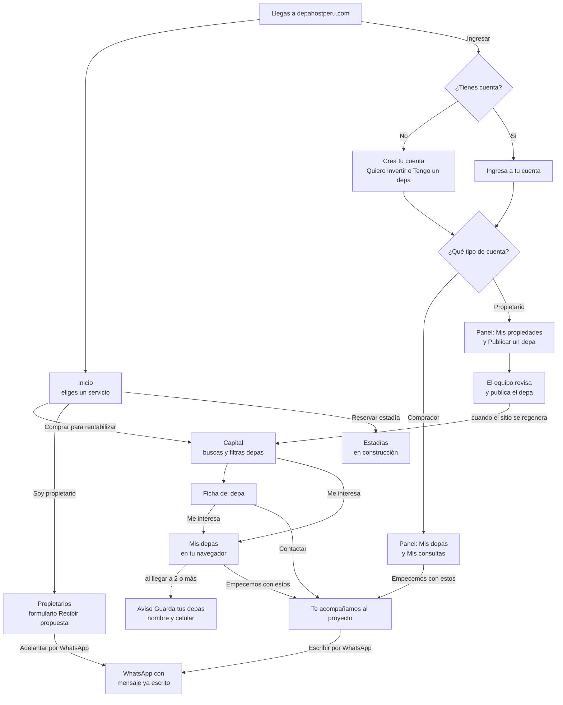

La mayoría de las personas llega al inicio y elige un servicio. Quien busca invertir entra a Capital. Ahí busca y filtra depas, abre las fichas y marca con "Me interesa" los que le gustan. Esos depas forman su lista "Mis depas", que se guarda en el navegador sin pedir cuenta. Cuando la lista llega a 2 o más depas, puede abrirse el aviso "Guarda tus depas", que pide nombre y celular para que el equipo le haga seguimiento.

Cuando está lista, la persona toca "Empecemos con estos" en "Mis depas", o "Contactar" en una ficha, y llega a "Te acompañamos al proyecto". Allí toca "Escribir por WhatsApp" y se abre la conversación con un mensaje ya escrito que lista sus depas. El propietario hace un camino más corto: llena el formulario de Propietarios y sigue la conversación por WhatsApp. "Estadías" todavía no permite reservar.

En cualquier momento, la persona puede tocar "Ingresar" y crear una cuenta gratuita. Como comprador, su lista "Mis depas" se une a la de la cuenta y ve sus consultas en el panel. Como propietario, puede publicar su depa desde el panel con fotos y datos completos. El equipo revisa cada solicitud antes de publicarla. El depa aparece en Capital recién cuando el sitio se vuelve a generar.

**Referencia técnica:** [05-flujos.md](05-flujos.md), [08-panel-y-cuentas.md](08-panel-y-cuentas.md)

## Mapa de pantallas

**Sitio público (depahostperu.com)**

| Dirección | Qué es | Quién la usa | Sección del manual |
|---|---|---|---|
| `/` | Inicio con los tres servicios | Todos | [1.2](#12-página-de-inicio) |
| `/estadias` | Estadías, en construcción | Todos | [1.10](#110-páginas-en-construcción-estadías-y-nosotros) |
| `/nosotros` | Nosotros, en construcción | Todos | [1.10](#110-páginas-en-construcción-estadías-y-nosotros) |
| `/capital` | Portada de Capital: buscador, filtros, depas de propietarios, aliados, ranking y formulario en inglés | Todos | [2](#2-buscar-depas-en-depahost-capital) y [5.3](#53-inversionistas-del-extranjero-formulario-en-inglés-capital) |
| `/capital/{slug}` | Ficha de un depa o de un proyecto | Todos | [3.1](#31-la-ficha-de-un-depa) |
| `/capital/aliados/{slug}` | Proyectos de una inmobiliaria aliada | Todos | [3.8](#38-página-de-una-inmobiliaria-aliada) |
| `/capital/empecemos` | "Te acompañamos al proyecto", el paso previo a WhatsApp | Todos | [4.7](#47-página-te-acompañamos) |
| `/mis-depas` | Lista de depas guardados con "Me interesa" | Todos | [4.5](#45-página-mis-depas) |
| `/carrito` | Dirección antigua: lleva sola a `/mis-depas` | Todos | [4.6](#46-dirección-antigua-carrito) |
| `/propietarios` | Formulario para vender o alquilar ("Recibir propuesta") | Visitante y propietario | [5.2](#52-propietarios-vender-o-poner-en-alquiler-propietarios) |
| `/libro-de-reclamaciones` | Libro de Reclamaciones virtual | Todos | [5.4](#54-libro-de-reclamaciones-libro-de-reclamaciones) |
| `/privacidad` | Política de privacidad, en borrador | Todos | [1.11](#111-política-de-privacidad-y-términos) |
| `/terminos` | Términos y condiciones, en borrador | Todos | [1.11](#111-política-de-privacidad-y-términos) |
| Cualquier otra dirección | Página 404 "No encontramos esta página" | Todos | [1.9](#19-página-no-encontrada-404) |

**Panel de cuentas (app.depahostperu.com)**

| Dirección | Qué es | Quién la usa | Sección del manual |
|---|---|---|---|
| `/` | Dirección principal. Con sesión lleva a tu inicio y sin sesión a "Ingresa a tu cuenta" | Todos | [6.2](#62-cómo-se-llega-al-panel) |
| `/registro` | "Crea tu cuenta" | Visitante | [6.4](#64-crear-cuenta) |
| `/ingresar` | "Ingresa a tu cuenta" | Comprador y propietario sin sesión | [6.5](#65-ingresar) |
| `/recuperar` | "Recupera tu contraseña" | Comprador y propietario sin sesión | [6.6](#66-olvidé-mi-contraseña) |
| `/restablecer` | "Crea una contraseña nueva", desde el enlace del correo | Comprador y propietario | [6.6](#66-olvidé-mi-contraseña) |
| `/perfil` | Datos de contacto, rol y contraseña | Comprador y propietario | [6.7](#67-perfil) |
| `/mis-depas` | "Mis depas" de la cuenta. Es el inicio del comprador | Comprador y propietario | [7.2](#72-mis-depas-en-el-panel) |
| `/mis-consultas` | Consultas enviadas con la sesión iniciada y su estado | Comprador y propietario | [7.3](#73-mis-consultas) |
| `/mis-propiedades` | Solicitudes del propietario. Es su inicio | Propietario | [8.2](#82-al-ingresar-mis-propiedades) |
| `/mis-propiedades/nueva` | "Publicar un depa" | Propietario | [8.3](#83-publicar-un-depa-crear-la-solicitud) |
| `/mis-propiedades/{id}` | Detalle de una solicitud | Propietario | [8.5](#85-el-detalle-de-una-solicitud) |
| `/mis-propiedades/{id}/editar` | "Editar mi depa" | Propietario | [8.8](#88-editar-o-eliminar-una-solicitud) |
| `/admin` y sus secciones | Panel del equipo. Si lo abre un comprador o un propietario, el panel lo lleva a su inicio | Solo administradores | [7.4](#74-lo-que-el-comprador-no-puede-abrir) |
| Cualquier otra dirección | "No encontramos esta página" con el botón "Ir a mi cuenta" | Todos | [6.2](#62-cómo-se-llega-al-panel) |

**Referencia técnica:** [src/pages/](../../src/pages/), [astro.config.mjs](../../astro.config.mjs), [router/index.ts](../../../depahost-panel/src/router/index.ts), [router/access.ts](../../../depahost-panel/src/router/access.ts) · Capítulos: [02-frontend.md](02-frontend.md), [08-panel-y-cuentas.md](08-panel-y-cuentas.md)

## 1. Navegar el sitio

Esta sección explica las partes comunes de depahostperu.com: la página de inicio, el encabezado, el pie de página, el aviso de cookies, los botones de WhatsApp y las páginas de apoyo. Todo lo que se describe aquí funciona sin cuenta.

### 1.1 Mapa del sitio

| Página | Dirección | Estado |
|---|---|---|
| Inicio | `/` | Lista |
| Estadías | `/estadias` | En construcción |
| Propietarios | `/propietarios` | Lista. Tiene su propia sección |
| Capital | `/capital` | Lista. Tiene su propia sección |
| Nosotros | `/nosotros` | En construcción |
| Mis depas | `/mis-depas` | Lista. No sale en el menú, se entra por el ícono "Mis depas" |
| Política de privacidad | `/privacidad` | Borrador |
| Términos y condiciones | `/terminos` | Borrador |
| Libro de Reclamaciones | `/libro-de-reclamaciones` | Lista. Tiene su propia sección |
| Página no encontrada | Cualquier dirección que no existe | Lista |

Los enlaces viejos a `/carrito` llevan solos a `/mis-depas`.

En la pestaña del navegador cada página se titula "Nombre de la página | Depa Host Perú". Por ejemplo: "Inicio | Depa Host Perú".

### 1.2 Página de inicio

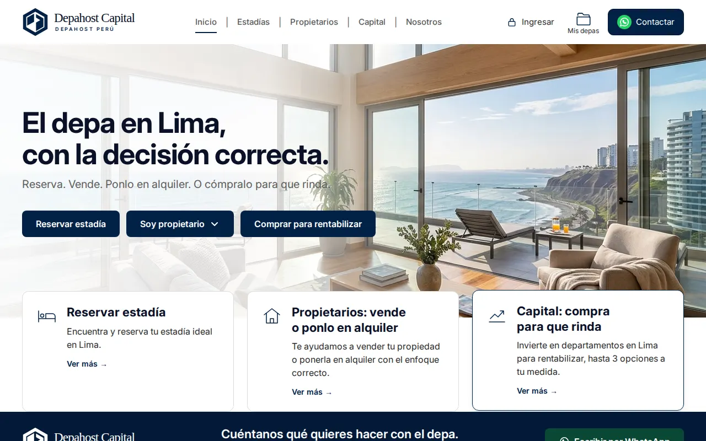

*Página de inicio.*

**Para qué sirve.** Presenta los tres servicios de Depa Host Perú y lleva a cada uno.

**Cómo se llega.** Entra a depahostperu.com (`/`). Desde cualquier página, toca el logo "Depahost Capital" o "Inicio" en el menú.

**Qué se ve.**
- Una foto de una sala con vista al mar.
- El título "El depa en Lima, con la decisión correcta."
- La frase "Reserva. Vende. Ponlo en alquiler. O cómpralo para que rinda."
- Tres botones: "Reservar estadía", "Soy propietario" (con una flecha hacia abajo) y "Comprar para rentabilizar".
- Tres tarjetas de servicios. Cada una tiene un dibujo, un título, un texto corto y "Ver más →".

| Tarjeta | Texto | A dónde lleva |
|---|---|---|
| "Reservar estadía" | "Encuentra y reserva tu estadía ideal en Lima." | `/estadias` (en construcción) |
| "Propietarios: vende o ponlo en alquiler" | "Te ayudamos a vender tu propiedad o ponerla en alquiler con el enfoque correcto." | `/propietarios` |
| "Capital: compra para que rinda" | "Invierte en departamentos en Lima para rentabilizar, hasta 3 opciones a tu medida." | `/capital` |

**Qué puede hacer.**
1. Toca "Reservar estadía" para ir a Estadías.
2. Toca "Comprar para rentabilizar" para ir a Capital.
3. Toca "Soy propietario". Se abre un menú con dos opciones:
   - "Vender mi propiedad" lleva a `/propietarios#vender`.
   - "Poner en alquiler mi propiedad" lleva a `/propietarios#alquiler`.
4. Para cerrar ese menú sin elegir, toca otra vez "Soy propietario", toca fuera del menú o presiona Esc.
5. También puedes tocar cualquier parte de una tarjeta de servicio, no solo "Ver más →".

**Qué pasa después.** Si eliges una opción de "Soy propietario", el formulario de Propietarios se abre con "Vender" o "Alquilar (largo plazo)" ya elegido en "Qué quieres hacer". La home no guarda datos ni consulta nada al sistema: todos sus textos son fijos.

**Casos especiales.**
- "Reservar estadía", tanto el botón como la tarjeta, lleva a una página en construcción. Hoy no se puede reservar desde el sitio.
- **Teléfono:** primero va el texto y debajo la foto. Los botones van uno debajo del otro, a todo el ancho. El menú de "Soy propietario" se abre debajo del botón y empuja el contenido hacia abajo.
- **Desde 640 px:** los botones van en fila y el menú de "Soy propietario" flota debajo del botón.
- **Escritorio (1024 px o más):** la foto ocupa todo el fondo y el texto va encima, a la izquierda. Los tres botones van en una sola fila. Las tarjetas se ponen en tres columnas, montadas sobre el borde inferior de la foto.

### 1.3 Encabezado

**Para qué sirve.** Te deja moverte entre páginas, entrar a tu cuenta, ver tus depas guardados y escribir por WhatsApp.

**Cómo se llega.** Aparece arriba en todas las páginas. Queda fijo cuando bajas, y al bajar un poco se le ve una sombra.

**Qué se ve, de izquierda a derecha.**
- **Logo** "Depahost Capital" / "DEPAHOST PERÚ". Lleva al inicio.
- **Menú:** "Inicio" | "Estadías" | "Propietarios" | "Capital" | "Nosotros". La página en la que estás aparece subrayada. Solo se marca en esas páginas principales: dentro del detalle de un depa, por ejemplo, no se subraya "Capital".
- **Saludo "Hola, …"**, con un círculo que muestra la inicial. Solo aparece si el sitio conoce tu nombre (ver diagrama).
- **"Ingresar"**, con un candado. Lleva a la pantalla de ingreso del panel (app.depahostperu.com/ingresar).
- **"Mis depas"**, con un ícono de carpeta. Muestra un número cuando tienes depas guardados.
- **"Contactar"**, un botón azul oscuro con el ícono verde de WhatsApp.
- **Botón de menú** (tres rayas). Solo aparece en pantallas de menos de 1024 px.

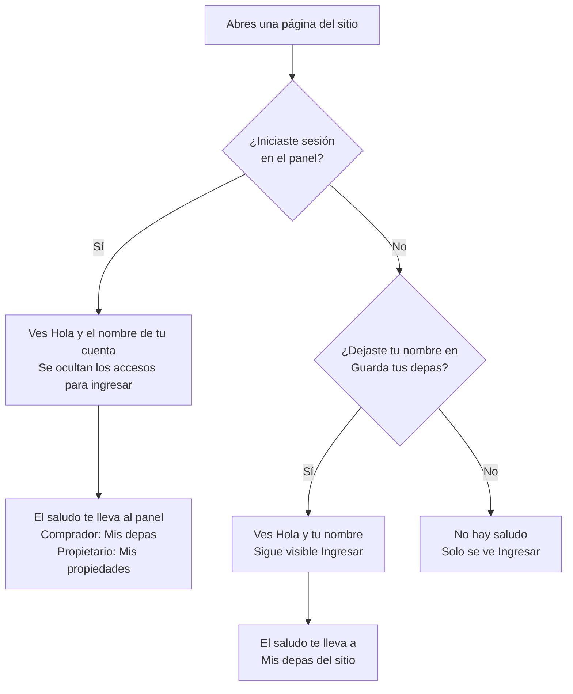

**Qué puede hacer.**
1. Toca un enlace del menú para ir a esa página. En computadora, la página se empieza a cargar apenas pasas el mouse por encima, así que abre más rápido.
2. Toca "Ingresar" para ir al panel de cuentas. Allí puedes ingresar o crear una cuenta (se explica en la sección de cuentas).
3. Toca el saludo "Hola, …":
   - Si iniciaste sesión, te lleva al panel, a la página de inicio de tu rol. Si eres comprador o inversionista, a "Mis depas" del panel. Si eres propietario, a "Mis propiedades".
   - Excepción: si el sitio no tiene configurada la dirección del panel, el saludo muestra el nombre de tu cuenta, pero te lleva a "Mis depas" del sitio (`/mis-depas`), no al panel.
   - Si no iniciaste sesión pero dejaste tu nombre en "Guarda tus depas", te lleva a "Mis depas" del sitio (`/mis-depas`).
4. Toca "Mis depas" para ver los depas que marcaste con "Me interesa".
5. Toca "Contactar" para abrir WhatsApp con un mensaje ya escrito (ver 1.8).
6. Si usas teclado, presiona Tab al entrar a una página. Aparece "Saltar al contenido", que te lleva directo al contenido sin pasar por el menú.

**Reglas.**

| Elemento | Regla | Si no se cumple |
|---|---|---|
| Saludo con la cuenta | Hay sesión iniciada en el panel y el sitio está conectado al API | No aparece el saludo con la cuenta. Puede verse el nombre de "Guarda tus depas" o nada |
| A dónde lleva el saludo con la cuenta | Lleva al panel solo si el sitio tiene configurada la dirección del panel | Muestra el nombre de la cuenta, pero lleva a `/mis-depas` del sitio |
| Nombre del saludo | Solo el primer nombre, con la primera letra en mayúscula (máximo 40 caracteres). Si hay sesión, manda el nombre de la cuenta | — |
| "Ingresar" / "Ingresar a mi cuenta" | Se muestran solo si el sitio tiene configurada la dirección del panel y no hay sesión | Si no hay dirección del panel, no aparecen nunca |
| Contador de "Mis depas" | Muestra cuántos depas guardaste. Con 0 no se ve ningún número | — |
| Límite de "Mis depas" | Hasta 20 depas en el navegador | Si guardas uno más, se quita el más antiguo sin aviso |

**Qué pasa después.**
- "Mis depas" se guarda en el navegador de la persona. El contador cambia al instante, también si tienes el sitio abierto en otra pestaña.
- Con sesión iniciada, el sitio junta los depas guardados en el navegador con los de tu cuenta. Desde ahí, cada cambio se guarda también en la cuenta. Así no pierdes lo que guardaste antes de ingresar.
- Ojo con el límite. Al juntar, la cuenta guarda la lista unida completa, siempre que no pase de 50. Si pasa de 50, la cuenta no cambia en ese momento. Los depas que ya no existen o que volvieron a borrador no se guardan en la cuenta. El navegador, en cambio, se queda solo con 20: si la lista unida pasa de 20, deja fuera primero los que ya estaban en la cuenta. Con tu siguiente cambio en "Mis depas" del sitio, la cuenta se actualiza con esos 20 y los demás se quitan de la cuenta, sin aviso.

**Casos especiales.**
- El saludo con la cuenta aparece un instante después de que carga la página. Mientras tanto puede verse el nombre de "Guarda tus depas" o nada.
- Si la sesión venció o la cerraste, el saludo con la cuenta desaparece y vuelve "Ingresar". La sesión dura 30 días desde que ingresas (valor por defecto). Pasado ese plazo el navegador la borra y hay que volver a ingresar, aunque hayas seguido usando el sitio. Cambiar la contraseña también reinicia ese plazo.
- **En teléfono (menos de 640 px) el saludo no se ve en ningún lado**, ni en la barra ni en el menú. Ya está anotado como pendiente.

### 1.4 Menú en el teléfono y cambios por ancho de pantalla

<p>
  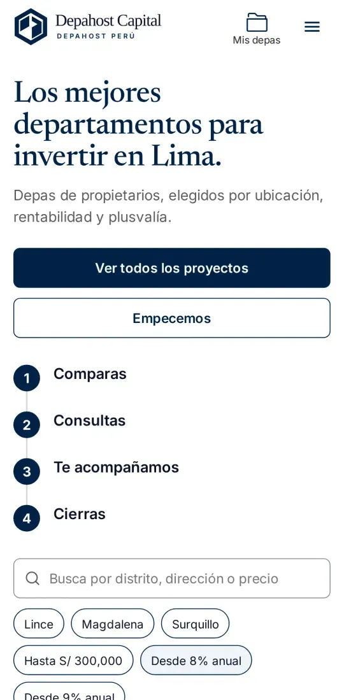
  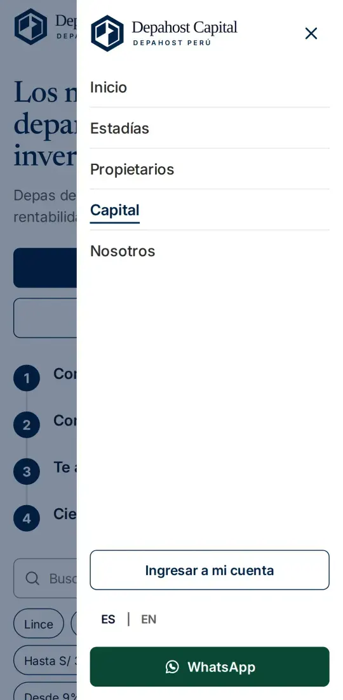
</p>

*Capital en un teléfono · Menú abierto en el teléfono.*

**Para qué sirve.** En pantallas chicas, el menú y algunos accesos se pasan a un panel lateral.

**Cómo se llega.** En pantallas de menos de 1024 px, toca el botón de tres rayas ("Abrir menú") arriba a la derecha.

**Qué se ve en el menú.**
- Arriba: el logo y una "✕" ("Cerrar menú").
- La lista "Inicio", "Estadías", "Propietarios", "Capital", "Nosotros". La página actual aparece subrayada.
- Abajo: el botón "Ingresar a mi cuenta" (solo si no hay sesión), el selector "ES | EN" y el botón verde "WhatsApp".

**Qué puede hacer.**
1. Toca el botón de tres rayas. El panel entra desde la derecha y el resto de la página se oscurece.
2. Toca la página a la que quieres ir.
3. Para cerrar el menú, toca la "✕", toca la parte oscura de la página o presiona Esc.

**Qué pasa después.** Con el menú abierto no puedes desplazarte por la página de atrás y se esconde el botón flotante de WhatsApp. Al cerrarlo, todo vuelve como estaba.

**Cómo cambia el encabezado según el ancho.**

| Elemento | Teléfono (menos de 640 px) | Tablet (640 a 1023 px) | Laptop (1024 a 1279 px) | Escritorio (1280 px o más) |
|---|---|---|---|---|
| Menú de páginas | Dentro del botón de tres rayas | Dentro del botón de tres rayas | En la barra | En la barra |
| Saludo "Hola, …" | No se ve | Círculo con la inicial y texto | Solo el círculo con la inicial | Círculo con la inicial y texto |
| Acceso a la cuenta | Solo en el menú: "Ingresar a mi cuenta" | Candado e "Ingresar", y también en el menú | Solo el candado | Candado e "Ingresar" |
| "Mis depas" | Sí | Sí | Sí | Sí |
| WhatsApp | Botón flotante verde, y "WhatsApp" en el menú | "Contactar", y "WhatsApp" en el menú | "Contactar" | "Contactar" |
| Selector "ES \| EN" | En el menú | En el menú | No se ve | No se ve |
| Botón de tres rayas | Sí | Sí | No | No |

**Casos especiales.**
- **Botón flotante de WhatsApp (solo teléfono):** es un círculo verde abajo a la derecha ("Escríbenos por WhatsApp").
  - En Inicio y Capital aparece recién cuando bajas más allá de la parte de arriba de la página. En las demás páginas se ve desde el principio.
  - Se esconde cuando aparece en pantalla la franja azul del pie de página y cuando abres el menú.
  - La página deja un espacio abajo para que el botón no tape el contenido.
- Si agrandas la ventana a 1024 px o más con el menú abierto, el menú se cierra solo.

### 1.5 Pie de página

**Para qué sirve.** Ofrece una última forma de contacto y reúne los enlaces legales.

**Cómo se llega.** Está al final de todas las páginas.

**Qué se ve.**
- **Franja azul oscuro:**
  - El logo en blanco, que lleva al inicio.
  - El título "Cuéntanos qué quieres hacer con el depa." y el texto "Reserva, vende, alquila o invierte: te respondemos por WhatsApp."
  - El botón verde "Escribir por WhatsApp".
- **Fila legal:**
  - Los enlaces "Nosotros", "Política de privacidad", "Términos" y "Libro de Reclamaciones".
  - La línea "© [año] Depa Host Perú · RUC [pendiente] · depahostperu.com ·" y, al final, "Preferencias de cookies".

**Qué puede hacer.**
1. Toca "Escribir por WhatsApp" para abrir WhatsApp con el mensaje "Hola, les cuento qué quiero hacer con mi depa."
2. Toca un enlace legal para ir a esa página.
3. Toca "Preferencias de cookies" para volver a ver el aviso de cookies y cambiar tu elección (ver 1.7).

**Casos especiales.**
- El RUC aparece literalmente como "[pendiente]" porque los datos de la empresa aún no están cargados.
- El año que se muestra es el de la última vez que se generó el sitio.
- **Teléfono:** el botón de WhatsApp ocupa todo el ancho y los enlaces legales van uno debajo del otro.
- **Escritorio:** logo, textos y botón van en una sola fila. Los enlaces legales también van en fila.

### 1.6 Selector de idioma ES | EN

**Para qué sirve.** Está pensado para cambiar de idioma. Hoy el sitio solo está en español.

**Cómo se llega.** Solo aparece dentro del menú de tres rayas, en pantallas de menos de 1024 px. En pantallas más grandes no se ve.

**Qué se ve.** "ES | EN". "ES" está resaltado y "EN" está en gris.

**Qué puede hacer.**
1. Toca "ES": vuelve a cargar la misma página en español.
2. "EN" no se puede tocar. Si pasas el mouse por encima, muestra "Próximamente".

**Casos especiales.** No existen páginas en inglés. Lo único en inglés del sitio es el formulario para inversionistas extranjeros al final de Capital. La versión en inglés figura como pendiente.

### 1.7 Aviso de cookies

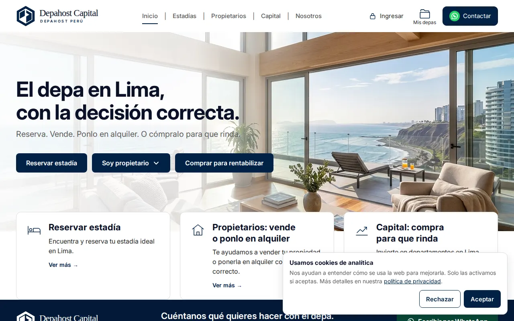

*Aviso de cookies en la primera visita.*

**Para qué sirve.** Pide permiso antes de activar la analítica del sitio (Microsoft Clarity), como manda la Ley N.° 29733 de Protección de Datos Personales.

**Cómo se llega.**
- Aparece solo en la primera visita.
- Vuelve a aparecer si tocas "Preferencias de cookies" en el pie de página.

**Qué se ve.** Una tarjeta blanca abajo de la pantalla:
- El título "Usamos cookies de analítica".
- El texto "Nos ayudan a entender cómo se usa la web para mejorarla. Solo las activamos si aceptas. Más detalles en nuestra política de privacidad." El enlace lleva a `/privacidad`.
- Los botones "Rechazar" y "Aceptar".

En teléfono ocupa todo el ancho. Desde 640 px queda en la esquina inferior derecha.

**Qué puede hacer.**
1. Toca "Aceptar" para activar la analítica, o "Rechazar" para no activarla.
2. El aviso se cierra.
3. Para cambiar de opinión, toca "Preferencias de cookies" en el pie de página y elige otra vez.

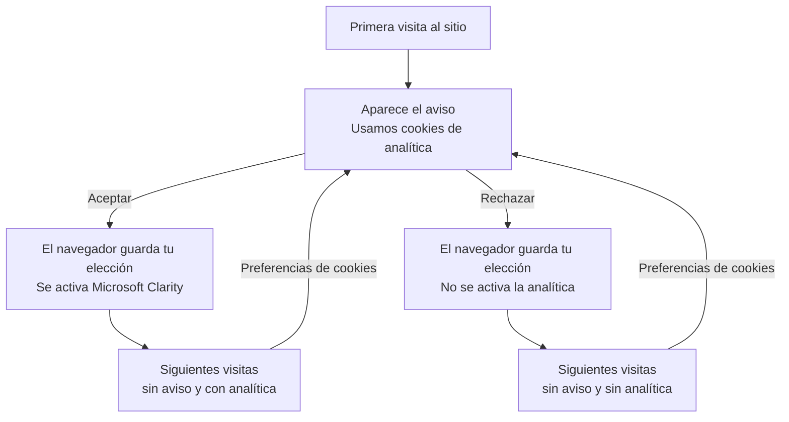

**Qué implica cada opción.**

| Opción | Qué pasa |
|---|---|
| "Aceptar" | Se activa Microsoft Clarity, que registra de forma agregada cómo se navega el sitio: clics, desplazamiento y tipo de dispositivo. En las siguientes visitas se activa sola y el aviso ya no aparece |
| "Rechazar" | No se activa ninguna analítica. El aviso ya no aparece en las siguientes visitas |
| No elegir | El aviso no bloquea la página: puedes seguir navegando. Pero aparece de nuevo en cada página hasta que elijas. No tiene botón para cerrarlo sin elegir |

**Qué pasa después.** La elección se guarda solo en el navegador de la persona. No queda en su cuenta ni pasa a otros dispositivos.

**Casos especiales.**
- **Si aceptaste y luego rechazas:** la analítica deja de activarse desde la siguiente página que abras. En la página donde cambiaste, la analítica que ya estaba cargada sigue activa hasta que cambies de página o recargues. El sitio no borra lo que Clarity ya haya registrado.
- **Si borras los datos del navegador**, el aviso vuelve a aparecer.
- **Si el navegador no permite guardar datos**, la elección vale solo para esa página y el aviso reaparece en cada página.
- **Depende de la configuración:** Clarity solo se activa si el sitio tiene configurado su identificador. En local y en preproducción está vacío, así que "Aceptar" se guarda pero no activa nada. En producción sí está configurado.
- El registro de errores técnicos del navegador (Sentry) no depende de esta elección. Solo funciona si está configurado, y hoy está vacío en todos los entornos.

### 1.8 Botones de WhatsApp

**Para qué sirve.** WhatsApp es el canal final de contacto en todo el sitio. Cada botón abre una conversación con Depa Host Perú con un mensaje ya escrito. Cada lugar usa un mensaje distinto, para que el equipo sepa desde dónde escribe la persona.

**Cómo se reconocen.** Los botones que abren WhatsApp son verdes y tienen el ícono de WhatsApp. La excepción es "Contactar" del encabezado: es azul oscuro, con el ícono en un círculo verde.

Ojo con dos casos:
- "Talk to us on WhatsApp" (formulario en inglés de Capital) y "Recibir propuesta" (Propietarios) tienen el ícono de WhatsApp, pero envían el formulario. No abren WhatsApp.
- Los enlaces a WhatsApp que aparecen después de enviar un formulario, o cuando no se pudo enviar, son texto subrayado dentro del mensaje, no botones verdes.

**Qué puede hacer.**
1. Toca el botón de WhatsApp.
2. WhatsApp se abre en una pestaña nueva, con el mensaje ya escrito.
3. Revisa o cambia el mensaje y envíalo. El sitio no envía nada por su cuenta.

**Mensajes prellenados.**

| Dónde | Botón | Mensaje |
|---|---|---|
| Encabezado (desde 640 px) | "Contactar" | "Hola, les escribo desde la web de Depa Host Perú." |
| Menú de tres rayas | "WhatsApp" | "Hola, les escribo desde la web de Depa Host Perú." |
| Botón flotante (teléfono) | Círculo verde | "Hola, les escribo desde la web de Depa Host Perú." |
| Pie de página | "Escribir por WhatsApp" | "Hola, les cuento qué quiero hacer con mi depa." |
| Formulario de Propietarios | "Adelantar por WhatsApp" (al enviar) o "Escribir por WhatsApp" (si no se pudo enviar) | "Hola, soy [nombre]. Quiero [vender / poner en alquiler / operar en Airbnb] mi depa en [distrito]." |
| Te acompañamos (`/capital/empecemos`) | "Escribir por WhatsApp" | Con depas elegidos: "Hola, quiero que me acompañen con este depa:" o "…con estos depas:", y la lista "- Distrito (dirección): precio". Sin depas: "Hola, quiero invertir en un depa en Lima y me gustaría que me acompañen." |
| "Guarda tus depas" (si no se pudo enviar) | "Escribir por WhatsApp" | "Hola, quiero que me ayuden con los depas que guardé en DepaHost Capital." |
| Libro de Reclamaciones (si no se pudo enviar) | "Escribir por WhatsApp" | "Hola, quiero registrar un reclamo en el Libro de Reclamaciones." |
| Formulario en inglés de Capital | "Message us on WhatsApp" | "Hi, I'm [name]. I'd like to invest in Lima with about USD [monto]." Si no se escribió el monto: "Hi, I'm [name]. I'd like to invest in Lima." |

**Qué pasa después.**
- Los botones generales (encabezado, menú, botón flotante y pie de página) no guardan nada en el sistema: solo abren WhatsApp.
- En "Te acompañamos", el sitio registra qué depas elegiste, sin datos personales, antes de abrir WhatsApp. Si ese registro falla, WhatsApp se abre igual.
- Cuando un formulario no se puede enviar, muestra un mensaje y un enlace "Escribir por WhatsApp" con los datos que ya escribiste:
  - Si el sitio no está conectado al API: "Por ahora recibimos estas consultas por WhatsApp."
  - Si falla la conexión: "No pudimos enviar tus datos. Revisa tu conexión o escríbenos por WhatsApp."
  - Si el sistema rechaza el envío por otro motivo, se muestra el mensaje del sistema y el mismo enlace. Si esa respuesta no trae mensaje, se muestra el de conexión de arriba.
- En dos casos no se ofrece WhatsApp:
  - Si hay campos con error: "Revisa los campos marcados."
  - Si hiciste demasiados envíos seguidos: "Hiciste varios envíos seguidos. Espera un minuto e inténtalo otra vez."

**Casos especiales.**
- **Número de relleno:** hoy el número configurado es "51XXXXXXXXX", tanto en local como en preproducción. Los botones abren WhatsApp hacia un número que no existe, así que no llegan a ningún chat real. En producción falta poner el número real. Está en la lista de pendientes.

### 1.9 Página no encontrada (404)

**Para qué sirve.** Avisa que la dirección no existe y te da una salida.

**Cómo se llega.** Aparece al abrir cualquier dirección del sitio que no existe. En la pestaña dice "Página no encontrada | Depa Host Perú".

**Qué se ve.** Un "404" grande, el título "No encontramos esta página" y el texto "Puede que el depa ya no esté disponible o que el link tenga un error." Debajo van dos botones. El encabezado y el pie de página son los de siempre.

**Qué puede hacer.**
1. Toca "Ver depas para invertir" para ir a Capital.
2. Toca "Ir al inicio" para volver a la home.

**Casos especiales.**
- Un enlace a un depa vendido lleva a esta página, porque los depas vendidos no tienen página. Los depas reservados sí la tienen.
- Un depa recién publicado puede tardar un poco en tener su página, porque el sitio se vuelve a generar después de cada cambio.
- Esta página no aparece en Google.

### 1.10 Páginas en construcción: Estadías y Nosotros

**Para qué sirven.** Reservan el lugar de dos secciones que todavía no tienen contenido.

**Cómo se llega.**
- **Estadías** (`/estadias`): desde "Estadías" en el menú, y desde el botón y la tarjeta "Reservar estadía" de la home.
- **Nosotros** (`/nosotros`): desde "Nosotros" en el menú y en el pie de página.

**Qué se ve.** Solo el título ("Estadías" o "Nosotros") y el texto "Página en construcción." No hay botones ni formularios. El encabezado y el pie de página siguen disponibles.

**Casos especiales.** Hoy no se puede reservar una estadía desde el sitio, aunque la home lo ofrece. Para consultas, la persona solo puede usar WhatsApp desde el encabezado, el botón flotante o el pie de página.

### 1.11 Política de privacidad y Términos

**Para qué sirven.** Explican cómo se tratan los datos personales y cuáles son las condiciones de uso del sitio.

**Cómo se llega.**
- Desde el pie de página: "Política de privacidad" (`/privacidad`) y "Términos" (`/terminos`).
- La política de privacidad también se enlaza desde el aviso de cookies y desde la casilla de aceptación de los formularios.

**Qué se ve.** Un texto largo con el título ("Política de privacidad" o "Términos y condiciones"), la línea "Última actualización: [fecha pendiente]" y secciones numeradas.

| Página | Qué dice, en resumen |
|---|---|
| Política de privacidad | Quién es responsable de los datos. Qué datos se recogen: formularios, Libro de Reclamaciones, Mis depas (solo en el navegador) y analítica (solo si se acepta). Para qué se usan y con qué proveedores se comparten. Cuánto tiempo se guardan. Cómo pedir acceso, rectificación, cancelación u oposición escribiendo a admin@depahostperu.com con copia del documento de identidad. Cómo cambiar la elección de cookies |
| Términos y condiciones | La información del sitio es referencial y no es una oferta. Las rentabilidades y cuotas son estimaciones, no garantías. Precios y disponibilidad pueden cambiar. Un depa reservado o vendido puede seguir apareciendo un tiempo. Uso permitido, propiedad intelectual y responsabilidad. Los reclamos van por el Libro de Reclamaciones. Rige la ley peruana, con jueces de Lima |

**Casos especiales.**
- **Ambos textos son borradores.** Debe revisarlos un abogado antes de publicarse.
- Tienen datos sin completar que se muestran tal cual: "[Razón social pendiente]", RUC "[pendiente]", "[Dirección fiscal pendiente]", "[fecha pendiente]" y, en privacidad, "[plazo pendiente]" para el tiempo de conservación.
- El borrador de privacidad todavía no menciona las cuentas del panel (registro, contraseña, perfil). Los términos tampoco.

### 1.12 Qué depende de la configuración

| Ajuste del sitio | Si está vacío o de relleno | Estado hoy |
|---|---|---|
| Número de WhatsApp (`PUBLIC_WHATSAPP_NUMBER`) | Se usa "51XXXXXXXXX" y los botones no llevan a un chat real | Relleno en local y preproducción. Falta el número real en producción |
| Dirección del panel (`PUBLIC_PANEL_URL`) | No aparecen "Ingresar" ni "Ingresar a mi cuenta". Si hay sesión y el sitio está conectado al API, el saludo muestra el nombre de la cuenta, pero lleva a `/mis-depas` del sitio en vez de al panel | app.depahostperu.com en producción |
| Conexión con el API (`PUBLIC_API_URL`) | El sitio no reconoce la sesión: no hay saludo con la cuenta ni "Mis depas" en la cuenta. Los formularios ofrecen WhatsApp | api.depahostperu.com en producción |
| Microsoft Clarity (`PUBLIC_CLARITY_ID`) | "Aceptar" se guarda, pero no se activa ninguna analítica | Vacío en local y preproducción. Configurado en producción |
| Registro de errores (`PUBLIC_SENTRY_DSN`) | No se registran errores del navegador | Vacío en todos los entornos |
| Datos de la empresa | Se ven textos entre corchetes, como "[pendiente]", en el pie de página y en las páginas legales | Pendientes |

**Referencia técnica:**
- Páginas: [index.astro](../../src/pages/index.astro), [estadias.astro](../../src/pages/estadias.astro), [nosotros.astro](../../src/pages/nosotros.astro), [404.astro](../../src/pages/404.astro), [privacidad.astro](../../src/pages/privacidad.astro), [terminos.astro](../../src/pages/terminos.astro)
- Plantillas: [BaseLayout.astro](../../src/layouts/BaseLayout.astro), [PlaceholderLayout.astro](../../src/layouts/PlaceholderLayout.astro), [LegalLayout.astro](../../src/layouts/LegalLayout.astro)
- Componentes: [Header.astro](../../src/components/Header.astro), [Footer.astro](../../src/components/Footer.astro), [LangSwitch.astro](../../src/components/LangSwitch.astro), [ConsentBanner.astro](../../src/components/ConsentBanner.astro), [OwnerDropdown.astro](../../src/components/OwnerDropdown.astro), [Logo.astro](../../src/components/Logo.astro), [Button.astro](../../src/components/Button.astro)
- Scripts y datos: [consent.ts](../../src/scripts/consent.ts), [forms.ts](../../src/scripts/forms.ts), [contacto.ts](../../src/data/contacto.ts), [empresa.ts](../../src/data/empresa.ts), [profile.ts](../../src/lib/profile.ts), [account.ts](../../src/lib/account.ts), [saved-store.ts](../../src/lib/saved-store.ts), [astro.config.mjs](../../astro.config.mjs)
- Capítulos técnicos: [02-frontend.md](02-frontend.md), [05-flujos.md](05-flujos.md) (flujos 11, 14 y 15), [07-decisiones-y-pendientes.md](07-decisiones-y-pendientes.md), [08-panel-y-cuentas.md](08-panel-y-cuentas.md)

## 2. Buscar depas en DepaHost Capital

### 2.1 La portada de Capital

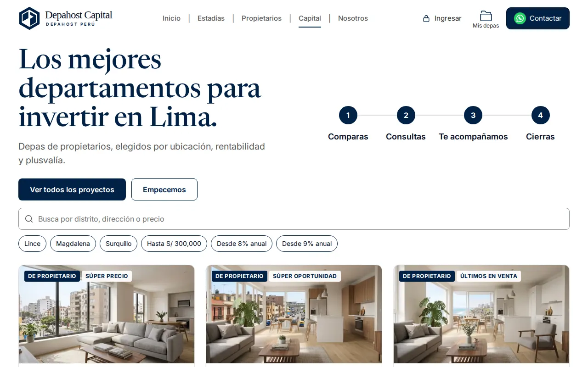

*Portada de Capital.*

**Para qué sirve.** En la portada de Capital la persona encuentra depas para invertir en Lima. Puede buscarlos, filtrarlos, compararlos y marcar los que le gustan. No necesita cuenta. Todo lo de esta sección funciona igual para un visitante, un comprador (buyer) y un propietario (seller).

**Cómo se llega.**
- Entra a `depahostperu.com/capital`.
- O toca "Capital" en el menú del encabezado.
- Desde el detalle de un depa, toca "Capital" en la ruta de navegación de arriba.
- En la pestaña del navegador se lee "Capital | Depa Host Perú".

**Qué se ve (de arriba hacia abajo).**

| Bloque | Qué muestra |
|---|---|
| Título y pasos | El título, los botones "Ver todos los proyectos" y "Empecemos", y los 4 pasos de "Cómo funciona" |
| Buscador y filtros | La caja de búsqueda, los chips de filtros rápidos y "Limpiar filtros" |
| Tarjetas de depas | Solo depas **de propietarios**. Los proyectos de inmobiliarias no salen aquí, están en la página de cada inmobiliaria |
| Nota de cuota estimada | Un texto legal debajo de las tarjetas |
| "Para ti, según lo que has visto" | Hasta 4 recomendaciones. Solo aparece si este navegador tiene historial |
| "Proyectos de aliados" | La franja de inmobiliarias aliadas |
| Barra del Top 10 | "Los 10 depas para invertir ahora" |
| Ranking | Los depas con mayor rentabilidad, de propietarios y de proyectos |
| Formulario en inglés | Para inversionistas extranjeros (ver la sección 5) |

**De dónde salen los depas.**
- En la portada salen los depas de propietarios que el equipo publicó, en estado publicado o reservado.
- Un depa vendido deja de aparecer en todo el sitio.
- Van primero los destacados y después los más recientes.
- El sitio es estático: las tarjetas se arman cuando se genera el sitio, no cuando la persona entra. Si el equipo publica o cambia un depa, el cambio se ve cuando el sitio se vuelve a generar. El API pide esa regeneración solo si está configurado el aviso de despliegue. Si no lo está, alguien tiene que regenerar el sitio a mano.
- El API espera 30 segundos y junta en una sola regeneración los cambios hechos seguidos. Los cambios en un borrador que sigue siendo borrador no la disparan. Por eso el cambio tarda al menos 30 segundos más lo que demore en generarse el sitio.
- Si el API falla mientras se genera el sitio, no se publica una versión nueva y queda la anterior.
- **Sin API configurada** (desarrollo o demo), el sitio muestra **datos de ejemplo**:
  - 3 depas de propietarios: Lince, Surquillo y Magdalena.
  - 3 proyectos de la inmobiliaria "Urbana".
  - 5 inmobiliarias de ejemplo.

**Móvil frente a escritorio.**

| Ancho de pantalla | Tarjetas de depas | Pasos |
|---|---|---|
| Celular (menos de 640 px) | Carrusel horizontal. Desliza con el dedo; cada tarjeta ocupa casi todo el ancho | En vertical, uno debajo de otro |
| Tablet (640 px a 1023 px) | 2 columnas | En horizontal, 4 columnas |
| Escritorio (1024 px o más) | 3 columnas | A la derecha del título |

### 2.2 Título, pasos y botones principales

**Qué se ve.**
- Título: "Los mejores departamentos para invertir en Lima."
- Subtítulo: "Depas de propietarios, elegidos por ubicación, rentabilidad y plusvalía."
- Pasos numerados: "Comparas", "Consultas", "Te acompañamos" y "Cierras". Solo muestran el título de cada paso, sin descripción, y no se pueden tocar. Son informativos.

**Qué puede hacer.**

| Botón | A dónde lleva |
|---|---|
| "Ver todos los proyectos" | Baja en la misma página hasta la franja "Proyectos de aliados". **No abre una lista con todos los proyectos.** Desde la franja se entra a la página de cada inmobiliaria |
| "Empecemos" | Abre la página "Te acompañamos al proyecto" (`/capital/empecemos`). Muestra los depas guardados en "Mis depas" y el botón "Escribir por WhatsApp". Si no hay ninguno guardado, aparece el aviso "Todavía no elegiste un depa. Marca **Me interesa** en los que te gusten o escríbenos y te ayudamos a elegir." |

**Casos especiales.**
- Si no hay ninguna inmobiliaria registrada, la franja de aliados no aparece y "Ver todos los proyectos" no hace nada.

### 2.3 Buscador

**Para qué sirve.** Sirve para encontrar rápido un depa por su distrito, su dirección o su precio.

**Qué se ve.** Una caja con una lupa y el texto guía "Busca por distrito, dirección o precio". En la portada no hay botón "Buscar" ni contador de resultados. Las páginas de cada inmobiliaria sí los tienen.

**Qué puede hacer.**
1. Toca la caja de búsqueda.
2. Escribe lo que buscas. Las tarjetas se filtran **mientras escribes**, sin esperar.
3. Si quieres, presiona Enter. La página no se recarga; en el celular solo se cierra el teclado.

**Cómo compara el texto.**
- No importan las tildes ni las mayúsculas: "ejercito" encuentra "Av. del Ejército".
- No importan los espacios ni los signos: "310000", "310,000", "310 000" y "S/ 310" encuentran el depa de S/ 310,000.
- Encuentra partes de palabras: "surq" encuentra Surquillo.
- Busca en el distrito, la dirección, la etiqueta de la tarjeta (por ejemplo "super precio" encuentra "Súper precio") y el precio.
- **No busca** por rentabilidad ni por años de recupero. Para eso usa los chips.
- Un número corto puede coincidir con la cuadra o con parte del precio. Por ejemplo, "20" encuentra "Av. Angamos Este cuadra 20".
- Solo busca entre las tarjetas de esta página, es decir, entre los depas de propietarios. Para buscar proyectos de inmobiliarias, entra a la página de la inmobiliaria desde "Proyectos de aliados".

### 2.4 Filtros rápidos (chips)

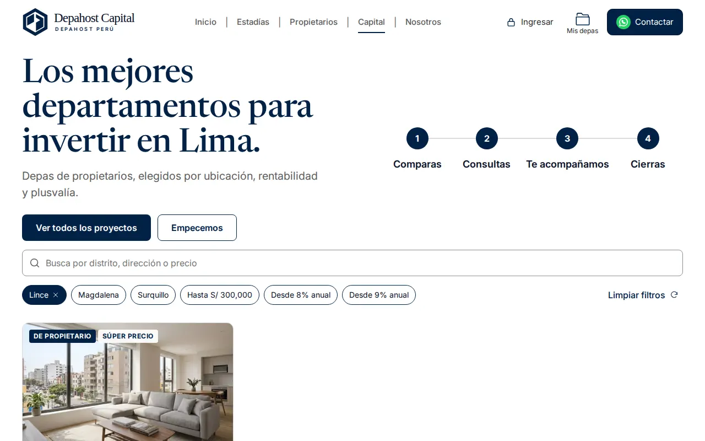

*Filtro rápido "Lince" activo.*

**Para qué sirven.** Con un toque dejan ver solo un distrito, un tope de precio o una rentabilidad mínima.

**De dónde salen.** Nadie los escribe a mano. Se calculan solos cada vez que se genera el sitio, a partir de los depas de la portada:

| Tipo de chip | Cómo se arma | Ejemplo con los datos de ejemplo |
|---|---|---|
| Distrito | Un chip por cada distrito con depas, en orden alfabético | "Lince", "Magdalena", "Surquillo" |
| Precio máximo | Los 2 topes más altos, redondeados hacia arriba a múltiplos de S/ 50,000, que dejan fuera al menos un depa | "Hasta S/ 300,000" (no sale "Hasta S/ 350,000" porque incluiría a todos) |
| Rentabilidad mínima | Los 2 valores de rentabilidad mínima más bajos, sin contar el más bajo de todos (ese incluiría a todos) | "Desde 8% anual", "Desde 9% anual" |

Si solo hay un depa, aparece solo el chip de su distrito, sin chips de precio ni de rentabilidad. Si no hay ningún depa, no aparece ningún chip.

**Qué puede hacer.**
1. Toca un chip para activarlo. Se pinta de azul oscuro y muestra una "x".
2. Toca otro chip **de otro tipo** para sumar condiciones.
3. Toca otro chip **del mismo tipo** para cambiar el anterior. Solo puede haber un distrito, un tope de precio y una rentabilidad a la vez.
4. Toca de nuevo un chip activo para quitarlo.

**Cómo se combinan.**

| Combinación | Resultado | Ejemplo con los datos de ejemplo |
|---|---|---|
| Chips de tipos distintos | Se tienen que cumplir todos | "Surquillo" + "Desde 9% anual": queda Surquillo |
| Dos chips del mismo tipo | El nuevo reemplaza al anterior | Con "Lince" activo, tocar "Magdalena" deja solo Magdalena |
| Buscador + chips | Se tienen que cumplir el texto y todos los chips | "Lince" + "Hasta S/ 300,000": no queda ninguno |

**Ojo con la rentabilidad.** El chip compara la rentabilidad **mínima** del depa. Un depa de "7–9% anual" no aparece con "Desde 8% anual", aunque su máximo sea 9%.

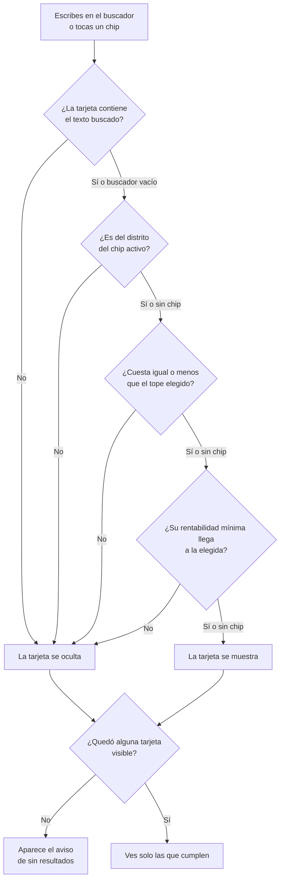

### 2.5 "Limpiar filtros" y resultados vacíos

**"Limpiar filtros".**
- Aparece al lado de los chips solo cuando hay un chip activo o texto en el buscador.
- Al tocarlo, apaga todos los chips, borra el texto y vuelven a verse todas las tarjetas.
- El cursor queda en el buscador. En el celular puede abrirse el teclado.

**Resultados vacíos.** Si ninguna tarjeta cumple, aparece el texto "No encontramos departamentos con esos criterios." Para salir de ahí, toca "Limpiar filtros" o cambia la búsqueda.

**Reglas y validaciones.**

| Campo | Regla | Mensaje si falla |
|---|---|---|
| Buscador | Busca en distrito, dirección, etiqueta y precio. Ignora tildes, mayúsculas, espacios y signos | "No encontramos departamentos con esos criterios." |
| Chip de distrito | Solo depas de ese distrito. Un distrito a la vez | "No encontramos departamentos con esos criterios." |
| Chip "Hasta S/ …" | Precio igual o menor al tope | "No encontramos departamentos con esos criterios." |
| Chip "Desde …% anual" | La rentabilidad mínima del depa es igual o mayor | "No encontramos departamentos con esos criterios." |

**Qué pasa después.**
- No se guarda nada.
- Los filtros no cambian la dirección (URL), así que no se pueden compartir.
- Al recargar la página vuelven a verse todos los depas.

**Casos especiales.**
- Si no hay ningún depa de propietario publicado, la página muestra "No encontramos departamentos con esos criterios." apenas carga.
- Si el navegador no ejecuta JavaScript, se ven todas las tarjetas, pero el buscador, los chips y "Me interesa" no funcionan.

### 2.6 Tarjetas de depa

**Qué se ve en cada tarjeta.**

| Parte | Qué muestra |
|---|---|
| Foto | La primera foto del depa. Si no tiene foto, se ve un bloque azul con una casita |
| Etiquetas sobre la foto | "De propietario" (en la portada siempre es esta). Al lado va "Reservado" si el depa está reservado. Si no, va la etiqueta comercial que le puso el equipo, por ejemplo "Súper precio", "Súper oportunidad" o "Últimos en venta" en los datos de ejemplo |
| Título | El distrito, por ejemplo "Lince" |
| Dirección | Por ejemplo "Av. Arequipa cuadra 12" |
| "valor" | El precio, por ejemplo "S/ 310,000" |
| "rentabilidad" | La rentabilidad anual estimada: "8–10% anual", o "8% anual" si no es un rango |
| "se paga en" | Los años de recupero, por ejemplo "11 años" (o "1 año") |
| Botones | "Me interesa" y "Ver más detalle" |

**Qué puede hacer.**
1. Toca cualquier parte de la tarjeta, o el botón "Ver más detalle", para abrir el detalle del depa (`/capital/{nombre-del-depa}`).
2. Toca "Me interesa" para guardarlo en "Mis depas" (ver 2.7).
3. Para contactar, abre el detalle y toca "Contactar". **La tarjeta no tiene botón de contacto.** "Contactar" lleva a "Te acompañamos al proyecto" con ese depa ya elegido.

**Nota de cuota estimada.** Debajo de las tarjetas va este texto:
> "*Cuota estimada con tasa pizarra a [plazo] años y [X] % de inicial, al [fecha]. Renta estimada según el mercado del distrito. No es una rentabilidad garantizada."

- [plazo], [X] y [fecha] se reemplazan con el plazo, la inicial y la fecha que carga el equipo.
- Si el equipo además carga la tasa, se agrega después de "tasa pizarra" (por ejemplo "tasa pizarra de 9.5%"). Si no la carga, la tasa simplemente no aparece.
- Mientras esos supuestos no estén cargados (como en los datos de ejemplo), se ven los corchetes tal cual.
- El texto habla de "cuota", pero hoy las tarjetas no muestran ninguna cuota.

**Casos especiales.**
- La tarjeta, el buscador y el Top 10 muestran el precio siempre con "S/", aunque el depa esté cargado en dólares. Las tarjetas chicas de "Para ti, según lo que has visto" y el detalle sí muestran la moneda correcta.
- Los chips de precio y el orden del Top 10 usan el monto tal como está cargado, sin convertir dólares a soles. Por ejemplo, un depa de USD 90,000 pasa el chip "Hasta S/ 300,000".
- Los depas reservados siguen en la lista con la etiqueta "Reservado".

### 2.7 Botón "Me interesa"

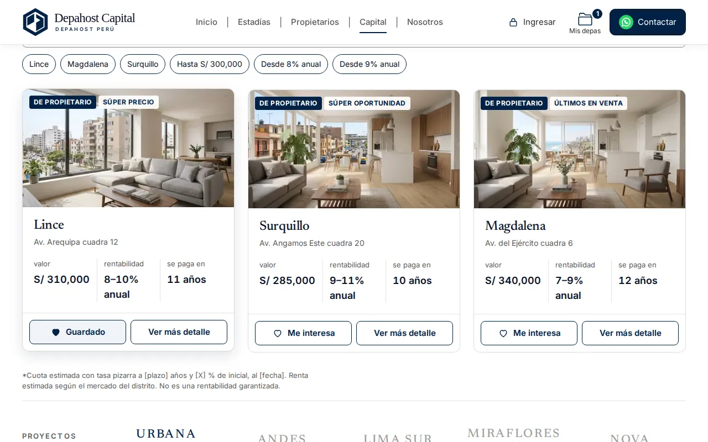

*Tarjeta guardada: el botón cambia a "Guardado" y el contador de "Mis depas" muestra 1.*

**Para qué sirve.** Guarda el depa en "Mis depas" para compararlo o consultarlo después. No hace falta tener cuenta.

**Qué puede hacer.**
1. Toca "Me interesa" en la tarjeta.
2. El botón cambia a "Guardado" y el corazón se rellena.
3. Para quitarlo, toca otra vez "Guardado". Vuelve a decir "Me interesa".

**Qué pasa después.**
- El contador de "Mis depas" en el encabezado sube. Se oculta cuando no hay ninguno guardado.
- Todos los botones del mismo depa se actualizan juntos: tarjeta, detalle y otras pestañas abiertas.
- "Mis depas" **se guarda en el navegador de la persona**. Si entra desde otro celular o computadora, no ve lo que guardó aquí, salvo que tenga cuenta.
- **Con sesión iniciada**, lo guardado en el navegador se une con lo guardado en la cuenta y cada cambio se guarda también en la cuenta (ver el capítulo de cuentas).
- El aviso "Guarda tus depas", que pide nombre y celular, se abre cuando la lista de "Mis depas" crece y queda con 2 o más depas (normalmente, al guardar el segundo). No se abre si la persona ya dejó sus datos en este navegador ni si lo cerró en los últimos 7 días; pasado ese plazo vuelve a abrirse con el siguiente depa que guarde. Puede abrirse aunque haya sesión iniciada, e incluso al cargar la página si al unir con la cuenta la lista crece. El detalle está en la sección de "Mis depas".

**Reglas y validaciones.**

| Campo | Regla | Mensaje si falla |
|---|---|---|
| "Me interesa" | Máximo 20 depas en el navegador | Ninguno. Al guardar el número 21, se quita sin aviso el más antiguo |

**Casos especiales.**
- Si el navegador bloquea el almacenamiento (por ejemplo, con las cookies y los datos de sitios bloqueados), lo guardado dura solo mientras la página está abierta. Se pierde al recargar o al cambiar de página.
- En una ventana privada de los navegadores actuales, lo guardado sí se conserva entre páginas, pero se borra al cerrar la ventana privada.

### 2.8 "Para ti, según lo que has visto"

**Para qué sirve.** Recomienda hasta 4 depas parecidos a los que la persona abrió o guardó.

**Cuándo aparece.** Aparece debajo de las tarjetas solo si se cumplen las dos condiciones:
- Este navegador tiene al menos un depa abierto en su detalle o guardado con "Me interesa".
- Hay al menos una recomendación.

Para quien entra por primera vez, la fila no existe. Aparece un instante después de que carga la página, así que puede mover un poco lo que está debajo (problema conocido).

**De dónde salen las recomendaciones.**
- **Del navegador de la persona, no de su cuenta.** Se usan:
  - el historial: los últimos 12 depas abiertos en su detalle, de los cuales cuentan los 6 más recientes;
  - la lista de "Mis depas".
- Se elige entre **todos** los depas publicados o reservados: de propietarios **y** proyectos de inmobiliarias.
- Qué hace que un depa se parezca más:
  1. Que esté en el mismo distrito. Es lo que más pesa.
  2. Que tenga un precio cercano.
  3. Que sea del mismo tipo (de propietario o de proyecto).
  4. Que tenga una rentabilidad parecida.
- Lo guardado pesa más que lo visto. Entre lo visto, lo más reciente pesa más.
- Nunca recomienda un depa que ya está en "Mis depas".
- Los depas ya vistos pueden salir, pero con menos prioridad que los nuevos.

**Qué se ve.**
- Cada recomendación es una tarjeta chica con:
  - la foto (o la casita);
  - el título "Distrito · calle", sin la cuadra, por ejemplo "Lince · Av. Arequipa";
  - "Distrito, Lima", más el nombre de la inmobiliaria si es un proyecto;
  - el precio, la rentabilidad sin la palabra "anual" y los años de recupero.
- Las tarjetas chicas no tienen botón "Me interesa" ni etiqueta "Reservado".
- Distribución: 1 columna en el celular, 2 en tablet y 4 en escritorio.

**Qué puede hacer.**
1. Toca una recomendación para abrir su detalle.
2. Toca "Ver todos" para bajar a la lista de depas de la misma página.

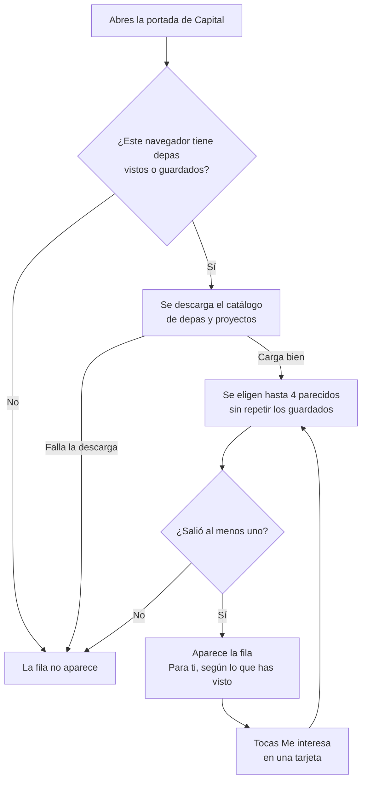

**Casos especiales.**
- Si la persona llega sin historial y marca "Me interesa" en la portada, la fila **no aparece hasta que recarga** la página o vuelve a entrar.
- Si ya había historial, la fila se recalcula sola cada vez que toca "Me interesa". Un depa recién guardado sale de la fila.
- Si la persona abre depas en otra pestaña, la fila se actualiza al recargar la portada.
- Si falla la descarga del catálogo, la fila no aparece y no se muestra ningún error.

### 2.9 "Proyectos de aliados"

**Para qué sirve.** Muestra las inmobiliarias aliadas y lleva a sus proyectos.

**Qué se ve.**
- El título "Proyectos de aliados" y el nombre de cada inmobiliaria en letras grandes.
- **Todavía no hay logos.** Están pendientes hasta tener permiso de uso.
- Las inmobiliarias con al menos un proyecto publicado o reservado se pueden tocar y muestran la cantidad: "1 proyecto" o "3 proyectos".
- Las que no tienen proyectos se ven en gris claro y no se pueden tocar.
- Van primero las que tienen más proyectos y después en orden alfabético.
- Con los datos de ejemplo:
  - "Urbana" muestra "3 proyectos";
  - "Andes", "Lima Sur", "Miraflores Hotel" y "Nova" salen en gris.
  - Son nombres de ejemplo: faltan las inmobiliarias reales.
- Distribución: 2 columnas en el celular, 3 en tablet y una sola fila en escritorio.

**Qué puede hacer.**
1. Toca el nombre de una inmobiliaria con proyectos.
2. Se abre "Proyectos de {nombre}". Esa página tiene su propio buscador ("Buscar por distrito, proyecto o palabra clave"), el botón "Buscar" y el contador "N proyectos encontrados".

**Casos especiales.**
- Si no hay inmobiliarias registradas, la franja no aparece.

### 2.10 Top 10

**Para qué sirve.** Ordena los depas con mejor rentabilidad estimada, para decidir rápido.

**Cómo se llega.**
- Toca la barra "Los 10 depas para invertir ahora". Toda la barra es un enlace.
- El botón de la barra dice "Ver el top 10 →" en tablet y escritorio, y "Ver →" en el celular.
- Al tocarla, la página baja hasta el ranking.

**Qué se ve.**
- El título es "Los 10 depas para invertir ahora" solo si hay exactamente 10. Si hay menos, dice "Los depas para invertir ahora". Con los datos de ejemplo hay 6, así que se ve el segundo título.
- Debajo dice "Ordenados por rentabilidad anual estimada."
- Cada fila muestra:
  - su número de puesto;
  - el distrito;
  - la dirección, el precio y, si es un proyecto, la inmobiliaria. Por ejemplo "Calle Schell cuadra 3 · S/ 789,000 · Urbana";
  - a la derecha, la rentabilidad.

**Qué entra y cómo se ordena.**
- Entran depas de propietarios **y** proyectos de inmobiliarias.
- Solo los **publicados**. Los reservados no entran.
- El orden:
  1. Primero la rentabilidad máxima más alta.
  2. Si empatan, la rentabilidad mínima más alta.
  3. Si siguen empatados, el precio más bajo.

**Qué puede hacer.**
1. Toca cualquier fila para abrir el detalle de ese depa. El enlace es el nombre del distrito, pero toda la fila responde al toque: el número, la dirección y la rentabilidad también abren el detalle. Al pasar el mouse, la fila entera se resalta.

**Casos especiales.**
- Si no hay ningún depa publicado, el ranking no aparece, pero la barra sí. En ese caso tocarla no lleva a ningún lado.
- El precio se muestra siempre con "S/", y el desempate por precio usa el monto sin convertir la moneda (ver 2.6).

### 2.11 Formulario en inglés

Al final de la portada hay un bloque en inglés para inversionistas extranjeros:
- título "Also in English for international investors";
- botón "Talk to us on WhatsApp".

Es lo único en inglés: el resto del sitio está solo en español. Sus campos, validaciones y lo que pasa al enviarlo se explican en la **sección 5**.

**Referencia técnica:** [src/pages/capital/index.astro](../../src/pages/capital/index.astro), [SearchFilters.astro](../../src/components/SearchFilters.astro), [PropertyCard.astro](../../src/components/PropertyCard.astro), [PropertyGrid.astro](../../src/components/PropertyGrid.astro), [SaveButton.astro](../../src/components/SaveButton.astro), [SaveListDialog.astro](../../src/components/SaveListDialog.astro), [ForYouRow.astro](../../src/components/ForYouRow.astro), [MiniCard.astro](../../src/components/MiniCard.astro), [AlliesStrip.astro](../../src/components/AlliesStrip.astro), [Step.astro](../../src/components/Step.astro), [property-filters.ts](../../src/scripts/property-filters.ts), [saved-buttons.ts](../../src/scripts/saved-buttons.ts), [catalog.ts](../../src/scripts/catalog.ts), [filters.ts](../../src/lib/filters.ts), [recommend.ts](../../src/lib/recommend.ts), [saved-store.ts](../../src/lib/saved-store.ts), [profile.ts](../../src/lib/profile.ts), [properties.ts](../../src/lib/properties.ts), [format.ts](../../src/lib/format.ts), [datos de ejemplo](../../src/content/properties.json). Capítulos: [02 · Frontend](../plataforma/02-frontend.md#detalle-de-la-portada-de-capital), [05 · Flujos, apartados 5, 6 y 9](../plataforma/05-flujos.md#5-buscar-y-filtrar), [08 · Panel y cuentas](../plataforma/08-panel-y-cuentas.md).

## 3. Ver un depa y los proyectos de una inmobiliaria

Esta sección explica la ficha de cada depa y la página con los proyectos de cada inmobiliaria aliada. Ninguna de las dos pide cuenta. Un visitante, un comprador (rol buyer) y un propietario (rol seller) ven exactamente lo mismo.

### 3.1 La ficha de un depa

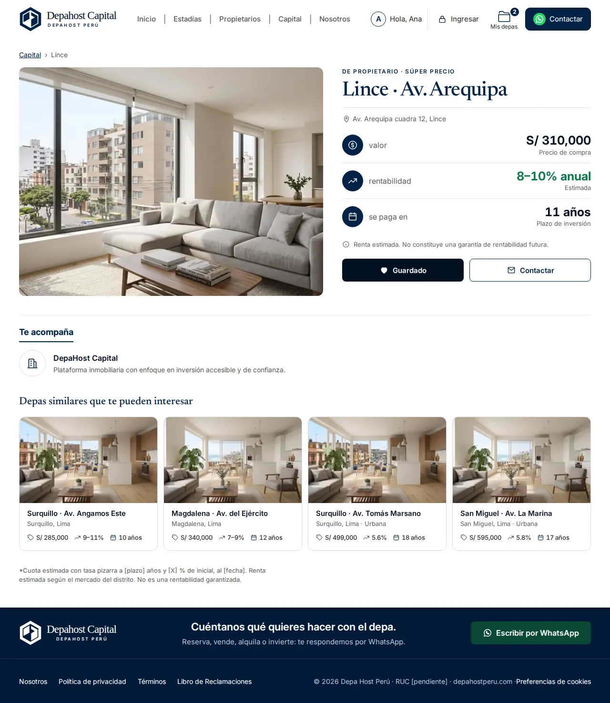

*Ficha de un depa.*

**Para qué sirve.** Reúne todo lo que se sabe de un depa para que decidas si te interesa: precio, rentabilidad estimada, en cuántos años se paga, fotos, características y quién lo ofrece. Desde la ficha lo guardas en "Mis depas" o pides que te acompañen.

**Cómo se llega.**

- **URL:** `depahostperu.com/capital/{slug}`. El sistema arma el slug con el distrito y la dirección cuando el equipo crea el depa. Por ejemplo, en los datos de ejemplo: `lince-av-arequipa-cuadra-12`. El equipo puede escribir otro slug.
- **Desde el sitio:**

| Desde | Qué tocas |
|---|---|
| `/capital`, lista de depas de propietarios | La tarjeta o "Ver más detalle" |
| `/capital`, "Los 10 depas para invertir ahora" (si hay menos de 10, el título es "Los depas para invertir ahora") | Cualquier parte de la fila. El enlace es el nombre del distrito, pero toda la fila responde al toque |
| `/capital`, "Para ti, según lo que has visto" | La tarjeta |
| `/capital/aliados/{slug}` | La tarjeta del proyecto o "Ver más detalle" |
| Otra ficha, "Depas similares que te pueden interesar" | La tarjeta |
| `/mis-depas` y "Te acompañamos al proyecto" | El nombre del distrito |

- **Desde el panel app.depahostperu.com:**
  - Comprador: en "Mis depas" toca "Ver en el sitio". En "Mis consultas" toca el nombre del distrito.
  - Propietario: en el detalle de su solicitud toca "Ver mi depa en el sitio".
- **Desde un enlace compartido** (WhatsApp, redes).

**Qué se ve.** De arriba hacia abajo:

| Parte | Qué muestra | Cuándo aparece |
|---|---|---|
| Miga de pan | "Capital" › nombre de la inmobiliaria › distrito | La inmobiliaria aparece solo en los proyectos |
| Fotos | Una foto grande y, debajo, las demás en miniatura | Si no hay fotos, sale un recuadro con el dibujo de una casa |
| Etiqueta superior (en mayúsculas) | Estado, origen e insignia. En los proyectos, el origen incluye el nombre de la inmobiliaria: "De proyecto · {inmobiliaria}". Por ejemplo: "De propietario · Súper precio" (datos de ejemplo) o, en un proyecto reservado de Urbana, "Reservado · De proyecto · Urbana" | El estado sale solo si el depa está reservado. La insignia sale solo si está publicado |
| Título | "{Distrito} · {calle}", sin el número de cuadra. Por ejemplo: "Lince · Av. Arequipa" | Siempre |
| Dirección | La dirección completa y el distrito, con un ícono de ubicación. Por ejemplo: "Av. Arequipa cuadra 12, Lince" | Siempre |
| Tres datos | "valor", "rentabilidad" y "se paga en" (ver 3.2) | Siempre |
| Características | "2 dorm.", "1 baño" o "2 baños", "68 m²" | Solo las que cargó el equipo. Si no hay ninguna, la fila no aparece |
| Aviso | "Renta estimada. No constituye una garantía de rentabilidad futura." | Siempre |
| Botones | "Me interesa" y "Contactar" | Siempre |
| Descripción | Texto libre, con sus saltos de línea | Solo si existe |
| Bloque del aliado | Ver 3.3 | Siempre |
| Depas similares | Hasta 4 tarjetas (ver 3.6) | Si hay otros depas en el sitio |
| Nota de cuota estimada | Texto al pie (ver 3.2) | Siempre |

**Qué puedes hacer.**

1. Mira las fotos. Las miniaturas no se agrandan al tocarlas: no hay visor de fotos.
2. Toca "Me interesa" para guardar el depa (ver 3.4).
3. Toca "Contactar" para pedir acompañamiento por WhatsApp (ver 3.5).
4. Toca el nombre de la inmobiliaria en la miga de pan, o "Ver sus N proyectos", para ver sus otros proyectos (ver 3.3 y 3.8).
5. Toca una tarjeta de "Depas similares que te pueden interesar" para abrir otra ficha (ver 3.6).
6. Toca "Capital" en la miga de pan para volver a la lista.

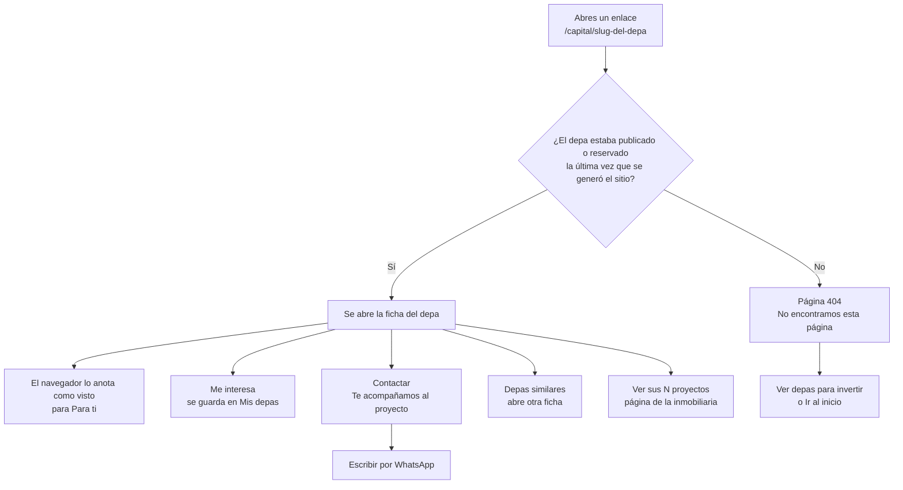

### 3.2 Precio, rentabilidad, recupero y "cuota estimada"

**Los tres datos principales.**

| Etiqueta | Qué muestra | Nota debajo | Formato |
|---|---|---|---|
| "valor" | El precio, en la moneda del depa | "Precio de compra" si es de propietario. "Precio desde" si es de proyecto | "S/ 310,000" o "US$ 50,000", sin decimales |
| "rentabilidad" | La rentabilidad anual estimada, en verde | "Estimada" | Un rango, como "8–10% anual", o un solo valor, como "5.8% anual" |
| "se paga en" | En cuántos años se recupera la inversión | "Plazo de inversión" | "11 años" o "1 año" |

**La nota de "cuota estimada".**

- La ficha **no calcula ni muestra una cuota mensual**. Solo pone al pie una nota con los supuestos de financiamiento. La misma nota aparece debajo de la lista de `/capital` y en la página de cada inmobiliaria.
- Cuando el equipo cargó todos los supuestos, el texto es:
  "*Cuota estimada con tasa pizarra de {tasa}% a {plazo} años y {inicial} % de inicial, al {fecha}. Renta estimada según el mercado del distrito. No es una rentabilidad garantizada." La fecha sale escrita, por ejemplo "8 de octubre de 2026".
- **Hoy no hay supuestos cargados.** Los datos de ejemplo vienen vacíos y, si el API no tiene supuestos, responde que no existen. Por eso el texto que se ve es:
  "*Cuota estimada con tasa pizarra a [plazo] años y [X] % de inicial, al [fecha]. Renta estimada según el mercado del distrito. No es una rentabilidad garantizada."
- Si falta solo uno de los datos, en su lugar sale "[plazo]", "[X]" o "[fecha]". Si falta la tasa, simplemente desaparece el tramo "de {tasa}%".
- El equipo carga los supuestos en el panel, en Configuración. El texto cambia cuando el sitio se vuelve a generar (ver 3.9).
- **Pendiente:** el asterisco de la nota no remite a ningún número de la página. Los términos (todavía en borrador) hablan de "cuotas que mostramos", pero hoy el sitio no muestra ninguna cuota.

### 3.3 Bloque del aliado

| Origen del depa | Título | Nombre | Texto | Enlace |
|---|---|---|---|---|
| Proyecto de inmobiliaria | "Aliado del proyecto" | Nombre de la inmobiliaria | Su descripción. Si no tiene: "Inmobiliaria aliada de DepaHost Capital." | "Ver sus N proyectos", solo si tiene más de 1 proyecto visible |
| Propietario | "Te acompaña" | "DepaHost Capital" | "Plataforma inmobiliaria con enfoque en inversión accesible y de confianza." | Ninguno |

- No se muestra el logo de la inmobiliaria, solo un ícono de edificio. Mientras no haya logos con permiso de uso, el sitio usa solo nombres.
- La web de la inmobiliaria no sale en la ficha. Sale en su página (ver 3.8).
- Si la inmobiliaria tiene un solo proyecto, el enlace "Ver sus N proyectos" no aparece. Su nombre en la miga de pan igual lleva a su página.
- N cuenta los proyectos publicados y reservados, incluido el que estás viendo.

### 3.4 "Me interesa" en la ficha

**Para qué sirve.** Guarda el depa en "Mis depas" para compararlo después y pedir acompañamiento con varios a la vez.

**Qué puedes hacer.**

1. Toca "Me interesa". El corazón se rellena, el botón cambia a "Guardado" y sube el contador de "Mis depas" en el encabezado.
2. Para quitarlo, toca "Guardado". El botón vuelve a "Me interesa".

**Reglas y validaciones.**

| Campo | Regla | Mensaje si falla |
|---|---|---|
| "Me interesa" | Funciona como interruptor: un toque guarda y el siguiente quita | — |
| Mis depas en el navegador | Guarda como máximo 20 depas | Sin mensaje. Al guardar el número 21 se quita el más antiguo |
| Mis depas en la cuenta | La cuenta admite hasta 50. Al iniciar sesión, el sitio une la lista de la cuenta con la del navegador y guarda en la cuenta **la lista unida completa**, aunque pase de 20. Si la lista unida pasa de 50, la cuenta no la acepta y queda como estaba. En los dos casos, el navegador se queda solo con los 20 más recientes de esa lista. La cuenta baja a esos 20 con el siguiente cambio de la lista en el navegador: cuando guardas o quitas un depa (también desde otra pestaña), o cuando `/mis-depas` quita por su cuenta los que ya no están disponibles. Desde ese momento, cada cambio guarda en la cuenta la lista del navegador. Los que no existen o son borradores se descartan | Sin mensaje. Si la sincronización falla, la lista sigue en el navegador |
| Almacenamiento del navegador bloqueado | La lista vive solo mientras la página esté abierta | Sin mensaje |

**Qué pasa después.**

- **Sin cuenta:** "Mis depas" se guarda en el navegador de la persona. Solo lo ves en ese dispositivo y en ese navegador. Si tienes otras pestañas abiertas del sitio, se actualizan solas.
- **Con sesión iniciada en el panel** (comprador o propietario): el sitio junta lo del navegador con lo de la cuenta y guarda cada cambio en la cuenta. Lo ves en "Mis depas" del panel desde cualquier dispositivo. Esto funciona solo si el sitio tiene configurado el API.
- **Cuando guardas un depa y ya tienes al menos 2 en Mis depas** (el segundo, el tercero, etc.), puede abrirse la ventana "Guarda tus depas", que pide nombre y celular. Aparece si nunca dejaste tu nombre ahí y no la cerraste en los últimos 7 días. Puede salir aunque tengas sesión iniciada, porque solo revisa si dejaste tu nombre en esa ventana. Los detalles están en la sección de Mis depas.
- Guardar no avisa al equipo por sí solo. Al propietario, "Veces guardado" le muestra cuántas cuentas tienen hoy ese depa en Mis depas. Sube cuando alguien con sesión lo guarda y baja cuando lo quita. Los guardados sin sesión no cuentan.

### 3.5 "Contactar"

**Para qué sirve.** Pide que el equipo te acompañe con este depa en particular. La conversación sigue por WhatsApp.

**Cómo se llega.** Es el botón "Contactar", con ícono de sobre, al lado de "Me interesa". Lleva a `/capital/empecemos?depa={slug}`.

**Qué puedes hacer.**

1. Toca "Contactar".
2. Se abre "Te acompañamos al proyecto". En "Departamento seleccionado" aparece **solo este depa**, aunque tengas otros en Mis depas. El subtítulo dice "Estamos de tu lado para que encuentres el departamento ideal en {distrito}."
3. Revisa los tres pasos: "Entramos juntos", "Coordinamos la visita" y "Cierras la compra".
4. Si prefieres consultar por varios depas, toca "Cambiar selección". Te lleva a `/mis-depas`.
5. Toca "Escribir por WhatsApp". WhatsApp se abre con este mensaje ya escrito:
   ```
   Hola, quiero que me acompañen con este depa:
   - {Distrito} ({dirección}): {precio}
   ```
6. Envía el mensaje desde WhatsApp.

**Qué pasa después.**

- Si el API está configurado, al tocar "Escribir por WhatsApp" el sitio registra una consulta **sin nombre, correo ni teléfono**: guarda qué depa pediste, de qué campaña llegaste (UTM) y, si tienes sesión iniciada, tu cuenta. Se registra aunque después no envíes el mensaje.
- Solo ese toque registra la consulta. Abrir "Te acompañamos al proyecto", tocar "Contactar" o "Cambiar selección", o llegar desde "Empecemos con estos" de Mis depas no envía nada.
- El API acepta hasta 10 consultas por minuto desde una misma conexión. El cupo se comparte con los demás formularios de contacto del sitio y con "Guarda tus depas". Si se pasa del límite, la consulta no se registra.
- Para este tipo de consulta el equipo no recibe correo. Si hay CRM configurado, la consulta le llega.
- Si tienes sesión iniciada, la consulta aparece en "Mis consultas" del panel como "Te acompañamos (WhatsApp)".
- Al propietario del depa se le suma en el contador "Consultas" de su solicitud.
- Si el API falla o se pasa del límite, WhatsApp se abre igual.

**Casos especiales.**

- **Número de WhatsApp de relleno:** si no se configuró el número real, el enlace usa `51XXXXXXXXX` y no llega a nadie.
- **Dos botones con el mismo nombre:** el "Contactar" del encabezado es otro botón. Aparece desde 640 px de ancho y abre WhatsApp directo con "Hola, les escribo desde la web de Depa Host Perú.". En celulares, en su lugar está el botón flotante de WhatsApp.
- **El catálogo no carga:** la tarjeta de selección queda vacía, el mensaje pasa a ser genérico ("Hola, quiero invertir en un depa en Lima y me gustaría que me acompañen.") y no se registra ninguna consulta.
- **El depa ya no está en el catálogo:** la página muestra lo que tengas en Mis depas en lugar de ese depa.

### 3.6 Depas similares

**Qué se ve.** Bajo el título "Depas similares que te pueden interesar" aparecen hasta 4 tarjetas pequeñas. Cada una muestra:

- la foto, o el dibujo de la casa si no hay foto;
- "{Distrito} · {calle}";
- "{Distrito}, Lima", más " · {inmobiliaria}" si es un proyecto;
- el precio, la rentabilidad sin la palabra "anual" (por ejemplo "8–10%") y los años de recupero.

Toda la tarjeta es un enlace a su ficha. Estas tarjetas no tienen botón "Me interesa".

**Cómo se eligen.** Se comparan todos los depas visibles con el que estás viendo:

| Criterio | Puntos |
|---|---|
| Mismo distrito | 3 |
| Precio parecido | 0 a 2 |
| Mismo origen (propietario o proyecto) | 1 |
| Rentabilidad parecida | 0 a 1 |

**Reglas.**

- Se calculan cuando se genera el sitio. Todos ven los mismos similares: no dependen de tu historial.
- Mezclan depas de propietarios y proyectos. Nunca incluyen el mismo depa ni los vendidos.
- Pueden incluir depas reservados, y en estas tarjetas no se marcan como "Reservado".
- No hay un mínimo de parecido. Con pocos depas en el sitio, igual salen 4 aunque no se parezcan mucho. La sección solo desaparece si no hay otros depas.

### 3.7 El depa queda como "visto" para "Para ti"

- Al abrir la ficha, el navegador anota el depa como visto. No aparece ningún aviso.
- Guarda los últimos 12 depas vistos. Si vuelves a abrir uno, pasa a ser el más reciente.
- Con esa lista se arman "Para ti, según lo que has visto" en `/capital` y "Parecidos a los que guardaste" en `/mis-depas`:
  - se usan los 6 últimos vistos más lo que tienes en Mis depas;
  - lo más reciente pesa más;
  - nunca te recomienda lo que ya está en Mis depas;
  - lo que ya viste sale después de lo nuevo;
  - si solo viste un depa, ese no aparece en sus propias recomendaciones.
- La lista de vistos **vive solo en ese navegador**. No se envía al API, no se guarda en la cuenta y no pasa a otros dispositivos.
- No hay botón para borrarla. Se borra solo si se eliminan los datos del sitio en el navegador. Si el navegador bloquea el almacenamiento, la visita no se recuerda.

### 3.8 Página de una inmobiliaria aliada

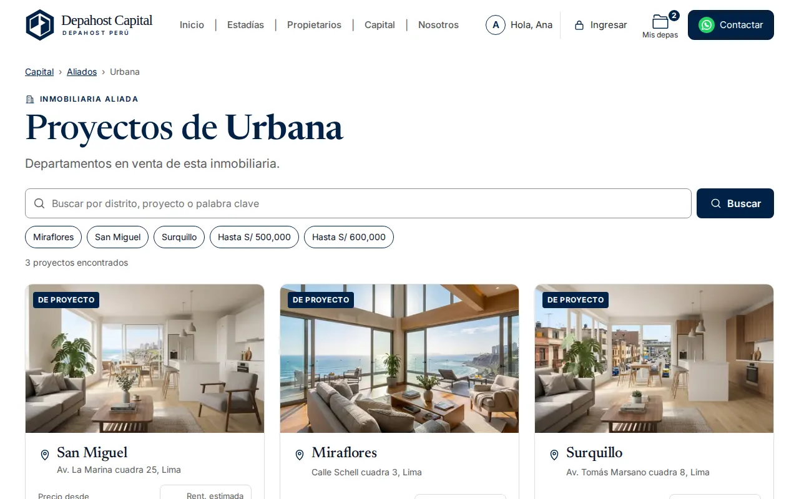

*Proyectos de una inmobiliaria aliada.*

**Para qué sirve.** Muestra juntos todos los proyectos de una inmobiliaria, con un buscador y filtros rápidos para encontrarlos.

**Cómo se llega.** La URL es `depahostperu.com/capital/aliados/{slug}`, por ejemplo `/capital/aliados/urbana` en los datos de ejemplo.

- En `/capital`, en la franja "Proyectos de aliados", toca el nombre de la inmobiliaria. El botón "Ver todos los proyectos" de la parte de arriba de `/capital` baja hasta esa franja.
- En `/propietarios`, en la franja "Aliados", toca el nombre.
- En la ficha de un proyecto, toca el nombre de la inmobiliaria en la miga de pan o "Ver sus N proyectos".

En las franjas, cada inmobiliaria con proyectos muestra su nombre y "N proyecto" o "N proyectos". Las que no tienen proyectos visibles muestran solo el nombre, atenuado (en gris), sin contador y sin enlace.

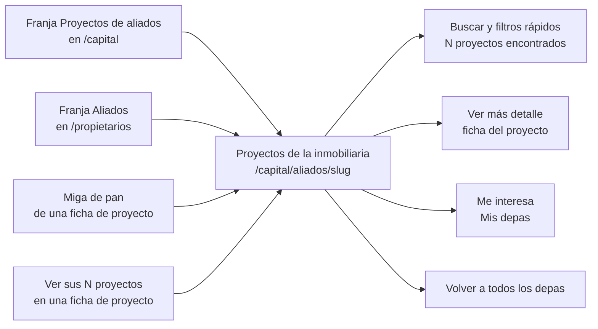

**Qué se ve.**

| Parte | Qué muestra |
|---|---|
| Miga de pan | "Capital" › "Aliados" › nombre. "Aliados" lleva a la franja de aliados de `/capital` |
| Encabezado | "Inmobiliaria aliada" y el título "Proyectos de {nombre}" |
| Descripción | La descripción de la inmobiliaria. Si no tiene: "Departamentos en venta de esta inmobiliaria." |
| Web | "Sitio web de {nombre}", que se abre en otra pestaña. Solo aparece si el equipo cargó la web |
| Buscador | La caja "Buscar por distrito, proyecto o palabra clave" y el botón "Buscar" |
| Filtros rápidos | Botones redondos (chips) con distritos, topes de precio ("Hasta S/ …") y rentabilidad mínima ("Desde …% anual") |
| "Limpiar filtros" | Solo aparece si hay texto escrito o un chip activo |
| Contador | "1 proyecto encontrado" o "N proyectos encontrados" |
| Tarjetas de proyecto | Ver la tabla siguiente. Los destacados van primero y luego los más nuevos |
| Sin resultados | "No encontramos proyectos con esos criterios." |
| Nota de cuota estimada | La misma de 3.2 |
| "Volver a todos los depas" | Lleva a la lista de depas de `/capital` |

Cada tarjeta de proyecto muestra:

| Elemento | Detalle |
|---|---|
| Foto | La primera foto, o el dibujo de la casa |
| Etiqueta sobre la foto | "De proyecto", o "Reservado" si está reservado |
| Ubicación | El distrito y "{dirección}, Lima" |
| "Precio desde" | El precio, en su moneda |
| "Rent. estimada" | La rentabilidad sin "anual", por ejemplo "5.8%" |
| Descripción | Solo si existe |
| Botones | "Me interesa" (igual que en 3.4) y "Ver más detalle" |

Si tocas cualquier parte de la tarjeta que no sea un botón, se abre la ficha.

**Qué puedes hacer.**

1. Escribe en "Buscar por distrito, proyecto o palabra clave". La lista se filtra mientras escribes.
2. Toca "Buscar" o presiona Enter para aplicar la búsqueda y cerrar el teclado del celular.
3. Toca un chip para filtrar. El chip activo se pinta de azul y muestra una "x". Tócalo otra vez para quitarlo.
4. Mira el contador para saber cuántos proyectos quedan.
5. Toca "Limpiar filtros" para borrar el texto y los chips a la vez. El cursor vuelve a la caja de búsqueda.
6. Toca "Ver más detalle" o la tarjeta para abrir la ficha del proyecto.

**Reglas y validaciones.**

| Campo | Regla | Mensaje si falla |
|---|---|---|
| "Buscar por distrito, proyecto o palabra clave" | No distingue mayúsculas ni tildes e ignora espacios y signos. Busca en el distrito, la dirección, la insignia y el precio ("595000" o "S/ 595,000" encuentran lo mismo) | "No encontramos proyectos con esos criterios." y el contador en "0 proyectos encontrados" |
| Chips de distrito | Hay uno por cada distrito con proyectos, en orden alfabético. Solo puede haber un distrito activo: tocar otro reemplaza al anterior | Igual que arriba |
| Chips "Hasta S/ …" | Cada precio se redondea hacia arriba al múltiplo de S/ 50,000 siguiente. Solo quedan los topes menores al precio más alto, es decir, los que dejan fuera al menos un proyecto. Se muestran como máximo los 2 más altos de ellos. Muestran los proyectos con precio menor o igual al tope | Igual que arriba |
| Chips "Desde …% anual" | Solo aparecen si la inmobiliaria tiene más de 3 proyectos. Son las 2 rentabilidades mínimas más bajas que superan a la menor de todas. Muestran los proyectos cuya rentabilidad mínima es igual o mayor | Igual que arriba |
| Combinación | El texto y un chip de cada tipo se suman: el proyecto debe cumplir todo | Igual que arriba |

**Qué pasa después.** No se envía nada al servidor. El buscador y los filtros no se recuerdan: si recargas la página, vuelven a cero. "Me interesa" funciona igual que en la ficha (ver 3.4).

**Casos especiales.**

- La página existe solo para inmobiliarias con al menos un proyecto publicado o reservado. Si no tiene ninguno, la dirección da la página 404 y en las franjas su nombre sale atenuado y sin enlace.
- **La búsqueda no revisa todo lo que dice la caja:** el texto de ayuda menciona "proyecto o palabra clave", pero no se busca en la descripción ni en el nombre de la inmobiliaria. Los proyectos no tienen un nombre propio en el sistema: se identifican por su dirección.
- **Buscar un precio en dólares:** en proyectos en dólares, buscar el precio como aparece en la tarjeta ("US$ 50,000") no da resultados. Hay que escribir solo el número ("50000").
- **Topes de precio en soles:** los chips "Hasta S/ …" comparan el número del precio sin convertir la moneda. Un proyecto en dólares se compara como si su precio estuviera en soles.
- Los proyectos reservados aparecen con la etiqueta "Reservado" y sí cuentan en el contador.
- **Datos de ejemplo:** sin el API, el sitio trae una sola inmobiliaria con proyectos, "Urbana", con 3 proyectos. Por eso no aparecen sus chips de rentabilidad. "Lima Sur", "Andes", "Miraflores Hotel" y "Nova" salen sin enlace. Ninguna tiene descripción ni web.
- **Móvil frente a escritorio:** las tarjetas van en 1 columna en celular, 2 desde 640 px y 3 desde 1024 px. En pantallas de menos de 480 px el botón "Buscar" muestra solo la palabra, sin ícono.

### 3.9 Depas reservados, vendidos y enlaces que ya no existen

El equipo es quien cambia el estado de cada depa desde el panel.

| Estado | Ficha `/capital/{slug}` | Tarjetas y listas | Mis depas | Página de la inmobiliaria |
|---|---|---|---|---|
| Publicado | Se ve completa, con la insignia si tiene | Aparece en todas | Se muestra | Cuenta como proyecto |
| Reservado | Se abre. La etiqueta empieza con "Reservado · " y no muestra insignia. Igual puedes usar "Me interesa" y "Contactar" | En `/capital` y en las tarjetas de proyecto sale la etiqueta "Reservado". En similares y "Para ti" no se marca. No entra en "Los 10 depas para invertir ahora" | Se muestra con "Reservado" | Cuenta, con la etiqueta "Reservado" |
| Vendido | No se genera: da 404 | Desaparece de todo | Se quita de la lista al abrir `/mis-depas`. Hasta entonces, el contador del encabezado lo sigue contando | No cuenta. Si era su último proyecto, la página desaparece |
| Borrador | Nunca se ve: da 404 | No aparece | No aparece | No cuenta |

- **Pendiente:** el código de la ficha ya contempla la etiqueta "Vendido · ", pero no se ve nunca, porque los depas vendidos no generan página. Mostrar la ficha con "Vendido" está anotado como pendiente.
- **Reservados en Google:** la ficha lleva datos para buscadores con el precio y la disponibilidad. Un depa publicado se marca como disponible y uno reservado como agotado. Por eso, en los resultados de Google un depa reservado puede aparecer como agotado, aunque su ficha siga abierta y acepte "Me interesa" y "Contactar".

**Cuándo se ven los cambios.** El sitio se genera de antemano, así que un cambio de estado, precio o fotos aparece recién cuando el sitio se vuelve a generar.

- Si está configurada la regeneración automática, el API espera 30 segundos para juntar los cambios seguidos y luego pide al hosting que regenere el sitio. A eso se suma lo que tarde esa generación.
- Si no está configurada, el cambio aparece recién en la siguiente publicación manual.
- Mientras tanto se sigue viendo el estado anterior. Los términos (en borrador) lo advierten: un depa reservado o vendido "puede seguir apareciendo por un tiempo".

**Enlace que ya no existe (página 404).**

- **Qué se ve:** un "404" grande, el título "No encontramos esta página" y el texto "Puede que el depa ya no esté disponible o que el link tenga un error.". Hay dos botones: "Ver depas para invertir", que lleva a `/capital`, y "Ir al inicio", que lleva a `/`. Google no indexa esta página.
- **Cuándo sale:**
  - el slug está mal escrito;
  - el depa se vendió, volvió a borrador o se eliminó;
  - el equipo cambió el slug: el enlace antiguo deja de funcionar y no redirige al nuevo;
  - el depa se acaba de publicar, pero el sitio todavía no se regeneró.
- **Desde el panel:**
  - Propietario: el botón "Ver mi depa en el sitio" aparece apenas su solicitud queda vinculada a un depa. Si ese depa todavía es borrador, ya se vendió o el sitio no se regeneró, el botón lleva a la página 404.
  - Comprador: los vendidos desaparecen de "Mis depas" del panel. En "Mis consultas" se ven como "Ya no disponible".

### 3.10 Otros casos especiales

- **Móvil frente a escritorio:**
  - En celular y tablet (menos de 1024 px), la ficha va en una sola columna: primero las fotos y luego los datos. "Me interesa" y "Contactar" quedan lado a lado.
  - En escritorio, las fotos van a la izquierda y los datos a la derecha. El bloque de datos se queda fijo mientras bajas.
  - Los similares van en 1 columna en celular, 2 desde 640 px y 4 desde 1024 px.
- **Datos de ejemplo:** si el sitio se genera sin el API, usa 6 depas de ejemplo: 3 de propietarios y 3 de "Urbana". Tienen una sola foto cada uno (algunas fotos se repiten entre depas), y no traen dormitorios, baños ni metros cuadrados. Los de propietarios tampoco tienen descripción. Por eso, con esos datos, las fichas no muestran ni miniaturas ni características.
- **Fotos:** con el API, las fotos vienen del almacenamiento del API (Cloudflare R2) y el sitio las optimiza al generarse. Un depa sin fotos muestra el dibujo de la casa.
- **Precio en dólares:** la ficha, los similares y las tarjetas de proyecto muestran "US$". En cambio, la tarjeta de `/capital` y "Los 10 depas para invertir ahora" siempre muestran el precio con "S/".
- **Al compartir el enlace:** la vista previa (en WhatsApp, por ejemplo) muestra el título "{Distrito} · {calle} | Depa Host Perú" y el texto "Depa en {distrito} desde {precio}. Rentabilidad {rentabilidad}.". La imagen es una genérica del sitio, no la foto del depa, y todavía está pendiente la imagen final de marca. En la página de una inmobiliaria, el título es "Proyectos de {nombre} | Depa Host Perú".
- **Observación para QA:** los íconos de las características se asignan por posición: cama, baño y área. Si falta un dato, los siguientes se corren y toman el ícono equivocado. Por ejemplo, si solo hay metros cuadrados, salen con el ícono de cama.

**Referencia técnica:** [`src/pages/capital/[slug].astro`](../../src/pages/capital/%5Bslug%5D.astro) · [`src/pages/capital/aliados/[slug].astro`](../../src/pages/capital/aliados/%5Bslug%5D.astro) · [`src/pages/capital/index.astro`](../../src/pages/capital/index.astro) · [`src/pages/404.astro`](../../src/pages/404.astro) · [`src/pages/capital/empecemos.astro`](../../src/pages/capital/empecemos.astro) · [`src/components/SaveButton.astro`](../../src/components/SaveButton.astro) · [`src/components/SaveListDialog.astro`](../../src/components/SaveListDialog.astro) · [`src/components/MiniCard.astro`](../../src/components/MiniCard.astro) · [`src/components/ProjectCard.astro`](../../src/components/ProjectCard.astro) · [`src/components/AlliesStrip.astro`](../../src/components/AlliesStrip.astro) · [`src/components/SearchFilters.astro`](../../src/components/SearchFilters.astro) · [`src/lib/properties.ts`](../../src/lib/properties.ts) · [`src/lib/recommend.ts`](../../src/lib/recommend.ts) · [`src/lib/format.ts`](../../src/lib/format.ts) · [`src/lib/filters.ts`](../../src/lib/filters.ts) · [`src/lib/saved-store.ts`](../../src/lib/saved-store.ts) · [`src/lib/account.ts`](../../src/lib/account.ts) · [`src/scripts/saved-buttons.ts`](../../src/scripts/saved-buttons.ts) · [`src/scripts/property-filters.ts`](../../src/scripts/property-filters.ts) · [`src/content/financing.json`](../../src/content/financing.json) · [`depahost-api/src/modules/properties/service.ts`](../../../depahost-api/src/modules/properties/service.ts) · [`depahost-api/src/modules/accounts/service.ts`](../../../depahost-api/src/modules/accounts/service.ts) · [`depahost-api/src/modules/leads/routes.ts`](../../../depahost-api/src/modules/leads/routes.ts) · [`depahost-panel/src/views/seller/RequestDetailView.vue`](../../../depahost-panel/src/views/seller/RequestDetailView.vue) · Capítulos: [05-flujos.md](05-flujos.md) (flujos 5, 6, 8, 9 y 11), [07-decisiones-y-pendientes.md](07-decisiones-y-pendientes.md), [08-panel-y-cuentas.md](08-panel-y-cuentas.md)

## 4. Guardar depas y pedir acompañamiento

Aquí se explica cómo la persona arma su lista de depas favoritos, cómo deja sus datos para que el equipo le haga seguimiento y cómo pide acompañamiento por WhatsApp. Todo funciona sin cuenta. Con cuenta, la lista también se guarda en ella (ver 4.8).

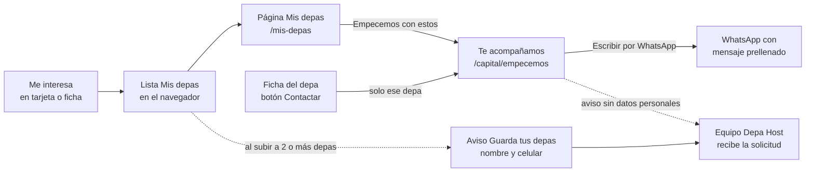

### 4.1 Botón "Me interesa"

**Para qué sirve.** Marca un depa para revisarlo después en "Mis depas". No pide datos ni cuenta.

**Dónde está.**

| Lugar | Ruta |
|---|---|
| Tarjetas de depas de propietarios | `/capital` |
| Tarjetas de proyectos de una inmobiliaria aliada | `/capital/aliados/{inmobiliaria}` |
| Ficha del depa, junto al botón "Contactar" | `/capital/{depa}` |

No aparece en las tarjetas pequeñas ("Depas similares", "Para ti, según lo que has visto", "Parecidos a los que guardaste"). Para guardar uno de esos, abre su ficha.

**Qué se ve.** Un corazón vacío con el texto "Me interesa". Cuando el depa ya está guardado, el corazón se rellena y el texto cambia a "Guardado".

**Qué puede hacer.**
1. Toca "Me interesa" en la tarjeta o en la ficha.
2. Fíjate que el botón cambie a "Guardado" y que suba el contador "Mis depas" del encabezado.
3. Para quitarlo, toca otra vez "Guardado".

**Reglas.**

| Regla | Detalle |
|---|---|
| Máximo 20 depas | Si ya tienes 20 y guardas otro, el más antiguo sale de la lista sin aviso. |
| Sin repetidos | Cada depa aparece una sola vez. |
| Orden | Del más antiguo al más reciente. |
| Mismo depa en varios lugares | Si el mismo depa aparece dos veces en la página, todos sus botones cambian a la vez. |

**Qué pasa después.** Si la lista llega a 2 o más depas, puede abrirse el aviso "Guarda tus depas" (4.3).

### 4.2 La lista "Mis depas" sin cuenta

**Dónde se guarda.** En el navegador del dispositivo de la persona. El equipo no la recibe hasta que la persona llena "Guarda tus depas" o toca "Escribir por WhatsApp" en "Te acompañamos". La lista no vence. Funciona aunque la persona rechace las cookies de analítica.

**Contador del encabezado.**
- Es un ícono de carpeta con el texto "Mis depas". Se ve en celular y en escritorio.
- Muestra un círculo con el número de depas guardados. Si no hay ninguno, el círculo no aparece.
- Al tocarlo, lleva a `/mis-depas`.
- Cuenta todo lo guardado en el navegador, incluidos los depas que ya no están publicados. El número se corrige al abrir `/mis-depas` (ver 4.5).

**Casos especiales.**

| Situación | Qué pasa |
|---|---|
| El sitio está abierto en otra pestaña | El contador, los botones "Me interesa", la lista y el resumen de la página "Mis depas" y "Parecidos a los que guardaste" se actualizan solos. El saludo "Hola, …", la nota final de "Mis depas" ("Guardado en este dispositivo…" / "Guardado para {nombre}…") y la página "Te acompañamos" no se actualizan: muestran lo último al recargar. El aviso "Guarda tus depas" puede abrirse también en la otra pestaña. |
| Otro navegador u otro dispositivo | No se ve la lista. Cada navegador tiene la suya. Para verla en todos, hace falta una cuenta (4.8). |
| La persona borra los datos del navegador | Se pierden la lista, el nombre del saludo, la pausa del aviso (que puede volver a salir) y el historial de fichas vistas. Lo que ya se envió al equipo se conserva. |
| El navegador no deja guardar datos del sitio | La lista funciona, pero solo hasta que la persona cambia de página. |

### 4.3 Aviso "Guarda tus depas"

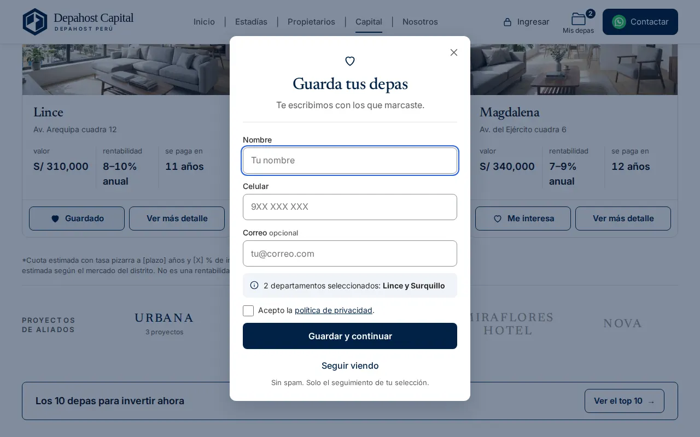

*Aviso "Guarda tus depas" al guardar el segundo depa.*

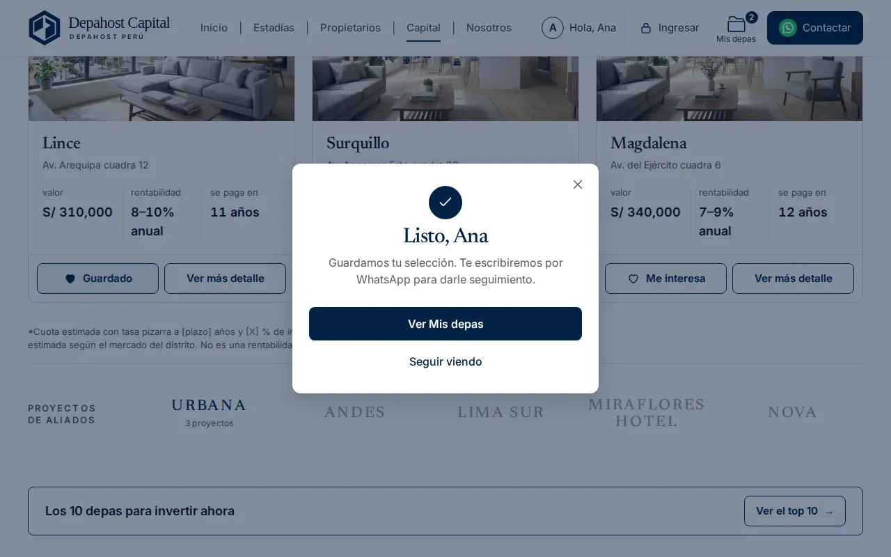

*Confirmación después de dejar nombre y celular.*

**Para qué sirve.** Pide nombre y celular para que el equipo le escriba por WhatsApp sobre los depas que marcó.

**Cómo se llega.**
- **Solo:** se abre en cualquier página cuando la lista sube a 2 o más depas al tocar "Me interesa". No sale si en ese navegador la persona ya dejó sus datos, ni si cerró el aviso hace menos de 7 días.
- **A pedido:** con el enlace "Guárdalos con tu celular" de la página `/mis-depas`. Así se abre siempre, aunque esté en pausa. El enlace solo se ve mientras la persona no haya dejado su nombre.

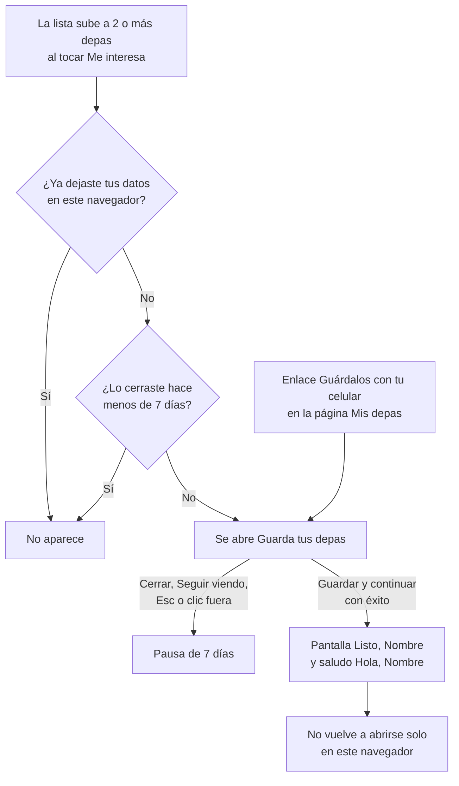

**Qué se ve.**
- Título "Guarda tus depas" y el texto "Te escribimos con los que marcaste.".
- Campos "Nombre" ("Tu nombre"), "Celular" ("9XX XXX XXX") y "Correo" con la marca "opcional" ("tu@correo.com").
- Un resumen de lo guardado, por ejemplo "2 departamentos seleccionados: Lince y Surquillo" (los distritos son de ejemplo). Con uno solo dice "1 departamento seleccionado". Si la lista está vacía, el resumen no aparece.
- La casilla "Acepto la política de privacidad.", que enlaza a `/privacidad`.
- La verificación anti-robots de Cloudflare, solo si está configurada.
- El botón "Guardar y continuar", el enlace "Seguir viendo", la "X" para cerrar y el texto "Sin spam. Solo el seguimiento de tu selección.".

**Cómo se arma el resumen.**
- El número cuenta todo lo que está guardado en el navegador. Eso incluye depas vendidos o retirados que siguen en la lista porque la persona todavía no abrió `/mis-depas`, que es donde se limpian (4.5).
- Los distritos salen solo de los depas que siguen en el catálogo, sin repetir. Por eso puede decir, por ejemplo, "3 departamentos seleccionados: Lince y Surquillo" aunque uno de los tres ya no esté publicado.
- Si el catálogo no carga, el resumen muestra solo el número, sin distritos (por ejemplo "2 departamentos seleccionados").

**Qué puede hacer.**
1. Escribe tu nombre en "Nombre".
2. Escribe tu número en "Celular".
3. Si quieres, escribe tu correo en "Correo".
4. Revisa el resumen de depas seleccionados.
5. Marca "Acepto la política de privacidad.".
6. Si aparece la verificación anti-robots, complétala.
7. Toca "Guardar y continuar". El botón se bloquea y aparece "Enviando…".
8. En la pantalla "Listo, {tu primer nombre}" (por ejemplo, "Listo, Ana" si escribiste "ana lucía"), toca "Ver Mis depas" para ir a tu lista o "Seguir viendo" para cerrar.

Para cerrar sin dejar datos, toca la "X", "Seguir viendo", la tecla Esc o fuera del aviso. Los depas siguen guardados y el aviso queda en pausa 7 días.

**Reglas y validaciones.**

| Campo | Regla | Mensaje si falla |
|---|---|---|
| "Nombre" | Obligatorio. Mínimo 2 caracteres (sin contar espacios al inicio y al final) y máximo 120. | Si está vacío o tiene menos de 2 caracteres, avisa el navegador con su propio mensaje. Si llega vacío al servidor: "Ingresa tu nombre". El máximo de 120 lo controla solo el servidor y responde en inglés: "Too big: expected string to have <=120 characters". Un nombre como " a" pasa el navegador (cuenta el espacio), pero el servidor lo rechaza en inglés: "Too small: expected string to have >=2 characters". |
| "Celular" | Obligatorio. De 6 a 20 caracteres: números, espacios, guiones o paréntesis, con un "+" opcional al inicio. | Si está vacío, avisa el navegador. El formato lo revisa solo el servidor: aparece "Revisa los campos marcados." y, debajo del campo, "Teléfono inválido". |
| "Correo" | Opcional. Si se llena, debe ser un correo válido. El servidor exige un dominio completo, por ejemplo ".com". | Primero avisa el navegador. Un correo como `ana@correo` pasa el navegador, pero el servidor lo rechaza en inglés: "Invalid email address". |
| Casilla de privacidad | Obligatoria. | Si no se marca, avisa el navegador. |
| Verificación anti-robots (si está activa) | Debe completarse. | "No pudimos verificar que no eres un robot. Recarga la página e inténtalo otra vez." más el enlace "Escribir por WhatsApp". |
| Envíos seguidos | Máximo 10 envíos por minuto desde la misma conexión, contando también los toques a "Escribir por WhatsApp" en "Te acompañamos" y los otros formularios de consulta del sitio. | "Hiciste varios envíos seguidos. Espera un minuto e inténtalo otra vez." |
| Sin conexión | — | "No pudimos enviar tus datos. Revisa tu conexión o escríbenos por WhatsApp." más el enlace "Escribir por WhatsApp". |
| Falla del servidor | — | Se muestra el mensaje que manda el servidor (por ejemplo "Error interno" u "Origen no permitido") más el enlace "Escribir por WhatsApp". Si la respuesta no trae mensaje, se muestra "No pudimos enviar tus datos. Revisa tu conexión o escríbenos por WhatsApp.". |

Cuando el servidor marca errores por campo, aparece "Revisa los campos marcados." y el mensaje se muestra debajo de "Nombre", "Celular" o "Correo". La verificación anti-robots se reinicia después de cada error.

**Qué pasa después.**
- Se crea una solicitud de tipo "Guarda tus depas". Lleva el nombre, el celular, el correo si se puso, los depas de la lista en ese momento, la fecha en que se aceptó la privacidad y los datos de campaña si la persona llegó desde un anuncio en esa misma pestaña del navegador.
- Los depas se envían tal como están en el navegador. Si quedaba alguno vendido o retirado, también va en la solicitud. El sistema no lo rechaza.
- Si la persona tenía la sesión iniciada, la solicitud queda vinculada a su cuenta (4.8).
- El equipo la ve como lead nuevo en el panel de administración. Si el correo de avisos está configurado, también recibe un correo "Nuevo lead · Guarda tus depas (lista de interés)". En ese correo los depas salen con su código interno, no con su nombre. Si hay un CRM conectado, también se le avisa.
- La persona no recibe ningún correo ni mensaje automático. El seguimiento por WhatsApp lo hace el equipo a mano.
- En pantalla sale "Listo, {primer nombre}" con el texto "Guardamos tu selección. Te escribiremos por WhatsApp para darle seguimiento.".
- El navegador guarda solo el primer nombre, para el saludo (4.4). El aviso ya no se abre solo en ese navegador.

**Casos especiales.**
- **La API no está configurada:** al tocar "Guardar y continuar" aparece "Por ahora recibimos estas consultas por WhatsApp." con el enlace "Escribir por WhatsApp". Ese enlace abre WhatsApp con el mensaje "Hola, quiero que me ayuden con los depas que guardé en DepaHost Capital.". No se guarda el nombre y, al cerrar, el aviso entra en pausa de 7 días.
- **La verificación anti-robots depende de la configuración:** si la API la exige y el sitio no la muestra, todos los envíos fallan con el mensaje del robot.
- **La solicitud es una foto del momento:** los depas que la persona guarde o quite después no se envían de nuevo.
- **Depas que ya no están en el catálogo:** como la lista solo se limpia al abrir `/mis-depas`, el resumen puede contar un depa vendido o retirado sin nombrarlo, y la solicitud lo incluye (ver "Cómo se arma el resumen").
- **La política de privacidad es un borrador:** el texto de `/privacidad` está pendiente de revisión legal y su fecha de actualización dice "[fecha pendiente]".
- **En celular** el aviso ocupa casi todo el ancho de la pantalla.

### 4.4 Saludo "Hola, …"

- Después de enviar "Guarda tus depas", el encabezado muestra "Hola, {nombre}" con un círculo que lleva la inicial. Al tocarlo, lleva a `/mis-depas`.
- Usa solo la primera palabra del nombre, con mayúscula inicial. Por ejemplo, "ana lucía" se muestra como "Ana".
- Se ve en pantallas desde 640 px de ancho. En celulares angostos no aparece. Entre 1024 y 1279 px solo se ve el círculo con la inicial.
- En `/mis-depas`, la nota final cambia a "Guardado para {nombre}. La próxima vez te mostramos depas parecidos.".
- Si la persona tiene la sesión iniciada, el saludo usa el nombre de la cuenta y lleva al panel (4.8).
- Si la persona borra los datos del navegador, el saludo desaparece.

### 4.5 Página "Mis depas"

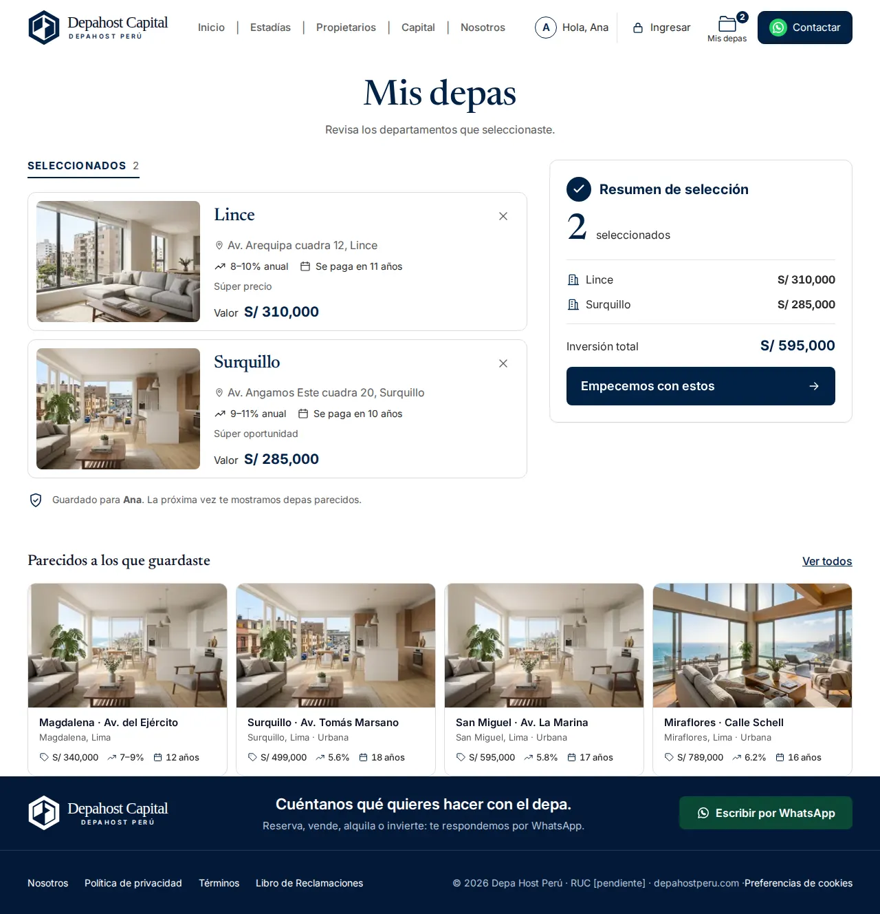

*Página "Mis depas" con dos depas guardados.*

**Para qué sirve.** Revisar y comparar los depas guardados, ver cuánto suman y pasar a pedir acompañamiento.

**Cómo se llega.** Por el ícono "Mis depas" del encabezado, por el saludo "Hola, …" (sin cuenta), por "Ver Mis depas" en el aviso o por "Cambiar selección" en "Te acompañamos". La ruta es `/mis-depas`. La página no sale en Google.

**Qué se ve.**

| Parte | Contenido |
|---|---|
| Encabezado | "Mis depas" y "Revisa los departamentos que seleccionaste." |
| "Seleccionados" | Cuántos depas guardados se encontraron en el catálogo. |
| Tarjeta de cada depa | Foto (o un ícono de casa si no tiene foto); el distrito como título, con enlace a la ficha; la "X" para quitar; la dirección y el distrito; dormitorios, baños y m² si existen, y si no, la rentabilidad y "Se paga en …"; una línea con la inmobiliaria y la descripción o etiqueta del depa ("Reservado" si está reservado); y "Valor" (depa de propietario) o "Desde" (proyecto) con el precio. |
| "Resumen de selección" | El número de depas con "seleccionados", la lista de distritos con su precio, la "Inversión total" y el botón "Empecemos con estos". |
| Nota final | Sin nombre guardado: "Guardado en este dispositivo. Guárdalos con tu celular y te escribimos con los que marcaste." ("Guárdalos con tu celular" abre el aviso de 4.3). Con nombre: "Guardado para {nombre}. La próxima vez te mostramos depas parecidos." |
| "Parecidos a los que guardaste" | Hasta 4 depas sugeridos, con el enlace "Ver todos" a la lista de `/capital`. |

**Qué puede hacer.**
1. Toca el distrito de una tarjeta para abrir su ficha.
2. Toca la "X" de una tarjeta para quitar ese depa. No pide confirmación y no se puede deshacer. Para recuperarlo, vuelve a tocar "Me interesa" en su ficha.
3. Revisa la "Inversión total" en el resumen.
4. Toca "Empecemos con estos" para ir a "Te acompañamos" (4.7).
5. Si aún no dejaste tus datos, toca "Guárdalos con tu celular".

**Reglas.**
- **Inversión total:** suma los precios por moneda, por ejemplo "S/ 595,000" o "S/ 595,000 + US$ 80,000".
- **"Empecemos con estos":** se ve apagado y no responde mientras no haya ningún depa.
- **Depas que ya no están en el catálogo:** se quitan solos de la lista al abrir la página, sin aviso. Son los vendidos o retirados. Los reservados se quedan, marcados como "Reservado".
- **"Parecidos a los que guardaste":** se arma con los depas guardados (pesan más) y con las últimas 6 fichas que la persona abrió. Nunca sugiere un depa ya guardado. A los que ya vio les baja la prioridad, pero pueden salir antes que otros si se parecen mucho. Se recalcula al quitar un depa. Si no hay nada guardado ni visto, o no hay sugerencias, la sección no aparece.

**Casos especiales.**
- **Lista vacía:** aparece "Aún no guardaste departamentos. Toca Me interesa en los que te gusten." con el botón "Explorar departamentos" (va a `/capital`). Si la persona abrió fichas antes, igual pueden salir sugerencias abajo.
- **No hay botón "Seguir viendo" en esta página.** "Seguir viendo" solo existe en el aviso "Guarda tus depas". Para seguir explorando desde aquí se usan "Explorar departamentos", "Ver todos" o el menú "Capital".
- **Solo depas en dólares:** la inversión total igual muestra soles en cero, por ejemplo "S/ 0 + US$ 80,000".
- **El catálogo no carga:** aparece "No pudimos cargar tus depas guardados. Recarga la página.".
- **Celular frente a escritorio:** desde 900 px de ancho, el resumen va a la derecha y acompaña al bajar la página. En pantallas más angostas va debajo de la lista. Hasta 480 px, cada tarjeta pone la foto arriba. Las sugerencias se ven en 1 columna en celular, en 2 desde 640 px y en 4 desde 1024 px.

### 4.6 Dirección antigua `/carrito`

"Mis depas" antes estaba en `/carrito`. Quien abra esa dirección, por ejemplo desde un enlace viejo, pasa automáticamente a `/mis-depas`. Esa dirección tampoco sale en Google.

### 4.7 Página "Te acompañamos"

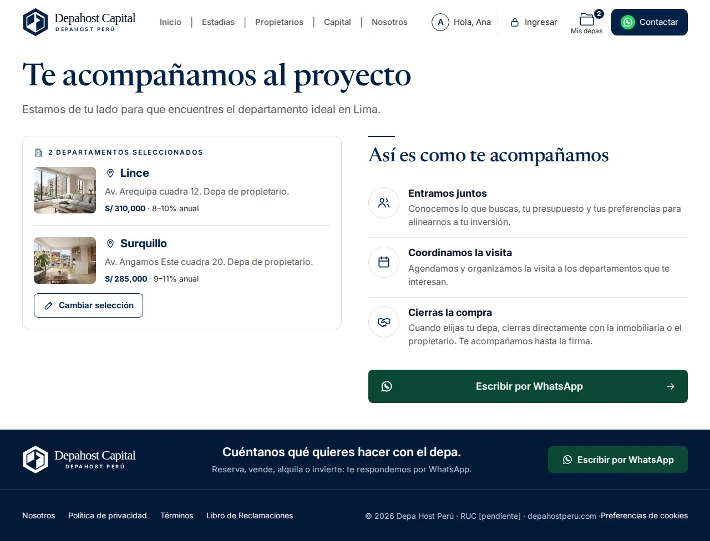

*Página "Te acompañamos" con los depas elegidos.*

**Para qué sirve.** Es el paso previo a WhatsApp. Muestra los depas elegidos, explica cómo acompaña el equipo y abre WhatsApp con un mensaje ya escrito.

**Cómo se llega.** La ruta es `/capital/empecemos` (en la pestaña dice "Te acompañamos"). La página no sale en Google.

| Desde | Botón | Qué depas muestra |
|---|---|---|
| Página "Mis depas" | "Empecemos con estos" | Todos los de Mis depas |
| Portada de Capital (`/capital`) | "Empecemos" | Todos los de Mis depas, o ninguno |
| Ficha de un depa | "Contactar" | Solo ese depa, aunque haya otros guardados. Ese depa no se agrega a Mis depas. |
| "Mis depas" del panel (con cuenta) | "Empecemos con estos" | Todos los de Mis depas de ese navegador |
| "Mis consultas" del panel, sin consultas (con cuenta) | "Empecemos" | Todos los de Mis depas de ese navegador, o ninguno |

Estos botones solo llevan a la página. No envían nada al equipo. La solicitud se registra recién al tocar "Escribir por WhatsApp".

**Qué se ve.**
- El título "Te acompañamos al proyecto" y el texto "Estamos de tu lado para que encuentres el departamento ideal en Lima.". Con un solo depa, el texto termina con su distrito, por ejemplo "… ideal en Lince.".
- Una tarjeta titulada "Departamento seleccionado" o "{n} departamentos seleccionados". El título en singular se usa con un depa y también cuando no hay ninguno. Cada depa lleva foto, distrito (con enlace a la ficha), "{dirección}. Proyecto de {inmobiliaria}." o "{dirección}. Depa de propietario.", y el precio con la rentabilidad (por ejemplo "S/ 310,000 · 8–10% anual"). Con varios depas, la foto se achica a la izquierda.
- El botón "Cambiar selección", que vuelve a `/mis-depas`. Se ve siempre, haya o no depas.
- La sección "Así es como te acompañamos", con tres pasos:
  - "Entramos juntos": "Conocemos lo que buscas, tu presupuesto y tus preferencias para alinearnos a tu inversión."
  - "Coordinamos la visita": "Agendamos y organizamos la visita a los departamentos que te interesan."
  - "Cierras la compra": "Cuando elijas tu depa, cierras directamente con la inmobiliaria o el propietario. Te acompañamos hasta la firma."
- El botón verde "Escribir por WhatsApp".

**Qué puede hacer.**
1. Revisa los depas de la tarjeta. Si quieres cambiarlos, toca "Cambiar selección".
2. Toca "Escribir por WhatsApp".
3. En WhatsApp, que se abre en una pestaña nueva con el mensaje ya escrito, revisa el texto y envíalo. El sitio no lo envía por ti.

**Mensaje prellenado de WhatsApp.**

| Selección | Texto |
|---|---|
| Ningún depa | "Hola, quiero invertir en un depa en Lima y me gustaría que me acompañen." |
| Un depa | "Hola, quiero que me acompañen con este depa:" y debajo una línea como "- Lince (Av. Arequipa cuadra 12): S/ 310,000" |
| Varios depas | "Hola, quiero que me acompañen con estos depas:" y debajo una línea por depa con distrito, dirección y precio |

Los distritos, direcciones y precios del cuadro son de ejemplo.

**Qué se envía al equipo.** Al tocar "Escribir por WhatsApp" con al menos un depa, el sitio registra una solicitud de tipo "Te acompañamos". Solo lleva qué depas eligió la persona y los datos de campaña: no lleva nombre ni teléfono. No pide aceptar la privacidad ni pasa por la verificación anti-robots.
- El equipo la ve en el panel de administración. Este tipo de solicitud no genera correo al equipo. Si hay un CRM conectado, también se le avisa.
- El equipo sabe quién es la persona cuando le llega su mensaje de WhatsApp.
- Cada toque del botón registra una solicitud nueva, hasta 10 por minuto desde la misma conexión (el mismo límite de 4.3). Las que pasan ese límite no se registran y no se avisa; WhatsApp se abre igual.
- Si la persona tenía la sesión iniciada, queda vinculada a su cuenta.

**Casos especiales.**
- **Sin depas elegidos:** la tarjeta mantiene el título "Departamento seleccionado" (en singular) y muestra a la vez el aviso "Todavía no elegiste un depa. Marca Me interesa en los que te gusten o escríbenos y te ayudamos a elegir.", el botón "Ver depas" (va a `/capital`) y el botón "Cambiar selección" (va a `/mis-depas`). WhatsApp se abre con el mensaje general y no se registra nada.
- **La API no está configurada o falla:** WhatsApp se abre igual. La solicitud simplemente no se registra.
- **El enlace de "Contactar" apunta a un depa que ya no está publicado:** la página muestra los depas de Mis depas.
- **Botón tocado antes de tiempo:** el botón queda listo cuando la página termina de cargar los depas. Si se toca antes, abre una pestaña sin WhatsApp.
- **El catálogo no carga:** la tarjeta queda con el título "Departamento seleccionado" y el botón "Cambiar selección", sin depas y sin el aviso "Todavía no elegiste un depa…" ni el botón "Ver depas". WhatsApp se abre con el mensaje general y no se registra nada.
- **Número de WhatsApp de relleno:** el número sale de la configuración del sitio. El valor por defecto es `51XXXXXXXXX`; mientras no se configure el real, el mensaje no llega a Depa Host.
- **No se actualiza sola:** la página muestra la lista tal como estaba al abrirla. Los cambios hechos en otra pestaña se ven al recargar.
- **Celular frente a escritorio:** desde 1024 px de ancho, la selección va a la izquierda y los pasos con el botón a la derecha. En pantallas más angostas va todo en una columna.

### 4.8 Qué cambia cuando la persona tiene cuenta

Aplica igual a compradores (rol buyer) y propietarios (rol seller). Cómo crear la cuenta e ingresar está en la sección 6. Para que funcione, el sitio, el panel y la API tienen que estar configurados para compartir la sesión. Si el panel no está configurado, el botón "Ingresar" no aparece en el sitio.

| Tema | Sin cuenta | Con sesión iniciada |
|---|---|---|
| Dónde vive Mis depas | Solo en ese navegador | En el navegador y en la cuenta |
| Otros dispositivos | No ven la lista | La ven al iniciar sesión y abrir cualquier página del sitio |
| Encabezado | "Hola, {nombre del aviso}" lleva a `/mis-depas`; se ve "Ingresar" | "Hola, {nombre de la cuenta}" lleva al panel; "Ingresar" se oculta |
| Solicitudes enviadas | No quedan ligadas a nadie | Aparecen en "Mis consultas" del panel como "Guarda tus depas" o "Te acompañamos (WhatsApp)" |

**Cómo se sincroniza.**
1. Inicia sesión (sección 6) y abre cualquier página del sitio.
2. El sitio une las dos listas: primero van los depas de la cuenta y después los que tenías solo en ese navegador. Lo que guardaste antes de ingresar no se pierde.
3. Desde ese momento, cada "Me interesa" o cada depa que quitas se guarda también en la cuenta, en menos de un segundo.
4. En otro dispositivo, inicia sesión y abre el sitio. El contador y la lista se completan con lo de tu cuenta.

**"Mis depas" en el panel** (`app.depahostperu.com/mis-depas`, en el menú "Mi cuenta"):
- Es la misma lista. Muestra "Los departamentos que marcaste con Me interesa, en el sitio o aquí. Se guardan en tu cuenta.".
- Cada depa tiene la "X" para quitar, que muestra el aviso "Quitaste {distrito}", y el enlace "Ver en el sitio".
- El "Resumen" lleva los "seleccionados", la "Inversión total" y el botón "Empecemos con estos", que abre "Te acompañamos" del sitio.
- Con la lista vacía muestra "Aún no guardaste departamentos" y el botón "Ver depas para invertir".

**Casos especiales.**
- **Un depa quitado puede volver.** Si quitas un depa en el panel o en otro dispositivo, vuelve a la cuenta cuando abres el sitio en un navegador que todavía lo tenía guardado. Pasa también en el mismo navegador donde usas el panel. En ese caso, quítalo desde el sitio, en ese navegador.
- **Límite de 20 en el sitio.** Si al unir las listas hay más de 20 depas, el sitio se queda con los 20 últimos de la lista unida: salen primero los depas más antiguos de la cuenta, aunque un depa que solo estaba en el navegador sea más antiguo. La cuenta guarda la lista unida completa (y el panel la muestra entera) hasta el siguiente cambio en el sitio, cuando también queda con esos 20.
- **El aviso "Guarda tus depas" puede aparecer igual.** No distingue si la persona tiene sesión. Puede abrirse incluso cuando llega la lista de la cuenta a un dispositivo nuevo, si trae 2 o más depas.
- **La nota de `/mis-depas` no cambia con la cuenta.** Sigue diciendo "Guardado en este dispositivo." si la persona nunca llenó el aviso en ese navegador, aunque la lista ya esté en su cuenta.
- **Al cerrar sesión o si la sesión vence:** la lista queda en ese navegador, pero los cambios posteriores ya no se guardan en la cuenta. El encabezado vuelve a mostrar "Ingresar".

**Referencia técnica:** [`src/components/SaveButton.astro`](../../src/components/SaveButton.astro), [`src/scripts/saved-buttons.ts`](../../src/scripts/saved-buttons.ts), [`src/lib/saved-store.ts`](../../src/lib/saved-store.ts), [`src/components/Header.astro`](../../src/components/Header.astro), [`src/components/SaveListDialog.astro`](../../src/components/SaveListDialog.astro), [`src/scripts/forms.ts`](../../src/scripts/forms.ts), [`src/lib/profile.ts`](../../src/lib/profile.ts), [`src/pages/mis-depas.astro`](../../src/pages/mis-depas.astro), [`src/components/SavedDepa.astro`](../../src/components/SavedDepa.astro), [`src/components/ForYouRow.astro`](../../src/components/ForYouRow.astro), [`src/lib/recommend.ts`](../../src/lib/recommend.ts), [`src/pages/capital/empecemos.astro`](../../src/pages/capital/empecemos.astro), [`src/data/contacto.ts`](../../src/data/contacto.ts), [`src/lib/account.ts`](../../src/lib/account.ts), [`astro.config.mjs`](../../astro.config.mjs) · API: `depahost-api/src/modules/leads/` (`schema.ts`, `service.ts`, `routes.ts`) y `depahost-api/src/modules/accounts/service.ts` · Panel: `depahost-panel/src/views/buyer/SavedView.vue` y `depahost-panel/src/views/buyer/MyLeadsView.vue` · Capítulos: [05-flujos.md](05-flujos.md) (flujos 6, 7, 9, 10 y 11) y [08-panel-y-cuentas.md](08-panel-y-cuentas.md#mis-depas-del-navegador-a-la-cuenta).

## 5. Formularios: propietarios, inversionistas del extranjero y Libro de Reclamaciones

El sitio tiene tres formularios que envían datos al equipo. Los tres funcionan de la misma forma. Lo que cambia es qué datos piden y qué pasa al final.

| Formulario | Dónde está | Botón de envío | Idioma | ¿Necesita cuenta? |
|---|---|---|---|---|
| Propietarios | `/propietarios` | "Recibir propuesta" | Español | No |
| Inversionistas del extranjero | `/capital`, al final de la página | "Talk to us on WhatsApp" | Inglés | No |
| Libro de Reclamaciones | `/libro-de-reclamaciones` | "Enviar reclamo" | Español | No |

### 5.1 Lo que tienen en común todos los formularios

**Qué pasa cuando tocas el botón de envío**

1. Completa los campos y toca el botón de envío.
2. Primero revisa el navegador. Si falta un campo obligatorio o un dato tiene mal formato, el navegador pone su propio aviso sobre el primer campo con problema y no envía nada. El texto de ese aviso depende del navegador y de su idioma. El navegador revisa los campos obligatorios y la mayoría de los formatos (correo, documento, montos). El formato del teléfono lo revisa solo el API.
3. Si todo está bien, el botón se bloquea, se ve más tenue y debajo aparece "Enviando…" ("Sending…" en el formulario en inglés). Así no se puede enviar dos veces seguidas.
4. Debajo del botón aparece el resultado: fondo verde si salió bien, rojo si hubo error y claro si es un aviso.
5. Si hubo error, el botón se desbloquea y puedes corregir e intentar otra vez.

**Errores por campo que devuelve el API**

El API revisa otra vez todos los datos. Si algo no pasa:

- El campo se marca con borde rojo.
- El motivo aparece en rojo debajo del campo, si ese campo tiene espacio para mensaje. Las listas desplegables ("Distrito", "Tipo", "Tipo de documento"…) solo se marcan con el borde.
- El cursor salta al primer campo marcado.
- Debajo del botón aparece "Revisa los campos marcados." ("Please check the highlighted fields." en inglés).

Algunos mensajes del API están escritos en español: "Ingresa tu nombre", "Ingresa un correo o un teléfono", "Teléfono inválido", "Número de documento inválido", "Debes aceptar la política de privacidad" y "Si eres menor de edad, indica el nombre de tu padre, madre o apoderado". Los demás límites salen con un mensaje genérico en inglés, por ejemplo "Too big: expected string to have <=120 characters". Esos límites son los que el navegador no revisa, como el largo máximo de un nombre o un monto con decimales.

**Mensajes de resultado**

| Situación | Formularios en español | Formulario en inglés | ¿Trae enlace a WhatsApp? |
|---|---|---|---|
| El sitio se publicó sin la dirección del API | "Por ahora recibimos estas consultas por WhatsApp." | "For now we take these requests on WhatsApp." | Sí: "Escribir por WhatsApp" / "Message us on WhatsApp" |
| Enviando | "Enviando…" | "Sending…" | No |
| Un dato no pasa la revisión del API | "Revisa los campos marcados." | "Please check the highlighted fields." | No |
| Demasiados envíos seguidos | "Hiciste varios envíos seguidos. Espera un minuto e inténtalo otra vez." | "Too many attempts. Please wait a minute and try again." | No |
| Falla la verificación anti-bots | "No pudimos verificar que no eres un robot. Recarga la página e inténtalo otra vez." | El mismo texto, en español | Sí |
| Sin conexión o el API no responde | "No pudimos enviar tus datos. Revisa tu conexión o escríbenos por WhatsApp." | "We could not send your details. Check your connection or message us on WhatsApp." | Sí |
| El API rechaza el envío por otro motivo | El mensaje que manda el propio API, por ejemplo "Error interno". Solo si el API no manda ningún mensaje sale "No pudimos enviar tus datos…" | Igual: el mensaje del API, en español ("Error interno"), o "We could not send your details…" si no trae mensaje | Sí |
| Envío correcto | Depende del formulario (ver 5.2, 5.3 y 5.4) | Depende del formulario | Depende |

El enlace a WhatsApp se abre en una pestaña nueva y trae un mensaje ya escrito con lo que llenaste. Así la persona no pierde la consulta aunque el envío falle. Si el sitio se publicó sin el número real de WhatsApp, el enlace apunta al número de relleno `51XXXXXXXXX` y no sirve.

**Depende de la configuración:** el API solo acepta envíos de las direcciones web que tiene en su lista de orígenes permitidos. Si la dirección del sitio no está en esa lista, el navegador bloquea el envío y todas las personas, con sesión o sin ella, ven "No pudimos enviar tus datos…" (o "We could not send your details…") con el enlace a WhatsApp. No se guarda nada.

**Verificación anti-bots (Cloudflare Turnstile)**

- Es un recuadro de Cloudflare que aparece encima del botón de envío o del mensaje de resultado. Sale en español y con tema claro, también en el formulario en inglés.
- A veces se resuelve solo. Otras veces pide que marques una casilla. Espera a que termine antes de enviar.
- Si el envío falla, el recuadro se reinicia solo. Complétalo otra vez antes de reenviar.
- **Depende de la configuración:**
  - Si el sitio no tiene la clave de Turnstile, el recuadro no aparece.
  - Si el API sí exige la verificación (es obligatoria en producción) y el sitio no muestra el recuadro, todos los envíos fallan con el mensaje "No pudimos verificar que no eres un robot…".
  - En desarrollo local, sin claves, todo pasa sin verificación.

**Casilla de consentimiento**

- Los tres formularios tienen una casilla obligatoria para aceptar la política de privacidad, con enlace a `/privacidad`.
- Si no la marcas, el navegador no deja enviar. Si igual llega sin marcar, el API responde "Debes aceptar la política de privacidad".
- Se guarda la fecha y hora en que la persona aceptó.
- La página de privacidad es un **borrador** que aún debe revisar un abogado. Tiene la fecha de actualización y algunos plazos "[pendiente]".

**Campo oculto contra bots**

Cada formulario tiene un campo "Sitio web" ("Website" en inglés) que las personas no ven. Si un programa lo llena, el API responde como si todo hubiera salido bien, pero no guarda nada ni avisa al equipo. En las pruebas con herramientas automáticas, deja ese campo vacío.

**Límites por minuto**

| Formulario | Límite | Qué se comparte |
|---|---|---|
| Propietarios y formulario en inglés | 10 envíos por minuto desde la misma conexión (IP) | El mismo cupo que "Guarda tus depas" y que la consulta que se registra al tocar "Escribir por WhatsApp" en "Te acompañamos al proyecto" (`/capital/empecemos`) |
| Libro de Reclamaciones | 5 envíos por minuto desde la misma conexión (IP) | Solo ese formulario |

Cuenta cada intento, incluso los que fallan. Las personas que usan la misma red, por ejemplo en una oficina, comparten el cupo.

**Si tienes sesión iniciada**

Si iniciaste sesión en app.depahostperu.com en el mismo navegador, los envíos de Propietarios y del formulario en inglés quedan unidos a tu cuenta. Aparecen en el panel, en "Mis consultas", con su origen ("Quiero vender mi depa", "Quiero alquilar mi depa" o "Formulario para inversionistas") y su estado ("Nuevo", "En conversación" o "Cerrado"). Esto vale para compradores (buyer) y propietarios (seller). El Libro de Reclamaciones **no** se une a ninguna cuenta.

**De qué campaña vienes**

Si llegaste por un enlace de campaña (con parámetros `utm_` en la dirección), el sitio lo recuerda mientras la pestaña siga abierta. Lo manda junto con los formularios de Propietarios y en inglés. Así el equipo sabe de qué campaña viene cada contacto.

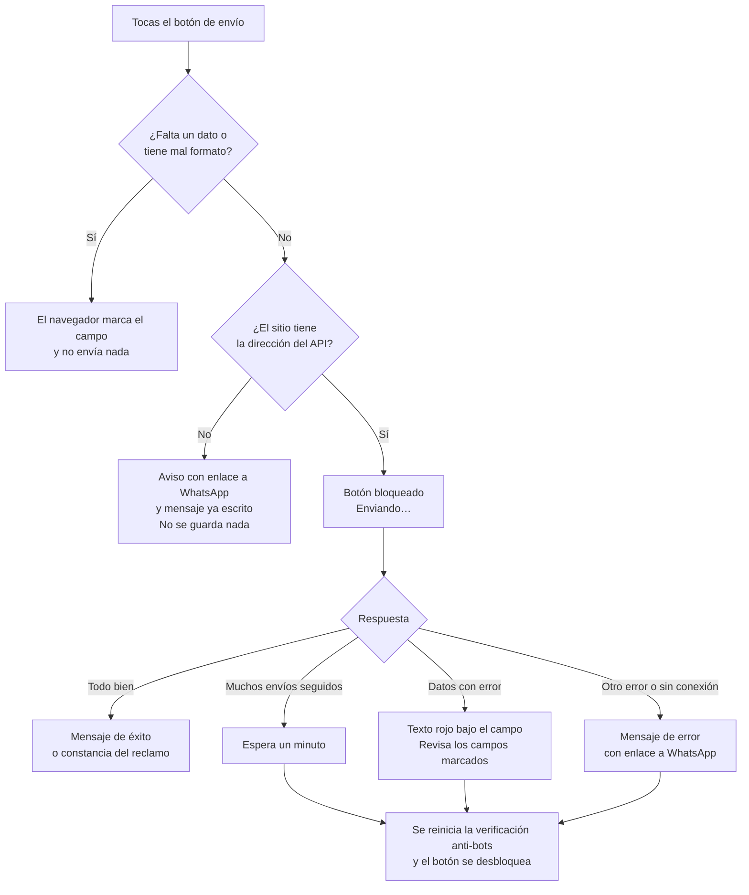

### 5.2 Propietarios: vender o poner en alquiler (`/propietarios`)

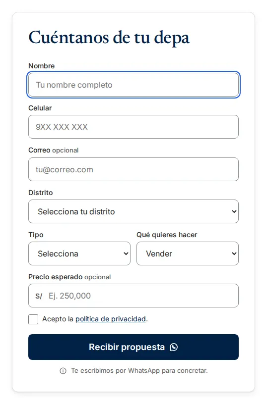

*Formulario de Propietarios con "Vender" elegido.*

**Para qué sirve**

Es para el dueño de un depa que quiere venderlo, alquilarlo a largo plazo o que Depa Host lo opere en Airbnb. Es un contacto rápido: no pide cuenta y el equipo sigue la conversación por WhatsApp.

**Cómo se llega**

- Menú principal: "Propietarios".
- Inicio: botón "Soy propietario". Se abre un menú con dos opciones:
  - "Vender mi propiedad" lleva a `/propietarios#vender` y deja elegido "Vender".
  - "Poner en alquiler mi propiedad" lleva a `/propietarios#alquiler` y deja elegido "Alquilar (largo plazo)".
  - En el celular, el menú se abre debajo del botón y empuja el contenido. Desde 640 px de ancho se abre como panel flotante. Se cierra con Esc o tocando fuera.
- Inicio: tarjeta "Propietarios: vende o ponlo en alquiler".
- Dirección directa: `depahostperu.com/propietarios`.

**Qué se ve**

- Título "Vende o alquila tu departamento en Lima" y el texto "Te sugerimos el precio para venderlo en máximo 2 meses, o lo operamos en Airbnb."
- Botones "Quiero vender" y "Poner en alquiler".
- El formulario "Cuéntanos de tu depa". Debajo del botón dice "Te escribimos por WhatsApp para concretar."
- Tres pasos numerados, cada uno con su texto:

  | Paso | Texto |
  |---|---|
  | 1. "Precio" | "Te sugerimos el valor con el que tu depa se mueve." |
  | 2. "Pauta" | "Lo publicamos en portales, medios y redes." |
  | 3. "Cierre" | "Te acompañamos hasta la firma o el primer huésped." |

- La franja "Aliados" con las inmobiliarias, si hay alguna cargada.
- En el celular, el formulario va debajo del título. Desde 1024 px va a la derecha del título.

**Qué puede hacer**

1. Si quieres, toca "Quiero vender" o "Poner en alquiler". Eso elige la opción en "Qué quieres hacer" y te lleva al campo "Nombre".
2. Escribe tu nombre en "Nombre".
3. Escribe tu número en "Celular".
4. Si quieres, escribe tu "Correo" (es opcional).
5. Elige tu "Distrito". La lista trae 36 distritos de Lima y Callao en orden alfabético. Si el tuyo no está, elige "Otro".
6. Elige el "Tipo": "Departamento", "Dúplex o penthouse", "Casa" u "Otro".
7. Elige "Qué quieres hacer": "Vender", "Alquilar (largo plazo)" u "Operarlo en Airbnb".
8. Si quieres, escribe el monto en soles. El campo se llama "Precio esperado" si eliges vender, o "Alquiler mensual esperado" si eliges alquilar o Airbnb.
9. Marca "Acepto la política de privacidad."
10. Completa la verificación anti-bots, si aparece.
11. Toca "Recibir propuesta".

**Reglas y validaciones**

| Campo | Regla | Mensaje si falla |
|---|---|---|
| "Nombre" | Obligatorio. Mínimo 2 caracteres, máximo 120 | Aviso del navegador. Si llega vacío al API: "Ingresa tu nombre". Si pasa de 120: mensaje genérico en inglés |
| "Celular" | Obligatorio. De 6 a 20 caracteres: números, espacios, paréntesis, guiones y un "+" opcional al inicio | Aviso del navegador si está vacío. Si el formato no es válido, el navegador no lo detecta: el API responde "Teléfono inválido", que aparece en rojo bajo el campo junto con "Revisa los campos marcados." |
| "Correo" | Opcional. Si lo escribes, debe tener formato de correo (máximo 200 caracteres) | Aviso del navegador. En el API: "Invalid email address" |
| "Distrito" | Obligatorio. Una opción de la lista | Aviso del navegador |
| "Tipo" | Obligatorio | Aviso del navegador |
| "Qué quieres hacer" | Obligatorio | Aviso del navegador |
| "Precio esperado" / "Alquiler mensual esperado" | Opcional. Solo números, espacios, comas y puntos. Se guarda como número, en soles | Aviso del navegador si escribes letras |
| Casilla de privacidad | Obligatoria | Aviso del navegador. En el API: "Debes aceptar la política de privacidad" |
| Verificación anti-bots | Debe completarse, si está activa | "No pudimos verificar que no eres un robot. Recarga la página e inténtalo otra vez." |

**Qué pasa después**

1. Aparece "¡Listo! Te escribimos por WhatsApp para concretar." con el enlace "Adelantar por WhatsApp".
2. El enlace abre WhatsApp con este mensaje ya escrito: "Hola, soy [nombre]. Quiero [vender / poner en alquiler / operar en Airbnb] mi depa en [distrito]."
3. El formulario se vacía.
4. Queda registrado: nombre, celular, correo, distrito, tipo, qué quiere hacer, precio, fecha del consentimiento, campaña y cuenta (si había sesión).
5. Se clasifica como venta si eligió "Vender", y como alquiler si eligió alquiler o Airbnb. En el correo al equipo sale como "Propietario: vender" / "Propietario: alquilar". En el panel, como "Quiero vender mi depa" / "Quiero alquilar mi depa". El detalle "qué quieres hacer" indica cuál de los dos.
6. Del lado del equipo:
   - Llega un correo "Nuevo lead · Propietario: vender" (o "· Propietario: alquilar") con todos los datos. Responder ese correo le escribe directo al propietario, si dejó correo.
   - Si hay un CRM conectado, también recibe el aviso.
   - El contacto aparece en el panel de administración, en "Leads", con el origen "Quiero vender mi depa" o "Quiero alquilar mi depa" y el estado "Sin contactar".
7. La persona **no** recibe correo de confirmación. El siguiente paso es el WhatsApp del equipo.

El correo al equipo y el CRM dependen de la configuración. Si están apagados o fallan, el contacto igual queda guardado.

**Casos especiales**

- **Sin API:** sale "Por ahora recibimos estas consultas por WhatsApp." con "Escribir por WhatsApp" y el mismo mensaje armado. No se guarda nada.
- **Puntos de miles:** usa coma o ningún separador. Si escribes "250.000", el punto se toma como decimal y se guarda **250**.
- **Segundo envío sin recargar:** la verificación anti-bots no se reinicia después de un envío correcto. Un segundo envío seguido puede fallar con el mensaje del robot. Vuelve a completar el recuadro (se reinicia tras el error) o recarga la página.
- **Etiqueta del precio:** después de enviar, "Qué quieres hacer" vuelve a "Selecciona". Si antes elegiste alquiler, el campo de precio puede seguir diciendo "Alquiler mensual esperado".
- **Airbnb:** no tiene enlace directo. `#alquiler` elige el alquiler a largo plazo y "Operarlo en Airbnb" se elige en la lista.
- **Propietario con cuenta:** el panel tiene otro camino, "Publicar un depa", para registrar el depa completo. Este formulario no crea esa solicitud: solo deja el contacto.

### 5.3 Inversionistas del extranjero: formulario en inglés (`/capital`)

**Para qué sirve**

Es para inversionistas de fuera del Perú. Dejan su nombre, su correo y cuánto piensan invertir, y el equipo los contacta. Es lo único del sitio en inglés: el "EN" del selector de idioma está desactivado y dice "Próximamente".

**Cómo se llega**

- Menú "Capital", botón "Comprar para rentabilizar" o tarjeta "Capital: compra para que rinda" del inicio.
- Baja hasta el final de `/capital`, después del ranking "Los 10 depas para invertir ahora". Con menos de 10 depas, el ranking se titula "Los depas para invertir ahora". Si no hay ninguno, no aparece, pero el formulario sigue al final de la página.
- El bloque se titula "Also in English for international investors", con el texto "We help you find high-yield rental apartments in Lima."

**Qué se ve**

- "Full name", con el ejemplo "e.g. Jane Smith".
- "Email", con el ejemplo "e.g. jane@email.com".
- "Initial amount (USD)", con el prefijo "USD" y el ejemplo "e.g. 50,000".
- El botón "Talk to us on WhatsApp".
- La casilla "I agree to the privacy policy (in Spanish)." y la verificación anti-bots.
- En el celular, todo va en una columna. Desde 640 px, en dos columnas. Desde 1024 px, los tres campos y el botón van en una sola fila.

Ojo: aunque el botón dice WhatsApp, primero **guarda los datos** en el sistema. WhatsApp se ofrece después, en el mensaje de éxito.

**Qué puede hacer**

1. Escribe tu nombre en "Full name".
2. Escribe tu correo en "Email".
3. Si quieres, escribe el monto en dólares en "Initial amount (USD)". Es opcional, aunque no dice "optional".
4. Marca "I agree to the privacy policy (in Spanish)."
5. Completa la verificación anti-bots, si aparece.
6. Toca "Talk to us on WhatsApp".

**Reglas y validaciones**

| Campo | Regla | Mensaje si falla |
|---|---|---|
| "Full name" | Obligatorio. Mínimo 2 caracteres, máximo 120 | Aviso del navegador. En el API: "Ingresa tu nombre" (en español) |
| "Email" | Obligatorio. Formato de correo, máximo 200 caracteres | Aviso del navegador. En el API: "Invalid email address" |
| "Initial amount (USD)" | Opcional. Solo números, espacios, comas y puntos. Debe quedar un número entero entre 0 y 100,000,000 | Aviso del navegador si hay letras. Con decimales: "Invalid input: expected int, received number". Si pasa el máximo: "Too big: expected number to be <=100000000" |
| Casilla de privacidad | Obligatoria | Aviso del navegador. En el API: "Debes aceptar la política de privacidad" (en español) |
| Verificación anti-bots | Debe completarse, si está activa | Mensaje del robot, en español |

**Qué pasa después**

1. Aparece "Thanks! We got your details and will contact you soon." con el enlace "Message us on WhatsApp".
2. El enlace abre WhatsApp con este mensaje: "Hi, I'm [nombre]. I'd like to invest in Lima with about USD [monto]." Sin monto, dice "Hi, I'm [nombre]. I'd like to invest in Lima."
3. El formulario se vacía.
4. Queda registrado: nombre, correo, monto en USD, idioma inglés, fecha del consentimiento, campaña y cuenta (si había sesión).
5. Del lado del equipo:
   - Llega un correo en español, "Nuevo lead · Formulario en inglés (Capital)", con la línea "Monto inicial: USD …". Responder ese correo le escribe directo al inversionista.
   - En el panel aparece como "Formulario para inversionistas", "Sin contactar".
   - El correo y el CRM dependen de la configuración.
6. El inversionista **no** recibe correo de confirmación.

**Casos especiales**

- **Mensajes en español dentro del formulario en inglés:** los errores del API "Ingresa tu nombre" y "Debes aceptar la política de privacidad", el mensaje del robot, "Error interno", el recuadro anti-bots y la política de privacidad.
- **Monto con comas (comportamiento actual):** si escribes "50,000", el monto se guarda bien (50000). Pero el mensaje de WhatsApp del enlace de éxito sale como "USD NaN". Si escribes "50000" sin separadores, sale bien ("USD 50,000").
- **Puntos de miles:** "50.000" se guarda como **50** dólares.
- **Sin API:** sale "For now we take these requests on WhatsApp." con "Message us on WhatsApp". No se guarda nada.
- **Segundo envío sin recargar:** puede fallar la verificación anti-bots, igual que en Propietarios.

### 5.4 Libro de Reclamaciones (`/libro-de-reclamaciones`)

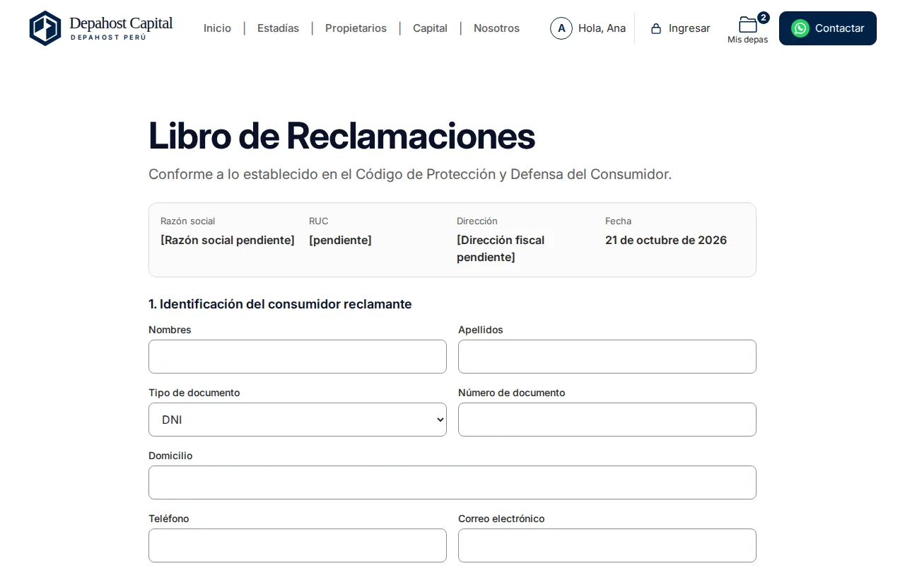

*Libro de Reclamaciones.*

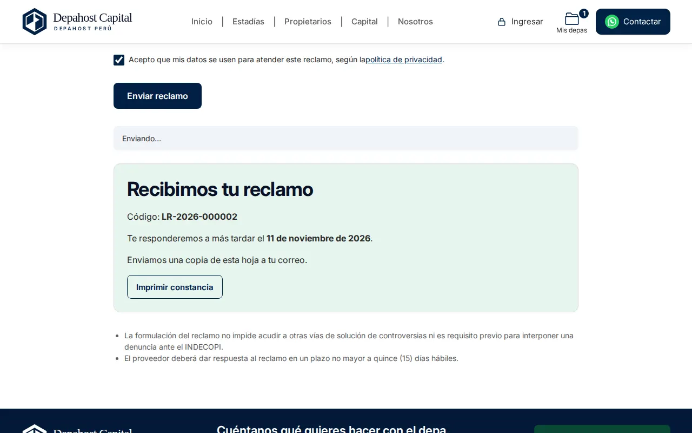

*Reclamo registrado, con su código y el plazo de respuesta.*

**Para qué sirve**

Es el Libro de Reclamaciones virtual que pide el Código de Protección y Defensa del Consumidor. Cualquier persona puede registrar un reclamo o una queja, sin cuenta. Recibe un código, una fecha límite de respuesta y una constancia por correo.

**Cómo se llega**

- Pie de página de cualquier página: "Libro de Reclamaciones".
- Página "Términos", sección "7. Reclamos".
- Dirección directa: `depahostperu.com/libro-de-reclamaciones`.

**Qué se ve**

- Título "Libro de Reclamaciones" y el texto "Conforme a lo establecido en el Código de Protección y Defensa del Consumidor."
- Un recuadro con los datos del proveedor: "Razón social", "RUC", "Dirección" y "Fecha". Hoy muestran datos **pendientes**: "[Razón social pendiente]", "[pendiente]" y "[Dirección fiscal pendiente]".
- El formulario, en tres bloques:
  - "1. Identificación del consumidor reclamante"
  - "2. Identificación del bien contratado"
  - "3. Detalle de la reclamación y pedido del consumidor"
- Dos notas al final:
  - "La formulación del reclamo no impide acudir a otras vías de solución de controversias ni es requisito previo para interponer una denuncia ante el INDECOPI."
  - "El proveedor deberá dar respuesta al reclamo en un plazo no mayor a quince (15) días hábiles."
- En el celular, todo va en una columna. Desde 640 px, los campos van de dos en dos.

**Reclamo o queja**

| Opción | Cuándo usarla (texto de la pantalla) |
|---|---|
| "Reclamo" (viene marcada) | "disconformidad con el producto o servicio." |
| "Queja" | "malestar con la atención recibida, no relacionado con el producto o servicio." |

**Qué puede hacer**

Bloque 1, tus datos:

1. Escribe tus "Nombres" y "Apellidos".
2. Elige el "Tipo de documento": "DNI" (viene elegido), "Carné de extranjería", "Pasaporte" o "RUC".
3. Escribe el "Número de documento".
4. Escribe tu "Domicilio".
5. Escribe tu "Teléfono" y tu "Correo electrónico". Bajo el correo dice "Aquí te enviaremos la constancia y la respuesta."
6. Si eres menor de edad, marca "Soy menor de edad". Aparece el campo "Nombre del padre, madre o apoderado": complétalo.

Bloque 2, el bien contratado:

7. Elige "Servicio" (viene marcado) o "Producto".
8. Escribe la "Descripción". Ejemplo de la pantalla: "p. ej. Estadía en depa de Lince del 10 al 12 de octubre".
9. Si quieres, escribe el "Monto reclamado (S/)" (es opcional).

Bloque 3, el detalle:

10. Elige "Reclamo" o "Queja".
11. En "Detalle", cuenta qué pasó.
12. En "Pedido", escribe qué solicitas.

Para terminar:

13. Marca "Acepto que mis datos se usen para atender este reclamo, según la política de privacidad."
14. Completa la verificación anti-bots, si aparece.
15. Toca "Enviar reclamo". El botón dice lo mismo aunque elijas "Queja".

**Reglas y validaciones**

| Campo | Regla | Mensaje si falla |
|---|---|---|
| "Nombres" / "Apellidos" | Obligatorios. De 2 a 100 caracteres | Aviso del navegador. Si pasa de 100: mensaje genérico en inglés |
| "Tipo de documento" | Uno de los cuatro de la lista | — |
| "Número de documento" | Obligatorio. De 6 a 20 caracteres: letras, números o guiones. Es la misma regla para los cuatro tipos (no revisa, por ejemplo, que un DNI tenga 8 dígitos) | Aviso del navegador. En el API: "Número de documento inválido" |
| "Domicilio" | Obligatorio. De 5 a 300 caracteres | Aviso del navegador. Si pasa de 300: mensaje genérico en inglés |
| "Teléfono" | Obligatorio. De 6 a 20 caracteres: números, espacios, paréntesis, guiones y un "+" opcional al inicio | Aviso del navegador si está vacío. Si el formato no es válido, el navegador no lo detecta: el API responde "Teléfono inválido", que aparece en rojo bajo el campo junto con "Revisa los campos marcados." |
| "Correo electrónico" | Obligatorio. Formato de correo, máximo 200 caracteres | Aviso del navegador. En el API: "Invalid email address" |
| "Nombre del padre, madre o apoderado" | Obligatorio solo si marcas "Soy menor de edad". De 2 a 200 caracteres | Aviso del navegador si está vacío. En el API: "Si eres menor de edad, indica el nombre de tu padre, madre o apoderado". Con 1 letra: "Too small: expected string to have >=2 characters" |
| "Servicio" / "Producto" | Uno de los dos | — |
| "Descripción" | Obligatoria. De 3 a 1000 caracteres | Aviso del navegador. Si pasa de 1000: mensaje genérico en inglés |
| "Monto reclamado (S/)" | Opcional. Número de 0 o más, con hasta 2 decimales, máximo 100,000,000 | Aviso del navegador si es negativo o tiene más de 2 decimales. Si pasa de 100,000,000: "Too big: expected number to be <=100000000" (mensaje genérico en inglés, debajo del campo) |
| "Reclamo" / "Queja" | Uno de los dos | — |
| "Detalle" | Obligatorio. De 10 a 3000 caracteres (no deja escribir más de 3000) | Aviso del navegador |
| "Pedido" | Obligatorio. De 5 a 2000 caracteres (no deja escribir más de 2000) | Aviso del navegador |
| Casilla de consentimiento | Obligatoria | Aviso del navegador. En el API: "Debes aceptar la política de privacidad" |
| Verificación anti-bots | Debe completarse, si está activa | "No pudimos verificar que no eres un robot. Recarga la página e inténtalo otra vez." |

**El código del reclamo: LR-AAAA-NNNNNN**

- "LR" más el año (en hora de Lima) en que se registró, más un número correlativo de 6 dígitos. Ejemplo: `LR-2026-000001`.
- El número es único y sigue corriendo. No vuelve a 000001 cuando cambia el año.

**Plazo de respuesta: 15 días hábiles**

Así se calcula la fecha límite:

- Se parte de la fecha de Lima del día en que se registra. Ese día no cuenta.
- Solo cuentan los días de lunes a viernes. Sábados y domingos no cuentan.
- Los feriados **no** se descuentan. Por eso la fecha mostrada puede ser igual o anterior al plazo legal, nunca posterior.
- Vale la hora de Lima. Un reclamo enviado a las 11:30 p. m. de Lima cuenta como de ese día.

| Si se registra el… | Fecha límite |
|---|---|
| miércoles 21 de octubre de 2026 | 11 de noviembre de 2026 |
| sábado 24 de octubre de 2026 | 13 de noviembre de 2026 |

**Qué pasa después**

1. **En pantalla:** el formulario desaparece y aparece la constancia:
   - "Recibimos tu reclamo" (o "Recibimos tu queja").
   - "Código: LR-…".
   - "Te responderemos a más tardar el [fecha]." (por ejemplo, "11 de noviembre de 2026").
   - "Enviamos una copia de esta hoja a tu correo."
   - El botón "Imprimir constancia". Abre la ventana de impresión del navegador e imprime la página tal como se ve, con encabezado y pie de página.
2. **Por correo:** llega "Constancia de reclamo LR-… · Depa Host Perú" (o "Constancia de queja…"). Es texto simple y trae:
   - "HOJA DE RECLAMACIÓN N.° LR-…", la fecha y los datos del proveedor.
   - Los tres bloques del formulario.
   - La fecha límite en formato AAAA-MM-DD.
   - La nota sobre el INDECOPI.
   - El equipo va como destinatario **en el mismo correo**, si su dirección de avisos está configurada. El consumidor ve esa dirección.
3. **Lo que queda guardado:** todos los datos, el código, la fecha límite, la fecha del consentimiento y el estado "Pendiente".
4. **Del lado del equipo:**
   - El reclamo aparece en el panel, en "Reclamos", como pendiente. La fecha límite se marca cuando faltan 4 días o menos, y dice "Vencido" si ya pasó.
   - El equipo escribe la respuesta (mínimo 10 caracteres) y la envía con "Enviar respuesta por correo".
   - El consumidor recibe "Respuesta a tu reclamo LR-… · Depa Host Perú", con la respuesta y una copia de su hoja.
   - El estado pasa a "Respondido". El equipo puede mandar otra respuesta después.
5. El consumidor no tiene una página para ver el estado. Todo le llega por correo.

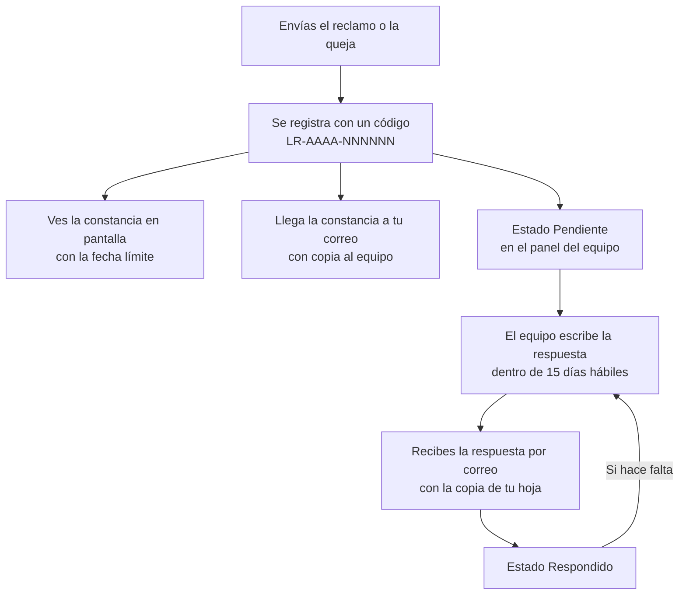

**Casos especiales**

- **Sin API:** sale "Por ahora recibimos estas consultas por WhatsApp." con "Escribir por WhatsApp" y el mensaje "Hola, quiero registrar un reclamo en el Libro de Reclamaciones.". En ese estado el Libro **no registra nada** y no da código.
- **Correo apagado o con fallas:** el reclamo igual queda registrado y la pantalla muestra el código y la fecha. Pero no llega ningún correo, ni al consumidor ni al equipo. La pantalla igual dice "Enviamos una copia de esta hoja a tu correo.". Por eso conviene imprimir o anotar el código.
- **Datos del proveedor pendientes:**
  - En la página: "[Razón social pendiente]", "[pendiente]", "[Dirección fiscal pendiente]".
  - En el correo salen de la configuración del API. Por defecto: "Depa Host Perú", RUC "[pendiente]" y dirección "[pendiente]".
  - Hay que completarlos antes del lanzamiento.
- **La "Fecha" del recuadro del proveedor** es la fecha en que se publicó el sitio por última vez, no necesariamente la de hoy. La fecha que vale es la del correo de constancia.
- **Código terminado en 000000:** significa que el envío se descartó como bot (se llenó el campo oculto) y no se guardó nada.
- **Otro reclamo:** para registrar otro, recarga la página.
- **Menor de edad:** si desmarcas "Soy menor de edad", el campo del apoderado se oculta y no se envía.
- **Límite:** 5 envíos por minuto desde la misma conexión.

**Referencia técnica:** [propietarios.astro](../../src/pages/propietarios.astro), [capital/index.astro](../../src/pages/capital/index.astro), [capital/empecemos.astro](../../src/pages/capital/empecemos.astro), [libro-de-reclamaciones.astro](../../src/pages/libro-de-reclamaciones.astro), [forms.ts](../../src/scripts/forms.ts), [api/client.ts](../../src/lib/api/client.ts), [Turnstile.astro](../../src/components/Turnstile.astro), [OwnerDropdown.astro](../../src/components/OwnerDropdown.astro), [SaveListDialog.astro](../../src/components/SaveListDialog.astro), [empresa.ts](../../src/data/empresa.ts), [contacto.ts](../../src/data/contacto.ts), API: [leads/routes.ts](../../../depahost-api/src/modules/leads/routes.ts), [leads/schema.ts](../../../depahost-api/src/modules/leads/schema.ts), [leads/service.ts](../../../depahost-api/src/modules/leads/service.ts), [complaints/schema.ts](../../../depahost-api/src/modules/complaints/schema.ts), [complaints/service.ts](../../../depahost-api/src/modules/complaints/service.ts), [business-days.ts](../../../depahost-api/src/lib/business-days.ts), [turnstile.ts](../../../depahost-api/src/lib/turnstile.ts), [plugins/auth.ts](../../../depahost-api/src/plugins/auth.ts), [app.ts](../../../depahost-api/src/app.ts), panel: [MyLeadsView.vue](../../../depahost-panel/src/views/buyer/MyLeadsView.vue), [LeadsView.vue](../../../depahost-panel/src/views/admin/LeadsView.vue), [ComplaintsView.vue](../../../depahost-panel/src/views/admin/ComplaintsView.vue), [labels.ts](../../../depahost-panel/src/composables/labels.ts). Capítulos técnicos: [05-flujos.md](05-flujos.md) (secciones 12 y 15), [03-api.md](03-api.md), [08-panel-y-cuentas.md](08-panel-y-cuentas.md).

## 6. Crear una cuenta, ingresar y manejar la sesión

La cuenta es gratis y opcional. Todo el sitio funciona sin ella. Las cuentas se crean y se usan en el panel de cuentas (app.depahostperu.com, la dirección prevista en la configuración de producción). El panel es una aplicación aparte del sitio. Si ingresas una vez en un navegador, la sesión sirve tanto en el sitio como en el panel.

### 6.1 Para qué sirve tener cuenta

| Qué quieres hacer | Sin cuenta | Comprador o inversionista ("Quiero invertir") | Propietario ("Tengo un depa") |
|---|---|---|---|
| Guardar depas con "Me interesa" | Sí, pero solo en ese navegador | Sí. Además se guardan en la cuenta y los ves en otros dispositivos | Igual que el comprador |
| Ver tus consultas y en qué estado están ("Mis consultas") | No | Sí, las que envías con la sesión abierta | Sí |
| Publicar tu depa y seguir su revisión ("Mis propiedades", "Publicar un depa") | No desde el panel. Puedes usar el formulario de la página Propietarios | No. Primero cambia a propietario en "Perfil" | Sí |
| Formularios del sitio y WhatsApp | Sí | Sí | Sí |

- Cada cuenta tiene un solo tipo a la vez, comprador o propietario. Puedes cambiarlo cuando quieras en "Perfil" (ver 6.7).
- Nadie puede crearse una cuenta de administrador. Esas cuentas solo las crea el equipo.
- En "Mis consultas" solo aparecen las consultas que enviaste con la sesión abierta. Las que enviaste antes de crear la cuenta, o sin haber ingresado, no se vinculan.

### 6.2 Cómo se llega al panel

**Desde el sitio**

| Dónde estás | Qué tocas | Adónde llegas |
|---|---|---|
| Sitio en computadora o tablet (desde 640 px de ancho) | "Ingresar", con un candado, arriba a la derecha. Entre 1024 y 1279 px solo se ve el candado | "Ingresa a tu cuenta" en el panel |
| Sitio en celular | Botón de menú ☰ y luego "Ingresar a mi cuenta" | "Ingresa a tu cuenta" |
| Sitio con la sesión abierta | El saludo "Hola, {tu nombre}" | Tu inicio en el panel |
| Correo del equipo con un enlace al panel (por ejemplo, sobre tu solicitud de propietario) | El enlace | Esa página. Si no tienes sesión, primero pasas por "Ingresa a tu cuenta" |

- El sitio no tiene un botón "Crear cuenta". Para registrarte, toca "Ingresar" y luego "Crea una gratis".
- "Ingresar" solo aparece si el sitio tiene configurada la dirección del panel. Sin esa configuración, el sitio no ofrece ninguna entrada al panel.
- Al cargar una página, "Ingresar" puede verse un instante antes de que aparezca el saludo.

**Direcciones del panel**

| Pantalla | Dirección | Quién la ve |
|---|---|---|
| Dirección principal del panel | / (app.depahostperu.com, sin nada después) | Cualquiera. No muestra una pantalla propia: con sesión te lleva a tu inicio y sin sesión a "Ingresa a tu cuenta" |
| "Ingresa a tu cuenta" | /ingresar | Personas sin sesión |
| "Crea tu cuenta" | /registro | Personas sin sesión |
| "Recupera tu contraseña" | /recuperar | Personas sin sesión |
| "Crea una contraseña nueva" | /restablecer (se abre con el enlace del correo) | Cualquiera, con sesión o sin ella |
| "Perfil" | /perfil | Personas con sesión |
| Inicio del comprador | /mis-depas | Comprador |
| Inicio del propietario | /mis-propiedades | Propietario |

- Si ya tienes la sesión abierta y entras a /ingresar, /registro o /recuperar, el panel te lleva directo a tu inicio.
- Si abres una página del panel sin sesión, el panel te manda a "Ingresa a tu cuenta" y recuerda a dónde ibas. La dirección principal es la excepción: no se recuerda, y después de ingresar vas a tu inicio.
- Si la dirección no existe, verás "No encontramos esta página" y el botón "Ir a mi cuenta". Esa pantalla sale con sesión o sin ella. El botón lleva a la dirección principal del panel:
  - Con sesión, vas a tu inicio: "Mis depas" si eres comprador o "Mis propiedades" si eres propietario.
  - Sin sesión, vas a "Ingresa a tu cuenta". Después de ingresar vas a tu inicio.

**Cómo se ven las pantallas de acceso**

- **Computadora (desde 960 px):** a la izquierda hay una franja azul marino con el logo, la frase "El depa en Lima, con la decisión correcta." y el texto "Guarda depas, sigue tus consultas o publica el tuyo. Todo en un solo lugar.". El logo lleva al sitio. Si el panel no tiene configurada la dirección del sitio, lleva al inicio del panel. A la derecha está el formulario.
- **Celular o tablet (menos de 960 px):** solo se ve el formulario, con el logo arriba. Ese logo no lleva al sitio. Lleva al inicio del panel, o sea, de vuelta a "Ingresa a tu cuenta". Para regresar al sitio, usa el botón atrás del navegador.

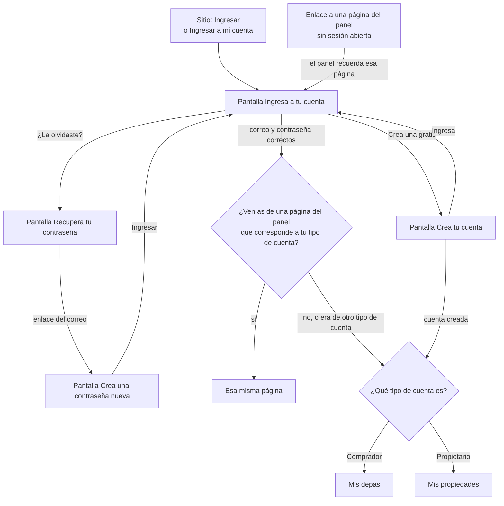

### 6.3 Mensajes que pueden salir en cualquier formulario del panel

| Mensaje | Cuándo sale |
|---|---|
| "Revisa los campos marcados." | Algún dato no cumple una regla. El detalle aparece debajo del campo. Hay campos que no tienen espacio para ese detalle (ver cada pantalla) |
| "No pudimos conectarnos. Revisa tu conexión e inténtalo otra vez." | No hay internet, o el panel no logra comunicarse con el sistema (caído o mal configurado) |
| "Error interno" | Falla inesperada del sistema. El texto llega desde el servidor |
| "Algo salió mal. Inténtalo otra vez." | Error inesperado en el navegador, o una respuesta del sistema que no trae mensaje |
| "Rate limit exceeded, retry in 1 minute", o con los segundos que falten, por ejemplo "Rate limit exceeded, retry in 37 seconds" | Superaste el límite de intentos por minuto. El texto llega en inglés desde el servidor |
| "Hiciste varios intentos seguidos. Espera un minuto." | Es el mismo caso de arriba. Solo sale si el servidor no manda su propio texto |
| "Inicia sesión para continuar" | Tu sesión venció o se cerró mientras tenías el panel abierto |

- Los límites por minuto se cuentan por conexión (dirección IP). Las personas que usan la misma red, como el wifi de una oficina, pueden compartir el mismo límite.
- Algunos mensajes salen en inglés, por ejemplo el del límite de intentos y el del nombre demasiado corto. Falta traducirlos.
- Si la configuración del sistema está mal, pueden salir otros textos que manda el servidor, por ejemplo "Origen no permitido".
- Mientras se envía un formulario, su botón se desactiva.

### 6.4 Crear cuenta

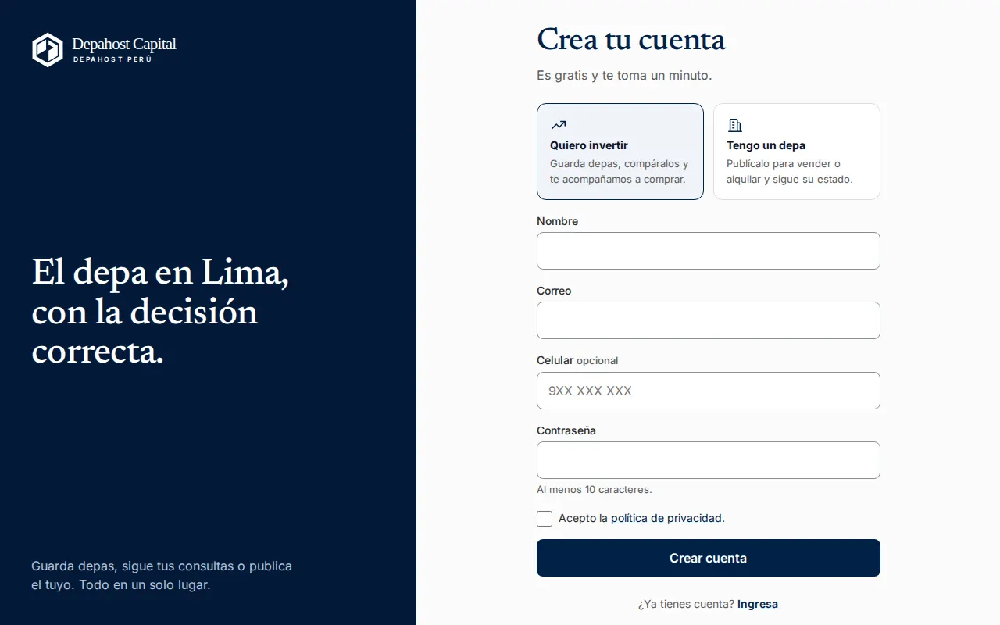

*Crear cuenta.*

**Para qué sirve:** abrir tu cuenta de comprador o de propietario. Cuando terminas, ya quedas con la sesión abierta.

**Cómo se llega:** /registro. Desde "Ingresa a tu cuenta", toca "Crea una gratis".

**Qué se ve:**

- El título "Crea tu cuenta" y el texto "Es gratis y te toma un minuto.".
- Dos tarjetas para elegir:
  - "Quiero invertir": "Guarda depas, compáralos y te acompañamos a comprar."
  - "Tengo un depa": "Publícalo para vender o alquilar y sigue su estado."
  - Ya viene elegida "Quiero invertir".
- Los campos "Nombre", "Correo", "Celular" y "Contraseña".
  - "Celular" está marcado "opcional" y trae el ejemplo "9XX XXX XXX".
  - "Contraseña" tiene la ayuda "Al menos 10 caracteres.".
- La casilla "Acepto la política de privacidad.".
- El recuadro de verificación anti-robots de Cloudflare (Turnstile), si está activado.
- El botón "Crear cuenta". Al pie, "¿Ya tienes cuenta?" con el enlace "Ingresa".


**Qué puedes hacer:**

1. Elige "Quiero invertir" si buscas comprar o invertir. Elige "Tengo un depa" si quieres publicar tu depa para venderlo o alquilarlo.
2. Escribe tu nombre y tu correo.
3. Si quieres, escribe tu celular.
4. Crea una contraseña de al menos 10 caracteres.
5. Marca "Acepto la política de privacidad.". El enlace abre la política del sitio en otra pestaña.
6. Si aparece la verificación anti-robots, espera a que se complete.
7. Toca "Crear cuenta". Mientras se envía, el botón dice "Creando tu cuenta…".

**Reglas y validaciones:** las revisiones van en este orden: primero la casilla de privacidad, luego los campos, después la verificación anti-robots y al final si el correo ya existe.

| Campo | Regla | Mensaje si falla |
|---|---|---|
| Tipo de cuenta | "Quiero invertir" (comprador) o "Tengo un depa" (propietario) | Nunca falla: siempre hay uno elegido |
| "Nombre" | Obligatorio. De 2 a 120 caracteres, sin contar los espacios al inicio y al final | "Too small: expected string to have >=2 characters". Con más de 120: "Too big: expected string to have <=120 characters". Los dos salen en inglés |
| "Correo" | Obligatorio y con formato de correo, hasta 200 caracteres. Se guarda en minúsculas y sin espacios | "Correo inválido". Con más de 200 caracteres: "Too big: expected string to have <=200 characters", en inglés |
| "Celular" | Opcional. Si lo llenas: un "+" opcional al inicio y luego de 6 a 20 caracteres entre números, espacios, paréntesis y guiones. Antes de revisarlo se quitan los espacios del inicio y del final | "Teléfono inválido" |
| "Contraseña" | De 10 a 200 caracteres. No pide mayúsculas, números ni símbolos | "La contraseña debe tener al menos 10 caracteres". Con más de 200 caracteres: "Too big: expected string to have <=200 characters", en inglés |
| Casilla de privacidad | Obligatoria | "Debes aceptar la política de privacidad" |
| Verificación anti-robots | Obligatoria cuando está activada | "No pudimos verificar que no eres un robot. Recarga la página e inténtalo otra vez." |
| Correo ya registrado | Cada correo solo puede tener una cuenta | "Ya existe una cuenta con ese correo. Inicia sesión o recupera tu contraseña." |
| Intentos | Máximo 5 por minuto | "Rate limit exceeded, retry in …" |

**Qué pasa después:**

- Se crea la cuenta con tu nombre, tu correo en minúsculas, tu celular y el tipo que elegiste. La contraseña se guarda cifrada: nadie del equipo puede verla.
- Quedas con la sesión abierta en ese navegador, en el panel y también en el sitio.
- El panel te lleva a tu inicio. Con "Quiero invertir" vas a "Mis depas". Con "Tengo un depa" vas a "Mis propiedades".
- No llega correo de bienvenida ni de verificación, ni aviso por WhatsApp.
- El equipo ve la cuenta en su lista de usuarios: nombre, contacto, fecha de creación y tipo. Su columna "Último ingreso" dice "Nunca" hasta que ingreses por la pantalla "Ingresa a tu cuenta", porque crear la cuenta no cuenta como ingreso.

**Casos especiales:**

- **Correo ya registrado:** a diferencia de "Ingresar", aquí el sistema sí avisa que el correo ya tiene cuenta. El mensaje no trae enlaces. Usa "Ingresa" al pie, o "¿La olvidaste?" en la pantalla de ingreso.
- **Casilla sin marcar:** el panel solo avisa eso. Los demás campos se revisan cuando la marcas y vuelves a tocar "Crear cuenta".
- **Verificación anti-robots:**
  - El recuadro solo aparece si el panel tiene configurada la clave de Turnstile.
  - Sin esa clave (por ejemplo, en desarrollo), el recuadro no se ve. Si el sistema tampoco tiene la clave, deja pasar el registro sin verificar.
  - En producción el sistema siempre exige la verificación. Si el panel no muestra el recuadro pero el sistema la exige, todos los intentos terminan en "No pudimos verificar que no eres un robot. Recarga la página e inténtalo otra vez.".
  - Ese mismo mensaje sale si tocas "Crear cuenta" antes de que termine la verificación, o si ya venció.
  - Después de un error del sistema (datos inválidos, correo ya registrado, verificación fallida o límite de intentos), la verificación vuelve a empezar. Espera a que se complete otra vez antes de reintentar. Si el único problema era la casilla sin marcar, la verificación no se reinicia.
- **Consentimiento:** marcar la casilla es obligatorio, pero el sistema no guarda ninguna constancia ni fecha de la aceptación.
- **Política de privacidad:** es un borrador. Todavía muestra "[fecha pendiente]" y "[plazo pendiente]" y no habla de las cuentas: sigue diciendo que "Mis depas" se guarda solo en el navegador. Hay que actualizarla.
- Si el panel no tiene configurada la dirección del sitio, el enlace a la política abre "No encontramos esta página".
- **Celular:** el sistema no revisa que haya dígitos ni que sea un celular peruano. Por ejemplo, acepta "((((((".
- **Contraseña:** no hay campo para repetirla ni botón para verla. Revisa bien lo que escribes.
- Después de crear la cuenta siempre vas a tu inicio. A diferencia del ingreso, aquí el panel no te devuelve a la página que pedías.

### 6.5 Ingresar

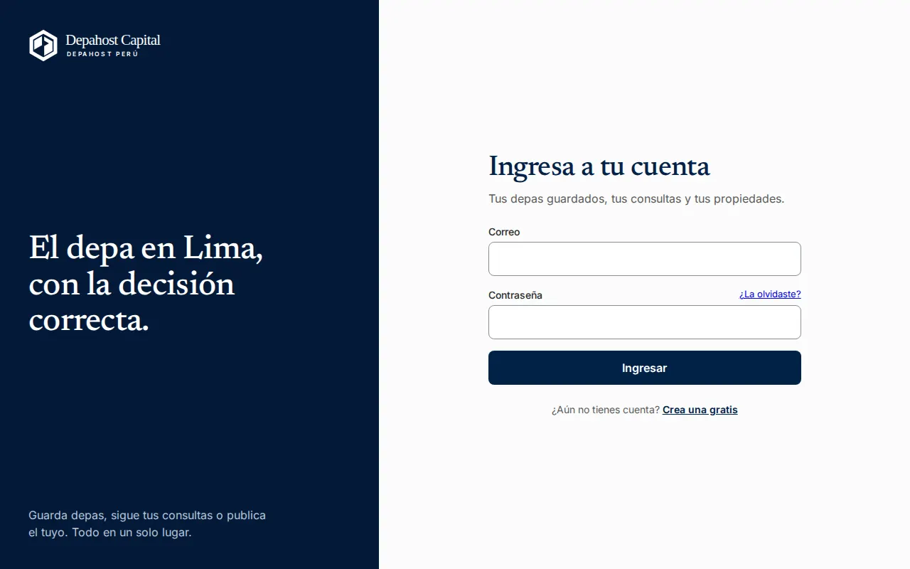

*Ingresar.*

**Para qué sirve:** abrir tu sesión para usar el panel. Con la sesión abierta, el sitio también te reconoce.

**Cómo se llega:**

- Ve a /ingresar.
- En el sitio, toca "Ingresar" o "Ingresar a mi cuenta".
- También llegas aquí si abres cualquier página del panel sin tener sesión.

**Qué se ve:**

- El título "Ingresa a tu cuenta" y el texto "Tus depas guardados, tus consultas y tus propiedades.".
- Los campos "Correo" y "Contraseña". Junto a "Contraseña" está el enlace "¿La olvidaste?".
- El botón "Ingresar". Al pie, "¿Aún no tienes cuenta?" con el enlace "Crea una gratis".


**Qué puedes hacer:**

1. Escribe el correo de tu cuenta.
2. Escribe tu contraseña.
3. Toca "Ingresar". Mientras se envía, el botón dice "Ingresando…".

**Reglas y validaciones:**

| Campo | Regla | Mensaje si falla |
|---|---|---|
| "Correo" | Formato de correo. No importan las mayúsculas ni los espacios al inicio o al final | "Correo inválido" |
| "Contraseña" | Obligatoria. Distingue mayúsculas de minúsculas | Si la dejas vacía, solo sale "Revisa los campos marcados.", sin ningún mensaje bajo el campo |
| Correo y contraseña | Deben coincidir con una cuenta | "Correo o contraseña incorrectos" |
| Intentos | Máximo 10 por minuto. Cuentan todos, también los correctos | "Rate limit exceeded, retry in …" |

**Qué pasa después:**

- Queda abierta tu sesión en ese navegador, en el panel y en el sitio. Dura 30 días (ver 6.9).
- Si llegaste aquí porque intentabas abrir una página del panel, vuelves a esa página. Si no, vas a tu inicio: "Mis depas" si eres comprador o "Mis propiedades" si eres propietario.
- Si la página que pedías no corresponde a tu tipo de cuenta, vas a tu inicio. Por ejemplo, cuando un comprador abre "Mis propiedades".
- Se guardan la fecha y la hora del ingreso. El equipo las ve como "Último ingreso".
- No llega correo ni aviso.

**Casos especiales:**

- El mensaje es el mismo si el correo no tiene cuenta o si la contraseña está mal. Así la pantalla no revela qué correos están registrados.
- La cuenta no se bloquea por intentos fallidos. Solo rige el límite por minuto: pasado el minuto, puedes volver a intentar.
- El panel solo te devuelve a páginas del propio panel. Si un enlace intenta mandarte a otro sitio, terminas en tu inicio.
- Si desde aquí vas a "Crea una gratis" o a "¿La olvidaste?", el panel olvida la página que pedías.
- Si ingresas desde el sitio, te quedas en el panel. No vuelves a la página del sitio donde estabas. Para regresar, toca "Ver el sitio" en el menú: te lleva a la página Capital. Ese enlace solo aparece si el panel tiene configurada la dirección del sitio.
- Ingresar en un dispositivo no cierra tus sesiones en otros.
- Si al abrirse el panel no logra comunicarse con el sistema, te trata como si no tuvieras sesión y muestra "Ingresa a tu cuenta". Si intentas ingresar así, verás "No pudimos conectarnos. Revisa tu conexión e inténtalo otra vez.".

### 6.6 Olvidé mi contraseña

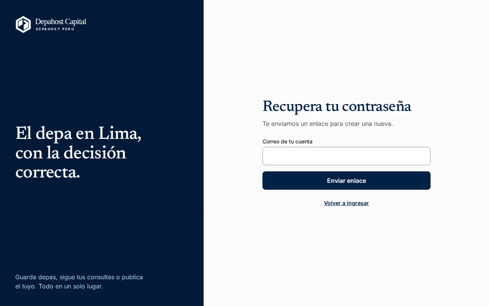

*Recuperar la contraseña.*

**Para qué sirve:** crear una contraseña nueva cuando olvidaste la actual. Son dos pasos: pides un enlace por correo y luego lo abres para crear la nueva.

**Paso 1: pedir el enlace**

- **Cómo se llega:** ve a /recuperar. En "Ingresa a tu cuenta", toca "¿La olvidaste?".
- **Qué se ve:** el título "Recupera tu contraseña", el texto "Te enviamos un enlace para crear una nueva.", el campo "Correo de tu cuenta", el botón "Enviar enlace" y, al pie, "Volver a ingresar".


1. Escribe el correo de tu cuenta.
2. Toca "Enviar enlace".
3. Lee el aviso: "Si existe una cuenta con {el correo que escribiste}, te llegará un correo con el enlace. Vence en 1 hora."
4. Abre tu correo y busca el mensaje con el asunto "Restablece tu contraseña · DepaHost Capital".

El correo es de texto simple. Sale del remitente configurado, que por defecto es "Depa Host Perú <no-reply@depahostperu.com>". Dice "Hola, {nombre}." y "Para crear una contraseña nueva, abre este enlace (vence en 1 hora):". Luego trae el enlace y la nota "Si no pediste el cambio, ignora este correo: tu contraseña sigue igual.".

**Paso 2: crear la contraseña nueva**

- **Cómo se llega:** con el enlace del correo, que abre /restablecer en el panel. Funciona con sesión o sin ella.
- **Qué se ve:**
  - El título "Crea una contraseña nueva" y el campo "Contraseña nueva".
  - La ayuda "Al menos 10 caracteres. Cerraremos tus sesiones abiertas.".
  - El botón "Guardar contraseña" y, al pie, "Pedir otro enlace".

1. Abre el enlace del correo antes de que pase una hora.
2. Escribe tu contraseña nueva.
3. Toca "Guardar contraseña".
4. Verás "Listo. Ya puedes ingresar con tu contraseña nueva.". Toca "Ingresar" y entra con la contraseña nueva.

**Reglas y validaciones:**

| Campo | Regla | Mensaje si falla |
|---|---|---|
| "Correo de tu cuenta" | Formato de correo | "Correo inválido" |
| Pedidos de enlace | Máximo 5 por minuto | "Rate limit exceeded, retry in …" |
| Enlace sin código | El enlace debe venir completo | "El enlace está incompleto. Pide uno nuevo." En este caso no se muestra el formulario |
| Enlace cortado | El código del enlace debe estar entero | "Revisa los campos marcados." o "El enlace venció o ya se usó. Pide uno nuevo.", según cuánto se haya cortado |
| Vigencia | 1 hora, y un solo uso | "El enlace venció o ya se usó. Pide uno nuevo." |
| "Contraseña nueva" | De 10 a 200 caracteres | "La contraseña debe tener al menos 10 caracteres". Con más de 200 caracteres: "Too big: expected string to have <=200 characters", en inglés |
| Intentos de guardar | Máximo 10 por minuto | "Rate limit exceeded, retry in …" |

**Qué pasa después:**

- La contraseña cambia y ese enlace queda usado.
- Se cierran todas tus sesiones, en todos los dispositivos, incluida la del sitio.
- No quedas con la sesión abierta: tienes que ingresar.
- No llega ningún correo que confirme el cambio.

**Casos especiales:**

- **El aviso siempre es el mismo,** exista o no la cuenta. Si el correo no llega, revisa:
  - que el correo del aviso esté bien escrito, porque el aviso muestra lo que tú escribiste;
  - la carpeta de spam;
  - que ese correo de verdad tenga una cuenta.
- **Envío de correos:** si el servicio de correo (Resend) no está configurado, como en desarrollo o preproducción, el correo no sale. El servidor solo anota que hubo un correo, sin el enlace. Si el envío falla, la persona ve el mismo aviso y el error solo queda en el registro del servidor.
- **Varios pedidos:** cada pedido genera un enlace distinto. Cada enlace sirve una sola vez y vence a la hora. Pedir uno nuevo no anula los anteriores: siguen sirviendo hasta que se usen o venzan.
- **"Pedir otro enlace" con la sesión abierta:** si abriste el enlace con tu sesión iniciada y tocas "Pedir otro enlace", no ves "Recupera tu contraseña". El panel te lleva a tu inicio, porque esa pantalla es solo para personas sin sesión. Para pedir otro enlace, cierra sesión primero (ver 6.8), o cambia tu contraseña desde "Perfil" si recuerdas la actual.
- **Enlace abierto con la sesión iniciada:** al guardar, esa sesión también se cierra. El panel puede seguir mostrándote como si estuvieras dentro, con errores como "No pudimos cargar tus depas.". Lo mismo pasa si tocas "Ingresar" después del mensaje "Listo…": en lugar de "Ingresa a tu cuenta", el panel te lleva a tu inicio y no carga tus datos. Recarga la página: el panel te pedirá ingresar.

### 6.7 Perfil

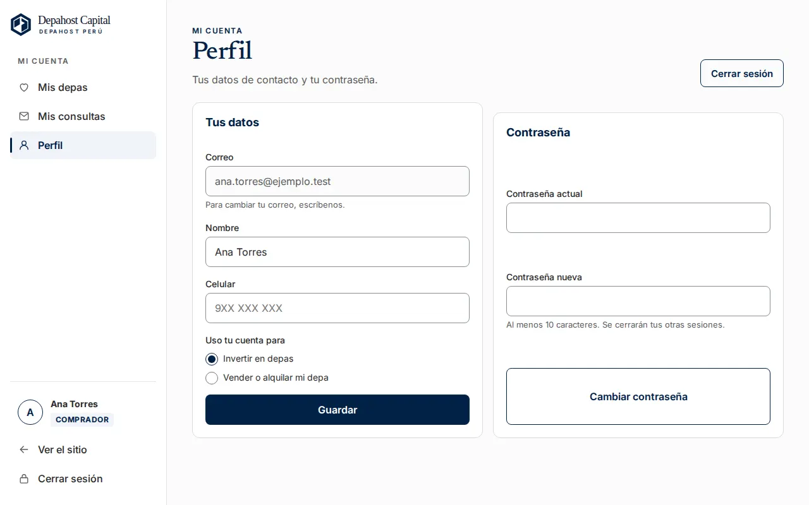

*Perfil.*

**Para qué sirve:** ver y cambiar tus datos de contacto, tu tipo de cuenta y tu contraseña.

**Cómo se llega:** toca "Perfil" en la sección "Mi cuenta" del menú (/perfil). Necesitas tener la sesión abierta.

**Qué se ve:**

- El encabezado "Mi cuenta", el título "Perfil", el texto "Tus datos de contacto y tu contraseña." y el botón "Cerrar sesión".
- La tarjeta "Tus datos":
  - "Correo", sin poder editarlo y con la nota "Para cambiar tu correo, escríbenos.".
  - "Nombre" y "Celular".
  - "Uso tu cuenta para", con las opciones "Invertir en depas" y "Vender o alquilar mi depa".
  - El botón "Guardar".
- La tarjeta "Contraseña":
  - Los campos "Contraseña actual" y "Contraseña nueva".
  - La ayuda "Al menos 10 caracteres. Se cerrarán tus otras sesiones.".
  - El botón "Cambiar contraseña".


**Cambiar tus datos:**

1. Cambia tu nombre o tu celular. Para borrar el celular, deja el campo vacío.
2. Si quieres, cambia la opción de "Uso tu cuenta para".
3. Toca "Guardar".
4. Verás el aviso "Guardamos tus datos". Se va solo a los 4 segundos.

**Cambiar entre comprador y propietario:**

- "Invertir en depas" es comprador y "Vender o alquilar mi depa" es propietario.
- Si guardas con otro tipo, el panel te lleva al inicio del tipo nuevo: "Mis propiedades" si pasaste a propietario, "Mis depas" si pasaste a comprador. El menú cambia en ese momento.
- Si pasas de propietario a comprador, tus solicitudes de propietario no se borran. Lo que pasa es que "Mis propiedades" y "Publicar un depa" desaparecen del menú y no puedes verlas hasta que vuelvas a ser propietario.
- "Mis depas", "Mis consultas" y "Perfil" se mantienen con los dos tipos.
- El equipo también puede cambiarte el tipo desde su lista de usuarios.

**Cambiar tu contraseña:**

1. Escribe tu contraseña actual.
2. Escribe la contraseña nueva, de al menos 10 caracteres.
3. Toca "Cambiar contraseña".
4. Verás "Cambiaste tu contraseña. Cerramos tus otras sesiones." y los dos campos quedan vacíos.

**Reglas y validaciones:**

| Campo | Regla | Mensaje si falla |
|---|---|---|
| "Nombre" | De 2 a 120 caracteres | "Too small: expected string to have >=2 characters", en inglés |
| "Celular" | Vacío, o un "+" opcional al inicio y luego de 6 a 20 caracteres entre números, espacios, paréntesis y guiones. No revisa que haya dígitos | "Teléfono inválido" |
| "Correo" | No se puede editar | No aplica |
| "Contraseña actual" | Debe ser la contraseña vigente | "La contraseña actual no es correcta". Si la dejas vacía, solo sale "Revisa los campos marcados.", sin mensaje bajo el campo |
| "Contraseña nueva" | De 10 a 200 caracteres | "La contraseña debe tener al menos 10 caracteres". Con más de 200 caracteres: "Too big: expected string to have <=200 characters", en inglés |
| Cambios de contraseña | Máximo 5 por minuto. Guardar tus datos no tiene límite | "Rate limit exceeded, retry in …" |

**Qué pasa después:**

- **Datos:** el nombre nuevo se ve al instante en el menú del panel. En el sitio, el saludo se actualiza en la próxima página que abras.
- **Contraseña:**
  - Tu sesión actual sigue abierta y se renueva: vuelve a contar 30 días.
  - Se cierran tus sesiones en otros celulares, computadoras y navegadores, también en el sitio.
- No llega correo en ninguno de los dos casos.

**Casos especiales:**

- **Cambiar el correo:** no lo puedes hacer tú. La nota "Para cambiar tu correo, escríbenos." no dice a dónde escribir, y el panel del equipo tampoco tiene una opción para cambiar el correo de una cuenta.
- **Misma contraseña:** el sistema no impide que la contraseña nueva sea igual a la actual.
- **Sesión vencida:** si tu sesión venció mientras estabas en esta pantalla, al guardar verás "Inicia sesión para continuar".

### 6.8 Cerrar sesión

**Qué puedes hacer:**

1. En computadora, toca "Cerrar sesión" al pie del menú lateral. En celular, toca el botón "Abrir menú" (☰) arriba a la derecha y luego "Cerrar sesión" al final del menú.
2. También puedes tocar el botón "Cerrar sesión" arriba de la pantalla "Perfil".

El panel no pide confirmación. Al pie del menú también están tu nombre completo, una etiqueta con tu tipo de cuenta ("Comprador" o "Propietario") y el enlace "Ver el sitio".

**Qué pasa después:**

- Vuelves a "Ingresa a tu cuenta".
- Se cierra la sesión de ese navegador, en el panel y en el sitio. En la próxima página del sitio que abras o recargues, vuelve "Ingresar" y desaparece "Hola, {tu nombre}". Excepción: si antes dejaste tu nombre en "Guarda tus depas", el sitio sigue mostrando "Hola, {ese nombre}" junto a "Ingresar", y ese saludo lleva a "Mis depas" del sitio, no al panel.
- Las pestañas del sitio que ya tenías abiertas siguen mostrando el saludo hasta que las recargues.
- Tus sesiones en otros dispositivos siguen abiertas. No hay un botón para cerrarlas todas: para hacerlo, cambia tu contraseña.
- "Mis depas" del sitio no se borra de ese navegador. Los depas que llegaron desde tu cuenta siguen apareciendo ahí, pero los cambios que hagas ya no se guardan en tu cuenta.

**Casos especiales:**

- **Computadora compartida:** después de que cierres sesión, la siguiente persona verá tus depas en "Mis depas" del sitio. Si dejaste tu nombre en "Guarda tus depas", también verá el saludo con tu nombre. Si esa persona ingresa con su cuenta en ese navegador, esos depas se suman a su cuenta.
- **Sin conexión al cerrar sesión:** el panel igual te muestra "Ingresa a tu cuenta", pero la sesión puede seguir abierta en el servidor. Si recargas cuando vuelva la conexión, puedes quedar dentro otra vez. Repite "Cerrar sesión" con conexión.

### 6.9 Cuánto dura la sesión

La sesión dura 30 días. Ese número se puede configurar, y la configuración prevista para producción usa 30.

| Qué haces | Qué pasa con tus sesiones |
|---|---|
| Crear la cuenta | Se abre una sesión de 30 días en ese navegador |
| Ingresar | Se abre una sesión de 30 días en ese navegador. Las demás siguen igual |
| Cambiar la contraseña en "Perfil" | Se renueva la sesión de ese navegador por 30 días y se cierran todas las demás |
| Restablecer la contraseña con el enlace del correo | Se cierran todas, incluida la de ese navegador |
| "Cerrar sesión" | Se cierra solo la de ese navegador |
| Usar el panel o el sitio | El servidor alarga la sesión cuando le quedan menos de 15 días, pero el navegador no se entera (ver abajo) |

- **Ojo con la renovación:** la cookie del navegador vence a los 30 días de haber ingresado y nunca se renueva. En la práctica, tendrás que volver a ingresar 30 días después de tu último ingreso o de tu último cambio de contraseña, aunque uses la cuenta todos los días. El capítulo técnico 08 dice que la sesión "se extiende con el uso". Según el código, eso solo pasa en el servidor.
- **Si vence con el panel abierto:** no hay aviso. Las acciones fallan con "Inicia sesión para continuar", o con un error de carga. Recarga la página: el panel te manda a "Ingresa a tu cuenta" y, después de ingresar, te devuelve a donde estabas.
- **Si vence en el sitio:** el sitio deja de saludarte y vuelve a mostrar "Ingresar". No muestra ningún mensaje.

### 6.10 Sesión compartida entre el sitio y el panel

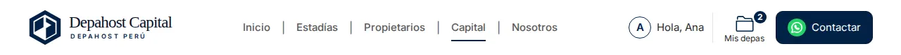

*Encabezado del sitio con la sesión iniciada.*

**Para qué sirve:** ingresas una sola vez, en el panel, y el sitio te reconoce en ese mismo navegador. Funciona porque la cookie de sesión vale para todo el dominio depahostperu.com, como está en la configuración de producción. El sitio nunca te pide la contraseña.

**Qué pasa en cada página del sitio:**

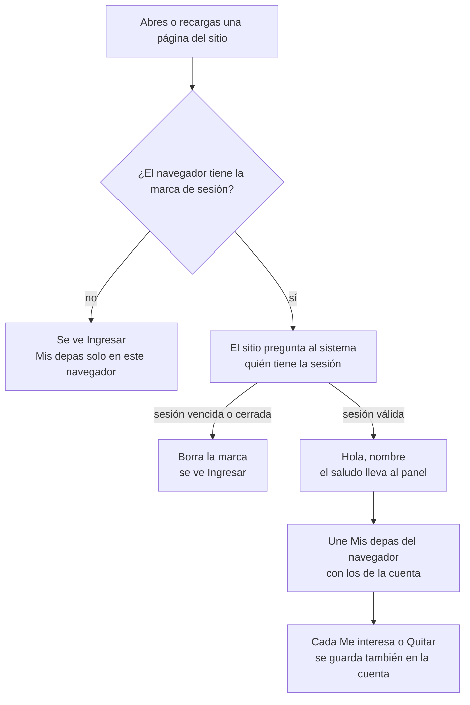

Si el navegador no tiene sesión, el sitio no hace ninguna consulta. Los visitantes sin cuenta navegan sin llamadas al sistema.

**El saludo**

- Con la sesión abierta, el sitio muestra "Hola, {tu primer nombre}" y un círculo con tu inicial. Al tocarlo vas a tu inicio en el panel.
- "Ingresar" desaparece del encabezado, y "Ingresar a mi cuenta" desaparece del menú del celular.

| Ancho de pantalla | Qué se ve con la sesión abierta |
|---|---|
| Menos de 640 px (celular) | No hay saludo, y el menú tampoco ofrece "Ingresar a mi cuenta". En el celular, el sitio no tiene ningún enlace al panel cuando ya ingresaste. Es un pendiente conocido |
| De 640 a 1023 px | "Hola, Ana" completo |
| De 1024 a 1279 px | Solo el círculo con la inicial |
| Desde 1280 px | "Hola, Ana" completo |


- **Saludo sin cuenta:** el sitio también saluda a quien dejó su nombre en "Guarda tus depas", aunque no tenga cuenta. Ese saludo lleva a "Mis depas" del sitio, no al panel, y "Ingresar" sigue visible. Si hay sesión, se usa el nombre de la cuenta.

**Mis depas al ingresar**

1. Después de ingresar, abre o recarga cualquier página del sitio en ese navegador.
2. El sitio une tus listas. Primero van los depas de tu cuenta. Después, los que habías guardado en el navegador y no estaban en la cuenta.
3. Se descartan los depas que ya no existen o que volvieron a borrador.
4. Si la lista unida tiene 20 depas o menos, queda igual en el navegador y en tu cuenta, y el panel muestra esa misma lista en "Mis depas". Si tiene más de 20, la cuenta guarda todos (hasta 50) y el navegador solo los 20 últimos de la lista unida. Si pasa de 50, la cuenta no se actualiza y no sale ningún aviso. El navegador igual se queda con los 20 últimos.
5. Desde ese momento, cada "Me interesa" o cada depa que quites en el sitio se guarda en tu cuenta en menos de un segundo. Esto incluye lo que hagas en otras pestañas.

**Casos especiales:**

- **Quitar un depa desde el panel:** si ese depa sigue guardado en el navegador del sitio, vuelve a aparecer en tu cuenta la próxima vez que abras el sitio en ese navegador. Para quitarlo del todo, quítalo desde el sitio.
- **Límite de 20 depas:** el navegador guarda como máximo 20. Si tu cuenta tiene más, o si la unión del paso 4 pasa de 20, el sitio muestra solo los 20 últimos de la lista. Los que traía el navegador van al final. El siguiente cambio que hagas desde el sitio deja en la cuenta solo esos 20.
- **Consultas:** las consultas que envías desde los formularios del sitio con la sesión abierta quedan vinculadas a tu cuenta y aparecen en "Mis consultas".
- **Sitio sin conexión al sistema configurada:** el sitio no saluda con la cuenta ni sincroniza "Mis depas". Todo queda solo en el navegador.
- **Pestañas ya abiertas:** el sitio revisa la sesión una vez por página. Si ingresas o cierras sesión, las pestañas abiertas cambian recién cuando las recargas.

### 6.11 Lo que todavía no existe

El código confirma que estas funciones no existen:

| Función | Situación |
|---|---|
| Verificación del correo | No existe. Cualquiera puede registrarse con un correo ajeno. Está en pendientes |
| Borrar la cuenta | No existe ni en el panel ni en el sistema. Está pendiente por el derecho de cancelación de la Ley 29733. La política de privacidad, que todavía es un borrador, indica escribir al correo de la empresa para ejercer ese derecho |
| Segundo factor de seguridad | No existe |
| Cambiar el correo | La persona no puede hacerlo. El panel del equipo solo permite cambiar el tipo de cuenta |
| Cerrar sesión en todos los dispositivos | No hay botón. Cambiar la contraseña cierra las demás sesiones |
| Correo de bienvenida o aviso de cambio de contraseña | No se envían. El único correo de cuenta es el de "Restablece tu contraseña" |
| Ingresar con Google u otras redes | No existe |
| "Recordarme", "mostrar contraseña" o "repetir contraseña" | No existen |
| Constancia del consentimiento de privacidad | La casilla es obligatoria, pero no se guarda registro de la aceptación |

**Referencia técnica:** [LoginView.vue](../../../depahost-panel/src/views/auth/LoginView.vue), [RegisterView.vue](../../../depahost-panel/src/views/auth/RegisterView.vue), [ForgotView.vue](../../../depahost-panel/src/views/auth/ForgotView.vue), [ResetView.vue](../../../depahost-panel/src/views/auth/ResetView.vue), [ProfileView.vue](../../../depahost-panel/src/views/account/ProfileView.vue), [NotFoundView.vue](../../../depahost-panel/src/views/NotFoundView.vue), [AuthLayout.vue](../../../depahost-panel/src/layouts/AuthLayout.vue), [router/index.ts](../../../depahost-panel/src/router/index.ts), [router/access.ts](../../../depahost-panel/src/router/access.ts), [stores/auth.ts](../../../depahost-panel/src/stores/auth.ts), [PanelLayout.vue](../../../depahost-panel/src/layouts/PanelLayout.vue), [TurnstileWidget.vue](../../../depahost-panel/src/components/TurnstileWidget.vue), [api/client.ts](../../../depahost-panel/src/api/client.ts), [composables/useForm.ts](../../../depahost-panel/src/composables/useForm.ts), [app.ts](../../../depahost-api/src/app.ts), [accounts/routes.ts](../../../depahost-api/src/modules/accounts/routes.ts), [accounts/schema.ts](../../../depahost-api/src/modules/accounts/schema.ts), [accounts/service.ts](../../../depahost-api/src/modules/accounts/service.ts), [plugins/auth.ts](../../../depahost-api/src/plugins/auth.ts), [Header.astro](../../src/components/Header.astro), [lib/account.ts](../../src/lib/account.ts), [lib/saved-store.ts](../../src/lib/saved-store.ts) · Capítulos: [08 · Panel y cuentas](08-panel-y-cuentas.md), [07 · Decisiones y pendientes](07-decisiones-y-pendientes.md)

## 7. El panel del comprador

El panel de cuentas (app.depahostperu.com) es donde el comprador o inversionista con cuenta revisa los depas que guardó y las consultas que envió. Tiene tres pantallas: "Mis depas", "Mis consultas" y "Perfil". El propietario también tiene estas tres pantallas, en el bloque "Mi cuenta" de su menú.

### 7.1 Al ingresar: inicio y menú

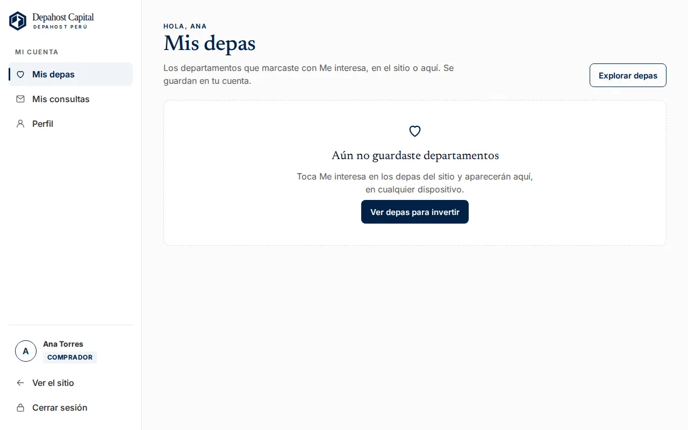

*Primer ingreso de un comprador: "Mis depas" vacío.*

**Para qué sirve.** Es la parte común de todas las pantallas del panel. Desde aquí cambias de pantalla, vuelves al sitio o cierras sesión.

**Cómo se llega**

- Escribe app.depahostperu.com en el navegador. Si no tienes sesión, el panel te muestra la pantalla de ingreso (ver sección 6).
- Desde el sitio, con la sesión iniciada, en tablet o computadora (pantallas de 640 px o más): toca tu saludo "Hola, {tu nombre}" arriba. Entre 1024 y 1279 px solo se ve el círculo con tu inicial.
- En el teléfono, con la sesión iniciada, el sitio no muestra ningún enlace al panel: escribe app.depahostperu.com en el navegador.
- Desde el sitio, sin sesión: toca "Ingresar". En el teléfono está dentro del menú, como "Ingresar a mi cuenta". Este botón solo aparece si el sitio tiene configurada la dirección del panel.
- Cuando ingresas o creas tu cuenta, llegas a "Mis depas", que es la pantalla de inicio del comprador. Si antes intentaste abrir otra pantalla del panel, al ingresar vuelves a esa pantalla. Esto pasa al ingresar, no al crear la cuenta.
- El logo del panel también te lleva a "Mis depas".

**Qué se ve**

| Parte | En computadora (pantallas de 1024 px o más) | En teléfono y tablet |
|---|---|---|
| Menú | Fijo a la izquierda | Oculto. Se abre con el botón de tres rayas |
| Barra superior | No aparece | Logo a la izquierda y botón de menú a la derecha |
| Contenido | A la derecha del menú | Debajo de la barra |

El menú del comprador tiene un solo bloque, "Mi cuenta":

| Opción | Dirección | Qué hay |
|---|---|---|
| "Mis depas" | /mis-depas | Los depas que marcaste con "Me interesa" (7.2) |
| "Mis consultas" | /mis-consultas | Lo que enviaste desde el sitio con tu sesión iniciada (7.3) |
| "Perfil" | /perfil | Tus datos, tu contraseña y tu rol (sección 6) |

- La opción de la pantalla en la que estás se ve resaltada, con una barra a la izquierda.
- Al pie del menú está tu tarjeta: un círculo con la inicial de tu nombre, tu nombre completo y la etiqueta "Comprador".
- Debajo de la tarjeta están "Ver el sitio" y "Cerrar sesión".
- La pestaña del navegador muestra el nombre de la pantalla, por ejemplo "Mis depas · DepaHost Capital".

**Qué puede hacer**

Abrir el menú en el teléfono:

1. Toca el botón de tres rayas, arriba a la derecha.
2. Elige una opción. El menú se cierra solo al cambiar de pantalla. Si tocas la pantalla en la que ya estás, el menú sigue abierto: ciérralo con la X.
3. Para cerrarlo sin elegir nada, toca la X, toca la zona oscura fuera del menú o presiona Esc.

Volver al sitio:

1. Toca "Ver el sitio". Te lleva a la página Capital del sitio, no a la portada.

Cerrar sesión:

1. Toca "Cerrar sesión".
2. El panel te lleva a la pantalla de ingreso.

**Qué pasa después de cerrar sesión**

- Se cierra la sesión de este navegador. En el sitio vuelve a aparecer "Ingresar". Si alguna vez dejaste tu nombre en "Guarda tus depas" en ese navegador, el saludo "Hola, {nombre}" sigue a la vista junto a "Ingresar", pero ya no lleva al panel: lleva a "Mis depas" del sitio.
- Tus otros dispositivos mantienen su sesión abierta.
- Los depas guardados en este navegador siguen en "Mis depas" del sitio. En una computadora compartida, la siguiente persona los verá.
- Si vuelves a abrir una pantalla del panel, te pide ingresar otra vez.

**Casos especiales**

- "Ver el sitio" solo aparece si el panel tiene configurada la dirección del sitio. Sin esa configuración, los demás enlaces al sitio ("Explorar depas", "Ver en el sitio", "Empecemos con estos") abren la página "No encontramos esta página" del propio panel.
- La sesión dura 30 días desde que ingresas. Ese es el valor por defecto y se puede configurar. Al terminar ese plazo tienes que ingresar otra vez, aunque hayas usado el panel o el sitio todos los días. Cambiar la contraseña también inicia una sesión nueva de 30 días.
- Si la sesión vence con el panel abierto, el menú sigue a la vista, pero las pantallas no cargan. "Mis depas" muestra "No pudimos cargar tus depas." y "Mis consultas" se ve vacía. Recarga la página y el panel te pedirá ingresar.
- Si usas teclado, al presionar Tab la primera vez aparece el enlace "Saltar al contenido".

### 7.2 Mis depas en el panel

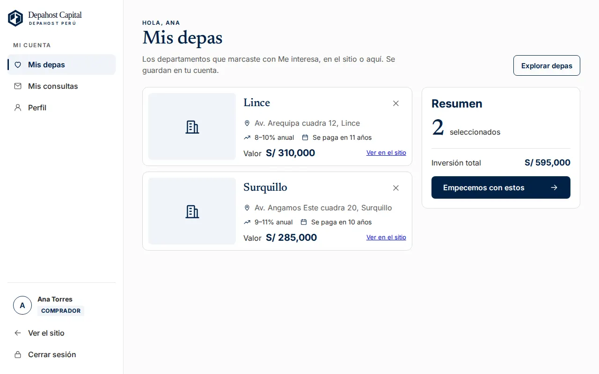

*"Mis depas" en el panel, sincronizado con el sitio.*

**Para qué sirve.** Reúne en un solo lugar los departamentos que marcaste con "Me interesa" en el sitio, en cualquier dispositivo donde iniciaste sesión. Desde aquí puedes quitarlos, abrir su ficha en el sitio o pedir que te acompañen por WhatsApp.

**Cómo se llega.** Es la pantalla de inicio del comprador. Está en app.depahostperu.com/mis-depas o en "Mis depas" del menú.

**Qué se ve**

- Encabezado: "Hola, {tu nombre}", el título "Mis depas" y el texto "Los departamentos que marcaste con Me interesa, en el sitio o aquí. Se guardan en tu cuenta." A la derecha está el botón "Explorar depas".
- Mientras carga aparece "Cargando…".
- Una tarjeta por depa, en el orden en que los guardaste: el primero que marcaste va arriba.
- El recuadro "Resumen".

Cada tarjeta muestra:

| Dato | Qué se ve |
|---|---|
| Foto | La primera foto del depa. Si no tiene foto, un ícono de edificio |
| Título | El distrito |
| Botón X | Quita el depa de tu lista |
| Ubicación | Dirección y distrito |
| Rentabilidad | Por ejemplo, "8–10% anual" |
| Plazo | "Se paga en {n} años" |
| Precio | "Desde" si es un proyecto de inmobiliaria, "Valor" si es el depa de un propietario |
| Enlace | "Ver en el sitio" |

El recuadro "Resumen" muestra:

- Cuántos depas tienes: "{n} seleccionados".
- La "Inversión total", que es la suma de los precios. Los soles y los dólares se suman por separado, por ejemplo "S/ 595,000 + USD 80,000". En el panel solo aparecen las monedas que tienen tus depas: si todos están en dólares, dice solo "USD 80,000". Las monedas van en el orden en que aparecen en la lista: si el primer depa está en dólares, los dólares van primero ("USD 80,000 + S/ 595,000").
- El botón "Empecemos con estos".

Los montos en dólares los escribe el navegador. En Chrome actual salen como "USD 80,000"; otro navegador podría escribirlos distinto.

En pantallas anchas, el "Resumen" va a la derecha y te sigue cuando bajas por la página. En pantallas angostas va debajo de la lista. En el teléfono, la foto de cada tarjeta va arriba del texto.

**Qué puede hacer**

Quitar un depa:

1. Toca la X junto al nombre del distrito.
2. El depa sale de la lista en el acto. No se pide confirmación.
3. Abajo a la derecha aparece el aviso "Quitaste {distrito}" por unos segundos.

Ver la ficha completa:

1. Toca "Ver en el sitio". La ficha del depa se abre en el sitio, en la misma pestaña.

Buscar más depas:

1. Toca "Explorar depas". Se abre la página Capital del sitio.
2. Toca "Me interesa" en los depas que te gusten. Con tu sesión iniciada, se guardan en tu cuenta y los verás aquí la próxima vez que abras esta pantalla.

Pedir que te acompañen por WhatsApp:

1. Toca "Empecemos con estos". Se abre la página "Te acompañamos al proyecto" del sitio, con tus depas.
2. Revisa la selección. Si quieres cambiarla, toca "Cambiar selección", que te lleva a "Mis depas" del sitio.
3. Toca "Escribir por WhatsApp". WhatsApp se abre con un mensaje ya escrito. Empieza con "Hola, quiero que me acompañen con estos depas:" (o "este depa", si es uno) y trae una línea por depa con el distrito, la dirección y el precio.
4. Envía el mensaje desde WhatsApp.

El panel no tiene un botón de WhatsApp propio. Para escribir por WhatsApp siempre se pasa por esa página del sitio.

**Cómo se relaciona con "Mis depas" del sitio**

Hay dos listas:

- **La lista del navegador.** El sitio guarda en cada navegador los depas que marcas con "Me interesa", aunque no tengas cuenta.
- **La lista de tu cuenta.** Es la que muestra el panel y la misma en todos tus dispositivos.

El sitio las une así:

1. Cada vez que abres una página del sitio con la sesión iniciada, el sitio trae la lista de tu cuenta y le agrega los depas del navegador que no estaban.
2. Luego copia la lista de la cuenta en el navegador, para que las dos queden iguales.
3. Desde ese momento, cada "Me interesa" que tocas y cada depa que quitas en el sitio se guarda también en tu cuenta.
4. El panel lee la lista de la cuenta. Lo que quitas en el panel se quita de la cuenta.

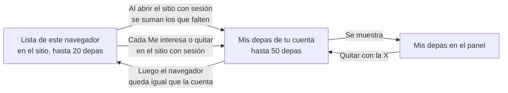

Para que las listas se unan, el sitio tiene que estar conectado al sistema de cuentas (API). Si no lo está, el sitio solo guarda los depas en el navegador y el panel no los ve.

Aunque tengas la sesión iniciada, la página "Mis depas" del sitio sigue mostrando la nota "Guardado en este dispositivo." (o "Guardado para {nombre}. La próxima vez te mostramos depas parecidos." si dejaste tu nombre en "Guarda tus depas" en ese navegador). Igual se guarda en tu cuenta.

**Reglas y validaciones**

| Campo | Regla | Mensaje si falla |
|---|---|---|
| Lista de la cuenta | Hasta 50 depas. Un depa repetido cuenta una sola vez. Los depas que no existen o están en borrador se descartan | Ninguno: se descartan sin aviso |
| Lista del navegador (sitio) | Hasta 20 depas. Si marcas uno más, se borra el más antiguo | Ninguno |
| Depas que se muestran | Solo los publicados o reservados | Ninguno: los vendidos o retirados no aparecen |
| Carga de la pantalla | Pide sesión activa y conexión con el sistema | "No pudimos cargar tus depas." |
| Quitar | Pide sesión activa y conexión con el sistema | Ninguno: el depa se queda en la lista y no sale el aviso "Quitaste…" |

**Qué pasa después**

- Cuando quitas un depa, el cambio se guarda en tu cuenta. Revisa los casos especiales: el sitio puede volver a sumarlo.
- Cuando tocas "Escribir por WhatsApp" con al menos un depa elegido, el sitio registra una consulta "Te acompañamos (WhatsApp)" con esos depas. Si tienes la sesión iniciada, la consulta aparece en "Mis consultas".
- La consulta se registra al tocar el botón, aunque después no envíes el mensaje. Cada vez que tocas el botón se registra una consulta nueva, hasta 10 por minuto. Pasado ese límite, WhatsApp se abre igual pero la consulta no se registra, y no sale ningún aviso.
- Esta consulta no lleva tu nombre ni tu celular, solo los depas. El equipo no recibe un correo por ella: la ve en su lista de leads.

**Casos especiales**

- **Sin depas.** Aparece "Aún no guardaste departamentos" con el texto "Toca Me interesa en los depas del sitio y aparecerán aquí, en cualquier dispositivo." y el botón "Ver depas para invertir", que abre Capital en el sitio.
- **No se pueden agregar depas desde el panel.** El encabezado dice "en el sitio o aquí", pero el panel solo permite quitar. Para agregar un depa, toca "Me interesa" en el sitio.
- **Un depa que quitas en el panel puede volver.** Hoy, cuando el sitio une las dos listas, solo suma depas: no se acuerda de los que quitaste en otro lado. Si quitas un depa en el panel y ese depa sigue guardado en un navegador, vuelve a tu cuenta la próxima vez que abras el sitio en ese navegador con tu sesión. Esto pasa también si tocas "Ver en el sitio", "Explorar depas" o "Empecemos con estos" justo después de quitarlo. Para quitarlo del todo, quítalo desde el sitio con tu sesión iniciada en cada navegador donde lo tengas. Puedes tocar "Guardado" en la ficha del depa o la X en "Mis depas" del sitio.
- **Lo que quitas en el sitio sin sesión también puede volver.** Si tu cuenta tenía ese depa, reaparece cuando inicias sesión.
- **Más de 20 depas.** Si al unir las listas de dos dispositivos tu cuenta queda con más de 20 depas, el sitio guarda en el navegador solo los 20 últimos. La próxima vez que cambies algo en el sitio, tu cuenta también se queda solo con esos 20.
- **Depa reservado.** En el panel aparece sin ninguna marca. En "Mis depas" del sitio sí dice "Reservado".
- **Depa vendido o retirado.** Ya no se ve en el panel y no entra en el conteo ni en la "Inversión total".
- **La "Inversión total" se escribe distinto en el panel y en el sitio.** Con la misma lista, los dos textos pueden no coincidir. El sitio (4.5) siempre muestra los soles primero, aunque sumen 0: con solo depas en dólares, el panel dice "USD 80,000" y "Mis depas" del sitio dice "S/ 0 + USD 80,000". Con las dos monedas, el panel puede poner los dólares primero si el primer depa de la lista está en dólares; el sitio siempre pone "S/ … + USD …". Los montos son los mismos; solo cambia cómo se escriben.
- **Selección vacía en "Te acompañamos al proyecto".** Esta página usa la lista del navegador. Si es la primera vez que usas el sitio en ese navegador, la selección puede salir vacía o incompleta. Recarga la página.
- **Sitio sin conexión al sistema.** "Escribir por WhatsApp" abre WhatsApp igual, pero la consulta no se registra.
- **Número de WhatsApp pendiente.** El número del sitio se configura aparte. Mientras no se configure, se usa el número de relleno 51XXXXXXXXX y los mensajes no llegan a nadie.
- **Texto del Resumen con un solo depa.** El contador dice "seleccionados" aunque haya uno solo ("1 seleccionados").
- **Cambios recientes.** El panel muestra los datos del momento. El sitio se actualiza cuando se vuelve a generar después de un cambio. Por un rato, "Ver en el sitio" puede mostrar datos anteriores o no encontrar un depa recién publicado.

### 7.3 Mis consultas

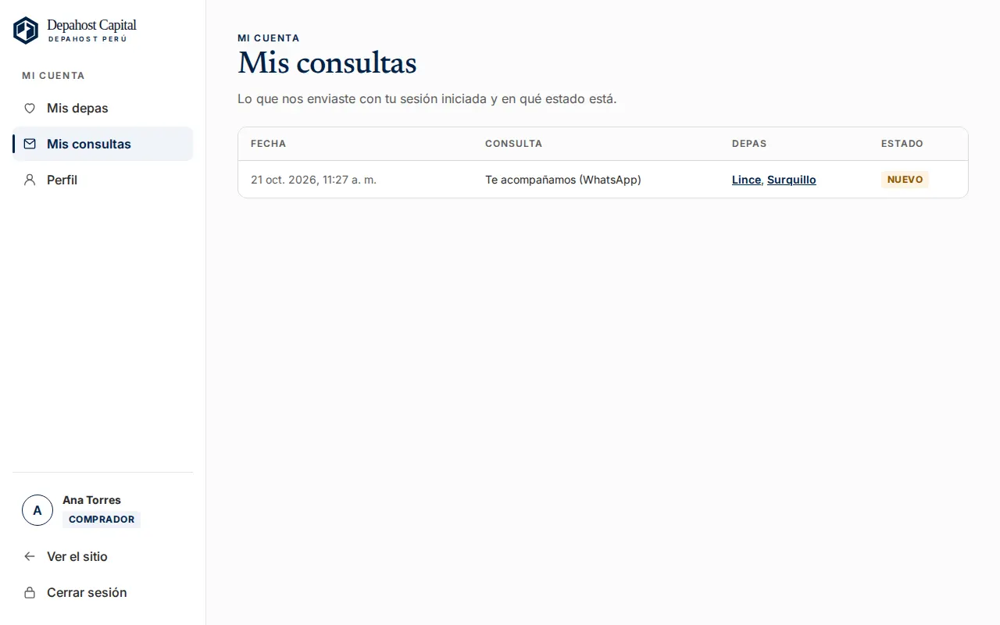

*"Mis consultas" con un pedido de acompañamiento.*

**Para qué sirve.** Muestra lo que enviaste desde el sitio con tu sesión iniciada y en qué estado está cada consulta.

**Cómo se llega.** Toca "Mis consultas" en el menú. La dirección es /mis-consultas.

**Qué se ve**

- Encabezado: "Mi cuenta", el título "Mis consultas" y el texto "Lo que nos enviaste con tu sesión iniciada y en qué estado está."
- Mientras carga aparece "Cargando…".
- Una tabla con la consulta más reciente arriba:

| Columna | Qué muestra |
|---|---|
| "Fecha" | Día y hora del envío, en hora de Lima |
| "Consulta" | El tipo de consulta (ver la tabla siguiente) |
| "Depas" | El distrito de cada depa incluido, con enlace a su ficha en el sitio. "—" si la consulta no tenía depas. "Ya no disponible" si el depa ya no está en el sitio |
| "Estado" | En qué va la consulta |

**Qué consultas aparecen y por qué**

Una consulta aparece aquí si la enviaste desde el sitio con la sesión iniciada en ese navegador. El sitio la manda junto con tu sesión y el sistema la vincula a tu cuenta.

| Texto en "Consulta" | Desde dónde se envía en el sitio | ¿Lleva depas? |
|---|---|---|
| "Te acompañamos (WhatsApp)" | Botón "Escribir por WhatsApp" de la página "Te acompañamos al proyecto". A esa página se llega con "Empecemos con estos" (Mis depas), con "Empecemos" en Capital o con "Contactar" en la ficha de un depa | Sí, los elegidos. Si llegaste con "Contactar" desde una ficha, solo ese depa |
| "Guarda tus depas" | Formulario "Guarda tus depas". Se abre con "Guárdalos con tu celular" en "Mis depas" del sitio. También se abre solo al marcar un depa cuando la lista llega a dos o más, salvo que ya hayas dejado tu nombre en ese navegador o lo hayas cerrado sin enviar en los últimos 7 días | Sí, los que tenías en la lista en ese momento |
| "Quiero vender mi depa" | Formulario de la página Propietarios, con la opción "Vender" | No |
| "Quiero alquilar mi depa" | El mismo formulario, con "Alquilar (largo plazo)" u "Operarlo en Airbnb" | No |
| "Formulario para inversionistas" | Formulario en inglés de la página Capital ("Also in English for international investors") | No |
| "Contacto" | Hoy ningún formulario del sitio envía este tipo | — |

No aparecen aquí:

- Lo que enviaste sin sesión, aunque hayas usado el mismo correo o celular. Esas consultas tampoco se suman cuando creas la cuenta.
- Las conversaciones directas por WhatsApp, por ejemplo desde el botón "Contactar" de la barra superior del sitio o el botón flotante.
- Los reclamos del Libro de reclamaciones.
- Las solicitudes de propietario hechas en el panel, que están en "Mis propiedades".
- Las consultas que no se registraron: cuando el sitio no está conectado al sistema (el formulario ofrece WhatsApp en su lugar) o cuando el envío dio error.
- Las consultas más antiguas que las 100 más recientes.

**Estados**

| Estado que ves | Qué significa | Del otro lado |
|---|---|---|
| "Nuevo" | La consulta llegó y todavía no te contactan | El equipo la ve como "Sin contactar" |
| "En conversación" | El equipo ya está en contacto contigo | El equipo la ve como "En conversación" |
| "Cerrado" | La consulta terminó | El equipo la ve como "Cerrado" |

- Todas las consultas empiezan en "Nuevo".
- Solo el equipo cambia el estado, desde su lista de leads. Lo puede mover en cualquier orden, también hacia atrás.
- No llega ningún correo cuando cambia el estado. Para saberlo, revisa esta pantalla.
- El estado se actualiza cuando abres o recargas la pantalla.

**Qué puede hacer**

1. Revisa la fecha, el tipo y el estado de cada consulta.
2. Toca el nombre de un distrito en la columna "Depas" para abrir la ficha de ese depa en el sitio.

Esta pantalla es solo para mirar. No puedes editar, borrar ni responder consultas. Tampoco ves el mensaje ni los datos que enviaste.

**Estado vacío.** Si no tienes consultas, aparece "Todavía no nos escribiste" con el texto "Cuando uses Empecemos o un formulario con tu sesión iniciada, verás aquí cada consulta." y el botón "Empecemos", que abre la página "Te acompañamos al proyecto" del sitio.

**Reglas y validaciones**

| Campo | Regla | Mensaje si falla |
|---|---|---|
| Lista de consultas | Solo las vinculadas a tu cuenta. Hasta 100, con la más reciente arriba | — |
| Depas de cada consulta | Se muestran mientras sigan publicados o reservados | "Ya no disponible" |
| Carga de la pantalla | Pide sesión activa y conexión con el sistema | No hay mensaje de error: se ve el estado vacío |

**Casos especiales**

- **Falla al cargar.** Si no hay conexión o la sesión venció, la pantalla muestra el mismo mensaje de lista vacía. Recarga antes de concluir que no tienes consultas.
- **Fallan solo los datos de los depas.** Si las consultas cargan pero los datos de los depas no, todos los depas salen como "Ya no disponible". Lo mismo pasa si tus consultas suman más de 100 depas distintos: todos salen como "Ya no disponible".
- **Dos depas del mismo distrito.** Se ven con el mismo nombre. Abre cada enlace para saber cuál es cuál.
- **En el teléfono.** La tabla se desliza de lado.
- **Varios toques en "Escribir por WhatsApp".** Cada toque crea una fila nueva, hasta 10 por minuto.

### 7.4 Lo que el comprador no puede abrir

El menú del comprador no muestra las pantallas de propietario ni las de administración. Si alguien escribe esas direcciones a mano, pasa esto:

| Si el comprador abre… | Qué pasa |
|---|---|
| Una pantalla de propietario: /mis-propiedades, /mis-propiedades/nueva, el detalle de una propiedad o su edición | El panel lo lleva a "Mis depas", sin ningún mensaje |
| Una pantalla de administración: /admin y sus secciones (Depas, Solicitudes, Leads, Reclamos, Inmobiliarias, Usuarios, Configuración), y el detalle o la edición de un depa o una solicitud | Lo lleva a "Mis depas", sin ningún mensaje. Si la dirección empieza con /admin/ pero no es una de esas pantallas, ve la página 404 |
| Ingresar, Crear cuenta o Recuperar contraseña, ya con la sesión iniciada | Lo lleva a "Mis depas" |
| Una dirección que no existe | Ve una página con "404", "No encontramos esta página" y el botón "Ir a mi cuenta", que lo lleva a "Mis depas" |
| Cualquier pantalla del panel, sin sesión | Ve la pantalla de ingreso. Al ingresar vuelve a esa dirección, si su rol la permite. Si no la permite, va a "Mis depas". Ingresar, Crear cuenta y Recuperar contraseña se abren normalmente |

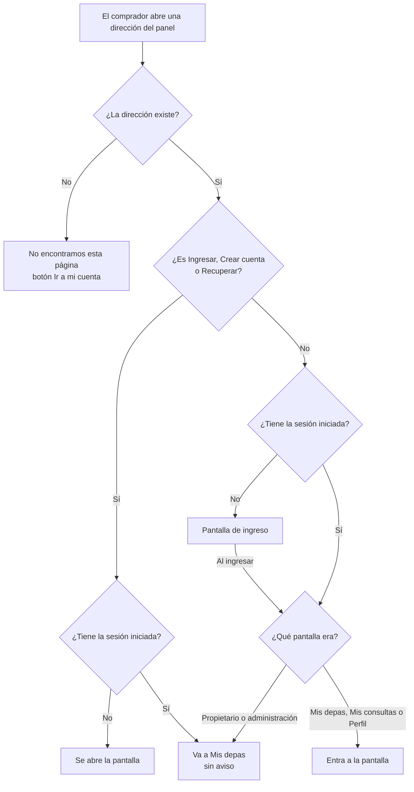

- La protección no está solo en el menú. Si alguien intenta pedir esos datos directamente al sistema, este responde "No tienes permiso para esto".
- Para publicar un depa, cambia tu rol a propietario en "Perfil" (ver sección 6).
- El rol de administrador no se puede elegir en el panel.

### 7.5 Perfil

La opción "Perfil" (/perfil) se explica en la sección 6.

**Referencia técnica:** [depahost-panel/src/layouts/PanelLayout.vue](../../../depahost-panel/src/layouts/PanelLayout.vue), [depahost-panel/src/router/nav.ts](../../../depahost-panel/src/router/nav.ts), [depahost-panel/src/router/access.ts](../../../depahost-panel/src/router/access.ts), [depahost-panel/src/router/index.ts](../../../depahost-panel/src/router/index.ts), [depahost-panel/src/views/buyer/SavedView.vue](../../../depahost-panel/src/views/buyer/SavedView.vue), [depahost-panel/src/views/buyer/MyLeadsView.vue](../../../depahost-panel/src/views/buyer/MyLeadsView.vue), [depahost-panel/src/composables/labels.ts](../../../depahost-panel/src/composables/labels.ts), [depahost-panel/src/components/StatusBadge.vue](../../../depahost-panel/src/components/StatusBadge.vue), [depahost-panel/src/views/NotFoundView.vue](../../../depahost-panel/src/views/NotFoundView.vue), [depahost-panel/src/brand/format.ts](../../../depahost-panel/src/brand/format.ts), [depahost-api/src/modules/accounts/service.ts](../../../depahost-api/src/modules/accounts/service.ts), [depahost-api/src/modules/accounts/routes.ts](../../../depahost-api/src/modules/accounts/routes.ts), [depahost-api/src/modules/leads/service.ts](../../../depahost-api/src/modules/leads/service.ts), [depahost-api/src/modules/leads/routes.ts](../../../depahost-api/src/modules/leads/routes.ts), [depahost-api/src/plugins/auth.ts](../../../depahost-api/src/plugins/auth.ts), [src/components/Header.astro](../../src/components/Header.astro), [src/components/SaveListDialog.astro](../../src/components/SaveListDialog.astro), [src/lib/account.ts](../../src/lib/account.ts), [src/lib/saved-store.ts](../../src/lib/saved-store.ts), [src/lib/profile.ts](../../src/lib/profile.ts), [src/pages/capital/empecemos.astro](../../src/pages/capital/empecemos.astro), [src/pages/mis-depas.astro](../../src/pages/mis-depas.astro) · Capítulos: [08-panel-y-cuentas.md](08-panel-y-cuentas.md), [05-flujos.md](05-flujos.md)

## 8. El panel del propietario: publicar un depa

En el panel de cuentas (app.depahostperu.com), el propietario envía su depa para venderlo, alquilarlo u operarlo en Airbnb, y sigue el avance de su solicitud. Ningún depa sale en el sitio sin que el equipo lo revise antes. El panel le muestra al propietario cuánto interés genera su depa una vez publicado.

| Pantalla | Dirección | Para qué sirve |
|---|---|---|
| "Mis propiedades" | `/mis-propiedades` | Ver tus solicitudes, su estado y el interés que generan |
| "Publicar un depa" | `/mis-propiedades/nueva` | Crear una solicitud nueva |
| Detalle de una solicitud | `/mis-propiedades/{id}` | Ver el estado, el comentario del equipo, el interés, los datos y las fotos |
| "Editar mi depa" | `/mis-propiedades/{id}/editar` | Corregir una solicitud "Enviada" o "No aprobada" |

### 8.1 Quién puede entrar a estas pantallas

**Para qué sirve.** Las pantallas de propietario son para cuentas con rol propietario. El equipo (administradores) también puede abrirlas escribiendo la dirección, aunque no aparecen en su menú.

| Situación | Qué pasa |
|---|---|
| No tienes sesión y abres cualquiera de estas direcciones | El panel te lleva a "Ingresar" (`/ingresar`). Cuando ingresas, vuelves a la pantalla que querías abrir. |
| Creas tu cuenta y eliges "Tengo un depa" ("Publícalo para vender o alquilar y sigue su estado.") | Entras directo a "Mis propiedades". |
| Ingresas con una cuenta de propietario | Entras directo a "Mis propiedades". |
| Tienes cuenta de comprador y abres una de estas direcciones | El panel te devuelve a "Mis depas" sin mostrar ningún mensaje. Tu menú no tiene la sección "Propietario". |
| Eres comprador y quieres publicar un depa | 1. Abre "Perfil". 2. En "Uso tu cuenta para", elige "Vender o alquilar mi depa". 3. Toca "Guardar". Verás "Guardamos tus datos" y pasarás a "Mis propiedades". El equipo también puede cambiar tu rol desde su panel. |
| Eres propietario y cambias a "Invertir en depas" | Tus solicitudes no se borran, pero dejas de ver "Mis propiedades" hasta que vuelvas a elegir "Vender o alquilar mi depa". |

### 8.2 Al ingresar: "Mis propiedades"

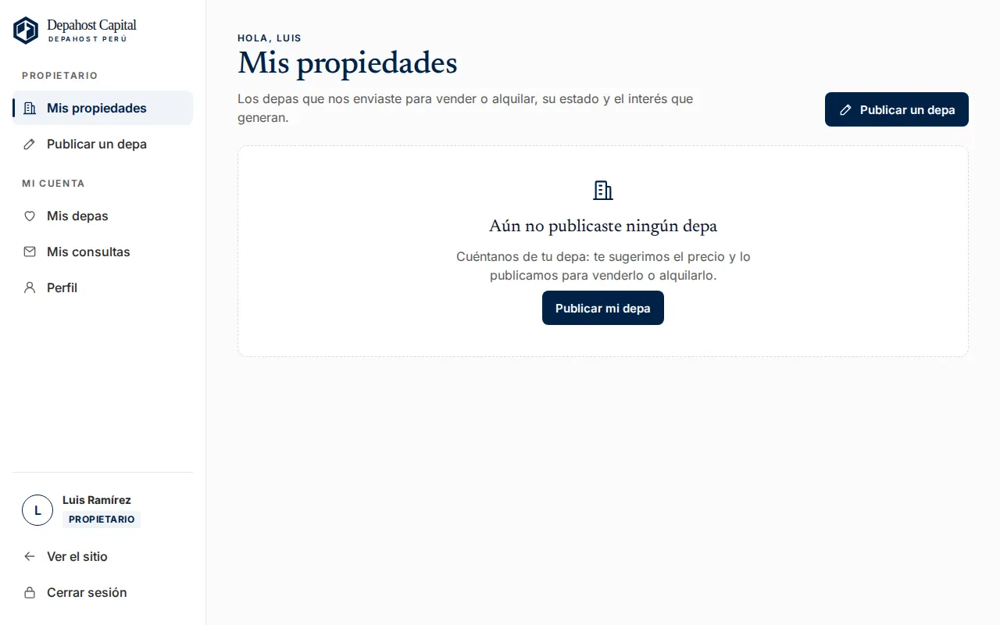

*"Mis propiedades" de un propietario nuevo.*

<p>
  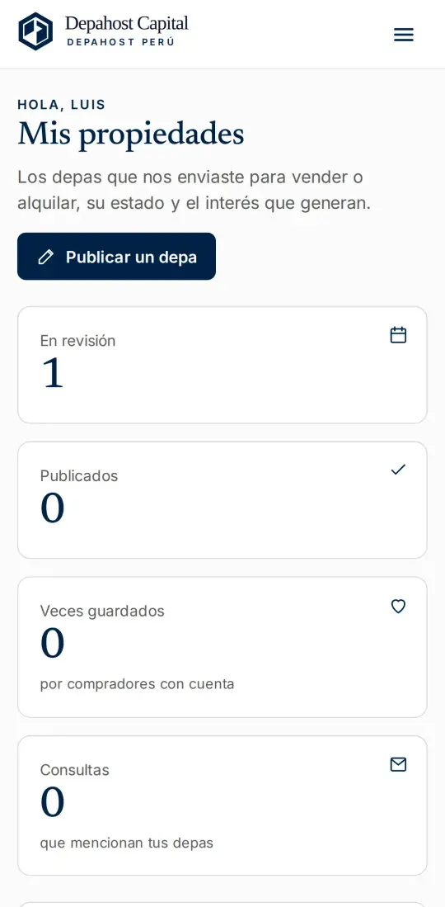
  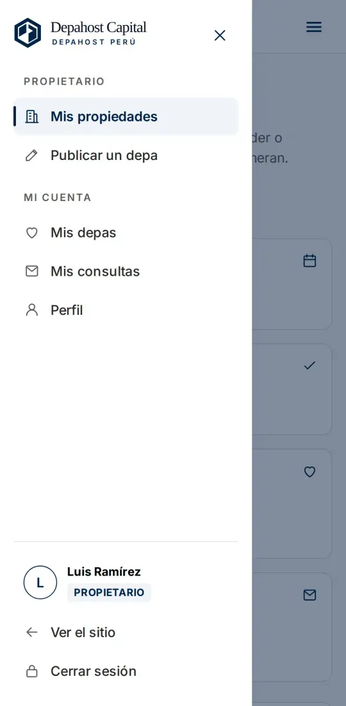
</p>

*Panel del propietario en un teléfono · Menú del panel abierto.*

**Para qué sirve.** Es la pantalla de inicio del propietario. Junta todas sus solicitudes y el interés que generan.

**Cómo se llega.** Entras aquí al ingresar. También puedes llegar desde el menú, con "Mis propiedades", o abriendo `app.depahostperu.com/mis-propiedades`.

**Qué se ve.**

- **Menú.** Tiene dos secciones. La sección "Propietario" trae "Mis propiedades" y "Publicar un depa". La sección "Mi cuenta" trae "Mis depas", "Mis consultas" y "Perfil", que son las mismas opciones del comprador. Abajo aparecen tu nombre, la etiqueta "Propietario", "Ver el sitio" y "Cerrar sesión".
- **Encabezado.** Primero dice "Hola, {tu primer nombre}" (por ejemplo, "Hola, Ana" para "Ana Pérez"). Luego vienen el título "Mis propiedades", el texto "Los depas que nos enviaste para vender o alquilar, su estado y el interés que generan." y el botón "Publicar un depa".
- **Si aún no tienes solicitudes.** Ves el título "Aún no publicaste ningún depa", el texto "Cuéntanos de tu depa: te sugerimos el precio y lo publicamos para venderlo o alquilarlo." y el botón "Publicar mi depa".


- **Si ya tienes solicitudes.** Arriba aparecen cuatro tarjetas con totales:

| Tarjeta | Qué cuenta |
|---|---|
| "En revisión" | Las solicitudes en estado "Enviada" más las que están "En revisión" |
| "Publicados" | Las solicitudes en estado "Publicada" |
| "Veces guardados" ("por compradores con cuenta") | La suma de las veces que guardaron todos tus depas publicados |
| "Consultas" ("que mencionan tus depas") | La suma de las consultas que incluyen tus depas publicados (cuenta toques, no personas: ver 8.7) |

- **Lista de solicitudes.** Va de la más nueva a la más antigua según la fecha en que la enviaste; editarla no la mueve de lugar. Cada fila muestra:
  - la foto de portada, o un ícono de edificio si no tiene fotos;
  - la dirección y el distrito;
  - el tipo, el precio (por ejemplo "S/ 320,000", o "Precio por definir" si no lo pusiste) y la fecha del último cambio ("actualizado …");
  - si el depa ya está publicado, cuántas veces lo guardaron (corazón) y cuántas consultas tiene (sobre);
  - dos etiquetas: lo que quieres hacer ("Vender", "Alquilar" o "Airbnb") y el estado ("Enviada", "En revisión", "Publicada" o "No aprobada").

**Qué puede hacer.**

1. Toca una fila para abrir el detalle de esa solicitud (ver 8.5).
2. Toca "Publicar un depa" para crear una solicitud nueva (ver 8.3).

**Casos especiales.**

- **Celular y tablet (menos de 1024 px).** El menú lateral se esconde. Arriba aparecen el logo y un botón ☰ ("Abrir menú"). El menú se abre como un panel desde la izquierda. Se cierra con la X ("Cerrar menú"), tocando fuera o al elegir una opción que te lleva a otra pantalla. Si tocas la opción de la pantalla en la que ya estás (por ejemplo, "Mis propiedades" estando en "Mis propiedades"), el menú sigue abierto: ciérralo con la X.
- **Pantallas angostas (menos de 720 px).** Las tarjetas se apilan una debajo de otra. Para llegar a la lista tienes que bajar.
- **"Ver el sitio".** Solo aparece si el panel tiene configurada la dirección del sitio.
- **Error al cargar la lista.** Si el servidor falla al cargar la lista, la pantalla muestra "Aún no publicaste ningún depa" aunque sí tengas solicitudes. Recarga la página.


### 8.3 Publicar un depa: crear la solicitud

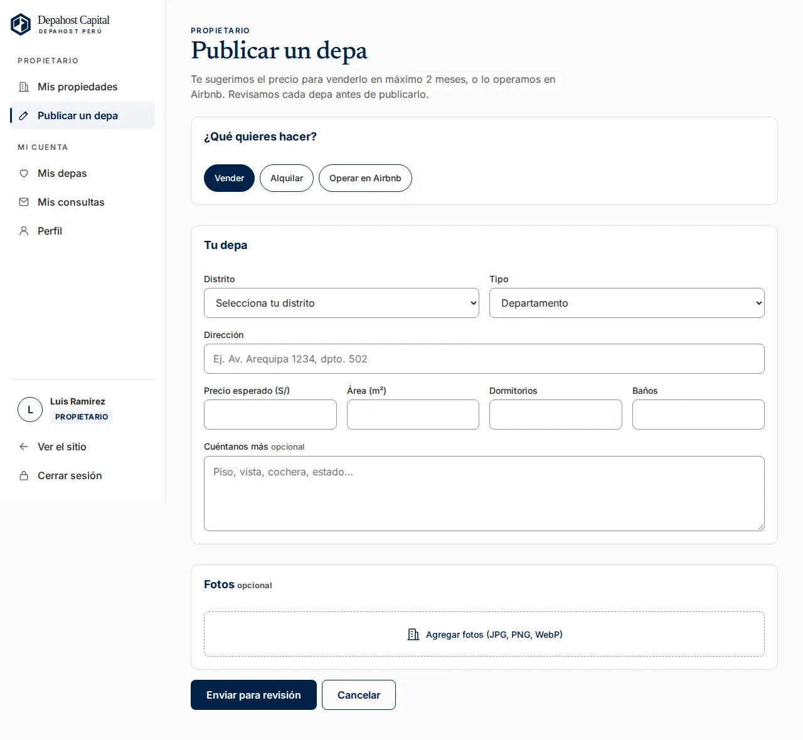

*Formulario "Publicar un depa".*

**Para qué sirve.** Sirve para contarle al equipo cómo es tu depa y qué quieres hacer con él. El equipo revisa la solicitud y, si la aprueba, publica el depa en el sitio.

Este camino es distinto del formulario de la página Propietarios del sitio. Ese formulario no pide cuenta y no crea una solicitud en "Mis propiedades": el equipo lo recibe como una consulta. Si lo envías con la sesión iniciada, lo verás en "Mis consultas" como "Quiero vender mi depa" o "Quiero alquilar mi depa", con el estado de la consulta, sin los estados de revisión de 8.6 y sin fotos.

**Cómo se llega.** Hay tres formas:

- "Publicar un depa", en el menú o en el encabezado de "Mis propiedades";
- "Publicar mi depa", si aún no tienes solicitudes;
- la dirección `/mis-propiedades/nueva`.

**Qué se ve.** Arriba aparecen el título "Publicar un depa" y el texto "Te sugerimos el precio para venderlo en máximo 2 meses, o lo operamos en Airbnb. Revisamos cada depa antes de publicarlo." Luego vienen tres bloques: "¿Qué quieres hacer?", "Tu depa" y "Fotos" ("opcional"). Al final están los botones "Enviar para revisión" y "Cancelar".


**Qué puede hacer (pasos).**

1. En "¿Qué quieres hacer?", elige "Vender", "Alquilar" u "Operar en Airbnb". Viene marcado "Vender".
2. En "Distrito", abre la lista ("Selecciona tu distrito") y elige el tuyo. Hay 36 distritos de Lima Metropolitana y Callao. Si el tuyo no está, elige "Otro". No hay un campo para escribir el nombre del distrito, así que conviene ponerlo en la dirección o en "Cuéntanos más".
3. En "Tipo", elige "Departamento", "Dúplex o penthouse", "Casa" u "Otro". Viene marcado "Departamento".
4. En "Dirección", escribe la dirección completa. Por ejemplo: "Ej. Av. Arequipa 1234, dpto. 502".
5. Si quieres, completa los números:
   - El precio: el campo se llama "Precio esperado (S/)" si elegiste "Vender" y "Alquiler mensual (S/)" si elegiste "Alquilar" u "Operar en Airbnb".
   - "Área (m²)", "Dormitorios" y "Baños".
6. Si quieres, escribe en "Cuéntanos más". Por ejemplo: "Piso, vista, cochera, estado…".
7. Si quieres, agrega fotos (ver 8.4) y espera a que termine "Subiendo…".
8. Toca "Enviar para revisión". Mientras se envía, el botón dice "Enviando…".

Si quieres abandonar, toca "Cancelar" y vuelves a "Mis propiedades".

**Reglas y validaciones.** El formulario no frena nada mientras escribes: todo se revisa al tocar "Enviar para revisión". Si algo falla:

- abajo aparece "Revisa los campos marcados.";
- solo "Distrito" y "Dirección" muestran su error debajo del campo;
- los demás campos no se marcan, así que tienes que revisar los números tú mismo.

Los mensajes que salen debajo de los campos hoy están en inglés, tal como los genera el validador del sistema.

| Campo | Regla | Mensaje si falla |
|---|---|---|
| "¿Qué quieres hacer?" | Obligatorio. Siempre tiene una opción marcada. | No puede fallar |
| "Distrito" | Obligatorio. Se elige de la lista. | Debajo del campo: "Too small: expected string to have >=2 characters" |
| "Tipo" | Obligatorio. Siempre tiene una opción marcada. | No puede fallar |
| "Dirección" | Obligatoria. De 3 a 200 caracteres; los espacios al inicio y al final no cuentan. | Debajo del campo: "Too small: expected string to have >=3 characters" o "Too big: expected string to have <=200 characters" |
| "Precio esperado (S/)" o "Alquiler mensual (S/)" | Opcional, aunque no dice "opcional". Número entero sin decimales, de 0 a 100 000 000, solo en soles. | Solo "Revisa los campos marcados." (el campo no se marca) |
| "Área (m²)" | Opcional. Mayor que 0 y hasta 100 000. Acepta decimales. | Solo "Revisa los campos marcados." |
| "Dormitorios" | Opcional. Número entero de 0 a 50. | Solo "Revisa los campos marcados." |
| "Baños" | Opcional. De 0 a 50. Acepta medios, por ejemplo 1.5. | Solo "Revisa los campos marcados." |
| "Cuéntanos más" | Opcional. Hasta 3000 caracteres; el cuadro no deja escribir más. | No llega a fallar |
| Fotos | Opcional. Hasta 20 por solicitud. La descripción de cada foto, hasta 300 caracteres. | Solo "Revisa los campos marcados." (ver 8.4) |

Escribe el precio solo con números, sin puntos ni comas de miles (por ejemplo 320000). El campo es numérico y toma el punto como decimal: "320.000" se guardaría como 320.

Si escribes una coma (por ejemplo "320,000" o un área "65,5"), el navegador puede descartar el valor y la solicitud se guarda sin ese dato y sin mostrar error. Revisa en el detalle que el precio y el área hayan quedado bien.

**Qué pasa después.**

- Ves el aviso "Recibimos tu depa. Lo revisaremos pronto." y se abre el detalle de la solicitud, en estado "Enviada".
- El equipo recibe el correo "Nueva solicitud de propietario · {distrito}" (ver 8.9).
- Tú no recibes correo en este paso.
- El depa todavía no aparece en el sitio.

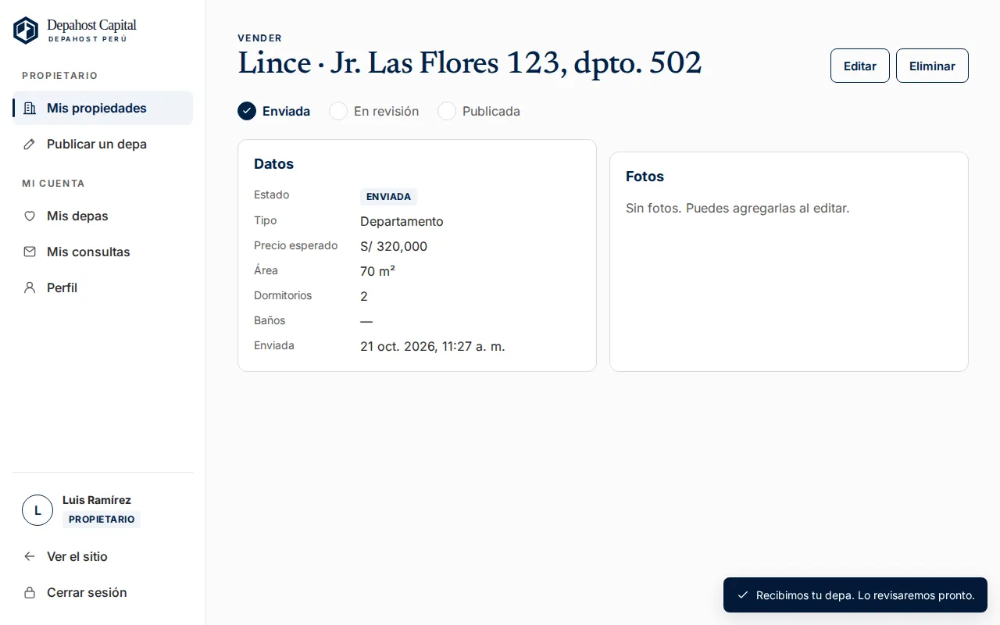

**Casos especiales.**

- **Sin captcha.** El formulario no pide captcha (Turnstile). Basta con tener la sesión iniciada.
- **No guarda borradores.** Si sales de la página o tocas "Cancelar", pierdes lo que escribiste.
- **Sesión vencida.** Si tu sesión venció mientras llenabas el formulario, aparece "Inicia sesión para continuar" y la solicitud no se guarda.
- **Sin conexión.** Aparece "No pudimos conectarnos. Revisa tu conexión e inténtalo otra vez."
- **Muchos intentos seguidos.** Si tocas "Enviar para revisión" más de 10 veces en un minuto desde la misma conexión, aunque algunos intentos hayan fallado, aparece "Rate limit exceeded, retry in 1 minute", en inglés. Espera un minuto. Las personas que usan la misma red comparten ese límite.
- **Cualquier otro error.** Aparece "Algo salió mal. Inténtalo otra vez."

### 8.4 Subir fotos

**Para qué sirve.** Sirve para mostrarle el depa al equipo. Si se publica, el equipo parte de estas fotos para armar la ficha del sitio.

**Qué puede hacer (pasos).**

1. En el bloque "Fotos", toca "Agregar fotos (JPG, PNG, WebP)".
2. Elige una o varias fotos.
3. Espera. Las fotos se suben de inmediato, una tras otra, y el botón dice "Subiendo…".
4. Cada foto subida aparece en una cuadrícula. La primera lleva la marca "Portada".
5. Para ordenarlas, usa "Subir" y "Bajar". Para sacar una, toca "Quitar". La foto que quede primera será la portada.
6. Si quieres, cambia la descripción de cada foto ("Describe la foto"). Viene escrita como "Depa en {distrito}", o "Depa en Lima" si aún no elegiste el distrito.

**Reglas y validaciones.**

| Regla | Detalle | Mensaje si falla |
|---|---|---|
| Tipo de archivo | JPG, PNG, WebP y también AVIF, aunque el botón no lo menciona. El selector solo muestra esos tipos. | Si se cuela otro tipo: "Revisa los datos enviados" |
| Tamaño | Ni el panel ni el API ponen un tamaño máximo por foto, y no la achican antes de subirla. Una foto pesada demora más. | No aplica |
| Cantidad | Hasta 20 fotos por solicitud. El selector te deja agregar más, pero se rechaza al enviar. | Al enviar: "Revisa los campos marcados.", sin campo marcado |
| Ritmo | Hasta 30 fotos por minuto desde la misma conexión | "Rate limit exceeded, retry in 1 minute" |
| Descripción | Hasta 300 caracteres por foto. Se revisa al enviar. | "Revisa los campos marcados.", sin campo marcado |
| Subida | Si falla una foto, se detiene el lote. Las fotos anteriores se quedan y las siguientes no se suben: vuelve a elegirlas. | "No se pudo subir la foto. Inténtalo otra vez." |

**Si la subida de fotos no está configurada.** Las fotos se guardan en Cloudflare R2, y eso exige configurar el API. Crear la cuenta de R2 figura en la lista de pendientes. Mientras no esté configurada:

- al elegir fotos aparece "La subida de fotos todavía no está disponible";
- puedes enviar la solicitud sin fotos y agregarlas después al editar, mientras siga "Enviada" o "No aprobada";
- el propietario no tiene la opción de pegar el enlace de una foto (esa opción es solo del equipo).

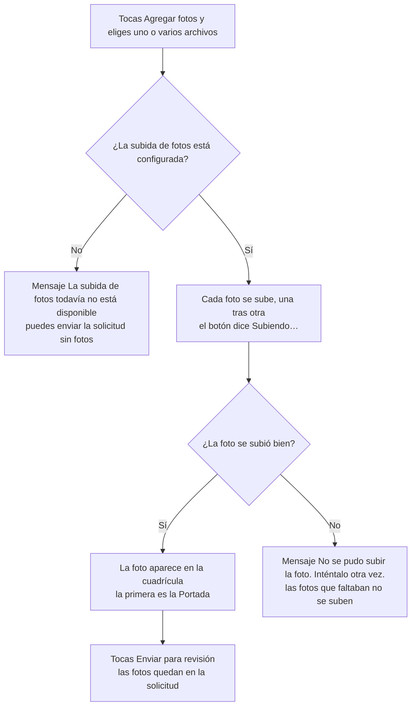

**Casos especiales.**

- **Espera a que termine "Subiendo…" antes de enviar.** El botón "Enviar para revisión" no se bloquea durante la subida. Una foto que termina de subir después del envío no entra en la solicitud.
- **Las fotos son públicas desde que se suben.** Cada foto recibe una dirección web pública apenas se sube, aunque nunca envíes la solicitud. "Quitar" solo la saca de la solicitud; no la borra del almacenamiento.
- **En el celular.** El botón abre el selector de archivos del teléfono.

### 8.5 El detalle de una solicitud


*Solicitud recién enviada.*

**Para qué sirve.** Sirve para seguir el avance de una solicitud, leer lo que dice el equipo y ver el interés que genera el depa publicado.

**Cómo se llega.** Hay tres formas:

- tocando una fila de "Mis propiedades";
- automáticamente, después de enviar o editar;
- desde el enlace de los correos de cambio de estado.

**Qué se ve.**

- **Encabezado.** Arriba dice lo que quieres hacer ("Vender", "Alquilar" u "Operar en Airbnb"). El título es "{Distrito} · {Dirección}". Al costado están los botones "Editar", que solo aparece en "Enviada" y "No aprobada", y "Eliminar", que aparece en todos los estados menos "Publicada".
- **Línea de avance** (en este orden):
  1. "Enviada": siempre marcada.
  2. "En revisión".
  3. "Publicada", o "No aprobada" en rojo con una X si el equipo no la aprobó.
- **Comentario del equipo.** Si el equipo dejó uno, aparece "Comentario del equipo:" con el texto (ver 8.7).
- **Si el depa ya está publicado.** Aparecen tres tarjetas: "Estado en el sitio", "Veces guardado" y "Consultas". Debajo está el botón "Ver mi depa en el sitio".
- **Bloque "Datos".** Muestra:
  - "Estado";
  - "Tipo";
  - "Precio esperado", o "Alquiler esperado" si elegiste alquilar u Airbnb;
  - "Área", "Dormitorios" y "Baños" (con "—" si no los pusiste);
  - "Enviada", con la fecha y la hora en que creaste la solicitud;
  - debajo, el texto de "Cuéntanos más".
- **Bloque "Fotos".** Muestra las miniaturas, o "Sin fotos. Puedes agregarlas al editar." si la solicitud no tiene fotos.

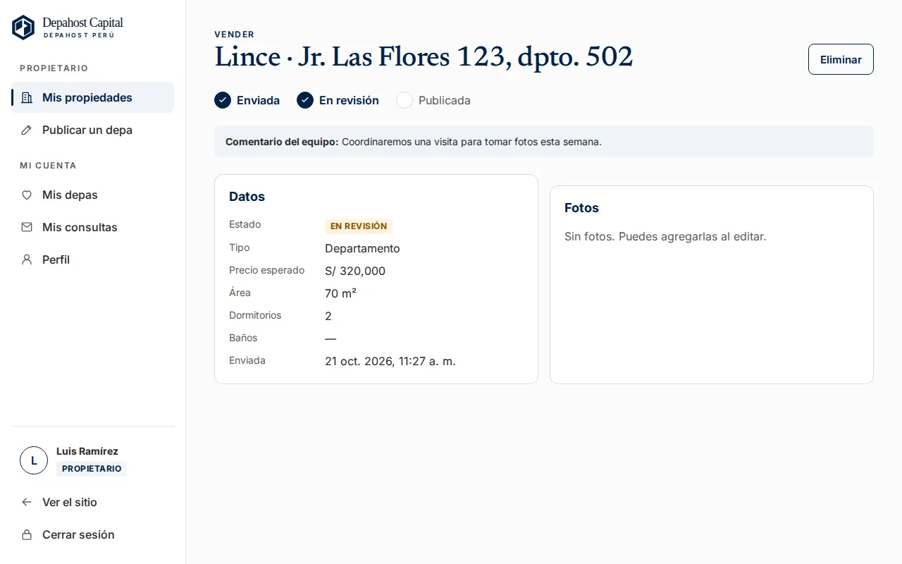

**Casos especiales.**

- **Enlace de una solicitud ajena o inexistente.** La pantalla se queda en "Cargando…". El panel no muestra el aviso de "no encontrado".
- **"Sin fotos. Puedes agregarlas al editar." en una solicitud que ya no se puede editar.** El texto aparece siempre que la solicitud no tiene fotos, también en "En revisión" y "Publicada". En esos estados no hay botón "Editar". Si abres la dirección de edición a mano, al guardar aparece "La solicitud ya está en revisión o publicada: escríbenos para cambiarla" (ver 8.8). Para sumar fotos en esos estados, habla con el equipo.
- **Fecha "Enviada".** No cambia aunque edites la solicitud. En la lista, "actualizado …" muestra el último cambio de la solicitud: tu edición o un cambio del equipo (estado, comentario o publicación).
- **"En revisión" marcado sin haber pasado por revisión.** Si el equipo publica o rechaza la solicitud sin pasarla antes a revisión, la línea de avance igual muestra "En revisión" marcado.

### 8.6 Estados de la solicitud


*Solicitud en revisión, con el comentario del equipo.*

En el panel, los estados se llaman "Enviada", "En revisión", "Publicada" y "No aprobada". En los correos dicen "en revisión", "aprobada y publicada" y "no aprobada".

| Estado | Qué significa para ti | ¿Puedes editarla? | ¿Puedes eliminarla? | ¿Te llega correo? |
|---|---|---|---|---|
| "Enviada" | La recibimos y espera que el equipo la revise | Sí | Sí | No |
| "En revisión" | El equipo la está evaluando | No | Sí | Sí, cuando pasa a este estado |
| "Publicada" | El equipo armó la ficha del depa con tus datos y la vinculó a tu solicitud | No | No | Sí |
| "No aprobada" | El equipo no la aprobó. El panel del equipo le pide escribir el motivo, así que normalmente verás un comentario y también te llegará en el correo | Sí; al guardar vuelve a "Enviada" | Sí | Sí |

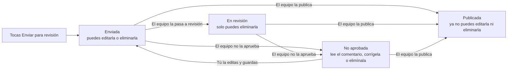

"Publicada" no siempre quiere decir que el depa ya se ve en el sitio (ver 8.7).

### 8.7 Comentario del equipo, depa publicado e interés

**Comentario del equipo.**

- Aparece como "Comentario del equipo:" seguido del texto.
- Se ve en rojo cuando la solicitud está "No aprobada" y en tono informativo en los demás estados.
- El equipo puede dejarlo o cambiarlo en cualquier momento sin cambiar el estado. En ese caso no te llega correo: solo lo ves en el panel.
- Si corriges una solicitud "No aprobada", el comentario sigue visible después de guardar.

**El depa publicado.**

Para publicarlo, el equipo arma la ficha del depa con tus datos: dirección, distrito, descripción, precio esperado, área, dormitorios, baños y fotos, en tu mismo orden. Luego completa lo que el formulario no pide, como la rentabilidad estimada, el plazo y la moneda. El equipo puede ajustar cualquier dato, también el precio. En el sitio, el depa aparece por defecto con la etiqueta "De propietario".

Cuando el equipo guarda la ficha, tu solicitud pasa a "Publicada" y te llega el correo, aunque la ficha haya quedado como borrador. Revisa la tarjeta "Estado en el sitio":

| "Estado en el sitio" | Qué significa | "Ver mi depa en el sitio" |
|---|---|---|
| "Publicado" | El depa se ve en el sitio | Abre la ficha (`/capital/…`) |
| "Reservado" | El depa sigue en el sitio, marcado como reservado | Abre la ficha |
| "Vendido" | El depa ya no aparece en el sitio | Muestra "No encontramos esta página" |
| "Borrador" | El equipo todavía no lo hizo visible | Muestra "No encontramos esta página" |

El sitio es estático y se reconstruye después de cada cambio. La ficha que se crea desde tu solicitud empieza como borrador. Si el equipo la guarda como visible, ve el aviso "Guardado. El sitio se actualizará en unos minutos."; si la deja como borrador, ve "Guardado como borrador" y tu depa no aparece en el sitio hasta que cambie su estado. Mientras el sitio se reconstruye, el enlace puede mostrar "No encontramos esta página".

La reconstrucción automática depende de configurar el *deploy hook*, que figura en la lista de pendientes. Si el equipo borra la ficha del depa, tu solicitud sigue "Publicada", pero sin tarjetas ni enlace, y no puedes editarla ni eliminarla.

**El interés que genera.** Solo ves números, no quién guardó o consultó. Del contacto se encarga el equipo.

| Tarjeta | Qué cuenta | Qué no cuenta |
|---|---|---|
| "Veces guardado" | Cuántas personas con cuenta tienen tu depa en su "Mis depas" (botón "Me interesa"). Si alguien lo quita, el número baja. | A quien lo guardó sin cuenta: su lista vive solo en su navegador. Cuenta cuando esa persona inicia sesión en el sitio y su lista se une a su cuenta. |
| "Consultas" | Cuántos pedidos de contacto registrados incluyen tu depa. Por ejemplo: alguien toca "Escribir por WhatsApp" en "Te acompañamos al proyecto" con tu depa elegido, o envía el formulario "Guarda tus depas" con tu depa en su lista. Cuentan también los visitantes sin cuenta. | Las consultas hechas mientras el sitio no está conectado al API |

**"Consultas" mide toques, no personas.** Cada toque en "Escribir por WhatsApp" de "Te acompañamos al proyecto" registra una consulta nueva, aunque sea la misma persona y aunque luego no escriba nada en WhatsApp. Si alguien toca el botón tres veces, tu depa suma tres consultas. Ese botón no pide cuenta ni captcha: basta con que el sitio esté conectado al API. El único freno es el límite de 10 consultas por minuto desde la misma conexión. Toma la cifra como una señal de interés, no como un número de interesados.

### 8.8 Editar o eliminar una solicitud

**Editar.**

1. Abre el detalle de la solicitud y toca "Editar". Solo aparece si está "Enviada" o "No aprobada".
2. Se abre "Editar mi depa" con tus datos cargados. Las reglas son las mismas de 8.3 y las fotos funcionan igual que en 8.4.
3. Toca "Guardar cambios". Mientras se guarda, el botón dice "Enviando…". Para salir sin guardar, toca "Cancelar" y vuelves al detalle.

Qué pasa después:

- Ves el aviso "Guardamos los cambios" y vuelves al detalle.
- La solicitud queda "Enviada", también si estaba "No aprobada".
- Al equipo no le llega correo: solo la ve otra vez como "Enviada" en su lista.

Si el equipo pasó la solicitud a revisión mientras tú la editabas, al guardar aparece "La solicitud ya está en revisión o publicada: escríbenos para cambiarla". Pasa lo mismo si abres la dirección de edición cuando la solicitud ya no se puede editar: el formulario se carga con tus datos, pero no deja guardar.

Si abres "Editar mi depa" con el enlace de una solicitud que no existe o que es de otra persona, ves el título "Editar mi depa" y debajo "Cargando…" para siempre, sin ningún mensaje de error. Vuelve a "Mis propiedades" y abre la solicitud desde la lista.

El panel no ofrece un botón ni un número para "escribirnos". Su configuración trae una variable para el WhatsApp con el valor de relleno 51XXXXXXXXX, pero hoy ninguna pantalla la usa. Del otro lado, el equipo puede escribirte por WhatsApp al celular de tu "Perfil", si lo registraste, o por correo.

**Eliminar (retirar la solicitud).**

1. En el detalle, toca "Eliminar".
2. Se abre la ventana "¿Eliminar la solicitud?" con el texto "Se borrará la solicitud de {dirección}. No se puede deshacer."
3. Toca "Eliminar" para confirmar. Si te arrepientes, toca "Cancelar", la X, la tecla Esc o fuera de la ventana.

Qué pasa después y límites:

- Ves el aviso "Eliminamos la solicitud" y vuelves a "Mis propiedades".
- Al equipo no le llega aviso: la solicitud simplemente desaparece de su lista.
- Puedes eliminar en "Enviada", "En revisión" y "No aprobada".
- En "Publicada" el botón no aparece, y el sistema lo rechaza ("Una solicitud publicada no se puede borrar"). Para retirar un depa publicado, habla con el equipo.
- Si la eliminación falla (por ejemplo, porque el equipo la publicó en ese momento), la ventana se queda abierta sin mensaje. Recarga la página.

### 8.9 Correos que recibe el propietario

| Cuándo | Quién lo recibe | Asunto |
|---|---|---|
| Envías una solicitud nueva | El equipo, en su correo de avisos | "Nueva solicitud de propietario · {distrito}" |
| El equipo la pasa a revisión | Tú | "Tu solicitud de {distrito} fue en revisión" |
| El equipo la publica | Tú | "Tu solicitud de {distrito} fue aprobada y publicada" |
| El equipo no la aprueba | Tú | "Tu solicitud de {distrito} fue no aprobada" |

- **Correo para el equipo.** Dice tu nombre y correo, qué quieres hacer, el tipo, la dirección y el distrito, y trae un enlace a su panel. Si el equipo responde ese correo, la respuesta te llega a ti.
- **Correos para ti.** Son de texto simple:
  - "Hola, {nombre}."
  - "Tu solicitud para {dirección}, {distrito}, ahora está {en revisión / aprobada y publicada / no aprobada}."
  - "Comentario del equipo: …", si hay comentario.
  - "Revisa el detalle en tu panel:" con el enlace a la solicitud. Si no tienes sesión, el enlace te pide ingresar y luego te lleva a la solicitud.
- **Asuntos literales.** "fue en revisión" y "fue no aprobada" salen así, tal cual.
- **Cuándo no te llega correo.**
  - cuando creas, editas o eliminas una solicitud;
  - cuando el equipo solo guarda un comentario;
  - cuando cambia el estado del depa en el sitio ("Reservado", "Vendido");
  - cuando suben las cifras de interés.
- **Depende de la configuración.**
  - Sin la clave de Resend, ningún correo se envía: solo queda registrado en el API.
  - El aviso al equipo necesita además un correo de avisos configurado.
  - Las dos cosas figuran en la lista de pendientes.
  - El remitente por defecto es "Depa Host Perú <no-reply@depahostperu.com>".

**Referencia técnica:**
- Panel: `depahost-panel/src/views/seller/RequestsView.vue`, `RequestFormView.vue`, `RequestDetailView.vue`, `src/components/PhotoUploader.vue`, `StatusBadge.vue`, `src/composables/labels.ts`, `useForm.ts`, `src/layouts/PanelLayout.vue`, `src/router/index.ts`, `access.ts`, `nav.ts`
- API: `depahost-api/src/modules/owner-requests/schema.ts`, `service.ts`, `routes.ts`, `src/modules/leads/routes.ts`, `src/modules/leads/service.ts`, `src/lib/storage.ts`, `src/lib/mailer.ts`, `src/app.ts`
- Sitio: `depahostcapital/src/pages/capital/empecemos.astro`
- Capítulos técnicos: [08-panel-y-cuentas.md § 5](08-panel-y-cuentas.md#5-solicitudes-de-propietarios), [05-flujos.md](05-flujos.md) y [07-decisiones-y-pendientes.md](07-decisiones-y-pendientes.md#pendientes)

## 9. Preguntas frecuentes

**1. ¿Necesito una cuenta para ver o guardar depas?**
No. Sin cuenta puedes buscar depas, abrir fichas, tocar "Me interesa", pedir acompañamiento y enviar formularios. La cuenta sirve para tener "Mis depas" en todos tus dispositivos, ver "Mis consultas" y, si eres propietario, publicar tu depa desde el panel. Ver [4.8](#48-qué-cambia-cuando-la-persona-tiene-cuenta) y [6.1](#61-para-qué-sirve-tener-cuenta).

**2. Guardé depas en mi celular y no los veo en mi computadora. ¿Por qué?**
Sin cuenta, "Mis depas" se guarda solo en el navegador donde tocaste "Me interesa". Para verlos en otro dispositivo, crea una cuenta, ingresa en los dos y abre cualquier página del sitio: tus listas se unen. Ver [4.2](#42-la-lista-mis-depas-sin-cuenta).

**3. ¿Cuántos depas puedo guardar?**
Hasta 20 en el navegador. Si guardas uno más, se quita el más antiguo, sin aviso. La cuenta admite hasta 50, pero el navegador siempre se queda con los 20 más recientes de la lista. Ver [4.1](#41-botón-me-interesa).

**4. ¿Cómo pido que me acompañen a comprar?**
Toca "Empecemos con estos" en "Mis depas", o "Contactar" en la ficha de un depa. En "Te acompañamos al proyecto", toca "Escribir por WhatsApp" y envía el mensaje que se abre ya escrito. El sitio no envía el mensaje por ti. Ver [4.7](#47-página-te-acompañamos).

**5. Toqué un botón de WhatsApp y no llegó a nadie. ¿Qué pasó?**
Hoy el número configurado es de relleno ("51XXXXXXXXX"), así que los botones no abren un chat real. Falta configurar el número real en producción. Ver [1.8](#18-botones-de-whatsapp).

**6. ¿Puedo reservar una estadía desde el sitio?**
Todavía no. "Estadías" es una página en construcción, aunque el inicio ofrezca "Reservar estadía". Por ahora la única forma de consultar es WhatsApp. Ver [1.10](#110-páginas-en-construcción-estadías-y-nosotros).

**7. Cerré el aviso "Guarda tus depas". ¿Vuelve a aparecer?**
Sí, pero no antes de 7 días, y solo cuando guardes otro depa y la lista tenga 2 o más. Si quieres abrirlo antes, toca "Guárdalos con tu celular" en "Mis depas". Si ya dejaste tus datos en ese navegador, no se vuelve a abrir solo. Ver [4.3](#43-aviso-guarda-tus-depas).

**8. Un enlace a un depa muestra "No encontramos esta página". ¿Por qué?**
Puede ser que el depa se haya vendido, que haya vuelto a borrador, que cambiara su dirección web, o que se haya publicado hace poco y el sitio todavía no se haya regenerado. Los depas reservados sí siguen teniendo su ficha. Ver [3.9](#39-depas-reservados-vendidos-y-enlaces-que-ya-no-existen).

**9. ¿Cómo creo una cuenta y cómo elijo si soy comprador o propietario?**
Toca "Ingresar" en el sitio y luego "Crea una gratis". Elige "Quiero invertir" para comprar o "Tengo un depa" para publicar. Después puedes cambiar el rol en "Perfil", en "Uso tu cuenta para". No llega correo de verificación ni de bienvenida. Ver [6.4](#64-crear-cuenta) y [6.7](#67-perfil).

**10. Olvidé mi contraseña. ¿Qué hago?**
En "Ingresa a tu cuenta", toca "¿La olvidaste?", escribe tu correo y abre el enlace que llega con el asunto "Restablece tu contraseña · DepaHost Capital". El enlace vence en 1 hora y sirve una sola vez. Al guardar la contraseña nueva se cierran todas tus sesiones. Si los correos no están configurados en ese entorno, el correo no llega. Ver [6.6](#66-olvidé-mi-contraseña).

**11. ¿Por qué me pide ingresar otra vez si uso el sitio todos los días?**
La sesión dura 30 días desde que ingresaste o desde tu último cambio de contraseña. Ese plazo no se alarga con el uso. Pasado ese tiempo, el sitio vuelve a mostrar "Ingresar". Ver [6.9](#69-cuánto-dura-la-sesión).

**12. Envié una consulta y no aparece en "Mis consultas". ¿Por qué?**
Solo aparecen las consultas enviadas con la sesión iniciada en ese navegador. Tampoco aparecen las conversaciones directas por WhatsApp, los reclamos, las consultas que no se registraron (por ejemplo, cuando el sitio no estaba conectado al API) ni lo que enviaste antes de crear la cuenta. Si la pantalla sale vacía, recárgala antes de concluir que no tienes consultas: un error de carga también la muestra vacía. Ver [7.3](#73-mis-consultas).

**13. Quité un depa en el panel y volvió a aparecer. ¿Por qué?**
Cuando abres el sitio con la sesión iniciada, el sitio suma a tu cuenta los depas que siguen guardados en ese navegador. Para quitarlo del todo, quítalo desde el sitio, en cada navegador donde lo tengas. Ver [7.2](#72-mis-depas-en-el-panel).

**14. Soy propietario. ¿Uso el formulario de Propietarios o "Publicar un depa"?**
El formulario de `/propietarios` es un contacto rápido, sin cuenta: el equipo te escribe por WhatsApp. "Publicar un depa" en el panel crea una solicitud con datos y fotos, que el equipo revisa y puedes seguir en "Mis propiedades". Ver [5.2](#52-propietarios-vender-o-poner-en-alquiler-propietarios) y [8.3](#83-publicar-un-depa-crear-la-solicitud).

**15. Mi solicitud dice "Publicada", pero no veo mi depa en el sitio. ¿Por qué?**
Revisa la tarjeta "Estado en el sitio" del detalle. Si dice "Borrador", el equipo todavía no lo hizo visible. Si dice "Publicado", espera a que el sitio se regenere: tarda al menos 30 segundos más lo que demore la generación, y si la regeneración automática no está configurada, depende de una publicación manual. Para registrar un reclamo, en cambio, usa el Libro de Reclamaciones: recibes un código LR y una respuesta en un plazo máximo de 15 días hábiles. Ver [8.7](#87-comentario-del-equipo-depa-publicado-e-interés) y [5.4](#54-libro-de-reclamaciones-libro-de-reclamaciones).

**Referencia técnica:** [05-flujos.md](05-flujos.md), [07-decisiones-y-pendientes.md](07-decisiones-y-pendientes.md), [08-panel-y-cuentas.md](08-panel-y-cuentas.md)

## 10. Escenarios de aceptación

Estos casos sirven para comprobar que el sitio y el panel se comportan como dice este manual. Cada fila es un escenario. Salvo que se diga otra cosa, se prueban en preproducción. Ahí el WhatsApp usa el número de relleno "51XXXXXXXXX", Clarity está vacío y la verificación anti-robots depende de la clave configurada. Si un escenario dice "sin API", el sitio se genera sin `PUBLIC_API_URL` y usa los datos de ejemplo.

### 10.1 Navegar el sitio (sección 1)

| ID | Dado | Cuando | Entonces |
|---|---|---|---|
| ESC-1.1 | Una persona sin sesión, en escritorio | Abre `/` | Ve el título "El depa en Lima, con la decisión correcta.", los botones "Reservar estadía", "Soy propietario" y "Comprar para rentabilizar", y tres tarjetas de servicios. La pestaña dice "Inicio \| Depa Host Perú" |
| ESC-1.2 | La home abierta | Toca "Comprar para rentabilizar" | Llega a `/capital` |
| ESC-1.3 | La home abierta | Toca "Reservar estadía", el botón o la tarjeta | Llega a `/estadias` y ve solo "Estadías" y "Página en construcción." |
| ESC-1.4 | La home abierta | Toca "Soy propietario" y luego "Vender mi propiedad" | Llega a `/propietarios#vender`. En "Qué quieres hacer" ya está elegido "Vender" |
| ESC-1.5 | La home abierta | Toca "Soy propietario" y luego "Poner en alquiler mi propiedad" | Llega a `/propietarios#alquiler`. En "Qué quieres hacer" ya está elegido "Alquilar (largo plazo)" |
| ESC-1.6 | El menú de "Soy propietario" abierto | Presiona Esc, toca fuera o toca otra vez "Soy propietario" | El menú se cierra sin navegar |
| ESC-1.7 | Una tarjeta de servicio en la home | Toca el texto de la tarjeta, no "Ver más →" | Navega igual a la página de esa tarjeta |
| ESC-1.8 | Cualquier página principal | Mira el menú del encabezado | La página actual aparece subrayada. En el detalle de un depa no se subraya "Capital" |
| ESC-1.9 | Navegación con teclado | Presiona Tab al cargar una página | Aparece "Saltar al contenido" y lleva directo al contenido |
| ESC-1.10 | Un navegador sin sesión y sin nombre en "Guarda tus depas", con `PUBLIC_PANEL_URL` configurada | Abre cualquier página en escritorio | No hay saludo. Se ve el candado con "Ingresar", que lleva a app.depahostperu.com/ingresar |
| ESC-1.11 | El sitio generado sin `PUBLIC_PANEL_URL` | Abre cualquier página, con sesión o sin ella | No aparecen nunca "Ingresar" ni "Ingresar a mi cuenta" |
| ESC-1.12 | Un navegador sin sesión que dejó el nombre "ana lucía" en "Guarda tus depas" | Abre una página en 1280 px | Ve "Hola, Ana" con el círculo "A" y también "Ingresar". El saludo lleva a `/mis-depas` del sitio |
| ESC-1.13 | Una sesión iniciada de comprador, con API y panel configurados | Abre una página y toca "Hola, …" | El saludo usa el nombre de la cuenta y "Ingresar" se oculta. Lleva a "Mis depas" del panel |
| ESC-1.14 | Una sesión iniciada de propietario | Toca el saludo | Lleva a "Mis propiedades" del panel |
| ESC-1.15 | Una sesión iniciada, con API pero sin `PUBLIC_PANEL_URL` | Toca el saludo | Muestra el nombre de la cuenta, pero lleva a `/mis-depas` del sitio |
| ESC-1.16 | Una sesión iniciada, en un teléfono de menos de 640 px | Revisa la barra y el menú de tres rayas | El saludo no aparece en ningún lado (pendiente conocido) |
| ESC-1.17 | Una sesión iniciada | La sesión vence o se cierra y se recarga la página | Desaparece el saludo de la cuenta y vuelve "Ingresar" |
| ESC-1.18 | Pantalla entre 1024 y 1279 px, sin sesión | Mira el encabezado | Se ve solo el candado, sin el texto "Ingresar". El saludo, si existe, es solo el círculo |
| ESC-1.19 | 0 depas guardados | Mira "Mis depas" del encabezado | No se ve ningún número |
| ESC-1.20 | Dos pestañas del sitio abiertas | Guarda un depa en una pestaña | El contador de "Mis depas" sube también en la otra |
| ESC-1.21 | Pantalla de menos de 1024 px | Toca "Abrir menú" | El panel entra por la derecha, el fondo se oscurece y no se puede desplazar la página de atrás. Muestra "Inicio", "Estadías", "Propietarios", "Capital", "Nosotros", "Ingresar a mi cuenta" (sin sesión), "ES \| EN" y "WhatsApp" |
| ESC-1.22 | El menú de tres rayas abierto | Toca la "✕", toca la zona oscura o presiona Esc | El menú se cierra y el scroll vuelve |
| ESC-1.23 | El menú abierto en una ventana angosta | Agranda la ventana a 1024 px o más | El menú se cierra solo |
| ESC-1.24 | El menú de tres rayas abierto | Pasa el mouse sobre "EN" y luego toca "ES" | "EN" no responde y muestra "Próximamente". "ES" recarga la misma página en español |
| ESC-1.25 | Un teléfono de menos de 640 px, en `/` o `/capital` | Carga la página y luego baja | El botón flotante de WhatsApp aparece recién al pasar la parte de arriba de la página |
| ESC-1.26 | Un teléfono, en `/propietarios` | Carga la página | El botón flotante se ve desde el principio. Se esconde al aparecer la franja azul del pie y al abrir el menú |
| ESC-1.27 | Cualquier página desde 640 px | Toca "Contactar" del encabezado | WhatsApp se abre en una pestaña nueva con "Hola, les escribo desde la web de Depa Host Perú." |
| ESC-1.28 | Cualquier página | Toca "Escribir por WhatsApp" del pie | WhatsApp se abre con "Hola, les cuento qué quiero hacer con mi depa." |
| ESC-1.29 | Preproducción | Abre cualquier enlace de WhatsApp del sitio | El enlace va al número "51XXXXXXXXX" |
| ESC-1.30 | El pie de página | Revisa la fila legal | Ve "Nosotros", "Política de privacidad", "Términos", "Libro de Reclamaciones", "RUC [pendiente]" y "Preferencias de cookies" |
| ESC-1.31 | Primera visita, con los datos del navegador limpios | Abre cualquier página | Aparece "Usamos cookies de analítica" con "Rechazar" y "Aceptar", sin botón de cerrar. La página se puede seguir usando |
| ESC-1.32 | El aviso de cookies visible | Navega a otra página sin elegir | El aviso aparece de nuevo |
| ESC-1.33 | El aviso de cookies visible, en producción | Toca "Aceptar" | El aviso se cierra y se carga Microsoft Clarity. En la siguiente visita no hay aviso y Clarity se carga solo |
| ESC-1.34 | El aviso de cookies visible | Toca "Rechazar" | El aviso se cierra, no se carga Clarity y no vuelve a salir |
| ESC-1.35 | Preproducción, con `PUBLIC_CLARITY_ID` vacío | Toca "Aceptar" | La elección se guarda, pero no se carga ninguna analítica |
| ESC-1.36 | Ya se eligió una opción | Toca "Preferencias de cookies" en el pie | El aviso vuelve a aparecer y se puede cambiar la elección |
| ESC-1.37 | Se aceptó antes y Clarity está activo | Cambia a "Rechazar" y luego abre otra página | En la página actual Clarity sigue cargado. En la siguiente ya no se carga |
| ESC-1.38 | Un navegador que bloquea el almacenamiento | Elige una opción y cambia de página | El aviso reaparece en cada página |
| ESC-1.39 | Cualquier dirección inexistente, por ejemplo `/xyz` | La abre | Ve "404", "No encontramos esta página", "Ver depas para invertir" (a `/capital`) e "Ir al inicio" (a `/`). La pestaña dice "Página no encontrada \| Depa Host Perú" |
| ESC-1.40 | Un enlace viejo a `/carrito` | Lo abre | Pasa solo a `/mis-depas` |
| ESC-1.41 | El pie de página | Toca "Política de privacidad" y "Términos" | Se ven los borradores con "Última actualización: [fecha pendiente]", "[Razón social pendiente]" y RUC "[pendiente]" |
| ESC-1.42 | El pie de página | Toca "Nosotros" | Ve "Nosotros" y "Página en construcción." |

### 10.2 Buscar depas en DepaHost Capital (sección 2)

Los ejemplos usan los datos de ejemplo: Lince S/ 310,000, Surquillo y Magdalena.

| ID | Dado | Cuando | Entonces |
|---|---|---|---|
| ESC-2.1 | Una persona sin cuenta | Abre `/capital` | La pestaña dice "Capital \| Depa Host Perú". Ve "Los mejores departamentos para invertir en Lima.", los pasos "Comparas", "Consultas", "Te acompañamos", "Cierras" y solo tarjetas "De propietario" |
| ESC-2.2 | El sitio sin API | Abre `/capital` | Ve 3 depas de propietarios (Lince, Surquillo, Magdalena), la franja con "Urbana" ("3 proyectos") y 4 inmobiliarias en gris |
| ESC-2.3 | La portada de Capital | Toca "Ver todos los proyectos" | La página baja hasta "Proyectos de aliados". No abre otra página |
| ESC-2.4 | Ningún depa en "Mis depas" | Toca "Empecemos" | Se abre `/capital/empecemos` con "Todavía no elegiste un depa. Marca **Me interesa** en los que te gusten o escríbenos y te ayudamos a elegir." |
| ESC-2.5 | La portada de Capital | Escribe "surq" en "Busca por distrito, dirección o precio" | Mientras escribe, queda solo Surquillo |
| ESC-2.6 | La portada de Capital | Busca "310000", "310,000", "310 000" o "S/ 310" | Cada vez aparece el depa de S/ 310,000 |
| ESC-2.7 | La portada de Capital | Busca "ejercito", sin tilde | Encuentra el depa de "Av. del Ejército" |
| ESC-2.8 | La portada de Capital | Busca "super precio" | Encuentra la tarjeta con la etiqueta "Súper precio" |
| ESC-2.9 | La portada de Capital | Busca un texto que no coincide con ningún depa | Se ocultan todas las tarjetas y aparece "No encontramos departamentos con esos criterios." |
| ESC-2.10 | El buscador con texto | Presiona Enter | La página no se recarga. En el celular se cierra el teclado |
| ESC-2.11 | Los datos de ejemplo | Revisa los chips | Ve "Lince", "Magdalena", "Surquillo", "Hasta S/ 300,000", "Desde 8% anual" y "Desde 9% anual". No ve "Hasta S/ 350,000" |
| ESC-2.12 | Ningún chip activo | Toca "Lince" | El chip se pinta de azul oscuro con una "x" y queda solo Lince. Aparece "Limpiar filtros" |
| ESC-2.13 | "Lince" activo | Toca "Magdalena" | Queda solo Magdalena. "Lince" se apaga |
| ESC-2.14 | La portada | Activa "Surquillo" y "Desde 9% anual" | Queda Surquillo |
| ESC-2.15 | La portada | Escribe "Lince" y activa "Hasta S/ 300,000" | No queda ninguno. Aparece "No encontramos departamentos con esos criterios." |
| ESC-2.16 | Un depa de "7–9% anual" | Activa "Desde 8% anual" | Ese depa no aparece, porque se compara su mínimo |
| ESC-2.17 | Un chip activo | Lo toca otra vez | Se quita el filtro |
| ESC-2.18 | Un chip activo y texto en el buscador | Toca "Limpiar filtros" | Se apagan los chips, se borra el texto, vuelven todas las tarjetas, el cursor queda en el buscador y el botón se oculta |
| ESC-2.19 | Filtros aplicados | Recarga la página | Vuelven a verse todos los depas. La URL no cambió |
| ESC-2.20 | El sitio generado con un solo depa de propietario | Abre `/capital` | Solo aparece el chip de su distrito, sin chips de precio ni de rentabilidad |
| ESC-2.21 | Ningún depa de propietario publicado | Abre `/capital` | Aparece "No encontramos departamentos con esos criterios." al cargar y no hay chips |
| ESC-2.22 | JavaScript desactivado | Abre `/capital` | Se ven todas las tarjetas, pero el buscador, los chips y "Me interesa" no responden |
| ESC-2.23 | Una tarjeta de depa | Revisa su contenido | Ve "De propietario", el distrito, la dirección, "valor", "rentabilidad", "se paga en", "Me interesa" y "Ver más detalle". No tiene botón de contacto |
| ESC-2.24 | Un depa reservado | Mira su tarjeta en `/capital` | Ve "De propietario" y "Reservado" en lugar de la etiqueta comercial |
| ESC-2.25 | Un depa cargado en USD 90,000 | Mira su tarjeta y activa "Hasta S/ 300,000" | La tarjeta muestra "S/" y el depa pasa el chip |
| ESC-2.26 | Una tarjeta | Toca fuera de los botones o "Ver más detalle" | Abre `/capital/{slug}` |
| ESC-2.27 | Una tarjeta | Toca "Me interesa" y luego "Guardado" | Primero cambia a "Guardado" con el corazón relleno y el contador sube. Después vuelve a "Me interesa" y el contador baja |
| ESC-2.28 | 20 depas guardados | Guarda uno más | El contador sigue en 20. Sale el más antiguo, sin aviso |
| ESC-2.29 | Supuestos de cuota sin cargar | Mira la nota bajo las tarjetas | Ve "*Cuota estimada con tasa pizarra a [plazo] años y [X] % de inicial, al [fecha]. …" |
| ESC-2.30 | Un navegador sin historial ni depas guardados | Abre `/capital` | La fila "Para ti, según lo que has visto" no aparece |
| ESC-2.31 | Un navegador sin historial, en `/capital` | Toca "Me interesa" en una tarjeta | La fila no aparece hasta recargar |
| ESC-2.32 | Un navegador que ya abrió fichas | Abre `/capital` | Aparecen hasta 4 tarjetas chicas, sin "Me interesa" ni "Reservado". Ninguna está en "Mis depas" |
| ESC-2.33 | La fila "Para ti" visible | Toca "Me interesa" en una tarjeta de la lista | La fila se recalcula y el depa guardado no sale en ella |
| ESC-2.34 | Hay historial, pero falla la descarga del catálogo | Abre `/capital` | La fila no aparece y no se muestra ningún error |
| ESC-2.35 | La franja "Proyectos de aliados" con los datos de ejemplo | Toca "Urbana" y luego "Andes" | "Urbana" abre "Proyectos de Urbana". "Andes" está en gris y no responde |
| ESC-2.36 | Ninguna inmobiliaria registrada | Abre `/capital` y toca "Ver todos los proyectos" | La franja no aparece y el botón no hace nada |
| ESC-2.37 | Los datos de ejemplo (6 depas) | Mira la barra y el ranking | El título es "Los depas para invertir ahora". Debajo dice "Ordenados por rentabilidad anual estimada." |
| ESC-2.38 | Hay exactamente 10 depas publicados | Mira el ranking | El título es "Los 10 depas para invertir ahora" |
| ESC-2.39 | Hay un depa reservado | Revisa el ranking | El reservado no aparece |
| ESC-2.40 | El ranking visible | Toca el número o la rentabilidad de una fila | Abre el detalle de ese depa |
| ESC-2.41 | Un celular | Mira la barra del Top 10 | El botón dice "Ver →". En tablet y escritorio dice "Ver el top 10 →" |
| ESC-2.42 | Ningún depa publicado | Toca la barra del Top 10 | El ranking no aparece y tocar la barra no lleva a ningún lado |
| ESC-2.43 | Un celular de menos de 640 px | Abre `/capital` | Las tarjetas forman un carrusel horizontal. Hay 2 columnas en tablet y 3 desde 1024 px |

### 10.3 Ver un depa y los proyectos de una inmobiliaria (sección 3)

| ID | Dado | Cuando | Entonces |
|---|---|---|---|
| ESC-3.1 | Los datos de ejemplo | Abre `/capital/lince-av-arequipa-cuadra-12` | El título es "Lince · Av. Arequipa", la dirección "Av. Arequipa cuadra 12, Lince" y la etiqueta "De propietario · Súper precio". Ve "valor" con "Precio de compra", "rentabilidad" con "Estimada" y "se paga en" con "Plazo de inversión" |
| ESC-3.2 | La ficha de un depa de propietario | Revisa el bloque del aliado | Ve "Te acompaña", "DepaHost Capital" y "Plataforma inmobiliaria con enfoque en inversión accesible y de confianza.", sin enlace |
| ESC-3.3 | La ficha de un proyecto de Urbana | Revisa la miga de pan y el bloque | La miga es "Capital" › "Urbana" › distrito. Ve "Aliado del proyecto", "Inmobiliaria aliada de DepaHost Capital." y "Ver sus 3 proyectos". La nota de "valor" dice "Precio desde" |
| ESC-3.4 | Una inmobiliaria con un solo proyecto | Abre la ficha de ese proyecto | No aparece "Ver sus N proyectos". El nombre de la miga lleva a su página |
| ESC-3.5 | Un proyecto reservado de Urbana | Abre su ficha | La etiqueta es "Reservado · De proyecto · Urbana", sin insignia. "Me interesa" y "Contactar" funcionan |
| ESC-3.6 | Un depa vendido o en borrador | Abre su `/capital/{slug}` | Ve la página 404 |
| ESC-3.7 | El equipo cambió el slug de un depa | Abre el enlace con el slug antiguo | Ve la 404, sin redirección |
| ESC-3.8 | Un depa sin dormitorios, baños ni m² | Abre su ficha | No aparece la fila de características |
| ESC-3.9 | Un depa con solo los m² cargados | Abre su ficha | Los m² salen con el ícono de cama (observación conocida) |
| ESC-3.10 | Un depa sin fotos | Abre su ficha | Ve un recuadro con el dibujo de una casa |
| ESC-3.11 | Un depa con varias fotos | Toca una miniatura | No se abre ningún visor |
| ESC-3.12 | Un depa en dólares | Mira la ficha, la tarjeta de `/capital` y el Top 10 | La ficha muestra "US$". La tarjeta de `/capital` y el Top 10 muestran "S/" |
| ESC-3.13 | Cualquier ficha | Revisa el aviso | Ve "Renta estimada. No constituye una garantía de rentabilidad futura." |
| ESC-3.14 | Una ficha sin "Mis depas" | Toca "Me interesa" y luego "Guardado" | Primero cambia a "Guardado" y el contador sube. Después vuelve a "Me interesa" |
| ESC-3.15 | Una ficha, con 2 depas en "Mis depas" | Toca "Contactar" | Se abre `/capital/empecemos?depa={slug}` con "Departamento seleccionado", solo ese depa y "… ideal en {distrito}." |
| ESC-3.16 | La página abierta desde "Contactar", con API | Toca "Escribir por WhatsApp" | WhatsApp se abre con "Hola, quiero que me acompañen con este depa:" y "- {Distrito} ({dirección}): {precio}". Se registra una consulta sin datos personales |
| ESC-3.17 | Una ficha | Revisa "Depas similares que te pueden interesar" | Hay hasta 4 tarjetas chicas sin "Me interesa". No está el mismo depa ni ningún vendido |
| ESC-3.18 | Un depa reservado entre los similares | Mira su tarjeta | No dice "Reservado" |
| ESC-3.19 | El sitio con un único depa visible | Abre su ficha | No aparece la sección de similares |
| ESC-3.20 | Un navegador limpio | Abre 13 fichas distintas | El historial guarda solo las últimas 12. No se envía nada al API |
| ESC-3.21 | Los datos de ejemplo | Abre `/capital/aliados/urbana` | Ve "Inmobiliaria aliada", "Proyectos de Urbana", "Departamentos en venta de esta inmobiliaria.", "3 proyectos encontrados" y ningún chip "Desde …% anual". La pestaña dice "Proyectos de Urbana \| Depa Host Perú" |
| ESC-3.22 | `/capital/aliados/urbana` | Escribe un texto que no coincide | Ve "No encontramos proyectos con esos criterios." y "0 proyectos encontrados" |
| ESC-3.23 | `/capital/aliados/urbana` | Busca "595000" o "S/ 595,000" | Encuentra el mismo proyecto |
| ESC-3.24 | Un proyecto en US$ 50,000 | Busca "US$ 50,000" y luego "50000" | La primera búsqueda no da resultados. La segunda sí |
| ESC-3.25 | La página de una inmobiliaria | Busca por una palabra de la descripción | No la encuentra |
| ESC-3.26 | La página con texto escrito | Toca "Buscar" o presiona Enter | Se aplica la búsqueda y en el celular se cierra el teclado |
| ESC-3.27 | La página con un chip activo y texto | Toca "Limpiar filtros" | Se borran el texto y los chips, el contador vuelve al total y el cursor queda en la caja |
| ESC-3.28 | Una inmobiliaria con más de 3 proyectos | Abre su página | Aparecen chips "Desde …% anual" |
| ESC-3.29 | Una inmobiliaria sin proyectos publicados ni reservados | Abre `/capital/aliados/{slug}` | Ve la 404 |
| ESC-3.30 | La página de una inmobiliaria | Toca "Volver a todos los depas" y "Aliados" de la miga | El primero lleva a la lista de `/capital`. El segundo, a la franja de aliados |
| ESC-3.31 | La inmobiliaria con web cargada | Toca "Sitio web de {nombre}" | Se abre en una pestaña nueva. Sin web cargada, el enlace no aparece |
| ESC-3.32 | Un proyecto reservado | Mira la página de su inmobiliaria | La tarjeta dice "Reservado" y cuenta en el contador |
| ESC-3.33 | Un depa publicado con regeneración automática | El equipo lo pasa a vendido | Al menos 30 segundos después, y una vez regenerado el sitio, la ficha da 404 y desaparece de las listas |
| ESC-3.34 | Una pantalla de menos de 480 px | Abre la página de una inmobiliaria | El botón "Buscar" muestra solo la palabra, sin ícono |

### 10.4 Guardar depas y pedir acompañamiento (sección 4)

| ID | Dado | Cuando | Entonces |
|---|---|---|---|
| ESC-4.1 | Un navegador limpio, sin sesión | Toca "Me interesa" en un depa | Cambia a "Guardado", el contador muestra 1 y no se abre ningún aviso |
| ESC-4.2 | 1 depa guardado y nunca se dejaron datos | Guarda un segundo depa | Se abre "Guarda tus depas" con "2 departamentos seleccionados: {distritos}" |
| ESC-4.3 | "Guarda tus depas" abierto | Toca la "X", "Seguir viendo", Esc o fuera | Se cierra, los depas siguen guardados y no vuelve a abrirse solo durante 7 días |
| ESC-4.4 | El aviso cerrado hace menos de 7 días | Guarda otro depa | No se abre el aviso |
| ESC-4.5 | El aviso en pausa | Toca "Guárdalos con tu celular" en `/mis-depas` | El aviso se abre igual |
| ESC-4.6 | El aviso abierto | Toca "Guardar y continuar" con "Nombre" vacío o la casilla sin marcar | El navegador avisa y no se envía nada |
| ESC-4.7 | El aviso abierto, con API | Envía "Celular" = "abc123" con lo demás válido | Ve "Revisa los campos marcados." y, bajo "Celular", "Teléfono inválido" |
| ESC-4.8 | El aviso abierto | Envía "Correo" = `ana@correo` | El navegador lo acepta y el servidor responde "Invalid email address" bajo "Correo" |
| ESC-4.9 | El aviso abierto | Envía "Nombre" = " a" | El servidor rechaza con "Too small: expected string to have >=2 characters" |
| ESC-4.10 | El aviso abierto, con API | Envía "ana lucía", un celular válido y la casilla marcada | El botón se bloquea con "Enviando…". Luego aparece "Listo, Ana" con "Guardamos tu selección. Te escribiremos por WhatsApp para darle seguimiento.", "Ver Mis depas" y "Seguir viendo" |
| ESC-4.11 | Un envío correcto de "Guarda tus depas" | Revisa el encabezado en 1280 px | Ve "Hola, Ana", que lleva a `/mis-depas`. El aviso no vuelve a abrirse solo en ese navegador |
| ESC-4.12 | Un envío correcto | El equipo revisa el panel de administración | Hay un lead nuevo de tipo "Guarda tus depas" con los depas de ese momento. Si el correo de avisos está configurado, llega "Nuevo lead · Guarda tus depas (lista de interés)" |
| ESC-4.13 | El sitio sin API | Toca "Guardar y continuar" | Ve "Por ahora recibimos estas consultas por WhatsApp." y "Escribir por WhatsApp", con "Hola, quiero que me ayuden con los depas que guardé en DepaHost Capital.". No se guarda el nombre |
| ESC-4.14 | El API caído o sin conexión | Envía el aviso | Ve "No pudimos enviar tus datos. Revisa tu conexión o escríbenos por WhatsApp." y el enlace "Escribir por WhatsApp" |
| ESC-4.15 | 10 envíos en un minuto desde la misma IP, contando "Te acompañamos" y otros formularios | Hace el envío 11 | Ve "Hiciste varios envíos seguidos. Espera un minuto e inténtalo otra vez.", sin enlace a WhatsApp |
| ESC-4.16 | El API exige Turnstile, pero el sitio no tiene la clave | Envía el aviso | Ve "No pudimos verificar que no eres un robot. Recarga la página e inténtalo otra vez." y "Escribir por WhatsApp" |
| ESC-4.17 | 3 depas guardados, uno de ellos ya vendido, sin haber abierto `/mis-depas` | Se abre el aviso | El resumen dice "3 departamentos seleccionados" y nombra solo los distritos que siguen en el catálogo |
| ESC-4.18 | Lista vacía | Abre `/mis-depas` | Ve "Aún no guardaste departamentos. Toca Me interesa en los que te gusten." con "Explorar departamentos". "Empecemos con estos" está apagado |
| ESC-4.19 | Un depa de S/ 310,000 y otro de S/ 285,000 guardados | Abre `/mis-depas` | El resumen muestra "Inversión total" "S/ 595,000" |
| ESC-4.20 | Solo depas en dólares | Abre `/mis-depas` | La inversión total sale como "S/ 0 + US$ 80,000" |
| ESC-4.21 | Un depa vendido en la lista | Abre `/mis-depas` | Se quita solo, sin aviso, y el contador del encabezado se corrige. Un reservado se queda con "Reservado" |
| ESC-4.22 | `/mis-depas` con depas | Toca la "X" de una tarjeta | Se quita sin confirmación. "Parecidos a los que guardaste" se recalcula |
| ESC-4.23 | Sin datos dejados en el aviso | Mira la nota final de `/mis-depas` | Ve "Guardado en este dispositivo. Guárdalos con tu celular y te escribimos con los que marcaste." |
| ESC-4.24 | Datos dejados como "Ana" | Mira la nota final | Ve "Guardado para Ana. La próxima vez te mostramos depas parecidos." y no aparece "Guárdalos con tu celular" |
| ESC-4.25 | Falla la descarga del catálogo | Abre `/mis-depas` | Ve "No pudimos cargar tus depas guardados. Recarga la página." |
| ESC-4.26 | 2 depas en "Mis depas" | Toca "Empecemos con estos" | Ve "2 departamentos seleccionados", los pasos "Entramos juntos", "Coordinamos la visita", "Cierras la compra" y "Cambiar selección". No se registra nada |
| ESC-4.27 | 2 depas elegidos, con API | Toca "Escribir por WhatsApp" | WhatsApp se abre con "Hola, quiero que me acompañen con estos depas:" y una línea por depa. Se registra una solicitud "Te acompañamos" sin nombre ni teléfono, que no genera correo al equipo |
| ESC-4.28 | Ningún depa elegido | Abre `/capital/empecemos` y toca "Escribir por WhatsApp" | Ve "Departamento seleccionado", "Todavía no elegiste un depa…", "Ver depas" y "Cambiar selección". WhatsApp se abre con "Hola, quiero invertir en un depa en Lima y me gustaría que me acompañen." y no se registra nada |
| ESC-4.29 | El sitio sin API | Toca "Escribir por WhatsApp" con depas | WhatsApp se abre igual y no se registra nada |
| ESC-4.30 | Falla la descarga del catálogo | Abre `/capital/empecemos` | La tarjeta queda con "Departamento seleccionado" y "Cambiar selección", sin el aviso ni "Ver depas". WhatsApp usa el mensaje general |
| ESC-4.31 | El enlace `?depa=` de un depa ya no publicado | Abre la página | Muestra los depas de "Mis depas" |
| ESC-4.32 | "Te acompañamos" abierta | Guarda otro depa en otra pestaña | La página no cambia hasta recargarla |
| ESC-4.33 | Una sesión iniciada con 2 depas en la cuenta y 1 distinto en el navegador | Abre una página del sitio | Los 3 quedan en el navegador y en la cuenta, primero los de la cuenta |
| ESC-4.34 | Una sesión iniciada | Toca "Me interesa" en el sitio | En menos de un segundo, el depa aparece en "Mis depas" del panel |
| ESC-4.35 | Una sesión iniciada, con un depa guardado en el navegador | Lo quita en el panel y luego abre el sitio en ese navegador | El depa vuelve a la cuenta |
| ESC-4.36 | La cuenta con 15 depas y el navegador con 10 distintos | Abre el sitio con sesión | La cuenta guarda los 25 y el navegador se queda con los 20 últimos. Con el siguiente cambio en el sitio, la cuenta baja a esos 20 |
| ESC-4.37 | La lista unida pasa de 50 | Abre el sitio con sesión | La cuenta no cambia y no hay aviso. El navegador se queda con 20 |
| ESC-4.38 | Una sesión iniciada, sin datos en el aviso y con 2 o más depas en la cuenta | Abre el sitio en un dispositivo nuevo | Puede abrirse "Guarda tus depas" igual |

### 10.5 Formularios (sección 5)

| ID | Dado | Cuando | Entonces |
|---|---|---|---|
| ESC-5.1 | `/propietarios` | Toca "Quiero vender" | Queda elegido "Vender" y el cursor pasa a "Nombre". "Poner en alquiler" elige "Alquilar (largo plazo)" |
| ESC-5.2 | El formulario de Propietarios | Elige "Vender" y luego "Operarlo en Airbnb" | El campo de precio cambia de "Precio esperado" a "Alquiler mensual esperado" |
| ESC-5.3 | El formulario de Propietarios | Envía sin "Distrito", "Tipo" o la casilla de privacidad | El navegador marca el primer campo con problema y no envía nada |
| ESC-5.4 | El formulario de Propietarios, con API | Envía "Celular" = "abc" con lo demás válido | El campo queda con borde rojo y "Teléfono inválido", y aparece "Revisa los campos marcados." |
| ESC-5.5 | El formulario de Propietarios | Escribe letras en el precio | El navegador no deja enviar |
| ESC-5.6 | El formulario de Propietarios, con API | Envía datos válidos | El botón se bloquea con "Enviando…". Luego aparece "¡Listo! Te escribimos por WhatsApp para concretar." con "Adelantar por WhatsApp" y el formulario se vacía |
| ESC-5.7 | El éxito anterior con "Ana", "Vender" y "Lince" | Toca "Adelantar por WhatsApp" | El mensaje es "Hola, soy Ana. Quiero vender mi depa en Lince." |
| ESC-5.8 | Un envío correcto con "Vender" | El equipo revisa | Llega "Nuevo lead · Propietario: vender". En "Leads" sale como "Quiero vender mi depa", "Sin contactar". La persona no recibe correo |
| ESC-5.9 | Un envío con "Operarlo en Airbnb" | El equipo revisa | El lead es de alquiler: "Propietario: alquilar" / "Quiero alquilar mi depa" |
| ESC-5.10 | El formulario de Propietarios | Envía el precio "250.000" | Se guarda 250 |
| ESC-5.11 | Un envío correcto con Turnstile activo | Envía otra vez sin recargar | Puede fallar con "No pudimos verificar que no eres un robot…". El recuadro se reinicia tras el error |
| ESC-5.12 | El sitio sin API | Envía Propietarios | Ve "Por ahora recibimos estas consultas por WhatsApp." y "Escribir por WhatsApp", con el mensaje armado. No se guarda nada |
| ESC-5.13 | Una prueba automatizada | Llena el campo oculto "Sitio web" y envía | El sitio muestra éxito, pero no se guarda nada ni se avisa al equipo |
| ESC-5.14 | Una sesión iniciada | Envía Propietarios | Aparece en "Mis consultas" del panel como "Quiero vender mi depa" o "Quiero alquilar mi depa", con estado "Nuevo" |
| ESC-5.15 | El origen del sitio no está en la lista de orígenes del API | Envía cualquier formulario | Ve "No pudimos enviar tus datos. Revisa tu conexión o escríbenos por WhatsApp." y no se guarda nada |
| ESC-5.16 | El formulario en inglés de `/capital`, con API | Envía "Jane", "jane@email.com", "50000" y la casilla marcada | Aparece "Sending…" y luego "Thanks! We got your details and will contact you soon." con "Message us on WhatsApp", que trae "Hi, I'm Jane. I'd like to invest in Lima with about USD 50,000." |
| ESC-5.17 | El formulario en inglés | Envía el monto vacío | El mensaje de WhatsApp es "Hi, I'm Jane. I'd like to invest in Lima." |
| ESC-5.18 | El formulario en inglés | Envía el monto "50,000" | Se guarda 50000, pero el enlace de WhatsApp dice "USD NaN" (comportamiento actual) |
| ESC-5.19 | El formulario en inglés | Envía "50.5" | El API responde "Invalid input: expected int, received number" y aparece "Please check the highlighted fields." |
| ESC-5.20 | El formulario en inglés | Envía 200000000 | El API responde "Too big: expected number to be <=100000000" |
| ESC-5.21 | El formulario en inglés sin API | Lo envía | Ve "For now we take these requests on WhatsApp." y "Message us on WhatsApp" |
| ESC-5.22 | Un envío correcto del formulario en inglés | El equipo revisa | Llega "Nuevo lead · Formulario en inglés (Capital)" con "Monto inicial: USD …". En el panel sale como "Formulario para inversionistas" |
| ESC-5.23 | `/libro-de-reclamaciones` | Abre la página | Ve "[Razón social pendiente]", "[pendiente]", "[Dirección fiscal pendiente]", los bloques 1 a 3, "Reclamo" marcado, "DNI" y "Servicio" elegidos, y "Enviar reclamo" |
| ESC-5.24 | El Libro | Marca "Soy menor de edad" | Aparece "Nombre del padre, madre o apoderado". Si se desmarca, se oculta y no se envía |
| ESC-5.25 | El Libro con "Soy menor de edad" marcado | Envía el apoderado con 1 letra | El API responde "Too small: expected string to have >=2 characters" |
| ESC-5.26 | El Libro | Envía el "Número de documento" "12-34", de menos de 6 caracteres | El navegador lo frena. En el API: "Número de documento inválido" |
| ESC-5.27 | El Libro | Envía "Monto reclamado (S/)" = 10.555 o un negativo | El navegador no deja enviar |
| ESC-5.28 | El Libro | Escribe más de 3000 caracteres en "Detalle" | El cuadro no deja escribir más |
| ESC-5.29 | El Libro, con API, el miércoles 21 de octubre de 2026 (hora de Lima) | Envía un reclamo válido | Desaparece el formulario. Ve "Recibimos tu reclamo", "Código: LR-2026-NNNNNN", "Te responderemos a más tardar el 11 de noviembre de 2026.", "Enviamos una copia de esta hoja a tu correo." e "Imprimir constancia" |
| ESC-5.30 | Un reclamo registrado el sábado 24 de octubre de 2026 | Revisa la fecha límite | Es el 13 de noviembre de 2026 |
| ESC-5.31 | El Libro con "Queja" elegida | Envía | El botón seguía diciendo "Enviar reclamo". La constancia dice "Recibimos tu queja" y el correo "Constancia de queja…" |
| ESC-5.32 | Un reclamo registrado, con correo configurado | Revisa el correo | Llega "Constancia de reclamo LR-… · Depa Host Perú", con el equipo como destinatario en el mismo correo |
| ESC-5.33 | El correo apagado | Envía un reclamo | Se registra y muestra código y fecha, pero no llega ningún correo |
| ESC-5.34 | El Libro sin API | Lo envía | Ve "Por ahora recibimos estas consultas por WhatsApp." con "Hola, quiero registrar un reclamo en el Libro de Reclamaciones.". No hay código |
| ESC-5.35 | 5 envíos del Libro en un minuto desde la misma IP | Hace el sexto | Ve "Hiciste varios envíos seguidos. Espera un minuto e inténtalo otra vez." |
| ESC-5.36 | El campo oculto lleno en el Libro | Envía | El código termina en 000000 y no se guarda nada |
| ESC-5.37 | Una sesión iniciada | Envía un reclamo | No aparece en "Mis consultas" |
| ESC-5.38 | Un reclamo pendiente | El administrador responde con menos de 10 caracteres y luego con un texto válido ("Enviar respuesta por correo") | El texto corto no se acepta. Con el válido, el consumidor recibe "Respuesta a tu reclamo LR-… · Depa Host Perú" y el estado pasa a "Respondido" |

### 10.6 Cuenta, ingreso y sesión (sección 6)

| ID | Dado | Cuando | Entonces |
|---|---|---|---|
| ESC-6.1 | Una persona sin sesión | Abre `/registro` | Ve "Crea tu cuenta", "Quiero invertir" ya elegido, "Tengo un depa", "Celular" con "opcional" y "Al menos 10 caracteres." |
| ESC-6.2 | El formulario de registro | Toca "Crear cuenta" sin marcar la privacidad | Ve "Debes aceptar la política de privacidad" y nada más. Turnstile no se reinicia |
| ESC-6.3 | El formulario de registro | Envía "Nombre" = "A" | Ve "Too small: expected string to have >=2 characters" |
| ESC-6.4 | El formulario de registro | Envía una contraseña de 9 caracteres | Ve "La contraseña debe tener al menos 10 caracteres" |
| ESC-6.5 | El formulario de registro | Envía el celular "abc" | Ve "Teléfono inválido". "((((((" se acepta |
| ESC-6.6 | Un correo ya registrado | Se registra con él | Ve "Ya existe una cuenta con ese correo. Inicia sesión o recupera tu contraseña." |
| ESC-6.7 | Datos válidos con "Quiero invertir" | Toca "Crear cuenta" | El botón dice "Creando tu cuenta…" y llega a "Mis depas" con la sesión iniciada. No llega correo. En la lista de usuarios, "Último ingreso" dice "Nunca" |
| ESC-6.8 | Datos válidos con "Tengo un depa" | Crea la cuenta | Llega a "Mis propiedades" |
| ESC-6.9 | 5 registros en un minuto desde la misma IP | Hace el sexto | Ve "Rate limit exceeded, retry in …" |
| ESC-6.10 | El API exige Turnstile y el panel no tiene la clave | Intenta registrarse | Ve "No pudimos verificar que no eres un robot. Recarga la página e inténtalo otra vez." |
| ESC-6.11 | Una cuenta existente | Ingresa en `/ingresar` con "ANA@Correo.com " | Funciona: no importan las mayúsculas ni los espacios del correo |
| ESC-6.12 | `/ingresar` | Envía una contraseña incorrecta o un correo sin cuenta | Las dos veces ve "Correo o contraseña incorrectos" |
| ESC-6.13 | `/ingresar` | Envía la contraseña vacía | Ve solo "Revisa los campos marcados.", sin mensaje bajo el campo |
| ESC-6.14 | 10 intentos de ingreso en un minuto | Hace el 11 | Ve "Rate limit exceeded, retry in …". La cuenta no se bloquea |
| ESC-6.15 | Un comprador sin sesión | Abre `/mis-consultas` e ingresa | Vuelve a "Mis consultas" |
| ESC-6.16 | Un comprador sin sesión | Abre `/mis-propiedades` e ingresa | Va a "Mis depas" |
| ESC-6.17 | Sin sesión | Abre la raíz del panel e ingresa | Va a su inicio, sin recordar la raíz |
| ESC-6.18 | Una sesión iniciada | Abre `/ingresar`, `/registro` o `/recuperar` | Va directo a su inicio |
| ESC-6.19 | Una dirección del panel inexistente | La abre, con sesión o sin ella | Ve "No encontramos esta página" e "Ir a mi cuenta" |
| ESC-6.20 | `/recuperar` | Envía un correo con cuenta y otro sin cuenta | Ve las dos veces "Si existe una cuenta con {correo}, te llegará un correo con el enlace. Vence en 1 hora." |
| ESC-6.21 | Resend configurado | Pide el enlace | Llega "Restablece tu contraseña · DepaHost Capital" |
| ESC-6.22 | Un enlace de restablecimiento válido | Guarda una contraseña nueva de 10 caracteres o más | Ve "Listo. Ya puedes ingresar con tu contraseña nueva.". Se cierran todas las sesiones, también la del sitio |
| ESC-6.23 | Un enlace ya usado o de más de 1 hora | Lo abre y guarda | Ve "El enlace venció o ya se usó. Pide uno nuevo." |
| ESC-6.24 | `/restablecer` sin código | Lo abre | Ve "El enlace está incompleto. Pide uno nuevo." y no hay formulario |
| ESC-6.25 | Dos enlaces pedidos seguidos | Usa el primero | Funciona: pedir otro no anula el anterior |
| ESC-6.26 | `/perfil` | Cambia el nombre y toca "Guardar" | Ve "Guardamos tus datos", que se va a los 4 segundos. El menú se actualiza y el saludo del sitio cambia en la próxima página |
| ESC-6.27 | `/perfil` | Revisa el campo "Correo" | No es editable y dice "Para cambiar tu correo, escríbenos." |
| ESC-6.28 | Un comprador en `/perfil` | Elige "Vender o alquilar mi depa" y guarda | Va a "Mis propiedades" y el menú muestra la sección "Propietario" |
| ESC-6.29 | `/perfil` | Cambia la contraseña con una "Contraseña actual" incorrecta | Ve "La contraseña actual no es correcta" |
| ESC-6.30 | Sesiones en dos navegadores | Cambia la contraseña en uno | Ve "Cambiaste tu contraseña. Cerramos tus otras sesiones." y los campos se vacían. Ese navegador sigue dentro y el otro queda fuera |
| ESC-6.31 | Una sesión iniciada | Toca "Cerrar sesión" en el menú o en "Perfil" | Sin confirmación, vuelve a "Ingresa a tu cuenta". Al recargar el sitio aparece "Ingresar" |
| ESC-6.32 | Se cerró sesión, pero antes se dejó un nombre en "Guarda tus depas" | Recarga el sitio | Ve "Hola, {ese nombre}" junto a "Ingresar". El saludo lleva a `/mis-depas` |
| ESC-6.33 | Una sesión vencida con el panel abierto | Guarda algo en "Perfil" | Ve "Inicia sesión para continuar" |
| ESC-6.34 | Un panel menor de 960 px | Abre `/ingresar` | Solo se ve el formulario, y el logo lleva al panel |
| ESC-6.35 | Un navegador sin la marca de sesión | Abre el sitio | No se consulta al API por la sesión |

### 10.7 El panel del comprador (sección 7)

| ID | Dado | Cuando | Entonces |
|---|---|---|---|
| ESC-7.1 | Un comprador con sesión | Abre el panel | Llega a "Mis depas". El menú tiene solo "Mi cuenta" ("Mis depas", "Mis consultas", "Perfil"), la etiqueta "Comprador", "Ver el sitio" y "Cerrar sesión". La pestaña dice "Mis depas · DepaHost Capital" |
| ESC-7.2 | El panel en un celular | Toca la opción de la pantalla actual en el menú | El menú sigue abierto hasta tocar la X, tocar fuera o presionar Esc |
| ESC-7.3 | El panel con la dirección del sitio configurada | Toca "Ver el sitio" | Va a la página Capital del sitio |
| ESC-7.4 | El panel sin la dirección del sitio configurada | Revisa el menú y toca "Explorar depas" | "Ver el sitio" no aparece. "Explorar depas" abre "No encontramos esta página" del panel |
| ESC-7.5 | La cuenta sin depas | Abre "Mis depas" | Ve "Aún no guardaste departamentos", "Toca Me interesa en los depas del sitio y aparecerán aquí, en cualquier dispositivo." y "Ver depas para invertir" |
| ESC-7.6 | La cuenta con depas | Abre "Mis depas" | Ve una tarjeta por depa (el más antiguo arriba), con "Ver en el sitio", "Desde" o "Valor", y el "Resumen" con "{n} seleccionados" y "Inversión total" |
| ESC-7.7 | La cuenta con un solo depa | Mira el Resumen | Dice "1 seleccionados" |
| ESC-7.8 | Solo depas en dólares | Mira la "Inversión total" | Dice solo "USD 80,000". El sitio dice "S/ 0 + USD 80,000" |
| ESC-7.9 | El primer depa de la lista en dólares y otro en soles | Mira la "Inversión total" | Dice "USD … + S/ …" |
| ESC-7.10 | La lista con depas | Toca la X de uno | Sale sin confirmación y aparece "Quitaste {distrito}" |
| ESC-7.11 | La sesión vencida | Toca la X | El depa se queda y no aparece "Quitaste…" |
| ESC-7.12 | La sesión vencida | Abre "Mis depas" | Ve "No pudimos cargar tus depas." |
| ESC-7.13 | Un depa reservado en la cuenta | Lo mira en el panel | Aparece sin marca de reservado |
| ESC-7.14 | Un depa vendido en la cuenta | Abre "Mis depas" | No aparece ni entra en el total |
| ESC-7.15 | La lista con depas | Toca "Empecemos con estos" | Se abre "Te acompañamos al proyecto" del sitio con los depas de ese navegador |
| ESC-7.16 | Sin consultas | Abre "Mis consultas" | Ve "Todavía no nos escribiste", el texto "Cuando uses Empecemos o un formulario con tu sesión iniciada, verás aquí cada consulta." y "Empecemos" |
| ESC-7.17 | Una sesión iniciada | Toca "Escribir por WhatsApp" en "Te acompañamos" y abre "Mis consultas" | Hay una fila "Te acompañamos (WhatsApp)" arriba, con la fecha en hora de Lima, los distritos enlazados y "Nuevo" |
| ESC-7.18 | Una sesión iniciada | Toca "Escribir por WhatsApp" tres veces | Aparecen tres filas |
| ESC-7.19 | Un formulario enviado sin sesión | Luego crea la cuenta y abre "Mis consultas" | Esa consulta no aparece |
| ESC-7.20 | Una consulta con un depa ya vendido | Abre "Mis consultas" | La columna "Depas" dice "Ya no disponible" |
| ESC-7.21 | Una consulta sin depas, como la de Propietarios | Mira la columna "Depas" | Muestra "—" |
| ESC-7.22 | El equipo pasa un lead a "En conversación" | El comprador recarga "Mis consultas" | Ve "En conversación". No llega correo |
| ESC-7.23 | Un reclamo enviado con sesión | Abre "Mis consultas" | No aparece |
| ESC-7.24 | Un comprador con sesión | Abre `/mis-propiedades`, `/mis-propiedades/nueva` o `/admin` | Va a "Mis depas" sin mensaje |
| ESC-7.25 | Un comprador con sesión | Abre `/admin/algo-inexistente` | Ve la 404 del panel |
| ESC-7.26 | Un comprador | Pide datos de propietario o de administración directo al API | El API responde "No tienes permiso para esto" |

### 10.8 El panel del propietario (sección 8)

| ID | Dado | Cuando | Entonces |
|---|---|---|---|
| ESC-8.1 | Un propietario sin solicitudes | Ingresa | Llega a "Mis propiedades" y ve "Aún no publicaste ningún depa" y "Publicar mi depa". El menú tiene las secciones "Propietario" y "Mi cuenta" |
| ESC-8.2 | "Publicar un depa" | Abre la pantalla | "Vender" y "Departamento" vienen marcados. Están los bloques "¿Qué quieres hacer?", "Tu depa" y "Fotos" ("opcional") |
| ESC-8.3 | El formulario | Elige "Alquilar" | El precio pasa a llamarse "Alquiler mensual (S/)" |
| ESC-8.4 | El formulario | Envía sin distrito y con la dirección "ab" | Ve "Revisa los campos marcados.", "Too small: expected string to have >=2 characters" bajo "Distrito" y "Too small: expected string to have >=3 characters" bajo "Dirección" |
| ESC-8.5 | El formulario | Envía "Dormitorios" = 60 o un precio con decimales | Ve solo "Revisa los campos marcados.". El campo no se marca |
| ESC-8.6 | El formulario | Envía el precio "320.000" | Se guarda 320 |
| ESC-8.7 | Datos válidos | Toca "Enviar para revisión" | El botón dice "Enviando…". Luego aparece "Recibimos tu depa. Lo revisaremos pronto." y se abre el detalle en "Enviada". El equipo recibe "Nueva solicitud de propietario · {distrito}" y el propietario no recibe correo |
| ESC-8.8 | El formulario | Lo envía | No pide Turnstile |
| ESC-8.9 | 10 envíos en un minuto desde la misma IP | Hace el 11 | Ve "Rate limit exceeded, retry in 1 minute" |
| ESC-8.10 | R2 sin configurar | Elige fotos | Ve "La subida de fotos todavía no está disponible". Puede enviar sin fotos |
| ESC-8.11 | R2 configurado | Elige 3 fotos JPG | El botón dice "Subiendo…". Las fotos aparecen en la cuadrícula, la primera con "Portada" y la descripción "Depa en {distrito}" |
| ESC-8.12 | Fotos subidas | Toca "Bajar" en la portada | Otra foto pasa a ser "Portada" |
| ESC-8.13 | Una subida que falla en la segunda foto de un lote | Mira el resultado | Ve "No se pudo subir la foto. Inténtalo otra vez.". La primera se queda y las siguientes no se suben |
| ESC-8.14 | 21 fotos en la solicitud | Envía | Ve "Revisa los campos marcados.", sin campo marcado |
| ESC-8.15 | El formulario con datos | Toca "Cancelar" | Vuelve a "Mis propiedades" y no se guarda nada |
| ESC-8.16 | Una solicitud "Enviada" | Abre el detalle | Ve "Editar" y "Eliminar". En la línea de avance solo está marcado "Enviada". Si no hay fotos, dice "Sin fotos. Puedes agregarlas al editar." |
| ESC-8.17 | Una solicitud "Enviada" | La edita y toca "Guardar cambios" | Ve "Guardamos los cambios" y vuelve al detalle en "Enviada". El equipo no recibe correo |
| ESC-8.18 | El administrador pasa la solicitud a "En revisión" | El propietario revisa | Le llega "Tu solicitud de {distrito} fue en revisión". En el detalle no está "Editar", pero sí "Eliminar" |
| ESC-8.19 | Una solicitud "En revisión" | Abre la dirección `/editar` a mano y guarda | Ve "La solicitud ya está en revisión o publicada: escríbenos para cambiarla" |
| ESC-8.20 | El administrador la marca "No aprobada" con un comentario | El propietario abre el detalle | Ve "No aprobada" en rojo con X, "Comentario del equipo:" en rojo y "Editar". Le llega "Tu solicitud de {distrito} fue no aprobada" |
| ESC-8.21 | Una solicitud "No aprobada" | La edita y guarda | Vuelve a "Enviada" y el comentario sigue visible |
| ESC-8.22 | El administrador solo cambia el comentario | El propietario revisa | Ve el comentario nuevo y no le llega correo |
| ESC-8.23 | El administrador crea la ficha visible desde la solicitud | El propietario abre el detalle | Ve "Publicada", las tarjetas "Estado en el sitio" ("Publicado"), "Veces guardado" y "Consultas", y "Ver mi depa en el sitio". No están "Editar" ni "Eliminar". Le llega "Tu solicitud de {distrito} fue aprobada y publicada" |
| ESC-8.24 | La ficha guardada como borrador | El propietario revisa | La solicitud dice "Publicada", con "Estado en el sitio" "Borrador". "Ver mi depa en el sitio" da "No encontramos esta página" |
| ESC-8.25 | Un depa publicado | Una persona con sesión lo guarda y luego lo quita | "Veces guardado" sube 1 y después baja 1 |
| ESC-8.26 | Un depa publicado | Una persona sin sesión lo guarda | "Veces guardado" no cambia |
| ESC-8.27 | Un depa publicado, con el sitio conectado al API | Un visitante sin cuenta toca dos veces "Escribir por WhatsApp" con ese depa | "Consultas" sube 2 |
| ESC-8.28 | Una solicitud en "Enviada", "En revisión" o "No aprobada" | Toca "Eliminar" y confirma | Ve "¿Eliminar la solicitud?" y "Se borrará la solicitud de {dirección}. No se puede deshacer.". Al confirmar ve "Eliminamos la solicitud" y vuelve a la lista |
| ESC-8.29 | Una solicitud "Publicada" | Pide borrarla directo al API | El API responde "Una solicitud publicada no se puede borrar" |
| ESC-8.30 | La ventana de eliminar abierta | Toca "Cancelar", la X, Esc o fuera | La ventana se cierra y la solicitud sigue |
| ESC-8.31 | Un propietario | Abre `/mis-propiedades/{id}` de otra persona o de una solicitud que no existe | La pantalla se queda en "Cargando…", sin mensaje |
| ESC-8.32 | Solicitudes en varios estados | Abre "Mis propiedades" | "En revisión" suma las "Enviada" y las "En revisión". "Publicados" cuenta las "Publicada". La lista va de la más nueva a la más antigua, con etiquetas de acción y estado |
| ESC-8.33 | Una solicitud sin precio | Mira la fila | Dice "Precio por definir" |
| ESC-8.34 | Un propietario | Cambia a "Invertir en depas" en "Perfil" | Va a "Mis depas" y ya no ve "Mis propiedades". Al volver a "Vender o alquilar mi depa", las solicitudes siguen ahí |
| ESC-8.35 | Un propietario sin sesión | Abre el enlace del correo de cambio de estado | Pasa por "Ingresa a tu cuenta" y luego llega a esa solicitud |
| ESC-8.36 | Un propietario con sesión | Envía el formulario de `/propietarios` del sitio | No se crea una solicitud en "Mis propiedades". Aparece en "Mis consultas" |
