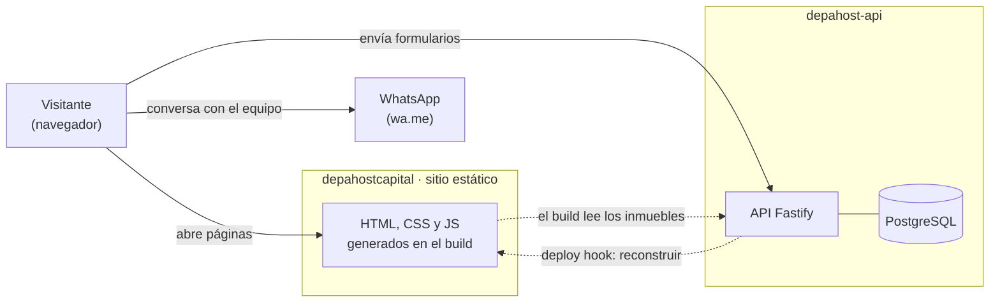

# Documentación de la plataforma Depa Host Perú

Esta carpeta explica **todo lo que hoy tiene la plataforma**: qué piezas la forman, cómo se
conectan, qué datos maneja y qué pasa, paso a paso, en cada flujo. Los diagramas están en UML,
escritos con [Mermaid](https://mermaid.js.org/). GitHub y VS Code (con la extensión
"Markdown Preview Mermaid Support") los muestran como imágenes.

> Estado descrito: 21 de octubre de 2026. Si cambias el código, actualiza el capítulo que
> corresponda en el mismo cambio.

## Cómo leer esta documentación

| Si quieres… | Lee |
|---|---|
| Entender la plataforma en 10 minutos | Este archivo y [01 · Arquitectura](01-arquitectura.md) |
| Saber qué hace cada página, componente y script del sitio | [02 · Frontend](02-frontend.md) |
| Conocer los endpoints, la seguridad y los servicios del API | [03 · API](03-api.md) |
| Ver las tablas, los esquemas y lo que se guarda en el navegador | [04 · Datos](04-datos.md) |
| Seguir cada flujo detalle a detalle | [05 · Flujos](05-flujos.md) |
| Conocer los entornos (desarrollo, preproducción y producción), levantarlos, probar y publicar | [06 · Desarrollo y operación](06-desarrollo-y-operacion.md) |
| Saber por qué se decidió cada cosa y qué falta | [07 · Decisiones y pendientes](07-decisiones-y-pendientes.md) |
| Entender las cuentas, los roles y el panel en Vue | [08 · Panel y cuentas](08-panel-y-cuentas.md) |
| Saber cómo usa la plataforma una persona común, pantalla por pantalla, con capturas, reglas, mensajes y escenarios de aceptación | [09 · Manual funcional del usuario](09-manual-funcional.md) |

## La plataforma en una página

Depa Host Perú (depahostperu.com) tiene tres líneas de negocio:

- **Estadías:** reservar un inmueble por días. Hoy es una página "en construcción".
- **Propietarios:** vender o alquilar un inmueble, en largo plazo o en Airbnb.
- **DepaHost Capital:** comprar inmuebles en Lima para que rindan. Es la parte más
  desarrollada: catálogo, inmobiliarias aliadas, recomendaciones y "Mis inmuebles".

Técnicamente son **tres repositorios** que se hablan por HTTP:

| Repo | Qué es | Tecnología |
|---|---|---|
| `depahostcapital` (este) | El sitio web: HTML estático generado en el build | Astro 7, TypeScript, CSS propio |
| `depahost-api` (carpeta hermana) | El backend: datos, cuentas, formularios y Libro de Reclamaciones | Fastify 5, TypeScript, PostgreSQL, Drizzle |
| `depahost-panel` (carpeta hermana) | El panel de comprador, propietario y administración | Vue 3, Vue Router, Pinia, Vite |

El contrato entre ellos es un archivo **OpenAPI** (`openapi.json`) que genera el API. El sitio y
el panel sacan de ahí sus tipos de TypeScript, así que si el API cambia, no compilan
hasta que se adapta.

**La idea central:** las páginas se generan una vez, en el build, con los datos del API. Lo que
depende de cada visitante se arma en su navegador: sus inmuebles guardados, sus recomendaciones,
su nombre. Los formularios van directo al API. Cuando el equipo publica o edita un inmueble, el
API pide al hosting que vuelva a construir el sitio. Quien crea una cuenta en el panel tiene su
sesión también en el sitio, y sus inmuebles guardados se sincronizan entre los dos.

## Glosario

| Término | Significado |
|---|---|
| **Inmueble de propietario** (`origin: owner`) | Inmueble que publica una persona dueña. Aparece en la portada de Capital. |
| **Proyecto** (`origin: developer`) | Inmueble de una inmobiliaria aliada. Aparece en la página de esa inmobiliaria. |
| **Inmobiliaria aliada** (`developer`) | Empresa con proyectos en el catálogo. Tiene su página `/capital/aliados/{slug}`. |
| **Mis inmuebles** | Lista de inmuebles que la persona marcó con "Me interesa". Vive en su navegador. |
| **Historial** | Últimos inmuebles que la persona abrió. Alimenta "Para ti, según lo que has visto". |
| **Lead** | Registro de interés que llega al API: formularios, "Guarda tus inmuebles" o "Empecemos". |
| **Reclamo / queja** | Registro del Libro de Reclamaciones, con código correlativo y plazo legal de respuesta. |
| **Build** | El momento en que Astro genera todas las páginas. Pasa al publicar y con cada deploy hook. |
| **Deploy hook** | URL secreta del hosting que, al llamarla, reconstruye el sitio. |
| **Contrato OpenAPI** | Descripción formal de todos los endpoints del API, en `openapi.json`. |
| **Slug** | Parte legible de una URL, por ejemplo `lince-av-arequipa-cuadra-12`. |
| **Turnstile** | Verificación anti-bots de Cloudflare en los formularios. |
| **Cuenta** | Usuario con rol comprador (`buyer`), propietario (`seller`) o administrador (`admin`). |
| **Sesión** | Cookie `dh_session` que el API entrega al ingresar; la comparten sitio, panel y API. |
| **Solicitud de propietario** | Inmueble que un propietario envía desde el panel; el equipo la revisa y la publica. |
| **Honeypot** | Campo oculto que solo llenan los bots. Si viene lleno, el envío se descarta en silencio. |
| **Preproducción** | Copia de producción que corre en tu máquina: builds de producción contra su propia base (`depahost_preprod`). Sirve para probar antes de publicar. |
| **Postgres local** | Servidor PostgreSQL del proyecto en `depahost-api/.data/postgres`, que se enciende con `pnpm db:up`. Tiene las bases de desarrollo y preproducción. |
| **Supabase** | Servicio donde vivirá la base de producción. Se usa solo como PostgreSQL gestionado. |

## Mapa de páginas

| Ruta | Qué muestra |
|---|---|
| `/` | Home de Depa Host Perú con los tres servicios |
| `/capital` | Portada de Capital: inmuebles de propietarios, "Para ti" y aliados |
| `/capital/inmuebles` | Todos los inmuebles con filtros por tipo, distrito, inmobiliaria, precio, rentabilidad y plazo, y orden |
| `/capital/{slug}` | Detalle de un inmueble: galería, datos, caja de compra, aliado y inmuebles similares |
| `/capital/aliados/{slug}` | Proyectos de una inmobiliaria aliada |
| `/mis-inmuebles` | Inmuebles guardados, resumen, inversión total y paso a WhatsApp. `/carrito` y `/capital/empecemos` redirigen aquí |
| `/propietarios` | Formulario para vender o alquilar |
| `/libro-de-reclamaciones` | Libro de Reclamaciones virtual |
| `/privacidad`, `/terminos` | Textos legales (borradores pendientes de revisión legal) |
| `/estadias`, `/nosotros` | En construcción |
| `/data/properties.json` | Catálogo liviano para los scripts del navegador (no es una página) |

El panel (`app.depahostperu.com`) tiene sus propias rutas: ver [08 · Panel y cuentas](08-panel-y-cuentas.md#3-rutas-y-acceso).
