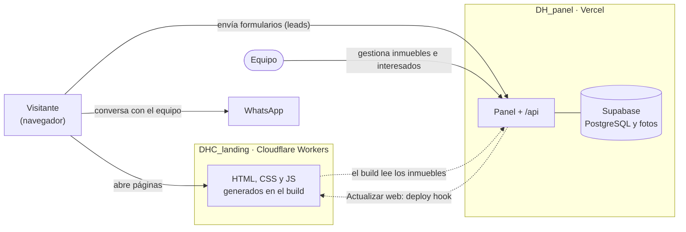

# Documentación de la plataforma Depa Host Perú

Esta carpeta explica **todo lo que hoy tiene el sitio web**: qué piezas lo forman, cómo se
conecta con el panel de DepaHost y qué pasa, paso a paso, en cada flujo. Los diagramas están en
UML, escritos con [Mermaid](https://mermaid.js.org/). GitHub y VS Code (con la extensión
"Markdown Preview Mermaid Support") los muestran como imágenes.

> Estado descrito: 13 de noviembre de 2026. Si cambias el código, actualiza el capítulo que
> corresponda en el mismo cambio.

## Cómo leer esta documentación

| Si quieres… | Lee |
|---|---|
| Entender la plataforma en 10 minutos | Este archivo y [01 · Arquitectura](01-arquitectura.md) |
| Saber qué hace cada página, componente y script del sitio | [02 · Frontend](02-frontend.md) |
| Conocer las rutas del panel que usa el sitio y cómo cambiar el contrato | [03 · API que usa el sitio](03-api.md) |
| Seguir cada flujo detalle a detalle | [05 · Flujos](05-flujos.md) |
| Conocer los entornos, levantarlos, probar y publicar | [06 · Desarrollo y operación](06-desarrollo-y-operacion.md) |
| Saber por qué se decidió cada cosa y qué falta | [07 · Decisiones y pendientes](07-decisiones-y-pendientes.md) |
| Saber cómo usa el sitio una persona común, pantalla por pantalla | [09 · Manual funcional del usuario](09-manual-funcional.md) |

Los capítulos 04 (Datos) y 08 (Panel y cuentas) se retiraron: el backend, su base y el panel se
documentan en el repo `DH_panel` (`README.md` y `docs/`).

## La plataforma en una página

Depa Host Perú (depahostperu.com) tiene tres líneas de negocio:

- **Estadías:** reservar un inmueble por días. Hoy es una página "en construcción".
- **Propietarios:** vender o alquilar un inmueble, en largo plazo o en Airbnb.
- **DepaHost Capital:** comprar inmuebles en Lima para que rindan. Es la parte más
  desarrollada: catálogo con búsqueda y mapa, y "Mis inmuebles".

Técnicamente son **dos repositorios** hermanos que se hablan por HTTP:

| Repo | Qué es | Tecnología | Dónde corre |
|---|---|---|---|
| `DHC_landing` (este, paquete `depahostcapital`) | El sitio web: HTML estático generado en el build | Astro 7, TypeScript, CSS propio | Cloudflare Workers (archivos estáticos) |
| `DH_panel` (carpeta hermana) | CRM interno del equipo: propietarios, inmuebles, interesados, citas, WhatsApp. También es el backend del sitio (`/api`) | Next.js 16, Supabase (PostgreSQL, Auth, Storage), Tailwind | Vercel |

El contrato entre ellos es el archivo **OpenAPI** `openapi/depahost-api.json`, que vive en este
repo. El sitio saca de ahí sus tipos de TypeScript; el panel implementa a mano la parte que el
sitio usa (ver [03 · API que usa el sitio](03-api.md)).

**La idea central:** las páginas se generan una vez, en el build, con los inmuebles del panel. Lo
que depende de cada visitante se arma en su navegador: sus inmuebles guardados y su nombre. No hay cuentas ni login en el sitio. Los formularios van directo al
panel, que los registra como interesados (leads). Cuando el equipo publica un inmueble, pulsa
"Actualizar web" en el panel y Cloudflare vuelve a construir el sitio.

## Glosario

| Término | Significado |
|---|---|
| **Inmueble de propietario** (`origin: owner`) | Inmueble de una persona dueña. Hoy es el único origen que envía el panel. |
| **Proyecto** (`origin: developer`) | Inmueble de una inmobiliaria aliada. El panel no los envía: hoy no hay ninguno. |
| **Inmobiliaria aliada** (`developer`) | Empresa con proyectos en el catálogo. Vive en `src/content/developers.json`, hoy vacío. |
| **Mis inmuebles** | Lista de inmuebles que la persona marcó con "Me interesa". Vive solo en su navegador. |
| **Historial** | Últimos inmuebles que la persona abrió, en su navegador. Era para "Para ti" (`ForYouRow`), que hoy ninguna página muestra. |
| **Lead** | Interesado que llega al panel desde un formulario del sitio (`POST /v1/leads`). |
| **Reclamo / queja** | Registro del Libro de Reclamaciones. El panel aún no lo recibe (pendiente). |
| **En cartera** | Estado de un inmueble en el panel. Si además tiene autorización para publicar, sale en la web. |
| **Build** | El momento en que Astro genera todas las páginas. Pasa al publicar y con cada deploy hook. |
| **Deploy hook** | URL secreta de Cloudflare que, al llamarla, reconstruye el sitio. La llama "Actualizar web". |
| **Contrato OpenAPI** | Descripción formal de los endpoints, en `openapi/depahost-api.json`. |
| **Slug** | Parte legible de la URL de un inmueble: `/capital/{slug}`. |
| **Turnstile** | Verificación anti-bots de Cloudflare en los formularios. |
| **Honeypot** | Campo oculto (`website`) que solo llenan los bots. Si viene lleno, el envío se descarta en silencio. |
| **Catálogo de pruebas** | Inmuebles e inmobiliarias de ejemplo en `tests/e2e/catalogo`. Solo los usan las pruebas e2e. |

## Mapa de páginas

| Ruta | Qué muestra |
|---|---|
| `/` | Home de Depa Host Perú con los tres servicios |
| `/capital` | Portada de Capital: cómo funciona, buscador e inmuebles de propietarios |
| `/capital/inmuebles` | Todos los inmuebles con filtros, orden, "Cerca de" y vista de mapa |
| `/capital/{slug}` | Detalle de un inmueble: galería con fotos y videos, precio, rentabilidad, características y Contactar |
| `/capital/aliados/{slug}` | Proyectos de una inmobiliaria aliada (hoy no se genera ninguna) |
| `/mis-inmuebles` | Inmuebles guardados, resumen, inversión total y paso a WhatsApp |
| `/propietarios` | Formulario para vender o alquilar |
| `/libro-de-reclamaciones` | Libro de Reclamaciones virtual |
| `/privacidad`, `/terminos` | Textos legales (borradores pendientes de revisión legal) |
| `/estadias`, `/nosotros` | En construcción |
| `/404` | Página no encontrada |
| `/data/properties.json` | Catálogo liviano para los scripts del navegador (no es una página) |

Redirecciones: `/carrito` y `/capital/empecemos` van a `/mis-inmuebles`. `/mis-depas` y
`/capital/depas` son páginas que redirigen conservando `?filtros` y `?agregar=`.
